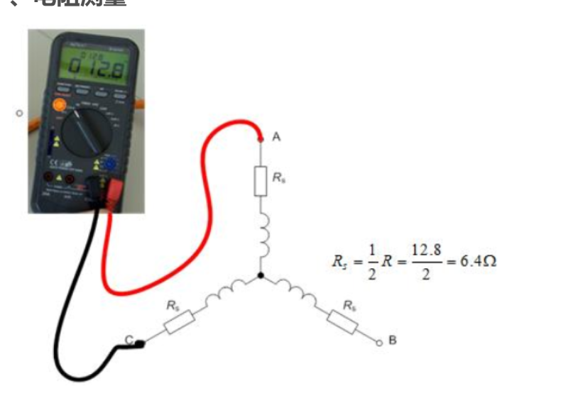

# 手动测试

当定子内阻值较小时，则应该采用精度较高的电桥来测量， 电桥的测量范围一般在 10mΩ ～ 10kΩ 之间。 使用电桥**测试**电机电阻时，设置测量频率为 100HZ 为佳，测试方法同 RLC 表

R=\frac{R_{AB}+R_{BC}+R_{AC}}{3}\times \frac{1}{2}=\frac{57.9+57.7+59}{3}\times \frac{1}{2}m\Omega =29.1m\Omega
