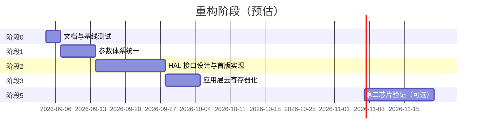

## 2026-10-16：项目自有空指针保护统一 COMMON_ASSERT

- 对自有无返回值接口中原 `if (required_ptr == NULL) return;` 及同类组合检查，共 125 处改为 COMMON_ASSERT；混合运行状态拆出保留原返回。第三方代码、允许空值的可选输出、有错误码返回的校验及正常状态返回不机械改成断言。
- common_assert.h 为纯接口头，供算法独立复用；ARM/Keil 仍进入 common.c 关中断停住，主机 abort。主机故意传空的测试改为验证 SIGABRT，补充单次求值及 NDEBUG 下仍检查测试；导出包加入公共断言头。
- 同步接口说明与编译头路径；主机全套与独立导出包通过，NDEBUG 两种模式均确认断言失败及单次求值；Keil 0 错误、0 警告。未烧录，不改变实际板上固件。断言改变的是调用错误行为，不是纯格式修改。

## 2026-10-16：更正 COMMON 断言格式意图

- 用户澄清需要 COMMON_ASSERT 检查，不是单纯压缩 if/return。正常 FOC 入口及诊断帧入口改为 COMMON_ASSERT，并更新空指针接口说明：失败停住，属于调用错误。
- 不将正常状态退出、可恢复错误或允许空值的接口机械替换成停机断言；AI_CODE.md 已更正格式偏好。此前纯格式调整记录保留，但不再作为把所有 return 压缩的要求。
- Keil 编译验证；不烧录。

## 2026-10-16：统一单行 return 保护语句

- 按用户要求，在 App、Library/Hal、Library/Bsp、Library/Common 自有代码中将简单的单 return 判断收成一行，共 67 个文件、454 处；保留条件与返回值，不修改第三方库，不处理含注释/else 的复杂块。
- .clang-format 允许无 else 的短 if 单行，AI_CODE.md 记录用户格式偏好，避免后续重新展开。验证：Tests/host/run.ps1 全部通过，Keil 0 错误、0 警告，编译产物大小不变。未烧录。

## 2026-10-16：精简中断分派调用

- motor_it.c 将检测与 BLDC 占用判断封装为两个返回 bool 的内部函数，调用处各一行；保持检测优先、处理后返回及正常 FOC 路径。
- 同步移除入口注释中已不适用的快速 V/F 分派说明；Keil 0 错误、0 警告。未烧录。

## 2026-10-16：恢复旧电感计算

- 按用户要求，motor_detect.c 恢复首尾电流斜率与中点 Ri 补偿的旧计算，移除全窗口拟合调用与采样缓冲。
- 保留原脉冲幅值/时序、斜率门槛、0.9 系数、多方向平均，以及新增电阻诊断和保护；全窗口拟合仅保留离线代码与测试。
- Keil 编译链接通过，0 错误、0 警告；随后按用户要求烧录，J-Link Program & Verify 成功，串口确认 Enable OFF、Fault NONE。恢复后未做参数复测。

## 2026-10-16：电阻平台分布诊断

- 增加三相均值/极性/近零比例、半窗电压电流和母线均值，仅统计，不改采样、控制、拟合和门槛；任务侧在拒绝前打印，便于保留失败信息。
- 编译 0 错误/0 警告、烧录校验通过；RAM 零偏后两轮 R/L 均通过单轮门槛，但 R=0.771969/0.689971 Ω、平均 L=84.231/91.834 µH，跨轮仍有约 10% 变化。
- 低平台 B/C 近零占比较高，跨轮 Vα 变化突出；不足以确定死区或转子运动根因。未应用/保存参数，结束停机且无故障。
- 详见 `参数检测实测_2026-10-16.md`。下一步用独立参考或专用电压时序对照，不把单轮通过当成精度验收。

## 2026-10-16：参数检测上板及命令队列启动修复

- 用户同意烧录当前工作区；首次启动捕获 Malloc Fail，命令入口无回应。固定 8 条命令队列改静态分配并检查队列/任务创建结果，避免初始化动态栈尚未回收时堆不足；未改外设或队列容量。
- Keil 0 错误、0 警告；J-Link 烧录校验通过，pitune/olstop 正常回应，RAM 零偏校准成功。ZI=127964、RW=1220 字节，后续扩展需关注静态 RAM 容量。
- 新固件两轮 R/L 均在 R 阶段拒绝：斜率差 15.02%；另一轮窗口电压漂移 3.09%。无故障且结束停机，未测磁链、未应用/保存参数；电感拟合硬件验收尚未完成。
- 详见 `参数检测实测_2026-10-16.md`。下一步增加平台诊断定位电压/相电流/转子状态变化，不放宽质量门槛。

## 2026-10-16：统一传感器初始化入口

- motor_sensor.c/h 封装默认实例编码器初始化、恢复校准与型号默认反馈源选择；Task_Init 在参数加载后调用 Motor_Sensor_Init，不再展开校准和反馈源细节。
- 保留原编码器初始化行为，霍尔 IO 仍由 BSP 建立、校准表仍由参数加载，无感观测器仍由 MOTOR_Param_Init 初始化；不执行检测、不启动电机、不改外设配置。
- 核对参数加载路径不依赖编码器先初始化；Keil 编译链接通过，0 错误、0 警告。未烧录，上板启动及反馈选择待验。

## 2026-10-16：统一启动断言

- common.h/common.c 新增始终启用、条件仅求值一次的 COMMON_ASSERT，失败统一关中断并停住，不依赖尚未初始化的日志或 RTOS。
- main.c 的内核初始化、初始化任务创建和内核启动改为单行断言，避免初始化调用被可关闭的 assert 宏省略。
- `build_keil.ps1` 编译链接通过，0 错误、0 警告；未烧录、未做故障注入。未改外设或任务参数。

## 2026-10-16：只读 PI 候选值命令

- 状态：应用入口及主机测试完成，Keil 0 错误、0 警告；未烧录、未上板。
- 文件：独立 cmd_autotune.c、command.c 注册 pitune、Keil 引用、命令主机测试。
- 行为：读取有效 RAM R/L 和 HAL 时基，显式输入带宽/总延时，展示分轴/共享候选值及预算；运行、故障、检测占用和无效输入拒绝。无自动检测、应用或保存。
- 验证：`Tests/host/run_motor_autotune.ps1` 覆盖计算模块、真实 PI/RL 阶跃与命令拒绝/只读性；`build_keil.ps1` 通过。
- 限制与下一步：结果未绑定电机身份，换电机需重测；延时须核实。后续独立受限阶跃编排需明确配置恢复及失败退出，尚未实现。

## 2026-10-16：独立电流 PI 模型整定模块

- 状态：第一版模型候选值计算与主机验证完成，不含闭环自动试验或自动应用。
- 文件：motor_autotune.c/h、独立主机测试与运行入口、Keil 源文件引用；说明见 `电流PI独立自动整定模块.md`。
- 边界：显式输入 R/L、PI 周期、带宽和总延时；输出分轴与共享候选增益。拒绝采样/延时预算超限及无效数值，不访问硬件或全局电机，不写 Flash。
- 验证：独立主机测试覆盖真实 PI 与连续 RL 小阶跃、错误输入及失败清零；上板频响、实际总延时和共享增益两轴表现待验证。
- 下一步：应用侧先展示候选值，再独立编排受限小阶跃验证，不直接接入现有启动或检测中断。

## 2026-10-16：电感脉冲全窗口拟合

- 状态：主机验证及 Keil 编译通过，上板待验。
- 修改：motor_detect.c 使用原 8 点窗口的磁链积分/电流拟合，新增 motor_detect_rl_fit.h；外设、注入时序与保护不变。
- 验证：新增 RL 拟合测试和既有主机回归通过；Keil 0 错误、0 警告。设定噪声场景下 RMSE 降低约 23.6%，不代表实机精度。
- 限制与下一步：仍使用指令电压、保留原经验系数；未烧录，需验证电压/采样时序、不同脉宽重复性和 ISR 峰值。详见 `电感脉冲全窗口拟合_2026-10-16.md`。

## 2026-10-16：离线共差模分解与诊断整数清零

- 仅离线读取上一轮停机32对CRC日志，不连接串口、烧录或启动。扩展analyze_adc_half.py，输出共/差模正交能量、固定半周期均值能量、去均值Clarke差分RMS及通道相关；不以差分除sqrt(2)估计独立噪声，不从32条抽样重建频谱。
- 原始差分共模81.94%、差模18.06%；Clarke差分RMS0.11475A，扣固定向量均值后仍0.10900A，固定向量均值只解释9.78%能量。共模本来被完整Clarke拒绝，不能据共模占多数断定无影响；只补固定半周期偏移也不足以解释大部分动态差异。无依据定责Vref/地、放大器或ADC超频。
- 反汇编发现half抽样判定前浮点赋零产生1条VLDR+3条VSTR，而字段只是零占位；FreeRTOS CM4F端口启用ASPEN/LSPEN，存在额外浮点上下文成本可能，实际触发/时间未测。改为局部帧memset，重编译确认判定前0条FPU指令；抽样命中后的快照/输出仍可用FPU，不宣称整个诊断无浮点或失响应已修复。
- C全套、Python31项通过，Keil0错误/0警告，Code178856、RO20644、RW1244、ZI128108。仍有每回调6次ADC读及88字节历史复制等开销；half停机专用限制不解除。新优化未烧录，板上仍为上轮安全限制版；下一步先停机重复统计及增加同拍参考通道旁证，未自动提交。详细见停机ADC差异与诊断开销_2026-10-16.md。

## 2026-10-16：只读相邻半周期DMA回调配对

- 新增slhandoff half，最终限制为仅停机采集；起转时立即停止半周期诊断，不阻止正常控制。仅正常FOC分派前读取原始ADC，不改控制分频或ADC/PWM/DMA设置，也不写入控制电流；校准、BLDC、快速V/F专用路径保持原样。复用原32条缓冲，每901次DMA服务回调抽样以交替采到两种相邻方向；旧pair仍只采选中FOC拍。最初运行脚本half选项已在下面失败后移除，不能用于运行中验证。
- 两次读取原始CURR1/2/3，记录raw变化、DIR变化、NDTR变化及软件提交序号变化四个状态位；非原子窗口检测仅能发现部分不稳定，零标志不证明硬件触发/帧一致性。回调期CNT/CR1/CCR不当作触发锁存或活动CCR。half格式单独标记capture_flags，电流槽为0占位，离线才按零偏ACB换算。
- analyze_adc_half.py按回调方向统一down−up符号，分别统计软件PWM序号相同/间隔一次提交的配对；不稳定配对排除统计，原始行保留。停机无触发基线须显式--allow-untriggered，时间原点标记为首样本，不冒充接管事件。
- 主机增加真实采集函数提取测试，覆盖四种状态位全部16组合、不写PWM比较寄存器及Due门控；缓冲测试覆盖901回调、触发冻结、方向交替与模式复位。C全套及Python分析27项通过，Keil严格编译0错误/0警告：Code178768、RO20640、RW1244、ZI128108；基线解析补充后的测试及实机结果另补。未调增益，未改变42MHz ADC既有基线。
- 停机基线完成：adc_half_stationary_20261016.log及repeat/repeat3，合并完整32条CRC有效（拒绝3条坏帧），间隔33～34us，32对DIR均交替，读取状态位均0，软件提交序号差0/1各16对。down−up均值−0.50/−1.03125/−1.25counts，通道差RMS1.854/2.172/2.947counts；最大Clarke电流差0.24619A，对应ADC差[3,4,8]counts。说明启用关闭时也有明显采样差异，不能全归因于运行中的真实电流演化，但还不能区分模拟链、参考/地、干扰与ADC/DMA时序原因。
- 运行尝试失败且有安全限制：3508_repro_20261016_095944在olstart目标300RPM后串口响应不完整，尚未发600RPM；脚本finally的olstop也未及时得到确认。恢复重试日志中T+93.866s起转指令后，T+191.020s才见积压olstop执行；没有这段期间可靠速度/故障记录，不能称有界运行/硬件无故障通过。adc_half_emergency_reset_20261016.log执行J-Link复位，adc_half_after_reset_20261016.log随后确认OFF、目标0、速度环/接管关闭、当前fault0、24.1V；复位后fault0不证明复位前全程无故障。运行冻结数据已随复位丢失，未做运行结果推断。
- 初步怀疑全回调诊断挤占实时余量，但未有本轮占用测量定量归因。停止继续运行测试，将half限定停机：运行状态直接关闭记录且不读ADC；脚本移除half选项。新增主机验证运行状态零读取、零记录并调用停止接口；C全套、Python分析28项通过，安全版Keil0错误/0警告，Code178856、RO20644、RW1244、ZI128108。下一步仅离线/停机扩大统计或优化诊断，先建立独立停机保障，再考虑运行对照；不因本次诊断失败更改增益或外设基线。
- 安全限制版已烧录校验O.K.（adc_half_stopped_only_flash_20261016.log），adc_half_stopped_only_final_20261016.log确认OFF、目标0、速度环/接管关闭、当前fault0、24.1V；恢复R/L/磁链、observer/PLL原RAM模型及sldt0，未启动。复位清除了本轮新RAM零偏，当前使用Flash既有偏移；下次运行前应重新静止校准。本轮不自动提交代码。

## 2026-10-16：配对原始ADC与软件PWM提交

- 新增slhandoff pair：继续复用32条缓冲，每450个选中FOC控制拍记录一对连续控制帧，混合完成后首拍触发，再留27条。每帧含软件采样序号、PWM COM提交调用序号、控制入口微秒时标、原始CURR1/2/3、重构后三相电流、重构相及回调时CNT/CR1/CCR/ARR；另附本拍观测器使用的电压模型输入。
- HAL仅增加显式武装的软件提交计数器，不改任何定时器/ADC/DMA寄存器配置；默认关闭。FOC重构后、更新观测器前采集帧，逐拍维护前一帧，无中断打印；头部frame在读取时没有硬件触发锁存保证，软件COM提交序号不等于硬件CCR生效序号。读取顺序也不保证跨定时器翻转时刻原子一致，后续分析不得越界声称时序已硬件验证。
- 只读核查现有HAL/BSP与锁定VESC：均有OC预装载与COM路径，当前软件记录不足以证明活动CCR切换时刻，因此不修改基线，也不把CCR读值当成活动寄存器证据。新增analyze_adc_pair.py验证ACB映射、重构、连续帧/软件提交计数回绕、ADC/回调元数据及CRC，分离电流差分的零序和alpha/beta分量。
- 主机C全套与Python分析24项通过；首次Keil严格编译0错误/0警告（Code178312、RO20340、RW1244、ZI128108），最终计数器可见性修订后编译和实机结果另补。未调增益、加电流滤波或改变保护/外设配置。
- 最终计数器使用volatile可见性并在关闭后重置再启用，严格编译仍0错误/0警告、内存数字不变；adc_pair_flash_20261016.log烧录校验O.K.，恢复原RAM模型与静止零偏成功。3508_repro_20261016_094134一次600 RPM测试通过，6次稳态平均599.6（598.5～601.5）RPM。最终OFF、目标0、速度环/接管关闭、fault0、24.1V，软件提交诊断已关闭。
- 首次31/32条CRC有效，停机重读合并完整32条。每对间隔66～68us，软件采样/提交序号均+1，64帧回调DIR均向上，无电流重构；ADC按本轮零偏ACB换算残差4.86e−8A，仅验证软件一致性。最大电流Clarke差分0.28428A，对应原始ADC[2046,2041,2038]→[2046,2043,2044]，每通道最多跳7counts。最大差分对中零序均值变化0.21490A，非纯共模。
- 记录将变化前移到原始采样端，未见配对内方向切换、重构介入或额外软件PWM提交；不能证明ADC触发/通道帧一致性或活动CCR时序正常，也不能把不同轮次最大差分与PLL相差硬配对。详细结果与局限见同目录ADC与PWM软件配对证据.md。下一步只读比较同一PWM周期相邻半周期ADC，区分共/差模与实际纹波，不先调增益或改外设。

## 2026-10-15：补齐观测器单拍积分证据

- 新增slhandoff step，互斥复用原32条缓冲，每450控制拍抽取一个完整单拍；控制路径标记混合完成后，下一次观测器更新强制触发，再留27条。事件比完成拍晚一个控制更新，不能与旧phase完成拍不加区分地对齐。每条包含积分前后x、当前/连续前一控制拍电流、当前PWM模型电压、实际有效R/L/磁链/gain与同公式修正项、PLL输入相差；默认关闭，停机CRC导出。
- 核心UpdateState保留原接口并转入内部可选诊断输出；不改变Euler/幅值误差/PLL公式，先seed再保存真实积分前态。默认包装只在显式step武装期间维护前一拍ABC电流，无中断打印或新增大数组。相邻电流属于每条样本内的连续拍，不是30ms相邻导出行；previous_dt为0时拒绝将前电流视为有效。
- 新增analyze_observer_step.py核对单边修正、Euler及完整psi增量恒等式，并将电压电阻项、修正项、−LΔi投影到上一拍估计磁链切向；标明一阶角近似误差，不将估计磁链角推进当作独立轴速。测试覆盖300步与无诊断实例一致、前电流、缓冲互斥/触发/冻结、CRC及单边修正。C全套和Python分析21项通过，Keil0错误/0警告：Code176968、RO19956、RW1240、ZI128024。实机结果另补。
- 已烧录校验O.K.并恢复既有RAM模型/静止校准，600 RPM单次有界测试通过：3508_repro_20261015_232035，6次稳态平均599.4（598.8～600.1）RPM；最终OFF、目标0、速度环/接管关闭、fault0、24.0V。首导出32/32 CRC有效，停机重读合并仍32条，拒绝2条坏帧，全部有有效前电流。窗口−98.899～810.034ms，见step_analysis.json及单拍积分证据.md。
- 单边修正公式残差最大2.01e−8V，Euler/完整psi增量残差1.17e−10Wb，支持软件单拍一致性，不代表物理准确度。幅值修正直接角贡献约−1.88e−6～1.71e−5rad/拍，−LΔi贡献−0.01063～0.00708rad/拍，实际估计磁链角增量0.00808～0.05239rad，线性化余项最大0.000868rad。+750ms电压项0.02685、修正0、电流项−0.01063rad，合成实际0.01630rad，提示电流变化项是快速角推进扰动的重要入口。
- 不能由此把真实纹波当成采样噪声，或把单拍扰动当作全部慢速摆动根因。下一步配对原始ADC、相电流、采样边沿/重构状态与PWM更新序号，先核对时序和测量，再考虑处理方案；不调增益、不直接加滤波或改外设。

## 2026-10-15：同批磁链、电压电流与PLL输入离线分析

- 仅扩展Scripts/analyze_phase.py及其测试，不改固件、不连接控制板。对3508_repro_20261015_230908两次冻结导出做CRC合并，32条完整、拒绝3条坏帧；生成phase_vector_analysis.json及同目录磁链与PLL输入离线分析.md。
- 逐条计算psi=x−L*i、沿估计磁链的电压/电流与v−R*i投影，分离标准atan2输入相差和快速atan误差，并分别统计全窗/完成后。保留零磁链无定义、常量相关无定义、旋转不变性、时间回绕及CRC校验测试；不对30ms角度差做速度估计，不将缺L*di/dt的切向电压代理当作角速度。
- 结果：标准atan2相差仍−0.07866～0.07406rad，快速atan误差约±0.0101rad；全窗磁链/额定0.817～1.458，完成后最高1.287。磁链与相差相关−0.825（完成后−0.784），去快速近似后−0.844（−0.814）。输入电压1.045～1.414V、电流0.0153～0.7543A；名义Li/磁链最大4.67%，不据此排除电感导数项。
- 主要相差不是快速atan单独能够解释，扰动在完成前存在；优先追查观测器输入/状态与控制混合的相互影响。数据缺积分前态、修正项和相邻电流，不能精确重放观测器或定责死区/R/L/电流偏差。下一步补同拍方程证据，暂不调增益、不改外设。
- 验证：Python分析测试18项全部通过；本轮未编译或烧录固件，上一轮实机结果不作为本轮新测量。详细证据和局限见Doc/verify/3508_repro_20261015_230908/磁链与PLL输入离线分析.md。

## 2026-10-15：延长低开销PLL同源窗口

- 新增停机命令slhandoff phaselong及有界测试脚本同名模式；仍复用32条缓冲，450控制拍抽样（约30ms），强制记录混合完成拍后保留27条（约810ms），此前约4条。正常接管下总窗约0.9s，相比短模式约30ms显著延长；短模式与交接积分记录行为不变。
- 不增加每拍磁链/PLL计算或大数组，记录复制频率降至短模式的1/30；未测量实际节省的执行时间。抽样会漏掉拍间尖峰，不能用30ms相邻角度差直接重建转速，也不能保证覆盖所有异常；保留每条样本对应的实际控制dt及PLL输入输出公式校验。
- 分析器输出相对完成拍时间、总跨度和最大采样间隔；C测试覆盖长窗口抽样、非整分频触发、触发位置、自动冻结、模式切换与计数回绕；Python新增时间回绕及乱序拒绝。主机C全套、Python分析15项通过；Keil0错误/0警告，Code175632、RO19436、RW1220、ZI128020。未修改控制公式、参数、限幅或外设基线。
- 上板：phaselong_flash_20261015.log烧录校验O.K.，phaselong_setup_20261015.log恢复既有RAM模型并静止零偏校准成功。3508_repro_20261015_230908一次600 RPM有界接管通过，首个CLOSED轮询观测722.6 RPM，随后6次稳态597.7～606.8、平均601.3 RPM，均CLOSED/tk1/fault0。结束已停机；phaselong_final_20261015.log再次确认OFF、目标0、速度环/接管关闭、fault0、24.0V。
- 首次导出31/32条CRC有效，停机重读后合并完整32条，拒绝3条损坏帧。phase_analysis.json实际窗口−115.534～809.999ms（总925.533ms、最大间隔30.002ms）；采样复制约33次/秒，不宣称ISR执行时间已实测降低30倍。
- 已捕获较大波动：PLL积分速度等效586.32～734.04 RPM，比例项−210.59～208.55 RPM，实际角推进合计396.13～921.62等效RPM；磁链1.9090～3.4059mWb、相差−0.07718～0.07644rad。+180ms积分速度约734 RPM；+210ms积分730、比例+191.7，合计921.6。PLL公式角残差最大9.04e−8rad、速度残差2.86e−5rad/s，未见记录中的公式跳变证据。
- −115.534ms已见磁链3.4059mWb及相差−0.07718rad（blend约0.423），完成拍前扰动已经存在；因此不能仅用完成拍积分运输解释本轮全部异常。长窗证明异常不只限于此前30ms小窗，但磁链波动与PLL相差的物理根因仍未确定，未有独立轴速，抽样也会漏峰。下一步针对观测器输入电压/电流、磁链向量误差与启动混合相互影响做离线同源分析，不盲调PLL或改外设。

## 2026-10-15：PLL 同步短窗口分解

- 新增 slhandoff phase，与原接管记录互斥复用32条缓冲，静态样本内存不增加；每15拍记录并强制包含混合完成拍，随后15条自动冻结。记录原始观测角、PLL更新前后角度/速度、实际相差、dt、Kp/Ki、磁链状态及本拍观测器电压/电流输入，停机后导出CRC32。
- 新增 analyze_phase.py，按单次控制步进公式分解积分速度与比例校正，不用降采样角度差替代PLL实际输入。等效RPM不是独立轴速；速度公式残差假定没有限幅/重置，atan2差含快速数学近似，采集也有执行开销。
- 主机C全套回归通过；Python分析14项通过；Keil严格编译0错误/0警告，Code175552、RO19380、RW1220、ZI128020。保持控制公式、增益、限幅、保护与外设基线不变。实机结果另补。
- 实机：phase_flash_20261015.log烧录校验O.K.；恢复既有RAM参数并静止校准成功。3508_repro_20261015_230316单次600 RPM接管通过，6次稳态轮询598.5～601.2 RPM、平均599.8，均CLOSED/tk1/fault0。首导出31/32有效，phase_final_20261015.log停机重读合并完整32条CRC有效样本；分析见同目录phase_analysis.json。
- 该短窗口PLL积分速度等效606.24～611.04 RPM，实际比例项等效−63.61～65.79 RPM，两者合计544.11～674.52 RPM；相差−0.02331～0.02412 rad，磁链2.0975～2.3880 mWb。PLL角更新最大公式残差1.17e−7 rad，速度更新1.53e−5 rad/s，支持本轮角步进非均匀主要来自显式比例校正而非积分速度突变；不能据此断定原始观测角扰动的物理来源。
- 本轮未复现先前入口长记录的巨大波动，不能把不同运行/短窗口数据当作已修复或解释全部1.66异常；下一步应延长低开销同源记录，比较异常时的磁链向量/电压电流与PLL输入。已再次确认Enable OFF、目标0、spenable0、sltakeover0、fault0、母线24.0V；未升速或写Flash参数。

## 2026-10-11：完善原理图学习路线与知识面

- Doc/原理图_python新增学习路线与知识补全.md、补充知识图.py及六组PNG/SVG教学图与总览；README与原理图阅读加入入口。覆盖单位/極对数、电压转矩预算、功率电路测量链、估角误差、采样延迟量化、参数辨识、惯量与制动能量、实验结论分层。
- 结合2804当前测试与源码，明确教学模型和硬件证据不同；附TI/Microchip官方资料，不改固件、控制参数或外设。Python生成成功，图件逐页及总览检查，修复缺字与注释边界；本轮未启动电机或提交。
## 2026-10-11：整理并提交无感测试与磁链检测改进

- 用户反馈现场测试已完成，要求整理代码提交；本记录不将该反馈扩写为未提供的转速、时长或成功率。保留此前实测的成功与失败记录。
- 提交范围：三档磁链交叉检测、同时间窗角度/电压配对、电阻稳态窗口延长、sltest高速限流/跟踪验收/诊断与集中配置、对应主机回归和2804验证文档。清理重复测试断言；未修改外设基线、未自动应用检测结果或写Flash配置。
- Keil严格编译0错误/0警告；整理后全套主机回归与差异空白检查通过。其他机械、MATLAB、第三方目录及3508历史记录改动保留，不混入本次提交。本轮未重新烧录或启动电机。
## 2026-10-11：集中sltest测试条件与保护边界

- App/cmd/cmd_openloop.c将sltest散落数值集中到只读sltest_bounds和sltest_profile，字段命名标明单位。保护边界与2804/16V测试配置分开；R/L/磁链、零偏继续沿用当前电机配置，速度/档位时间继续由命令指定。保护范围、时序、限流、通过判据数值均未改变，未扩展运行时调参或Flash格式。
- 命令开头打印实际限流、切换阈值、速度容差及连续超限次数/监测周期，拒绝条件文案由配置值生成。Keil严格编译0错误/0警告；全套主机回归通过，最终具名初始化版本命令专项再次通过，git diff --check通过。本轮未烧录/上板运行/提交；控制器仍保留前次已烧录版本。
## 2026-10-11：2804高速限流平台已定位，低速重复性仍未通过

- sltest补Iq/速度环限流/PWM电压估算诊断，跟踪门槛从20%收紧至max(60RPM,5%)；旧0.15A限流下2200档实际1925RPM、PWM估算4.826/8V。仅>1800RPM档将限流改为0.30A，保持600RPM接管原限流与外设基线。
- Keil0错误/0警告、全套主机回归和补充限流断言通过，已烧录校验。再次RAM零偏校准后五档各5秒600～2600RPM通过（2600均值2600.7，编码器档末2640.9）；随后同校准10秒轮在600RPM持续偏差中止，前面亦有接管超时。不得称整体稳定性已解决。最终OFF/fault0、SSI err0，未写Flash配置/未提交。详见Doc/verify/2804高速限流对照_2026-10-11.md。
## 2026-10-11：同时间窗磁链修复最终三轮通过

- scan统一BEMF/原始编码器角位移、电压积分和实际采样时间戳；只用>=.16V可信参考候选。档位50%/75%/100%，原50rad/s跨度门槛不变；R等待1.5s/采样1s，保留漂移与斜率门槛。外设基线未动。
- Keil及全套主机回归通过，已烧录校验。最终同固件同校准三轮SUCCESS，拟合3.0683/3.2325/3.3378mWb（极差/均值8.39%），R1.23%/L7.99%；SSI错误增量0，结束OFF/fault0。软件一致性改进已实测，不能称高精度或长期可靠性验证。未应用模型/写配置/跑无感，新修改未提交。详见Doc/verify/滑行磁链同时间窗修复_2026-10-11.md。

## 2026-10-11：参数检测稳定性三轮复测未通过

- 同固件/16V/同校准连续三轮fluxscan 0.65 3000 0.3，R/L均有效，R极差/均值2.78%、L7.74%；磁链拟合0/3成功，失败于不同滑行档BEMF与原始角度参考冲突，不能称稳定。SSI历史错误4915前后不变，本次增量0。均结束OFF/fault0，未应用模型，无固件修改。详见Doc/verify/2804参数检测稳定性_2026-10-11.md。

## 2026-10-11：三档磁链交叉检测首次实机通过

- 滑行轨迹证实PLL测速延迟；scan参考改用新鲜原始角度差，转动验收改为独立编码器目标80%～120%，保留最低电压、后续质量检查及原单点门槛。新增真实片段主机边界测试，全套回归及Keil通过，已烧录校验。
- detect fluxscan 0.65 3000 0.3三档SUCCESS：R3.703259Ω、L1310.672uH、拟合磁链3.1966mWb/偏置.0079V/R².9996，参考覆盖98.1～98.9%。仅一次成功，重复性和绝对精度待验证；未应用模型/写Flash，结束OFF/fault0。详见Doc/verify/三速度磁链交叉检测_2026-10-11.md。新改动未提交。

## 2026-10-11：fluxscan检测参考更新遗漏已修复并上板

- 检测占用ISR绕过正常编码器更新；仅scan磁链阶段补1kHz参考更新，失败也打印参考。Keil及全套主机回归通过，已烧录校验。0.65A检测R3.647119Ω/L1348.548uH通过；首档BEMF427.7与参考1219.5eRPM冲突，覆盖82.7%，磁链拒绝。不同样本集合和PLL延迟仍需分清，不宣称根因全解。结束OFF/fault0，未应用无效磁链，新改动未提交。详见Doc/verify/三速度磁链交叉检测_2026-10-11.md。

## 2026-10-11：保存基线后加入三速度磁链交叉检测

- 先提交ecce868作为可回退基线，再新增detect fluxscan：一次R/L、三档滑行BEMF与新鲜编码器转速配对，参考覆盖/测速一致性不合格即拒绝；多点带截距拟合磁链，RAM-only、不自动应用。保留原detect motor/rl单点行为和外设基线。
- 真实函数编排主机回归覆盖成功与多种拒绝/中止恢复，纳入run.ps1，全套通过；Keil0错误/0警告。新固件已核对烧录并上板三轮；均在电阻阶段因采样不稳或斜率不一致拒绝，三档磁链尚未实测。结束OFF/fault0，未应用参数；新改动未再次提交。用法、限制及证据详见Doc/verify/三速度磁链交叉检测_2026-10-11.md。

## 2026-10-11：参数辨识方法级离线仿真

- 新增Python仿真与6项解析/误差传播测试，全部通过；输出JSON/CSV。未改固件、未上板，非现有C检测算法SIL。固定偏置可用多点截距分离，但采样比例和串联电阻项不能仅靠拟合消除。L还敏感于端电压与采样延迟。
- 现有R已有多点拟合，磁链已有关桥滑行/BEMF实际速度测量；建议下步多速度+编码器独立速度交叉验证，不能把仿真命令速度错误当作现有固件缺陷。详见Doc/verify/参数辨识方法仿真_2026-10-11.md与Scripts/simulate_parameter_identification.py。

## 2026-10-11：sltest中止原因快照已上板

- 状态/电流检查失败按位记录API/enable/故障/保护/非有限/电流超限及停机前状态，先关输出再打印，不清保护；任务50ms快照非硬件故障瞬间。主机电流/API异常注入回归通过，Keil0错误/0警告，烧录校验通过。
- 同校准两次sltest 10 600，观测均值603.3/607.1，固件PASS；未复现旧中止，不能认定根因解决。段末参考不新鲜未输出。最大完整回调68/69us，超期仍存在。最终OFF/目标0/速度OFF/接管BLOCKED/fault0。详见Doc/verify/无感中止原因快照_2026-10-11.md。

## 2026-10-11：接管分段耗时诊断与后段异常

- 增加每256控制拍抽样的渐变观测器/完成后观测器/电流坐标校正三段统计及计数峰值；CadenceReset清空统计。不改控制公式或外设。时序/电流/无感主机回归通过，Keil0错误/0警告，烧录校验通过。
- 两次渐变仅3样本，约12～12.3us，完成后约10.1～10.8us，坐标校正2us；支持接管初段附加开销量级3～4us，尚非精确峰值归因。诊断本身有扰动。
- 首轮固件PASS但段末编码器25.9与观测621冲突，用户确认稳定转动，参考存在缺帧；第二轮状态/电流检查中止，最终OFF/fault0。接管记录早于中止，未捕获中止瞬时数据。下一步补中止原因快照。详见Doc/verify/2804接管分段耗时_2026-10-11.md。

## 2026-10-11：接管初50ms超期重复定位

- 未改固件和外设，现有诊断两次600RPM接管均PASS。两次首50ms均19/25个窗口出现>66us完整回调，峰值68us；接管前最大64/65us无超期。200～800ms分别2/285、0/285个窗口超期。控制频率14986.9/14986.3Hz，最长间隔101/102us。
- 超期集中于50ms角度渐变路径，候选为观测器渐变比例运算和电流坐标校正，尚未分别计时，不能确认单一根因。上次73us本轮未复现；内部FOC与完整回调计时边界不同。两次最终停机无故障。详见Doc/verify/2804接管计算超期定位_2026-10-11.md及A/B日志。

## 2026-10-10：无感一键测试扩展至2600 RPM并实测

- sltest自定义目标扩展到500～2600 RPM；起转上限800 RPM不变，高速仅CLOSED接管后进入。最高目标>1200时临时8 V，电流限制不变，结束恢复原电压。配置最高速度不足时前置拒绝，闭环超速阈值随目标变化且不超过3000 RPM；底层外设未改。
- 真实命令主机回归通过，Keil0错误/0警告，烧录校验通过。2804/16 V空载，600/1000/1400/1800/2200/2600六档各统计5秒，观测均值599.0/1001.0/1400.3/1801.8/2204.0/2602.5，段末编码器589.6/999.4/1404.9/1797.5/2226.3/2581.0 RPM。全程CLOSED、PASS，SSIerr=0、stale_reseed=0。
- 最终OFF、目标0、speedOFF、takeoverBLOCKED、fault=0、电压上限恢复4 V。沿用实验零偏B和现有模型，非普适默认。仅验证空载短时；本轮最大FOC计算73us，尚不能宣称时序超期问题完全解决。详见Doc/verify/无感一键速度测试.md和2804_sltest_2600.log。
## 2026-10-10：固件串口无感一键多速度测试

- 新增 `sltest [hold_s [rpm1 ... rpm6]]`，默认600RPM启动接管后测500/600/700，各统计5秒；支持2～20秒、500～800RPM。沿用当前模型/零偏，不写Flash。结束、故障、失锁、输入中止均停机并恢复配置/反馈，目标0、速度环OFF。
- 复用现有命令队列中止机制，任务中每50ms监测、按实际微秒时基限制测试阶段时间，不阻塞中断。不改变外设基线或控制公式。当前限7极对、16V测试范围。
- 真实命令片段主机回归验证成功/接管超时/失锁/输入中止/前置故障/非法参数及恢复路径，已纳入run.ps1；Keil0错误/0警告，烧录校验通过。
- 默认命令实机PASS：500/600/700RPM观测均值500.1/600.9/698.8，段末编码器491.4/604.8/699.9；stale_reseed=0、age_max=3ms、SSIerr=0。仅这三档实测，800档尚未测。最后OFF、目标0、速度环OFF、接管BLOCKED、fault=0。
- 用法及限制：`Doc/verify/无感一键速度测试.md`；实机日志`Doc/verify/2804_sltest_default.log`。PASS只代表固件无感反馈和观测跟踪，不代替负载/实轴验证。
## 2026-10-10：保留接管初段并分离参考采样延迟

- 新增 `sltrace entry`：首次CLOSED立即记录，再保留384条并冻结；保留约128条接管前历史。只冻结记录、不停电机，entry/loss标记独立，保持原失锁捕获模式。容量和全部外设基线未变。
- 窗口边界/冻结后不覆盖/触发标记测试、离线已知延迟与角度回绕测试通过；Keil 0错误/0警告，烧录校验通过。
- 同固件/零偏B/编码器RAM零点4.884 rad，两次复测保留约接管前255 ms、后780 ms。B1 512条完整；B2 511条有效、1条格式不完整。两次无失锁，最终均OFF、目标0、速度环OFF、接管BLOCKED、fault=0。
- 前后独立编码器角度按时间插值，不使用接管中不稳定的测速外推；剔除无效或超过4 ms间隔参考。50～200 ms原始中位差0.990/1.022 rad，对齐后0.060/0.081 rad；200～780 ms原始1.178/1.228，对齐后0.077/0.100 rad。
- 结果支持大部分约1 rad表观偏差来自参考采样滞后，不应据此添加固定1 rad补偿。残余误差仍有散布，不是精确补偿值。首50 ms合格仅3/7条，缺帧区间不能据此宣称相位正确或根因已解决。
- 下一步优先获得接管首50 ms连续可信参考，并核对计算超期与电流目标切换。详见 `Doc/verify/2804接管初段相位对齐_2026-10-10.md`，分析脚本 `Scripts/analyze_sensorless_entry.py`，B1/B2原始日志和phase.csv/json。
## 2026-10-10：接管路径重复计算与观测器局部优化复测

- motor_control.c 拖转路径复用 RunIfDrag 已在本拍更新的 speed_loop_latched，避免 FillCurrentCtx 再次判断速度门槛；对齐路径保留原判定。motor_sensorless.c 仅 ARMCC 使用 O2，保持浮点规则、防护和全部外设基线。两项一起复测，不能单独归因各项收益。
- 控制完整回归、2804保持路径回归、无感状态/接管/回退回归通过；Keil 0错误/0警告，Code=156572、ZI=121104，烧录校验通过。
- 2804、16 V、600 RPM、I/F 0.30 A、速度PI限幅0.15 A，同实验零偏B；新编码器RAM零点4.880 rad。首次校准预检因电压字符串15.9 V不是16.0 V退出，未起转；第二次采用15～17 V数值范围检查后正常校准，原日志保留。
- I/F600窗口：14992.7 Hz、完整回调平均55.00 us、最大64 us；此前同类窗口约14961.7 Hz、56.78 us、最大67 us。
- CLOSED连续22次轮询、跨度29.099 s，无失锁；最后10次编码器588.9～622.3 RPM。CLOSED统计窗口完整回调最大66 us、over66=0；实测控制仍14923～14963 Hz，不能宣称稳定15 kHz。早期编码器rpm曾126.8、403.6，不能把整轮参考描述为稳定。
- 最终编码器stale_reseed=166、age_max=21 ms、SSI err=0。采样任务与速度任务均PRI_SPEED=osPriorityRealtime，但不能抢占ADC ISR；提高任务优先级不能直接消除ISR占用造成的延迟，本轮未修改任务/中断优先级。
- RAM环形记录最终只保留约1 s稳态，接管初段已被覆盖，不能用其“首50ms”统计声称接管峰值改善。末段511条有效格式行中，筛选encoder_valid、age<2ms、500<enc_rpm<700的391条，用enc_angle+enc_rpm*2π/60*7*age估计同时间参考角，相位误差中位0.377 rad、绝对误差95分位0.944 rad、最大1.444 rad；这是基于恒速外推的诊断估计，含校准/滤波/时间戳误差，不能直接设为补偿角。
- 下一步：需保留接管初段记录而非仅等失锁冻结，并对诊断开销做对照，进一步分清剩余相位偏差与参考采样延迟。当前单轮保持29 s不代表根因彻底解决。
- 最终OFF、目标0、速度环OFF、接管BLOCKED、fault=0。证据：`Doc/verify/2804_observer_o2_flash.log`、`2804_observer_o2_cal.log`（预检退出）、`2804_observer_o2_cal2.log`、`2804_observer_o2_B1.log`及CSV；原输出512条记录中1条未满足28列解析条件，未补造数据。
## 2026-10-10：接管峰值与编码器参考采样时序核对

- RAM 记录增加控制入口最大间隔、已完成完整回调最大耗时、DMA pending 次数和软件入口方向计数；不修改算法、ADC/PWM/DMA/定时器配置。当前回调耗时计入下一记录窗口，避免错误配对。
- 窗口边界、回绕和冻结主机测试通过；Keil 0 错误/0 警告，烧录校验通过。ZI=121104，调试 RAM 增加约 4 KiB。
- B1 在禁止接管时捕获编码器测速暂时无效，随后恢复约 600 RPM，未授权接管。B2 参考恢复后授权接管，CLOSED 留存跨度 1031.030 ms，脚本因参考测速无效主动停机，没有无感失锁触发。
- 接管前局部回调最大 64 us，CLOSED 前 50 ms 最大 70 us；控制最大间隔 100 us，最后窗口 106 us。CLOSED 501 条有效记录中，230 条编码器年龄>5 ms、470 条编码器测速无效，SSI err=0。参考缺帧与无感失锁必须区分。
- 本轮证实超期与参考更新不及时，但未复现上一轮约 221 ms 失锁，不能宣称唯一根因或问题解决。下一步降低接管计算峰值、核对采样任务执行余量，并做诊断开销对照。
- 最终 OFF、目标0、速度环OFF、接管BLOCKED、fault=0。详见 `Doc/verify/2804接管时序核对_2026-10-10.md` 及 B1/B2 原始日志、CSV。
## 2026-10-10：无感计算耗时优化复测（未解决失锁）

- 共用 Park/逆 Park 的 sin/cos 查表归一化，矢量限幅在确定未饱和时跳过平方根；保留边界及异常数值路径。新增数学回归覆盖 65537 个角度、210000 个限幅案例，通过；电流环、SVM、节拍测试通过。
- 仅 ARMCC 的 motor_control.c 使用 O2，未改变浮点模式或 ADC/PWM/定时器配置。控制编排回归通过，Keil 严格编译 0 错误、0 警告，烧录校验通过。
- 2804、16 V、600 RPM、I/F 0.30 A，复用实验零偏 B；本轮校准 CURR3 与 B 相差 1.24 count，首次单次恢复被保护拒绝且未起转，随后停机分两次 RAM 调整，所有值及动作保留日志。B 仅为因果对照，不作为物理正确零偏或默认值。
- 600 RPM 独立窗口：实测控制 14957.6 Hz，平均 66.856 us；ADC 回调 29914.7 Hz，完整计算平均 56.70 us、最大 67 us，仍有超期。上一版相近工况约 14740 Hz、58.68 us，局部优化有收益，但不能声称恢复稳定 15 kHz。
- RAM 记录捕获 CLOSED 约 220.625 ms 后退出，CLOSED 样本间隔平均 2.167 ms（名义 2 ms）；磁链最低 0.619 mWb。编码器采样最终 stale_reseed=49、age_max=14 ms，SSI CRC 错误为 0；缺帧附近的编码器相位不能作为精确参考。Shell 轮询未看到这段短暂 CLOSED，必须以 RAM 记录判断。
- 最终已停机、目标 0、速度环关闭、接管禁止、fault=0。下一步需继续降低接管路径峰值，并核对速度环启用至失锁之间的状态/采样时序；本轮尚未证明单一根因。
- 证据：`Doc/verify/2804_control_o2_flash.log`、`2804_control_o2_cal.log`、`2804_control_o2_B.log`（保护拒绝）、`2804_control_o2_B_replay.log` 及同名 CSV。
## 2026-10-10：ADC回调包围计时与观测器计算负担对照

- 在原有DMA2 Stream4有效HT/TC分支清标志之后、Motor_DmaInt前后加诊断包围。记录每次回调入口间隔、完整FOC/跳过拍耗时、>33us/>66us次数及返回时同一DMA标志是否再次置位。覆盖Motor_FocIsr_Step中的状态发布；不包含异常进入/退出和End统计自身，pending只表示有事件待处理，不能当作精确漏拍数。不改变清标志顺序、ADC/PWM/定时器/DMA/NVIC配置；统计与slcadence reset一起启用，100万回调后停止。整数累加会增加少量实时负担，此轮对照固定同一固件。
- 主机测试验证跨uint32回绕、完整/跳过分类、间隔和耗时阈值、pending及空指针，通过；Keil 0 Error/0 Warning，Code=156632/RO=14932/RW=1028/ZI=117012；J-Link Program & Verify成功。
- 2804/16V/限流2A条件不变。重启后编码器RAM校准4.872rad/inverted=1，SSI err=0、stale_reseed=0；新静态电流校准2045.380005/2044.321045/2044.704956，实际测试统一RAM重放前轮B=2045.413940/2044.740967/2045.386963。与前轮固件不同，不能跨固件直接比较成功率；本轮各对照间不重校准。R/L/psi、600RPM、0.30A启动及0.15A速度限流等沿用前轮。
- I/F600稳态：ADC回调29467.2Hz，完整控制14733.8Hz/67.871us；完整回调平均58.49us、最大69us，跳过拍平均2.89us。完整+跳过两次合计约61.38us，已接近66.667us预算，且尚未包括异常入口/出口及部分诊断开销。
- CLOSED稳态reset后第一窗口：控制13324.6Hz/75.049us，ADC回调26649.1Hz；42134次完整回调平均62.34us、最大73us；跳过平均2.86us；>66us回调2472次，pending73672/84268。完整+跳过合计65.20us，硬件异常开销未计入，实时余量不足。下一窗口重复13323.8Hz/62.34us。该轮保持CLOSED且最终正常软件停机，记录见2804_callback_B.log及RAM环形数据。
- 停机编码器参考ON→OFF：两次ADC回调都30000Hz、控制都15000Hz/66.667us；完整回调29.41→29.34us；ON的最大37us、OFF最大32us。这次停机没有复现前轮11kHz现象，故前轮OFF异常不能作为固定频率错误的证据。仅关参考采样不是本次掉频的主要解释。
- I/F600、takeover BLOCKED、RAM记录保持启用，做观测器ON→OFF→ON，期间不串口持续输出，统计窗口约3s（命令返回等待也在窗口内）。结果如下，编码器对应600.8/600.1/599.0RPM，模型与零偏不变：

| 观测器 | ADC回调Hz | 完整控制Hz/平均间隔 | 完整回调平均/最大 | >66us | 控制91..110us间隔 |
| --- | --- | --- | --- | --- | --- |
| ON | 29477.4 | 14738.8 / 67.848us | 59.19 / 68us | 144 | 1594/44973 |
| OFF | 29999.7 | 15000.0 / 66.667us | 52.10 / 61us | 0 | 0/28772 |
| ON恢复 | 29478.8 | 14739.5 / 67.845us | 59.19 / 68us | 150 | 1583/44787 |

- 结论：同条件减少观测器计算可重复恢复真实15kHz，重新开启又掉频，确认实时计算负担影响回调和控制节拍。与超长回调、pending及长/短回调交替相符，支持DMA标志合并/回调分频滑拍方向；尚未独立计数硬件每次触发，不能把pending直接称为已丢失的事件。这里不说明观测器数学模型错误，也不说明节拍是前轮零偏敏感的唯一原因。基线算法仍按66.667us，不用放宽阈值或改dt掩盖掉频。
- 未启用RAM trace的一次I/F启动出现命令响应超过5s，脚本异常退出；olstop后续在T199.985s进入、T205.362s返回，最终OFF/Fault0。该次只证明启动时Shell响应严重拖延，未获取有效on/off统计，不能当作干净计算耗时对照，也不能认定关闭记录一定导致问题。原始异常保留2804_callback_observer_on_off.log；有效重复见2804_callback_observer_on_off_trace.log。
- 下一步应在不改底层采样配置的前提下，按sample/control/output分段削减快环耗时，特别是重复换算、数学调用和诊断负担；需要停用诊断的对照开关评估观测影响，并检查从IRQ入口到返回的预算。恢复稳定15kHz和固定采样侧后，再核对校准与运行边沿一致性，不硬编码本次成功零偏。
- 日志：Doc/verify/2804_callback_flash.log、2804_callback_cal.log、2804_callback_B.log、2804_callback_off_compare.log、2804_callback_observer_on_off_trace.log。最终OFF、目标0、speed OFF、takeover BLOCKED、observer ON、16V保持开启、成功B零偏只保留RAM，未提交Git。
## 2026-10-10：实际控制节拍与电流零偏隔离对照

- 新增 `slcadence reset|show`：用已有 TIM5 微秒时基记录完整 FOC 入口间隔、区间直方图及入口时 TIM1 DIR。整数 ISR 累加、短临界区快照，超过 1000us 的间隔单独记 gaps，不计平均；最多累计一百万拍。DIR 是软件入口读数，并非 ADC 采样瞬间硬件锁存。统计未改变算法 dt、ADC/PWM/定时器/DMA 配置。新增代码会占用少量 ISR 时间，本次因果对照均使用同一诊断固件。
- 新增 `detect offset ram set ADC0 ADC1 ADC2`：仅停机且未选择 BLDC/未检测时允许 RAM 重放；每相必须有限、1000..3000 且相对当前零偏变化不超过 1 ADC count；先验证全部三相再写入，不写 Flash、不修改电压零偏或编码器零点。主机验证计时回绕、直方图/异常间隔、停机限制、NaN、越界及拒绝时不部分写入；两项通过。Keil 0 Error / 0 Warning，Code=156056、RO=14756、RW=1016、ZI=116936，J-Link 烧录校验通过。
- 条件：2804、16V、7极对、编码器仅参考，RAM校准零点4.875rad/inverted=1，SSI err=0、stale_reseed=0。模型 R=2.925ohm/L=0.86mH/psi=3.5mWb，Ortega gain=12e6；I/F Iq=0.30A、600RPM，接管后速度PI限流0.15A、Kp=0.0003、Ki=0.0005、blend=0.05s。所有四轮使用相同固件、模型及编码器零点，中间不再校准。

| 对照 | CURR1 / CURR2 / CURR3 零偏（ADC count） | 接管结果 |
| --- | --- | --- |
| A1，本轮校准 | 2045.519043 / 2044.711060 / 2044.878052 | RAM捕获 CLOSED 后约241.495ms退出 |
| B，重放上轮成功零偏 | 2045.413940 / 2044.740967 / 2045.386963 | 22次CLOSED轮询跨度15.610s，编码器556.8..741.9RPM，无失锁触发 |
| A2，恢复本轮校准 | 同A1 | RAM捕获 CLOSED 后约244.227ms退出 |
| 只改CURR3 | A1前两相不变，CURR3=2045.386963 | 22次CLOSED轮询跨度16.073s，编码器494.3..670.1RPM，无失锁触发 |

- A1/A2完整CSV行分别510/511，失锁后标记128均16行；连续失锁计时在退出前分别0.098201/0.099134s。B/只改CURR3末段CSV均509行且全CLOSED，失锁计时最大0.000867/0.002s。成功记录的约1.095s是环形缓存末段窗口，不能当作全部运行时长。原始串口偶有字符缺失，CSV仅保留24列完整且年龄有效的行，原始日志保留。
- 结论：A→B→A重复，加单独CURR3对照，证实本次运行中第三路零偏是接管敏感因素。CURR3按ACB约定映射逻辑ib；差值0.508911count，按约0.0806A/count换算约41mA，R*deltaI约0.120V（模型量级推算，不是独立端电压实测）。这不能证明B就是真实物理零偏，更不能据此硬编码B。校准同轮下降沿CURR3=2044.88，上升沿=2045.79，约0.91count差；软件入口DIR两方向都出现。需解决运行样本与校准样本的一致性，不能单看静态零偏稳定就判采样正确。
- 实际节拍：600RPM I/F稳态短窗口B为14783.5Hz/67.643us，只改CURR3为14778.8Hz/67.665us；仅CLOSED窗口重置统计后首段13146.6Hz/76.066us，其中11597/41129约28.2%间隔在91..110us，其后累计13796.1Hz/72.484us；算法始终按66.667us。这里统计入口频率，不是PWM频率。CLOSED成功仍有节拍误差，说明零偏影响不能归结为节拍一项。末次OFF窗口10935.8Hz/91.443us也异常，故不能直接断言只有无感计算超时；DMA回调漏计/合并、其他IRQ延迟及诊断负担尚需回调级统计区分，当前证据未确认其中哪项。
- 本轮未修改实际 dt 或校准边沿，未放宽锁定阈值。下一步应固定B零偏与同一编码器零点，核对ADC回调入口间隔、完整ISR及高优先级中断预算，确认66→100us间隔来源，再处理校准/运行边沿一致性；不能用改变dt补偿或选一次恰好成功的零偏掩盖问题。
- 日志：`Doc/verify/2804_cadence_zero_cal.log`、`2804_cadence_zero_A1.log`、`2804_cadence_zero_B.log`、`2804_cadence_zero_A2.log`、`2804_cadence_zero_C_only.log`及同名CSV。最终`2804_cadence_zero_final.log`确认OFF、Fault=0、speed OFF、takeover BLOCKED；成功B零偏仅留RAM，16V电源保持开启。
## 2026-10-10：无感接管PI坐标迁移实现与0.15A复测

- 修改App/motor/motor_control.c、motor_current.c及对应头：在UpdateTheta正常转速积分完成后，记录Sensorless_Update额外修正的角差；仅无感来源、接管尚未完成时，将此角差传入电流环。普通旋转、完成接管、有感和纯开环均不迁移；停机复位清零。没有改变ADC/PWM/定时器、角度渐变公式、失锁门槛、速度PI限流或模型参数。
- 电流PI迁移采用Iint_new=R(-delta)*Iint_old+Kp*(R(-delta)*Iref_old-Iref_new)。反馈同样旋转，所以在同一采样下新P项+积分的静止alpha/beta电压等于交接前；随后按新目标正常积分、矢量限幅及抗饱和。这里只补偿交接中的比例跳变，没有增加电流目标斜坡、临时放宽限流或清零积分。
- 主机验证：正负pi/2、小角及跨圈旋转同时0.30→0.15A目标切换，静止电压误差小于1e-5V；实际Current_Step的目标输出指针与motor字段别名也通过，避免先覆盖旧目标。控制编排验证只传递额外修正角，接管完成及纯开环不迁移，复位清零。test_motor_current、test_motor_control及2804有感保持回归均通过。Keil Code154952/RO14532/RW1012/ZI116876，0错误0警告；烧录Program & Verify成功。
- 首次重启RAM零偏2045.392944/2044.776978/2045.579956，编码器inverted=1/zero4.873rad。第一次运行在600RPM未进入CLOSED：磁链反复跌出50%～150%窗口，锁定连续计时被重置；RAM512条全部非CLOSED，新迁移未执行。禁止记为修复成功或失败，也没有为了接管放宽磁链门槛。
- 停机再次零偏为2045.413940/2044.740967/2045.386963，保留同一编码器RAM零点。2804/16V、R2.925Ω/L0.86mH/磁链3.5mWb、gain12e6、600RPM、0.30A启动、速度PI上限0.15A、Kp0.0003/Ki0.0005、50ms渐变：两次完整复测分别持续22个CLOSED采样(T149.463～164.219s，至少14.756s)及21个CLOSED采样(T292.311～306.385s，至少14.074s)，均未失锁/无故障。编码器轮询范围约582～668RPM和548～667RPM，仍有动态波动，不能称为精确稳速或所有工况稳定。
- 两次完整运行末段RAM均510条CLOSED可解析样本，最终Iq目标分别0.0550～0.0693A和0.0470～0.0709A，未超过0.15A；输出电压最大1.551/1.544V，loss最大0.6ms；编码器参考最大年龄4.132/3.013ms，无stale_reseed或SSI通信错误。用匹配帧年龄及编码器PLL转速推进参考角后，观测PLL角RMS偏差15.46/16.32度，仍需继续改善；不能用低电流单拍数值判定PI精度。
- 同一校准快速串口捕获入口窗口：512条中509条完整，65条CLOSED；进入记录228684295us，测试显式停机前末记录228835826us。此末时间不是失锁退出，不得把151.531ms误报失锁寿命。DQ请求从约(-1.55,1.06)V逐步转换，30～50ms均值约(0.15,1.73)V、完成后约(1.0,1.34)V，再由电流积分消除残余D轴电流；区别于旧实现渐变结束仍继承-1.55V。入口仍有短暂磁链低值和约450RPM的减速，保护计时最多4.8ms；该窗口测试只证明交接执行，持续运行由两次完整复测证明。
- RAM按30控制拍采样，名义2ms，但入口渐变阶段实际间隔约2.5～2.6ms，50ms配置在记录中完成约60多ms；既有ISR负载/实际控制节拍偏差还没有消除，不以软件名义频率冒充实测频率。零偏重新测量也改变了条件，因此未做同一零偏下旧/新固件严格A/B，不能宣称唯一根因已排尽。
- 日志及CSV：Doc/verify/2804_transport_pi_loss_event（未接管）、2804_transport_pi_recal_event、2804_transport_pi_entry、2804_transport_pi_repeat；统计2804_transport_pi_summary.txt，烧录2804_transport_pi_flash.log，校准2804_transport_pi_cal.log。下一步优先核对实际控制节拍/ISR预算和零偏对锁定条件的敏感性，再改善稳速及剩余相位误差，不先增加速度PI增益或放宽保护。
- 最终已停机OFF/target0/faultNONE，速度环关闭、takeoverBLOCKED，16V仍开启。新固件在板上，校准仅RAM，没有提交Git或保存Flash参数。

## 2026-10-10：补齐最终电流目标并隔离接管瞬态

- 只读事件样本增加最终Id/Iq目标、Clarke电流αβ、限幅后DQ电压请求、母线及电压上限；原iq_target列明确命名iq_PI。未改控制公式、保护门槛或ADC/PWM/定时器基线。512条占48KiB，Keil Code154688/RO14532/RW1008/ZI116872，0错误0警告；记录器主机环绕/退出冻结测试通过。烧录Program & Verify成功，重建RAM电流偏置及编码器方向/零点，零点4.881rad、inverted=1、SSI错误0。
- 同一固件与校准，16V/2804、600RPM、0.30A启动、50ms角度渐变、速度PI Kp0.0003/Ki0.0005。速度上限0.15A立即接管时，事件CLOSED76362992us→退出76577123us，214.131ms。接管首拍最终Iq从0.30A变0.15A；首100ms编码器参考有效，未出现此前5ms缺帧。电压幅值仅约1.9V并下降，远低于4V上限，因此这次不能归因于电压饱和或参考采样超时。
- 接管前DQ请求约(-1.56,1.06)V；角度渐变期间仍沿用开环电流PI积分，前50ms负Vd仍约-1.55V。14ms出现一次磁链低于1.75mWb，但此前已有周期性幅值波动；连续保护计时约108ms才开始。50～100ms采样平均Id约-0.42A，随后实际转速明显下降、磁链/观测角失真并回退。低电流ADC分辨率限制仍适用，不能凭单拍电流断言PI精度，也尚未独立证明积分坐标交接是唯一首因。
- 关闭速度环、保持0.30A的对照曾进入CLOSED并持续加速，触发软件轮询边界后停机；最终RAM记录到约1613RPM，不能当作600RPM稳速通过。因环形窗口覆盖了入口，固定Iq记录的第一条CLOSED时间不是实际接管时刻，不使用分析脚本的该时间计算接管寿命。
- 速度PI上限改为0.30A、其余相同：一次从T232.272到248.025s持续22个CLOSED轮询，至少15.753s；先超调到编码器872RPM，再回到约600RPM，末段目标Iq平均0.0776A、电压最大1.57V、loss最大1.267ms，参考最大年龄2.209ms。说明稳态并不需要持续0.30A，但交接阶段对目标限制敏感。不是完全稳定或重复通过结论。
- 重复0.30A接管、计划稳定后降0.15A的试验，在首次CLOSED轮询已经观测903.2RPM/编码器916.8RPM，越过900RPM测试边界并停机。因此未执行运行中降0.15A，禁止记为降限流通过。当前仅增加记录功能，未把0.30A改为默认解决方案。
- 日志/CSV：Doc/verify/2804_current_loss_event、2804_fixed_iq_loss_event、2804_matched_iq_takeover、2804_delayed_iq_limit。立即0.15A失锁记录512条中509条完整且年龄合理，匹配0.30A记录511条，原文保留。软件轮询上限并非硬件逐拍转速保护，固定电流对照的加速证明不能依赖目标600RPM限速；后续对照应保持速度控制。
- 结论：实机证据把问题收敛到接管瞬态，特别是电流目标0.30→0.15A和开环→转子坐标交接；模型/采样误差仍可能参与，但不能继续把所有失锁归咎参数电阻或SSI缺帧。下一步在不突破用户电流上限的前提下验证积分坐标迁移及电流目标平滑交接，先主机验证电压矢量连续性，再上板控制超调。最后OFF、target0、faultNONE、speedOFF、takeoverBLOCKED，功率16V仍开启。

## 2026-10-10：RAM失锁事件记录与两次实机捕获

- 新增sltrace arm/show：仅停机允许Arm/读取，不写Flash。512条64字节RAM环形缓存，每30个15 kHz控制拍约2 ms记录一次，在第一次CLOSED退出后强制记录事件及后续15条约30 ms并冻结。若未触发，停机show冻结现有窗口。记录发生在电流环和输出提交后；保存控制角、PLL角、磁链、观测RPM、Id/Iq、速度PI的Iq输出、电压估计、编码器角/RPM/匹配帧年龄、blend与loss_timer。iq_target列实际为速度PI输出，非所有工况最终电流目标；低电流采样单拍值不做电流精度结论。
- 文件：motor_timing.c/h、motor_foc_isr.c、motor_sensorless.c/h只读快照、cmd_openloop.c/command.c；test_motor_timing_profile.c增加环形覆盖、触发与冻结验证。主机测试和原接管边界测试通过，Keil 0错误0警告，ZI约100488字节，固件已烧录校验。记录带来额外ISR开销，不能等同无记录固件行为。
- 2804/16 V，R2.925Ω/L0.86mH/ψ3.5mWb，gain12e6，启动0.30 A，接管限流0.15 A，600 RPM；重新RAM校准后，同一校准分别做500 ms和50 ms渐变，均捕获短暂CLOSED后退出。两次均完成停机清理：OFF/target0/faultNONE，takeover BLOCKED，速度环OFF。
- 长渐变：CLOSED时间80728157 us，退出81350787 us，共622.630 ms；退出前loss_timer最高0.098134 s，下一记录状态OPEN_LOOP且loss_timer清零。失锁前约100 ms，磁链连续异常先启动loss计时，随后低于300 RPM条件延续计时，约100 ms后按现有策略回退。方向条件始终正向，未触发高速停机（当前强制600低于800安全上限）。磁链曾降至约0.03 mWb，远低于1.75 mWb有效下限。
- 接管前编码器参考所有记录有效、年龄小于1.5 ms，PLL相对转子平均仅数度；CLOSED开始约8 ms后参考首次无效，渐变期间频繁重新Seed测速，最大记录年龄约16 ms。编码器RPM为0或几十RPM在这些区段不能直接当作轴停转；已用短于4 ms的相邻原始角帧差独立检查，失锁前阶段确有减速/反向摆动。参考恢复后的失锁末段年龄约0.4～2.6 ms，PLL偏差达到约140度，不能把全部偏差归咎缺帧。
- 短渐变：CLOSED301443691 us→退出301688087 us，共244.396 ms；也在磁链异常/低转速持续约100 ms后回退，末段编码器有效且年龄小于约2.9 ms，PLL出现约130度偏差。50 ms渐变不能单独解决失败，不能把长渐变视为唯一根因。
- 已定位直接保护触发链：磁链/观测相位失真→估算与实际运动脱离→磁链异常或低转速连续计时→回退。仍未证明是哪一个电压模型、电流偏置、电流目标交接或调度问题最先导致磁链失真；采集超时是真实并存问题，但仅凭时间先后不宣称其单独导致观测器失锁。
- 串口轮询未看到短暂CLOSED，脚本最后报“Takeover did not lock”；RAM事件证明实际曾接管，此脚本报错不用于否定捕获。长事件512条中511条可解析、其中1条年龄损坏被剔除；短事件512条可解析，保留原始日志，不修补丢失字符。
- 日志：Doc/verify/2804_loss_event_capture.log、2804_loss_event_short_blend.log；清洗CSV为2804_loss_event.csv及2804_loss_event_short_blend.csv，分段分析2804_loss_event_long_analysis.txt/2804_loss_event_short_analysis.txt。超时重建后的编码器PLL速度未稳定时禁止直接拿它补偿角度做根因结论。
- 下一步：在可靠参考与同一校准下分别验证电流目标交接和观测器输入误差；需要补最终电流目标、实际电流αβ与电压限幅信息，或用编码器仅作角度约束的对照隔离观测器。暂不修改底层外设或失锁保护阈值。
## 2026-10-10：分段计时定位母线换算的软件双精度开销

- 新增motor_timing稀疏分段计时，每256个完整FOC拍采一拍，窗口最多256样本、整数累加；olrpm输出采样/保护、电流重构、控制总计、其内无感、输出平均微秒。控制总计包含无感，不能重复相加；计时仍不覆盖完整中断入口/出口，诊断有额外开销。
- 相关文件：motor_timing.c/h、motor_foc_isr.c、motor_sensorless.c默认包装、cmd_openloop.c、host桩与test_motor_timing_profile.c，已接入run.ps1。主机验证稀疏分频、无效时不记录、计时回绕和有界窗口，及原接管渐变/正反转边界，均通过；Keil 0错误0警告。
- 优化前诊断版：采样/保护约15 us、电流重构1.4 us、控制32～34 us（其内无感10～12 us）、输出8.5 us。该次接管未保持，结束OFF/0/NONE。日志2804_segment_profile_runtime.log。
- 确认HAL母线换算GET_INPUT_VOLTAGE因4095.0把运行计算提升为double，机器码调用ui2d、两次dmul、d2f。仅在本项目HAL预计算固定float系数，再用ADC计数乘系数；保留4095分母、V_REG、VIN电阻参数，不改第三方、ADC/PWM/定时器或采样配置。
- 全4096个ADC码点比较最大舍入差7.629e-6 V，单码约0.02132 V；目标机器码成为VCVT.F32和VMUL.F32，无软件double调用。Keil编译通过，已烧录校验并重新RAM零偏和编码器校准。
- 优化后开环采样/保护约10.8 us，控制32.5～32.7 us，无感约10.0～10.2 us，输出8.6 us。完整控制拍节省约4 us，对ADC两拍平均占用的贡献约6个百分点，尚未独立测完整ISR利用率。
- 第一次脚本在仍LOCKING时过早按失锁结束，已修正为先允许锁定、只有已见CLOSED再退出才判断接管丢失。第二次实机先CLOSED（obs716.6 RPM），随后OPEN_LOOP且编码器接近停转，脚本立即停机；本次延长验证未实现，不能宣称稳定闭环。CLOSED首帧分段样本数15且窗口跨切换，不作为稳态平均。日志2804_bus_float_profile_runtime.log和2804_bus_float_profile_retry.log。
- 第二次测试编码器stale_reseed 0→3、age_max 5 ms、SSI错误0，相比之前约0.5 s缺帧改善明显但未清零；旧gap_max约1.075 s包含初始化，不当作本次运行缺帧。最终OFF、target0、faultNONE，增益12e6、接管BLOCKED、速度环OFF。
- 下一步：保持计算优化，捕获接管到失锁的高密度相位/电流/磁链数据，分辨观测角偏差和电流目标交接；目前0.15 A只在此前短测通过，本轮未复现，不提升为默认参数。
## 2026-10-10：接管电流、渐变时间与高增益RAM对照

- 本轮未修改固件代码、外设或Flash参数。2804、16 V、启动Iq=0.30 A，I/F先升至600 RPM再开速度环和接管；速度PI Kp=0.0003、Ki=0.0005。每组结束恢复速度参数、渐变0.2 s、增益12e6并核对OFF/target=0/fault=NONE。
- 0.05 A接管上限、50 ms渐变：短时CLOSED后失速并回退，否定过低限流。命令请求20 ms被现有参数下限限制为50 ms，以下均记录实际值。
- 0.15 A、50 ms：22个CLOSED快照均编码器有效，采样转速561.6～680.7 RPM；取前三帧后的19个600±60 RPM样本，时间补偿后PLL-编码器均值0.9度、居中RMS16.7度。
- 固定0.15 A，恢复500 ms渐变：22个CLOSED快照均有效，采样转速580.5～661.1 RPM；19个稳态样本均值-0.6度、居中RMS15.7度。短测约15 s，没有长时验收；峰值为稀疏采样峰值，不能排除未采到的切换尖峰。两组结果支持优先采用0.15 A作为该2804下一次测试上限，尚不能推广为固件默认。
- 高增益120e6、0.15 A、500 ms：接管后首个快照已回到OPEN_LOOP且编码器接近零速，后续检查确认未保持CLOSED，脚本终止并恢复增益12e6。先前高增益开环观测改善不能外推到实际接管。
- 编码器stale_reseed累计：0.15 A短渐变11→14，长渐变14→19；统计包含停机滑行，尚未隔离运行与清理阶段。SSI错误持续为0。渐变时间缩短不能单独解决任务缺帧。
- 日志：`2804_takeover_low_iq_short_blend.log`、`2804_takeover_mid_iq_short_blend.log`、`2804_takeover_mid_iq_long_blend.log`、`2804_takeover_mid_iq_gain120m.log`，位于Doc/verify；纯CLOSED筛选比较 `2804_takeover_parameter_comparison.txt`。
- 下一步：保留12e6和0.15 A试验条件，分段定位ISR运算耗时与渐变期间速度PI实际调度，捕获切换瞬态。约90%占用和相位周期波动仍未解决；不把本轮短测标成稳定闭环验收。
## 2026-10-10：CLOSED完成后直接跟随PLL的优化实测

- `motor_sensorless.c`在blend>=1后直接使用已归一化PLL角，省去重复渐变除法、角差与折返；渐变段、失锁与同步回退行为保持。主机测试延长至4500拍，覆盖正反转和跨±π，检查完成后控制角等于PLL且反馈有效；测试通过。Keil 0错误0警告，已烧录校验并重新RAM校准。
- 相同2804/16 V/600 RPM/0.30 A条件实际进入CLOSED，后续连续22次快照编码器valid=1、zero=1、fault=0。接管后状态格式化59.5 ms（前次5.68 s），中断平均30.2 us、报告90%（前次30.4 us、91%）；小幅运算节省可明显改善接近饱和时的任务运行，但不能认定预算已充足。
- 接管初期编码器读数曾达1044.8 RPM，stale_reseed最终5次、age_max约0.5 s；后续稳定段编码器约568～629 RPM。启动过冲和缺帧仍未解决，长时间稳定性未验收。实时状态打印存在跨时刻字段，本次诊断脚本中主动状态读取也增加背景负载。
- 角度分析22个600 RPM附近有效快照：时间补偿后PLL-编码器均值1.2度、居中RMS14.2度；该筛选包含少量接管前快照，不能作为纯闭环角度验收。日志 `Doc/verify/2804_blend_fast_runtime.log`，分析 `Doc/verify/2804_blend_fast_analysis.txt`。
- 结束已核对OFF、target=0、fault=NONE。未修改外设基线或提交。下一步针对渐变期间负载与速度PI接入时机处理过冲，并复核完整中断余量。
## 2026-10-10：接管后任务饥饿复测

- 使用当前固件、2804、16 V、0.30 A，I/F 升至600 RPM后再开启速度环与无感接管；日志为 `Doc/verify/2804_takeover_runtime_diagnostic.log`。
- 实机进入CLOSED且blend=1。运行中FOC计时平均30.4 us，ADC 30 kHz对应报告占用91%；此计时不包括完整中断入口/出口，不能当作全系统余量。
- 状态格式化耗时由停机约8.6 ms增至5.68 s，串口回复超过脚本5 s等待时间；清理命令随后成功执行，确认OFF、target=0、fault=NONE。
- 编码器累计stale_reseed由47增至95，gap_max达到1.077 s、age_max达到0.664 s；SSI传输、CRC和状态错误仍为0。证据支持接管后任务调度余量不足，尚不能据此判定观测相位错误或编码器硬件故障。
- 本次只采集诊断，未更改控制算法或ADC/PWM硬件基线，未烧录。运行状态快照中转速字段采集时刻不同，不用于独立测速验收。
- 下一步：检查并降低CLOSED路径额外计算，测完整中断预算；保持原有渐变轨迹和保护条件，主机验证后上板比较任务缺帧与编码器相位。稳定无感闭环仍未验收。
# FOC 框架重构计划

### 2026-10-10：修正I/F相位锁定参考及帧时间配对

- 确认olrpm的GetElecAngle取控制侧消费的缓存帧，却把MT6701最新采集时间戳配给该角，参考更新分频后可产生约1ms/25°电角误差。新增GetSampleTimeUs与缓存帧配对，诊断按对应时间戳补偿；编码器主机测试与Keil通过。保持供电烧录、RAM校准，日志2804_angle_time_flash.log、2804_angle_time_cal.log。
- 修复后原算法600RPM/0.30A/model2.925Ω/0.86mH/3.5mWb/gain12e6/sldt0的16个稳态点，PLL-编码器均值-1.1°/中心化RMS11.5°/跨度38.1°，编码器-I/F为83.7°±约数度。证实1.4rad(80°)绝对切角门限会拒绝准确转子角，不应以约90°差断言无感观测固定错相。日志sensorless_3508_20261010_164819.log、2804_matched_baseline_analysis.txt；首次清理状态回包缺字导致脚本未确认停机，独立停机并读回确认OFF/目标0/fault NONE。
- motor_sensorless.c/h新增lock_phase_error：按命令电流矢量相对I/F角的atan2(signed Iq,Id)检查磁链方向，Id0路径用±pi/2常量，无每拍三角开销；原phase_error仍记录PLL-I/F实际切角。phase_ok对lock_phase_error应用原门限，观测角不加90°补偿，不扩大门限；沿原blend_time渐变切角，速度/磁链/方向/持续锁定及失锁保护不变。olrpm增加lockph字段，脚本判据与头文件/命令注释同步。
- test_motor_sensorless与真实数学known-angle测试通过：准确1.5rad转子角可锁定，反向-1.5rad磁链与正向Iq矢量不匹配仍全部拒绝；原0.2s渐变及跨±pi/动态速度测试通过。Keil0错误0警告。串口脚本主机测试原模拟olstatus不含停机字段，与当前清理检查不兼容；补模拟OFF/目标0及slstats清理断言后通过。未修改外设或保存参数Flash。
- 600RPM接管关闭实机：10s统计F/S/D/P失败全部0、最长连续候选10s，稀疏诊断lock累计超过20s；原算法P失败约61%、最长约8ms。模型、gain12e6、sldt0、phase1.4均不变。16点PLL-编码器均值6.5°/中心化RMS10.6°，并未宣称观测波动全部消失。日志sensorless_3508_20261010_165313.log、2804_current_vector_observe_analysis.txt。
- 实际接管首测提前spenable1启动，使用速度模式较快斜坡，0.30A未起转，未进入CLOSED；随后先以100RPM/s起转，到编码器600.7RPM及lock1.919s后启用spenable1/sltakeover1，0.3A速度限流、PI0.0003/0.0005、blend0.5s。进入CLOSED、fb valid、fault0，首个采样obs710.4RPM/Iq0.166A；但参考valid0并出现重建，触发脚本退出。不能称稳定无感闭环已验收，当前阻塞转为闭环/渐变运行时采集连续性及速度环动态。
- 日志2804_current_vector_flash.log、2804_current_vector_cal.log、2804_current_vector_takeover.log、2804_current_vector_takeover_deferred.log。最终OFF/目标0/fault NONE、接管关闭、速度环关闭，速度PI/限流/渐变恢复原值，sldt0；未提交。下一步量化实际闭环时中断/后台任务负载，保证参考采集后继续速度及角度验收。

### 2026-10-10：参考更新分频释放ISR余量

- 运行中耗时对照：sldt0为28.7us/86%，sldt0.003为29.4us/88%（按30kHz ADC回调计），后者参考采样重建及长间断复现。停机15.8us不能用作运行基准。日志2804_dt0_active_timing.log、2804_dt003_active_timing.log。高负载与间断相关，尚未完整量化中断入口开销、调度及每模块峰值。
- motor_output.c等价优化符号整数合并后转换、固定除数倒数乘法，test_motor_output通过、Keil0错误0警告；保持供电烧录并RAM校准。实际仅降到29.3us，仍重建557次，不作为彻底修复。日志2804_output_perf_flash.log、2804_output_perf_cal.log、2804_dt003_optimized_timing.log。
- motor_sensor_update.c仅compare且非ENCODER时累计dt，约1ms更新一次参考PLL；正式ENCODER逐拍更新及2ms保护不变，参考5ms保护不变。cmd_openloop.c的olrpm原始角年龄改为硬件时间戳差，避免分频后年龄低估。ADC/PWM/定时器/SSI采集频率不变，未提高超时门限。
- test_motor_sensor_update通过：参考短步不逐拍更新、完整累计dt交接、关闭compare不更新、正式控制和故障路径隔离。Keil0错误0警告、git diff --check通过。保持16V供电烧录校验通过，RAM校准offset4.872rad、inverted1、zero_valid1。
- 同600RPM/0.30A/sldt0.003运行中28.4us/85%，watch3秒30点全部valid1，PLL595.79～602.04RPM，stale_reseed0、age_max2000us、SSI错误0。日志2804_reference_decimation_flash.log、2804_reference_decimation_cal.log、2804_dt003_decimated_timing.log。该轮参考间断消失，仍需连续角度诊断及更多工况确认，不宣称无感接管已解决。
- 连续olrpm20点对照亦完成，两轮均16个稳态有效点且最终stale_reseed0/SSI错误0。sldt0.003的PLL-编码器均值29.2°、中心化RMS15.9°、跨度63.8°；同校准恢复0后为9.4°/19.3°/63.1°。小补偿虽略减中心化波动，却增大平均偏差，单轮稀疏采样不支持采用该参数。电角度零点精度未独立验证，ABC低通相位延迟仍待检查。
- 补偿日志sensorless_3508_20261010_164239.log、2804_decimated_dt003_analysis.txt；基准sensorless_3508_20261010_164340.log、2804_decimated_dt0_analysis.txt；最终2804_decimated_final_status.log。结束OFF/目标0/fault NONE、sldt0、接管关闭。无Git提交、未保存RAM校准到Flash。后续验证电流滤波坐标及原始角与时间戳发布一致性，再评估真实相位及接管，不能仅放宽相位门限。

### 2026-10-10：补偿开关复现参考采集间断

- 5ms参考超时固件下，sldt0/600RPM/0.30A基准20点有16个稳态有效点，编码器597.4～601.5RPM；近似年龄补偿后PLL角差均值12.1°、中心化RMS15.7°、跨度53.6°，编码器与I/F均值77.2°。基准结束stale_reseed0、SSI错误0。日志sensorless_3508_20261010_145458.log及2804_reference5ms_baseline_analysis.txt。
- sldt0.003同条件复测出现sample_age6.467ms及参考失效，主动终止，独立串口停机并恢复sldt0，确认OFF/目标0/fault NONE。诊断stale_reseed837、age_max50266us、SSI错误0。此前5ms修复只消除了较小间断，不能宣称参考链已彻底修好；不采用此轮角差评价补偿。
- 排除连续olrpm打印：sldt0.003启动后只等待7s再watch3s，仍出现大量valid0及PLL归零，重建计数837→1262；同流程恢复sldt0再次运行，窗口测速恢复约600RPM且全部valid1。异常随补偿开关复现，但尚未量化运行中ISR执行负载或定位具体编译指令，不能直接认定通信硬件故障或补偿算法精度问题。
- 日志2804_reference5ms_dt003_abort.log、2804_dt003_without_olrpm_watch.log、2804_dt0_return_watch.log。结束保持sldt0、接管关闭、OFF/目标0/fault NONE。下一步检查补偿分支执行时间及调度挤占，再恢复角度对照；外设基线不变，无Flash参数保存或Git提交。

### 2026-10-10：编码器参考与控制的超时路径隔离

- motor_encoder.c/h新增UpdateReference，仅诊断参考使用5ms超时；原Update/PredictState保留2ms。motor_sensor_update.c显式按反馈源分支，ENCODER始终走原2ms路径，即使compare已开启也不放宽控制保护。ADC/PWM/定时器、采集频率不变。
- 主机测试通过：正式路径3ms间断重Seed且保留零点；参考路径3ms不重Seed、超过5ms仍失效并重Seed；控制与参考路由隔离。Keil0错误0警告。
- 用户明确要求保持功率供电直接烧录。确认OFF/故障NONE后在16V供电下烧录校验通过，启动仍OFF；重新RAM零偏及编码器校准成功，offset4.867rad、inverted1、zero_valid1。
- 600RPM、0.30A、sldt0、接管关闭复测：fresh288315→297449、stale_reseed始终0，age_max1066→2333us；watch3秒30点全部valid1，PLL598.45～600.90RPM，SSI全部错误0。此前同类测试重Seed128次，本轮消除了观察到的参考测速归零。日志2804_reference5ms_flash.log、2804_reference5ms_cal.log、2804_encoder_reference5ms_watch.log。
- 本次适配1kHz参考采集的超时余量，不能称采集任务延迟本身已解决，也不能称无感相位锁定已解决。结束OFF/目标0/fault NONE，校准未写Flash，sldt0、接管关闭，下一步恢复真实角误差及电压补偿对照。

### 2026-10-10：实机确认参考采样超时重Seed

- 只读诊断固件已烧录校验通过。用户确认16V/2A后RAM校准成功：delta=-477、inverted1、offset4.872rad，SSI错误0。启动前fresh35921、stale_reseed0、age_max1066us。
- sldt0、接管关闭、0.30A及2804模型，600RPM直接启动后watch3秒。结束fresh44967、stale_reseed128、age_max2399us；运行时间连续、zero_valid1、SSI CRC/xfer/status/error全部0，rejected0。证实此次测速异常触发了2ms采样超时后的PLL速度清零重建；不是控制器重启或RAM零点丢失。尚未定位采样任务延迟的全部原因。
- gap_max1075973us为校准阶段已存在的累计峰值，不能用它认定运行时停采1秒。窗口累计测速亦可能因Seed跳过差分漏计，不作实际转速精密真值。日志2804_sampling_diag_cal.log、2804_encoder_sampling_diag_watch.log，烧录2804_encoder_sampling_diag_flash.log。
- 结束OFF/目标0/fault NONE、sldt0、接管关闭。下一步只针对1kHz参考模式处理超时余量及采集间断、验证PLL持续跟踪；保留正式编码器控制的2ms故障保护和原硬件外设配置。未提交、未保存RAM校准到Flash。

### 2026-10-10：排除校准丢失并增加采样重建诊断

- 异常期间T+连续递增且zero=1，后续运行时间仍连续；没有控制器重启的日志证据。sldt恢复0后600RPM的encoder watch仍复现：累计计数窗口517.72～591.10RPM，PLL0～695.59RPM，并有valid0，SSI错误及rejected均0。窗口累计可能在重Seed时漏计，因此不是独立精确真值。日志2804_encoder_raw_pll_watch.log。
- 代码确认sample_age>2ms置sample_stale，新帧遇到stale会Seed，将PLL速度清零但保留电角零点；1kHz参考采集对该门槛的调度余量很小。尚不能仅凭现象证明实机根因。
- motor_encoder.c/h和cmd_encoder.c新增只读累计fresh_frames、max_sample_gap_us、stale_reseeds、max_sample_age_us诊断，不改变超时门槛、保护或外设。测试模拟3ms缺帧，计数及重建路径正确且zero_valid保留；test_motor_encoder通过，Keil0错误0警告。待烧录后以计数增量核实实机。
- 当前已确认OFF/目标0/fault NONE、sldt0、接管关闭。新诊断尚未上板，未提交、未保存校准到Flash。

### 2026-10-10：仅RAM观测死区补偿实现及首轮对照限制

- motor_output.c/h新增仅RAM的观测电压补偿比例，默认0、范围[0,0.02]，含义为有效死区秒数×PWM频率；cmd_openloop.c/command.c新增停机命令sldt。参数不进入motor_settings/Flash，不修改PWM比较值、ADC、定时器或硬件死区；只在无感/开环I/F的观测电压重建后按VESC归一化扣除补偿。
- 相电流ABC采用0.01一阶滤波，仅用于补偿方向；停机SAFE输出或重新设置参数时清滤波状态。注意这是直接相电流滤波，并非VESC滤波Id/Iq再反变换，电角频率35/70Hz时有相位延迟，尚需进一步验证，不应直接视作完全一致的VESC实现。非零参数遇到非有限电流时跳过补偿；参数无效不覆盖旧设置。
- host test_motor_output通过：非零补偿不改变实际PWM比较值、补偿极性、单次小幅反向噪声、停机复位、恢复0与NaN/超界拒绝。Keil0错误0警告，用户确认断功率后烧录校验通过；本次随后修改仅注释。未提交。
- 用户确认16V/限流2A后重新RAM零偏及编码器校准，delta=-500、inverted=1、offset4.873rad；SSI无错误。新基准sldt0：600RPM/0.30A/12e6，筛选后13/20点，PLL真实角差均值2.2°、中心化RMS8.6°、跨度27.8°；存在异常参考测速，不能与之前不同零偏的基准直接拼成精度提升结论。
- sldt0.003首轮600RPM出现大量encoder valid=0或不合理RPM（0～676.9），尽管观察器测速约600且最终SSI CRC/status/xfer错误0、rejected0。参考链可能有调度间断/超时重Seed，根因尚未证实；这轮不得用于真实角误差结论，因此未继续增大补偿。
- 10s磁链中心约0.753mWb→0.541mWb仅为诊断提示，参考链异常时不宣称补偿有效或死区值已标定。基准日志sensorless_3508_20261010_142705.log、补偿日志sensorless_3508_20261010_142800.log、校准2804_deadtime_encoder_cal.log、烧录2804_deadtime_ram_flash.log。
- 最终sldt恢复0并读回，OFF/目标0/fault NONE，编码器SSI错误0，接管关闭。日志2804_deadtime_restore.log。下一步先核查编码器参考采集超时/PLL重Seed的运行时证据，再验证滤波坐标及补偿量，不改变外设基线。

### 2026-10-10：VESC电压估计核查与原增益同流程复测

- 本地只读VESC HEAD c0094f58db86efab1fa0f496ebb59c387a573f6b，conf_general.h为7.00，工作树干净；并未证明与用户此前刷入二进制完全相同。foc_math.c默认配置分支MXLEMMING_LAMBDA_COMP；咱们对应ORTEGA_ORIGINAL核心公式一致。
- VESC mcpwm_foc.c:5083附近用滤波Id/Iq反变换得到相电流符号，按foc_dt_us*1e-6*foc_f_zv扣除调制死区误差，再乘2/3*Vbus得到电压。咱们Motor_OutputEstimateVoltage已有相同归一化和方向公式，实际调用死区比例0。host test_motor_output通过，相序公共模、补偿极性及无效输入边界正常；未发现可直接修正的确定公式错误。
- BM75 BSP设定HW_DEAD_TIME_NSEC=360ns；在16V/15kHz下代入VESC估计，单相正、另两相负时alpha补偿约0.0768V。这仅为数量级，实际有效死区未测，不能把该设定视作标定值。现有分段V-RI均值约(0.0322,-0.0257)V也只是理想电压和采样值计算，不能独立区分电流零偏与逆变器误差。
- 同直接爬至600RPM流程复测原gain12e6，0.30A及模型不变：20点诊断，统计10s中心(0.718,-0.641)mWb、模长约0.963mWb；之前同流程120e6为0.258mWb。原增益复测仍返回原中心偏移量级，支持增益抑制积分偏移的证据，尚非全部根因定位。
- 日志sensorless_3508_20261010_142159.log及2804_encoder_gain12_repeat_analysis.txt。最终OFF/目标0/fault NONE，保留12e6、接管关闭；无代码/外设更改、无参数Flash保存。下一步补偿方向需采用滤波电流，并用仅RAM可调有效死区参数对照，不更改硬件定时器死区；实际参数须通过真实角误差和多个工况核验。

### 2026-10-10：编码器参考下纠偏增益对照

- 在已校准编码器、16V/2A限流、0.30A、模型2.925Ω/0.86mH/3.5mWb、开环驱动及接管关闭的条件下，将observer gain从12e6临时改为120e6，PLL保持2000/30000。无代码或外设修改、无Flash参数保存。
- 600RPM共20次诊断，排除起转4次后16点速度598.5～602.0RPM。近似采样年龄补偿后PLL-编码器均值8.1°、中心化RMS5.8°、跨度21.9°；原始角RMS6.3°、跨度25.2°。之前12e6的18点为均值3.6°、RMS14.7°、跨度45.7°。均为电角度，单轮、启动路径不同（本轮直接爬至600，前轮300→600），并非严格重复性验收。
- 10s统计磁链中心从约0.953mWb降至0.258mWb，磁链范围0.002333～0.003961Wb；F/S/D失败0。真实参考角误差缩小，但PLL-I/F相位失败比例由60.6%升到79.1%，最长候选7.4ms：phase_ok指标包含真实负载角和切换角跳变，不能替代观测准确度，尚不应据此放宽门限接管。
- 证据支持积分中心偏移对周期角误差有主要贡献，提高纠偏可抑制它；尚未分清电流零偏、实际端电压误差和磁链模型/初始条件的各自贡献，不能称根因全部定位或将120e6直接写默认。
- 结束确认OFF/目标0/fault NONE，SSI错误0、拒绝样本0；恢复12e6、PLL2000/30000并读回确认。日志sensorless_3508_20261010_141813.log、2804_encoder_gain120_analysis.txt、2804_gain_restore.log。下一步做同启动路径的增益重复对照，并核查磁链模型与输入偏置；接管过渡另行验证。

### 2026-10-10：2804新编码器RAM校准及相位参考核查

- 增加 `encoder detect ram`，复用原方向/零点流程，仅应用运行时校准，不调用参数Flash保存；原无参数命令保留自动保存行为。涉及cmd_encoder.c、motor_encoder_detect.c及motor_encoder.h，不改ADC/PWM/定时器基线。Keil编译0错误0警告，固件烧录校验通过。
- 用户确认16V、限流2A、轴自由后，0.30A校准成功：方向delta=-472、inverted=1，offset=4.875rad；旧齿槽表按原校准行为清除，结果RAM-only。校准日志2804_encoder_ram_calibration.log。
- 0.30A、R/L/磁链=2.925Ω/0.86mH/3.5mWb、接管关闭，300→600RPM各20次诊断。按编码器速度距目标不超过5%筛选，各18个稳态样本；编码器分别298.3～302.4、598.9～601.9RPM，本轮无上次147RPM异常。
- 近似按编码器采样年龄外推电角度后，PLL相对编码器平均偏差分别-1.6°/+3.6°，中心化RMS10.6°/14.7°，跨度42.4°/45.7°；编码器相对I/F角平均82.2°/79.0°，波动跨度7.6°/11.4°。均为电角度及稀疏样本，零点精度尚无独立计量认证。
- 新证据不支持“观测器固定错90°”：真实转子本身与I/F强制角有接近80°差。当前phase_ok比较PLL与I/F，而非真实角误差；其限制兼顾接管角跳变，不能仅凭此失败宣称观测器失锁，也不能直接放宽或用固定偏置掩盖真实观测波动。
- 600RPM统计149847拍/10s：F/S/D失败0，P失败90771（约60.6%），最长候选7.733ms，磁链中心约0.953mWb。原始角相对参考RMS15.9°，PLL14.7°，说明波动已存在于PLL输入，不能只归因于PLL。仍需核查积分电压/电流误差及磁链中心偏置，再设计接管角度过渡。
- 测试最终OFF、目标0、fault NONE，未接管、未保存参数Flash。日志sensorless_3508_20261010_141435.log及2804_encoder_calibrated_compare_analysis.txt；烧录日志2804_encoder_ram_flash.log。校准掉电丢失。

> 当前执行顺序以根目录 AI_CODE.md 为准；下方旧阶段编号/时间表仅保留历史记录。
> 2026-09-05：已完成配置/校准持久化边界，主机验证通过，完整固件与硬件验收待做。见 [实施记录](./架构实施记录_2026-09-05.md)。

> 版本：v1.0  
> 日期：2026-09-03  
> 目标：把当前项目从「VESC 瘦身 + STM32F4 直连」演进为**便于理解、可跨芯片移植**的电机控制框架。

---

## 1. 背景与目标

### 1.1 项目定位（见 `AI_CODE.md`）

- 每个功能模块单独 `.c` + `.h`，职责清晰。
- 代码可读、可调试，适合学习 FOC 控制链路。
- 算法层与芯片解耦，换 MCU 时主要改 BSP / HAL，不重写 FOC。

### 1.2 当前状态（2026-09 评估）

| 维度 | 评分 | 说明 |
|------|------|------|
| 便于理解 | 6/10 | 模块拆分、ISR 注释、Shell 调试较好；VESC 遗留与双参数体系增加认知负担 |
| 跨芯片移植 | 3/10 | 有 BSP 目录和 `hw_*.h` 意图，但应用层仍直连 TIM1 寄存器与 STM32 中断 |

### 1.3 重构后目标架构

```
┌─────────────────────────────────────────────────────────┐
│  App/  业务层（与芯片无关）                                │
│  motor_foc / motor_it / motor_protect / motor_if_start  │
│  motor_sensor / motor_param / cmd                       │
└──────────────────────────┬──────────────────────────────┘
                           │ 只调用 hal_motor.h / hal_board.h
┌──────────────────────────▼──────────────────────────────┐
│  Library/Hal/  硬件抽象接口（函数声明 + 类型）             │
└──────────────────────────┬──────────────────────────────┘
                           │ 各 port 实现
┌──────────────────────────▼──────────────────────────────┐
│  Library/Bsp/port/stm32f4/  板级 + 芯片实现               │
│  （从现有 Library/Bsp/ 迁移而来）                          │
└─────────────────────────────────────────────────────────┘
```

**原则：**

1. **算法不进 BSP** — Clarke/Park/SVPWM、保护、起步逻辑留在 `App/motor/`。
2. **应用不碰寄存器** — `motor_it.c`、`motor_ctrl.c` 禁止出现 `TIM1->CCR`。
3. **一套运行时参数** — `MOTOR_PARAM_S` 为唯一主配置，VESC 类型归档或薄封装。
4. **小步可验证** — 每个阶段完成后，开环/I-F/无感/保护行为与重构前一致。

---

## 2. 现状问题清单

| # | 问题 | 影响 | 涉及文件（示例） |
|---|------|------|------------------|
| P-01 | 双参数体系：`MOTOR_PARAM_S` vs `mc_configuration` | 新人不知改哪个结构体 | `motor_param.h`, `datatypes.h`, `mcconf_default.h` |
| P-02 | `datatypes.h` 1400+ 行 VESC 类型大量未用 | 阅读噪音 | `App/motor/inc/datatypes.h` |
| P-03 | 寄存器宏泄漏到应用层 | 换芯片必改 motor 代码 | `bsp_tim.h` → `motor_it.c`, `motor_ctrl.c` |
| P-04 | `includes.h` 万能头文件 | 所有 `.c` 隐式依赖 STM32 | `App/user/includes.h` |
| P-05 | VESC 死代码 / 混用风格 | 干扰主路径判断 | `hw.h`, `motor_task.c`, `foc_simulink0.h` |
| P-06 | BSP 无统一 HAL 边界 | 移植 = 重写 BSP + 应用胶水 | 整个 `Library/Bsp/` |
| P-07 | 板级配置宏堆砌 | 换板子可换头文件，换 MCU 不行 | `hw_hd75.h` |

---

## 3. 分阶段重构计划

整体分 **5 个阶段**，建议按顺序执行；每阶段独立可合并、可回滚。



---

### 阶段 0：基线与验收标准（预估 2~3 天）

**目的：** 重构前后行为可对比，避免「改完不知道有没有坏」。

**任务：**

| 任务 | 说明 |
|------|------|
| 0.1 记录当前控制参数默认值 | `MOTOR_ShowParam`、`showparam` 命令输出存档 |
| 0.2 定义最小回归用例 | 见下方「验收清单」 |
| 0.3 标注主路径 vs 非主路径 | 在 [代码阅读指南](./代码阅读指南.md) 写推荐阅读顺序 |
| 0.4 完成 VESC 类型审计 | 见 [datatypes审计](./datatypes审计.md) |
| 0.5 冻结第三方库 | `Library/`、`ThirtyLibrary/` 本阶段不改 |

**推荐阅读顺序（写入代码阅读指南）：**

```
Doc/doc/开环FOC学习笔记.md
  → App/motor/motor_foc.c        （Clarke/Park/SVPWM）
  → App/motor/motor_it.c         （ISR 控制链）
  → App/motor/motor_protect.c    （保护）
  → App/motor/start/motor_if_start.c   （I/F 起步）
  → App/cmd/cmd_openloop.c       （Shell 调试）

暂不看：datatypes.h、motor_task.c、foc_simulink0、VESC 归档区
```

**验收清单（每阶段结束后跑一遍）：**

- [ ] 上电偏移校准约 5 s 完成，无异常复位
- [ ] `olspeed 500` + `olstart` 能稳定开环转
- [ ] `olstop` 后 PWM 安全关闭
- [ ] `olstatus` 显示电流、母线电压、ISR 耗时合理
- [ ] 人为堵转触发过流/堵转保护，`olfault clear` 可恢复
- [ ] `encoder show` / `detect hall` 命令正常（若硬件已接）

---

### 阶段 1：参数体系统一（预估 1 周）

**目的：** 只保留一套运行时配置，降低理解成本。

**任务：**

| 任务 | 操作 | 文件 |
|------|------|------|
| 1.1 审计 VESC 类型引用 | `grep mc_configuration motor_all_state_t` 列出实际调用点 | 全 App |
| 1.2 归档未用 VESC 文件 | 移动到 `Doc/VESC/archive/`，不参与编译 | `datatypes.h` 等 |
| 1.3 保留必要枚举/故障码 | 把 `mc_fault_code` 等仍在用的定义抽到 `motor_common.h` | `motor_common.h` |
| 1.4 删除或 `#if 0` 死 API | `hw_init_gpio` 等无实现声明 | `hw.h` |
| 1.5 文档化 `MOTOR_PARAM_S` 字段 | 每个字段加 `@detail` 或分组注释 | `motor_param.h` |

**`MOTOR_PARAM_S` 分组建议（文档 + 注释）：**

```
├── 采样与换算      ia/ib/ic, v_bus, offset
├── 开环 V/F        ol_enable, ol_target_rpm, ol_vd/vq
├── I/F 起步        if_* 或通过 motor_if_start 子模块
├── 电流环 PI       ol_kp/ki, ol_vd_int/vq_int
├── 速度环          speed_loop_*
├── 无感观测        sensorless_*（或观测器模块内部）
└── 保护快照引用    由 motor_protect 写入，motor 只读
```

**完成标准：**

- [ ] `includes.h` 不再 `#include "datatypes.h"`（或仅保留精简版 `motor_types.h` < 200 行）
- [ ] 新人只需阅读 `motor_param.h` 即可理解运行时状态
- [ ] 编译通过，阶段 0 验收清单全部通过

**风险：** 旧 `foc_pll_run` 无调用者且已删除；其余 VESC 接口仍需按实际调用核对，不能仅按类型名批量迁移。

---

### 阶段 2：HAL 接口设计与 STM32F4 首版实现（预估 2 周）

**目的：** 在 BSP 与应用之间建立稳定边界。

#### 2.1 新增目录

```
Library/Hal/
├── inc/
│   ├── hal_motor.h      # PWM、ADC 采样、时间
│   ├── hal_sensor.h     # 霍尔、编码器（可选合并）
│   └── hal_board.h      # GPIO、UART、Flash 等板级
└── port/
    └── stm32f4/
        ├── hal_motor_stm32f4.c
        └── hal_board_stm32f4.c
```

现有 `Library/Bsp/` 逐步**委托**给 `port/stm32f4/`，不一次性删除，降低风险。

#### 2.2 `hal_motor.h` 接口草案

```c
/* 初始化：PWM + ADC-DMA 联动，但不启动输出 */
void Hal_Motor_Init(void);

/* 启动/停止三相 PWM（安全态：50% 占空或下桥关断，与现有 Bsp_Tim_StartPwm 行为一致） */
void Hal_Motor_PwmStart(void);
void Hal_Motor_PwmStop(void);

/* 设置三相比较值（0 ~ pwm_period_counts） */
void Hal_Motor_PwmSetDuty(uint32_t duty_a, uint32_t duty_b, uint32_t duty_c);

/* 触发 COM 事件（若芯片需要，STM32 保留；其他芯片可为空操作） */
void Hal_Motor_PwmCommit(void);

/* 读取原始 ADC 缓冲（或已换算的物理量，二选一，建议先 raw + 应用层换算） */
void Hal_Motor_AdcGetRaw(uint16_t *adc_buf, size_t len);

/* PWM 周期计数（= ARR），供 SVPWM 归一化 */
uint32_t Hal_Motor_PwmPeriodCounts(void);

/* 控制环触发频率 (Hz)，中心对齐 PWM 时为更新频率 × 2 */
float Hal_Motor_AdcSampleRateHz(void);

/* 微秒计时（ISR 耗时统计） */
uint32_t Hal_Motor_TimeUs(void);
```

#### 2.3 `hal_sensor.h` 接口草案

```c
void Hal_Encoder_Init(void);
uint16_t Hal_Encoder_GetCount(void);
void Hal_Encoder_SetCount(uint16_t count);

int Hal_Hall_Read(int samples);  /* 返回 0~7 */
```

#### 2.4 实现策略

| 步骤 | 说明 |
|------|------|
| 2.4.1 | 新建 `hal_motor_stm32f4.c`，内部调用现有 `Bsp_Tim_*`、`Bsp_Adc_*` |
| 2.4.2 | `TIMER_UPDATE_DUTY_M1` 宏**仅**留在 port 实现内 |
| 2.4.3 | `Motor_DmaInt` 仍由 `bsp_dma` / `stm32f4xx_it.c` 调用，暂不改动中断向量 |
| 2.4.4 | 单元测试：Shell 增加 `haltest pwm|adc|time` 调试命令（可选） |

**完成标准：**

- [x] `hal_motor.h` 编译通过，STM32F4 port 实现完整（含 ADC / 时基）
- [x] 现有 `Bsp_*` 对外仍可用（兼容层），但新代码只调 HAL
- [ ] 阶段 0 验收清单通过（待上板）

---

### 阶段 3：应用层去寄存器化（预估 1 周）

**目的：** `App/motor/` 不再出现 `TIM1`、`TIMER_UPDATE_DUTY_M1`。

**改动清单：**

| 文件 | 改动 |
|------|------|
| `motor_it.c` | `TIM1->ARR` → `Hal_Motor_PwmPeriodCounts()`；占空写入 → `Hal_Motor_PwmSetDuty` + `Hal_Motor_PwmCommit` |
| `motor_ctrl.c` | 同上 |
| `motor_encoder.c` | `Bsp_Tim4_*` → `Hal_Encoder_*`（或保留 Bsp 但经 hal_sensor 转发） |
| `motor_hall.c` | GPIO 读取经 `Hal_Hall_Read` |
| `bsp_tim.h` | `#ifdef HAL_INTERNAL` 保护寄存器宏（已完成） |

**`Motor_Foc_OutputVoltage` 目标形态（示意）：**

```c
static void Motor_Foc_OutputVoltage(...)
{
    uint32_t period = Hal_Motor_PwmPeriodCounts();
    svm_hqd(v_alpha, v_beta, v_bus, period, &da, &db, &dc, &sector);
    Hal_Motor_PwmSetDuty(da, db, dc);
    Hal_Motor_PwmCommit();
}
```

**完成标准：**

- [x] `grep -r "TIM1->" App/motor/` 无结果（或仅剩 `#if 0` 注释块）
- [x] `grep -r "TIMER_UPDATE_DUTY" App/` 无结果（仅注释残留）
- [ ] 阶段 0 验收清单通过（待上板）

---

### 阶段 4：includes 拆分与死代码清理（预估 1 周）

**目的：** 明确依赖边界，减小「看一眼 includes.h 就被 STM32 淹没」的问题。

#### 4.1 新头文件结构

```
App/user/
├── includes.h          # 保留，但变薄：只 include 下面两个
├── includes_app.h      # motor / cmd / param / sensor（无 STM32）
└── includes_platform.h  # HAL + FreeRTOS + BSP（仅 main / it / bsp 用）
```

**规则：**

| 目录 | 允许 include |
|------|--------------|
| `App/motor/*.c` | 显式模块头 + HAL / 标准库（**禁止**万能 `includes.h`） |
| `App/motor_param/*.c` | 同上；`flash_storage.c` 例外（仍需 STM32 Flash API） |
| `App/motor_sensor/*.c` | 显式模块头 + HAL / 标准库 |
| `App/cmd/*.c` | `includes.h` 或 `includes_app.h`（暂保留） |
| `App/user/main.c` | `includes.h`（平台 + 应用） |
| `App/user/stm32f4xx_it.c` | `includes.h` / `includes_platform.h` |
| `Library/Bsp/*.c` | 芯片头 + HAL port |

> 注意：`AI_CODE.md` 第 3 节已同步：算法/控制/参数/传感器 `.c` 允许显式模块头；cmd/main 仍可用万能入口。

#### 4.2 死代码处理

| 项 | 处理 |
|----|------|
| `foc_simulink0.h` | 移出 `includes.h`；若不用则从 Keil 工程移除 |
| `motor_task.c` ChibiOS 注释块 | 删除或移到 `Doc/VESC/archive/` |
| `motor_simple_foc/` | 保留为「学习分支」，文档注明未接入主 ISR |
| `hw.h` 未实现函数 | 删除声明或补 stub 返回 |

**完成标准：**

- [x] `App/motor/motor_foc.c` 编译不依赖 `stm32f4xx.h`（只含 `motor_foc.h` / `motor_math.h`）
- [x] `App/motor/*.c` 与 `motor_sensor`、`motor_param`（除 `flash_storage`）已脱离万能 `includes.h`
- [x] `includes.h` 拆为 platform / app；`foc_simulink0.h` 已移出总入口；Simulink 源已移出 Keil 编译
- [x] `AI_CODE.md` 已更新 include 规则（算法/控制/参数例外）
- [ ] `App/cmd/*.c` 进一步变薄（可选）
- [ ] 阶段 0 验收清单通过

---

### 阶段 5：第二芯片验证（可选，预估 2 周）

**目的：** 证明 HAL 边界有效，而不只是「理论上可移植」。

**推荐验证目标（按难度排序）：**

1. **同厂商不同系列**：STM32G4 / H7（仍可用 CMSIS，改 port 层）
2. **国产替代**：GD32F4（与 F4 高度相似，验证 port 复制成本）
3. **差异较大**：ESP32 / RP2040（仅验证 HAL 接口是否足够，不必完整 FOC）

**最小 port 需实现：**

- `Hal_Motor_*` 全套
- ADC-DMA 或等价采样链路
- 一个 UART（Shell）
- SysTick / 微秒计时

**完成标准：**

- [ ] 新 port 目录 `Library/Hal/port/<chip>/` 可独立编译
- [ ] 开环 `olstart` 在新芯片上跑通
- [ ] 编写 `Doc/doc/移植指南_<chip>.md`

---

## 4. 板级配置演进

### 4.1 当前：`hw_hd75.h` 宏定义

适合**同 MCU 换板**，不适合换芯片。

### 4.2 目标：`board_<name>.h` + 结构体

```c
/* board_bm75.h — 仅引脚与硬件常量，不含函数 */
typedef struct {
    float shunt_res;       /* Ω */
    float amp_gain;        /* V/A */
    uint8_t adc_ch_ia;     /* 逻辑通道，port 层映射到硬件 */
    /* ... */
} board_config_t;

extern const board_config_t g_board;
```

`Hal_Motor_Init()` 读取 `g_board` 完成 ADC 增益、通道映射。换板 = 换 `board_*.h` + 链接对应 `g_board`。

---

## 5. 模块边界（重构后保持不变）

与 `AI_CODE.md` 一致，重构**不改变**以下分工：

| 模块 | 文件 | 重构时禁止 |
|------|------|------------|
| FOC 变换 | `motor_foc.c` | 不要塞进 PID 或保护 |
| 保护 | `motor_protect.c` | 不要在 ISR 里阻塞 |
| 起步 | `motor_if_start.c` 等 | 不要与保护混写 |
| 传感器 | `motor_hall.c`, `motor_encoder.c` | 不要合并为一个文件 |
| 命令 | `App/cmd/` | 不要直接写寄存器 |

---

## 6. 风险与回退

| 风险 | 缓解 |
|------|------|
| 重构引入控制回归 | 每阶段跑阶段 0 验收清单；Git 每阶段一 tag |
| HAL 抽象不足 | 先 STM32 薄封装，第二芯片验证后再改接口 |
| includes 拆分编译失败 | 先新增 `includes_app.h`，旧 `includes.h` 保留转发 |
| 与 VESC 上游合并困难 | 已决定 VESC 代码归档，不再追踪上游 |

**Git 建议：**

```
refactor/phase-1-param
refactor/phase-2-hal
refactor/phase-3-app-decouple
...
每阶段合并前打 tag：refactor-phase-N-baseline
```

---

## 7. 不在本次重构范围

以下明确**不做**，避免 scope 膨胀：

- 电机参数 R/L/磁链自动检测（`AI_CODE.md` 已暂停）
- 重写 FreeRTOS / letter-shell / FlashDB
- 替换 Keil 为 CMake / GCC（可另开任务）
- 完整 VESC 功能（CAN、BMS、平衡车等）
- 修改 `ThirtyLibrary/` 源码

---

## 8. 里程碑总览

| 阶段 | 交付物 | 理解性 | 可移植性 |
|------|--------|--------|----------|
| 0 | 代码阅读指南 + 验收清单 | +0.5 | — |
| 1 | 单一参数体系、`motor_types.h` | +2 | +0.5 |
| 2 | `hal_motor.h` + STM32F4 port | +0.5 | +2 |
| 3 | App 无寄存器依赖 | +0.5 | +2 |
| 4 | includes 拆分、死代码清理 | +1 | +1 |
| 5 | 第二芯片 port + 移植文档 | — | +2 |

**预期重构完成后：**

- 便于理解：**8~9 / 10**
- 跨芯片移植：**7~8 / 10**（取决于第二芯片验证深度）

---

## 9. 下一步行动

| 阶段 | 状态 |
|------|------|
| 0 文档/验收清单 | 文档已齐，**待上板**跑清单 |
| 1 参数统一 | 已完成（`MOTOR_PARAM_S` + `motor_types`，VESC 类型归档） |
| 2 HAL 接口 | 已完成首版；已补 ADC/时基 API |
| 3 App 去寄存器 | 主路径完成；`TIMER_UPDATE_*` 已 `HAL_INTERNAL` 保护 |
| 4 includes 拆分 | **主路径完成**：`App/motor` / `motor_sensor` / `motor_param`(除 flash) 已脱离万能 `includes.h`；cmd/main/BSP 仍用总入口 |
| 5 第二芯片 | 未开始 |

建议下一步：

1. **上板**验收：偏移校准、`olstart`/`olstop`、霍尔标定；`plot create speed|sine` 看 VOFA 曲线。
2. （可选）继续阶段 4：`App/cmd/*` 显式 include；或开始阶段 5 第二芯片 port。

如需提交：`refactor: 控制与参数模块脱离万能 includes.h`。

---

## 附录 A：关键文件索引

| 类别 | 路径 |
|------|------|
| 控制主链路 | `App/motor/motor_it.c` |
| FOC 数学 | `App/motor/motor_foc.c` |
| 运行时参数 | `App/motor_param/inc/motor_param.h` |
| 板级宏 | `App/motor/inc/hw_hd75.h` |
| BSP 定时器 | `Library/Bsp/bsp_tim.c`, `bsp_tim.h` |
| 入口 | `App/user/main.c` |
| 编码约束 | `AI_CODE.md` |
| 学习笔记 | `Doc/doc/开环FOC学习笔记.md` |

## 附录 B：HAL 与现有 BSP 映射

| HAL 函数 | 现有实现 |
|----------|----------|
| `Hal_Motor_Init` | `Bsp_Init` 中 TIM/ADC/DMA 相关部分 |
| `Hal_Motor_PwmStart` | `Bsp_Tim_StartPwm(MOTOR1)` |
| `Hal_Motor_PwmSetDuty` | `TIMER_UPDATE_DUTY_M1` |
| `Hal_Motor_PwmCommit` | `TIM_GenerateEvent(TIM1, TIM_EventSource_COM)` |
| `Hal_Motor_PwmPeriodCounts` | `TIM1->ARR` |
| `Hal_Motor_AdcSampleRateHz` | `motor_it.c` 中 `Motor_DmaInt_GetAdcFrequencyHz` 逻辑 |
| `Hal_Motor_TimeUs` | `Bsp_Tim_DtNow` / TIM5 |
| `Hal_Motor_CurrentScale` | `FAC_CURRENT` |
| `Hal_Motor_PhaseVoltageGain` | `PHASE_VOLTAGE_DIVIDER_GAIN * ADC_VOLTS_PH_FACTOR` |
| `Hal_Motor_HasThreeShunts` | `HW_HAS_3_SHUNTS` |
| `Hal_Encoder_*` | MT6701 I2C2（PB10/PB11）角度快照；协议在 `motor_mt6701.c` |

---

## 附录 C：BLDC 六步独立后端（2026-09-11）

- 状态：已完成纯控制代码、主 ADC 中断仲裁、Shell 命令和主机测试；BM75 已完成约 24 V 空载正反转与 5%/8% 占空比上板验证。
- 控制层：`motor_bldc_six_step.c` 提供霍尔/直接换相，`motor_bldc_sensorless.c` 提供定向、开环斜坡、BEMF 过零、30° 延迟接管及超时退出；均为实例状态，显式接收输入与 `dt`，不访问 HAL/RTOS/全局电机。
- 集成层：`motor_bldc_six_step_hal.c` 只把控制结果交给 HAL，不包含板级相序或寄存器操作。
- 硬件层：`hal_motor_bldc.h` 定义 `PWM/LOW/FLOAT` 契约；STM32F4 实现位于 `Library/Hal/port/stm32f4/`，BLDC 按 BM75 原理图 INHA/B/C ↔ TIM1 CH1/2/3 直接映射。
- 主路径：`motor_it.c` 在 BLDC 被选择时每个 ADC 周期执行采样、公共保护和无感 Step；`bldc stop` 保持出口选择权，`bldc exit` 才交回 FOC，避免停机后三相悬空被 FOC 中点输出覆盖。
- 应用入口：Shell 新增 `bldc start <duty> [cw|ccw]`、`stop`、`exit` 和 `status`；BLDC 已选择时 FOC 使能命令返回 `MOTOR_ERR_BUSY`。
- 验证：Keil `Foc` 全量构建为 0 error / 0 warning；`test_motor_api`、`test_motor_bldc_six_step` 和
  `test_motor_bldc_sensorless` 已实际执行通过，覆盖正反转、非法霍尔、换相超时、开环到闭环接管、
  30° 延迟、过零丢失和 FOC/BLDC 互斥。整套 `Tests/host/run.ps1` 的既有 `test_motor_control` 链接替身问题仍与本项分开记录。
- 限制：空载正反转和实际过零方向已验证；尚未验证带载、堵转、硬件 Break、最坏 ISR 耗时及更高占空比，因此不得标记完整硬件验收完成。
- 下一步：按 `Examples/06_bldc_sensorless.md`，先用低母线电压和限流电源核对六种桥臂状态，再逐步验证开环启动与 BEMF 波形。
- 2026-09-12 上板诊断：24 V、5% 占空比时开环可带动电机，但未接管。翻转板级过零极性后累计过零由 3 增至 212；逐 step 数据为 `23,0,88,14,1,86`，而各 step 均成功进入起始侧约 91～95 次。step 2/5（A 相）稳定、1/4（B 相）失败、0/3（C 相）不稳定，符合 BLDC 相电压 B/C 顺序错误；下一版仅在 BLDC 集成入口恢复 SENS1/2/3 的 ABC 顺序，保持其余参数不变继续验证。
- 继续核查发现 `HW_HAS_3_SHUNTS` 条件下主 PWM 为 TIM1 CH1/2/3 直出，而首版 BLDC HAL 又按旧 ACB 说明对调 CH2/CH3。仅交换采样后逐 step 变为 `0,0,88,0,0,86`，验证输出与采样仍不匹配；因此 BLDC HAL 改为 INHA/B/C ↔ CH1/2/3，BLDC 采样使用 SENS1/2/3 原理图 ABC 顺序，等待下一轮上板确认。
- 统一 ABC 后逐 step 为 `87,2,87,68,3,86`，仅悬空 B 相的 step 1/4 固定失败，而两步 `armed` 均约 95，说明已进入起始侧但边沿方向相反。核心新增按相 BEMF 极性掩码，BM75 仅反转 B 相，等待下一轮上板确认；未直接降低连续 6 次接管门槛。
- B 相反相复测为 `87,0,87,15,1,85`，且 step 1/4 的 `armed` 从约 95 降至 4/5，证明 B 相原极性正确，已撤销 BM75 的反相配置。下一版增加每个 step 的 BEMF 最小/最大值，先判断 SENS2 是否存在幅值不足或偏置，再决定阈值或硬件处理。
- 用户补充实际现象为“快速起步后跟不上、快速震动并停止”。结合原 50 ms→3 ms、1.5 s 的周期线性斜坡，后段换相频率加速度过大，更符合开环失步。BM75 默认改为 80 ms→8 ms、3 s 平滑插值、5 s 超时；连续 6 次过零接管条件不降低，B 相反相保持撤销，等待同一 24 V/5% 工况复测。
- 2026-09-12 慢斜坡上板结果：24.11 V、5% 占空比、CW、空载条件下成功进入并保持 `CLOSED_LOOP`，`fault=NONE`、`motor_fault=0`、连续/累计过零均为 101；六步过零计数为 `16,17,17,17,17,17`，armed 为每步 17，证明该工况下 ABC 输出/采样映射、过零极性、开环接管和 30° 延迟闭环链路已打通。此结果只覆盖低占空比空载正转，CCW、负载、启停重复性、堵转保护、硬件 Break 和 ISR 最坏耗时仍待验证。
- 同工况 CCW 首测未接管：六步均有过零但最大连续数仅 2。代码核查发现 CCW 输出已经交换 PWM/LOW 且反向遍历 step，期望 BEMF 边沿相对 step 与 CW 相同，检测函数再次按 CCW 翻转属于重复反向；已移除该额外翻转并增加 CCW 开环到闭环主机测试，等待复测。
- CCW 修正后复测通过：24.12 V、5% 占空比、空载时保持 `CLOSED_LOOP`，`fault=NONE`、`motor_fault=0`、连续/累计过零均为 113；六步计数 `18,19,19,19,19,19`，armed 每步均为 19。至此同一低压空载工况的 CW/CCW 启动、无感接管、停止和退出已验证；重复启停、阶跃占空比、带载、堵转、硬件 Break 与 ISR 最坏耗时仍待测试。
- CW 8% 占空比复测通过：24.08 V、空载时保持 `CLOSED_LOOP`，连续/累计过零 142，六步计数 `23,24,24,24,24,23`，无控制或公共保护故障；停止和退出正常。当前最高已验证占空比为 8%，不外推到 25% 上限。
- 用户反馈 5% 与 8% 闭环均仍有明显抖动。原闭环直接使用单次 `2*t_zc` 作为下一换相周期，过零噪声会逐拍改变换相间隔；已增加换相周期一阶滤波（默认 0.25）和单次 ±25% 变化限幅，并在状态中输出 `period`。该修改仅完成主机/编译验证前不宣称改善已上板确认。
- 周期滤波版 5% 复测仍抖，状态显示滤波周期达 84.938 ms。根因是原接管条件只有连续 6 次过零，斜坡初段即在极低速切入闭环，后续不再加速。新增 `takeover_max_period_s=20 ms`：连续过零和速度条件同时满足才接管，在此之前继续开环斜坡；周期滤波只在接管时初始化并用于后续闭环。
- 5%～12% 复测显示六步过零数始终均衡，但机械抖动随速度升高而加剧。代码复核发现使用 `2 *（换相到本次过零时间）` 预测下一换相时刻，会让换相相位误差逐拍反向传播。闭环现改为测量相邻过零点的 60° 周期，并在本次过零后延时该周期的 50% 换相；核心主机测试及 Keil 全量构建通过，改善效果等待上板复测。
- 相邻过零周期版 8% 复测仍有剧烈震动。为先区分功率六步输出与 BEMF 闭环问题，新增 `bldc open <duty> <sector_ms> [cw|ccw]` 固定周期开环诊断；该模式完成定向后不读取 BEMF、不自动接管，状态显示 `OPEN_FIXED`。
- 固定开环 8%/12 ms 起步后稳定，而 8%/8 ms 已无法稳定跟随，证明功率六步路径可用且存在当前电压下的速度边界。主仓库记录的 VESC 参考子仓库已检出到 `ThirtyLibrary/bldc` 的锁定提交 `c0094f58`。对照其 `mcpwm.c` 确认了 PWM 窗口选样和 BEMF 积分的抗干扰思路；本工程采用独立实现，只让 TIM1 向上计数侧样本进入状态机，并在确认反向区后累加正向 BEMF 伏秒面积。主机测试已通过，积分阈值待上板校准。
- 固定开环 8%/12ms 实测除起步外运行平稳，而 8%/8ms 已不能稳定跟随；自动闭环此前却被过零信号拉到约 6.4ms，确认存在伪过零导致的失控加速。BM75 暂将闭环最短 60° 周期限制为 12ms，并已加入 PWM 同步单侧采样和 BEMF 伏秒积分换相；软件测试已通过，抖动改善与阈值仍待上板复测。
- 后续时序复核发现 TIM2 固定 CCR2=250 等效于 TIM1 更新后 500 计数采样，而 5% PWM 导通脉冲仅约 280 计数，原 BEMF 样本实际位于关断续流区。现参照 VESC 的时序原则独立实现占空比跟随采样：BLDC 运行时将相电压触发移到 PWM 导通脉冲中点，停机恢复 FOC 的固定采样点。该时序修正待上板验证。
- 5% 下将积分阈值从 0.4 mV*s 调至 0.1 mV*s 后，状态出现换相周期由约 58 ms 突然压到 12 ms，随后当前扇区等待超过 28 ms 且积分为零，符合转子跟不上旋转磁场。积分换相现复用周期变化限制：BM75 每步最多缩短 10%，滤波周期按实际换相间隔平滑更新；新增主机测试覆盖“积分提前命中但不得提前换相”，上板效果待复测。
- 8% 过零延迟模式实测六步计数完全均衡，但在约 68ms 即接管并长期运行于约 60ms/扇区，机械仍明显抖动；固定开环 12ms 已证明更高速度区可平稳运行。BM75 接管周期上限由诊断阶段的 100ms 收紧为 20ms，使开环继续加速后再进入无感闭环，不改 ADC/PWM 外设基线。
- 接管上限 20ms、过零延迟 25% 复测出现严格的长短步交替：`47.333,4.400,47.600,4.267,46.533,4.467ms`。逐步 BEMF 显示部分正确方向半波终值仅约 0.21～0.25V，而原过零迟滞为 0.20V，触发点实际落在扇区末端并跨扇区传播。BM75 BLDC 专用过零迟滞降为 0.05V，延迟测试恢复标准 50%；不修改 VESC 派生 ADC/PWM 配置。
- 0.05V 迟滞、50% 延迟复测将异常集中到 step1/4：两步约 53ms，其余四步约 7.2～7.7ms。step1/4 均为 B 相悬空，约 53ms 又接近正常周期的六倍，表明 B 相在等下一整圈的反向边沿；输出 CH2 与采样 SENS2 映射核对一致，因此重新启用 B 相 BEMF 极性反转。此前高阈值下反相失败的结论不再沿用。
- B 相反转在 0.05V 迟滞下复测仍失败：最大连续过零仅 18，未能接管并最终 `STARTUP_TIMEOUT`，因此撤销 B 相反转。上一轮 step1/4 长周期改按“闭环相位偏晚、错过当前扇区过零后等待下一圈”继续验证，下一步使用零延迟判断能否打断该循环。
- 零延迟复测仍严格奇偶交替：偶数步约 40～41ms，奇数步约 1～2ms。逐步波形同时显示偶数步强负半波约 -0.745V、正半波仅 0.06～0.09V，奇数步强正半波约 1.07～1.23V，证明当前“偶数上升/奇数下降”的全局期望方向完全相反。BM75 撤销 `step0_rising=true`，恢复偶数下降、奇数上升；下一轮使用标准 50% 过零延迟验证。

---

## 附录 D：MT6701 I2C 适配（2026-09-28）

- `motor_mt6701.c/.h` 独立实现 MT6701 地址与寄存器协议，按手册顺序读取 `0x03`、`0x04`，发布 14 位绝对机械角度。
- BM75 使用外设口 I2C2：PB10=SCL、PB11=SDA，400 kHz；I2C 事务在独立 1 kHz 后台任务执行，不进入 ADC/FOC ISR。
- FOC 快环读取最近一次完整快照，并用机械转速做最多 2 ms 的短时角度外推；连续 3 次 I2C 失败后反馈失效并回退开环角。
- `encoder show` 增加 I2C 成功、错误和连续错误计数。零点仍通过 `encoder detect` 建立，不向 MT6701 EEPROM 写零点。
- 验证：完整主机测试通过；Keil `Foc` 全量构建 0 error / 0 warning。尚未完成 MT6701 实物通信、方向、零点及带电机闭环验证。
- 2026-09-29：新增 SSI 后端并设为默认。接线为 BM75 `5V/RX_SDA_NSS/SCK_ADC_EXT/MISO_ADC_EXT2/GND`
  对 MT6701 `VCC/CSN/CLK/DO/GND`；SPI1 mode 1、5.25 MHz、24 位帧，校验 6 位 CRC 和磁场/超速状态，
  后台采集 10 kHz。SSI 会占用 PA5/PA6，使 ADC_EXT1/ADC_EXT2 不再可用；三相电流、相电压和母线采样配置不变。
  I2C 后端继续保留，可通过 `MOTOR_MT6701_INTERFACE` 切回。硬件效果仍待上板验证。

## 2026-10-09：3508 无感观测短测

24 V、7 极对、Iq=1 A，完成 300→600 RPM 实机观测，未授权角度接管。300 RPM 观测约 294～304，600 RPM 约 604～607；600 RPM 相位条件不能持续通过，锁定计时复位，因此无感闭环仍待验证。全程无故障，最终已停机。Keil 完整重编译 0 错误/0 警告，主机测试通过；外设基线未修改。记录与限制见 [3508 无感观测短测](../verify/3508无感观测_2026-10-09.md)，下一步核验模型参数与相位误差来源。

同日继续：R/L 两次检测 R=0.466/0.556 Ω、L=114/112 µH，滑行 BEMF 磁链 2.345 mWb。临时检测模型与磁链归一化增益对比改善观测转速采样波动，但未获得连续 0.10 s 相位锁定；均未接管、无故障。已停机并恢复原模型与观测增益，检测及对比配置未保存 Flash。详情与日志见同一验证记录。下一步需同拍观测角/启动角诊断，区分真实负载角与观测误差。

同日追加开环无感复测：原3508模型和增益、24 V、1 A，300→600→800 RPM，每档10次短采样。稳态观测约297～303、596～607、793～809 RPM，均无故障；600/800相位条件仍反复失败，采到lock最多8/4 ms，未验证闭环。结束Enable OFF、目标0，接管和速度环关闭。日志 sensorless_3508_20261009_182654.log；未修改控制或外设配置。

2026-10-09 同拍诊断与撤销接管修复：motor_sensorless诊断增加参考/原始/PLL角与同拍相位，olrpm捕获后打印；低速撤销退出CLOSED并保留观测积分，高速撤销请求MOTOR_SPEED_LOSS。主机测试全通过，Keil完整重编译0错误0警告，烧录后3508原模型1A/24V复测300→600→800RPM，24次同拍一致性检查通过，无故障，最终已停机目标0。相位条件仍不连续通过，800RPM一拍磁链低于门槛；未进入CLOSED，实机撤销接管仍待验收。日志sensorless_3508_20261009_183420.log及3508无感观测记录。未改模型、观测公式、相位阈值、外设配置。

同日0.5A试验失败：用户现场确认未转，观测接近0。旧脚本漏未起转中止仍升档，日志随后出现控制器uptime归零，原因未明；已再次明确停机、目标0、Fault NONE。脚本补未跟随连续两拍和目标配置改变中止，离线替身验证不会升下一档且执行停机清理。未重新启动；记录见3508验证文档。

2026-10-09恢复1A仅300RPM复核：用户确认已实际转起来且基本平稳；稳态观测296.5～305.6RPM，12次同拍一致性通过，全程无故障。S=0符合300低于500RPM接管门槛。已停机目标0，不升档不接管。日志sensorless_3508_20261009_190825.log；下一步1A起转后受控减流，区分起步与运行需求。

同日提交前审核：检测命令严格解析有限数值，核心入口拒绝 NaN/Inf；检测占用期间拒绝 FOC/BLDC 启动及配置修改，公共停机接口请求中止。完整检测在 R/L 与磁链之间保持占用，失败调用不解除其他检测的占用；结果读取使用短临界区。主机回归与 Keil 完整构建通过，脚本未起转/复位中止的离线测试纳入 `Tests/host/test_sensorless_observe.py`。本轮审核未启动电机，新增检测互斥仍待实机验收；3508 模型与无感接管继续标为实验阶段，未修改 ADC/PWM/定时器/DMA 基线。

2026-10-09 21:36：增加无感快环条件统计slstats，达到目标且达到接管速度后最多累计10秒，停机保留、下次Seed清零。主机回归通过，Keil0错误0警告，已烧录。1A/300→600RPM短测因串口超时中止并确认停机无故障。120238拍统计F/S/D失败0、P失败49367（41.1%），最长连续候选9ms；相位67.0～93.3度。阻塞已定位到该窗口内的相位条件，实际负载角与观测误差仍不能分离；不放宽门槛或加固定补偿。尚未增加角度分箱及电流/电压统计；新增开销及串口迟滞待处理。详细记录见3508验证文档，本轮修改未提交。

21:47：统计重置改为仅清控制前缀，避免停机每拍复制/恢复统计；olrpm改RAM格式化后发送。主机全回归通过、Keil0错误0警告，已烧录。300→600短测正常结束停机无故障，但600回包仍有约1秒迟滞。149847拍统计P失败42.0%、F/S/D失败0、最长9.133ms，相位阻塞未解决。启动phase_boost仅首拍作用，不是稳态固定90度来源。代码未提交，继续保留接管关闭。

21:55：修复无感运行仍以高优先级10kHz轮询未使用MT6701的负载问题；运行非ENCODER且非编码器标定时暂停SPI轮询，停机恢复。外设配置不变，Keil通过并烧录，无感主机测试通过。300→600同工况回包由约1秒降至24～28ms，短测正常结束停机无故障。相位失败仍44.5%、最长9.733ms；磁链均值中心偏置约0.554mWb（额定23.2%），只作为进一步诊断线索，不直接固定补偿、不接管。详细记录见3508验证文档，修改未提交。

2026-10-09 22:02～22:23：1A起转后降低运行电流的短测脚本与离线顺序/停机验证已完成。0.6A出现秒级锁定但重复性不足；0.5A及RAM零点校准也未单独解决。新增detect offset ram复用校准流程但不写Flash，已编译烧录和实机验证。提高纠偏增益至120e6、0.5A运行的单轮稳态9.64s中，相位失败56/144502（0.039%）、最长4.91s。仍有残余越界、未取得现场观察，未作为默认配置或开启接管；末态停机无故障、恢复1A/gain12e6。独立真角/冷Seed/电压偏置模型测试纳入回归，详见3508验证记录。

2026-10-09 接管时间修复：定位CLOSED每拍将控制角回写ol_theta后仍乘累计blend，使角差重复消除、实际切换远快于0.2s设定。先新增时间比例行为测试复现失败，再改为新增blend/(1-上一拍blend)修正剩余角差；半程/90%进度及正反跨π测试通过。全套主机回归通过，Keil0错误0警告。板端真实motor_math.c与理想数学桩的已知真角对照均通过，真实快速atan2的无偏置RMS0.0295/max0.0355rad；不能以主机模型代替实机角度精度。此修复只作用CLOSED，不解释此前接管关闭的相位越界。正在烧录并维持接管关闭做候选参数重复试验，闭环硬件验收未完成，代码未提交。

接管时间修复已烧录校验，仍保持接管关闭；补充正反600RPM独立等速轨迹时长测试通过。22:31候选gain120e6/运行0.5A复测，统计149847拍中P失败323（0.2156%）、最长2.47s，仍有残余越界，不能宣称稳定闭环。电机末态停机目标0、Fault NONE，恢复起转及观测基线参数；现场轴观察未取得，后续排查偏置与接管电流过渡。

2026-10-09 根因诊断：增加8段电角统计及最终CCR平均电压还原，只记录数据；后续分箱每8拍采样，锁定计数仍逐拍。真实SVM整圈测试证明增益1.0，修复参数检测沿用0.75系数的确定错误；编译/烧录通过，不改外设。两次R/L检测约0.822～0.840Ω/141µH，但负拟合截距提示测量混入采样/逆变器误差，尚待用户万用表独立核查，不写默认值。磁链中心偏置与电角周期相位波动对应；离线去中心后相位跨度约0.527→0.052rad。RAM磁链2.39→2.05对照中心0.554→0.177mWb、周期幅度0.266→0.090rad，独立模型验证单边纠偏/偏大磁链允许残余偏心。相位均值约1.438仍超过1.4门槛，不能把通过率直接当角度准确性。0.3A升速前减流导致观测失去跟踪、脚本中止停机，不能用于证明稳态负载角。全套主机、分析脚本及异常停机测试通过；最坏实时耗时及硬件偏置源未验收。末态停机无故障、接管关闭、恢复原RAM模型/增益/起转电流，未提交。详见Doc/verify/3508相位锁定根因分析_2026-10-09.md。

### 2026-10-09：VESC 对照后的 PWM 电压观测接入

- 状态：软件第一步完成；未烧录、未实机测试，完整死区补偿和检测统计接入仍待完成。
- 文件：App/motor/motor_output.c、App/motor/inc/motor_sensorless.h、Tests/host/test_motor_output.c。
- 行为：I/F 无感/开环路径先保留指令与 PWM 重构差异诊断，再将逻辑 ABC 比较值重构的平均电压传给下一拍观测器，反映调制限幅与量化。未改 PWM 输出和 ADC/定时器配置。
- 验证：输出路径主机测试通过；Keil build 0 error、0 warning。
- 限制：重构是理想逆变器电压，不包含死区与管压降；电阻检测仍使用 PI 指令电压。不能据此宣称电阻和锁相问题解决。
- 下一步：建立可验证的有效电压估计接口，并统一检测统计，核实电流采样后复测 R。实机前确认三相线重新连接。

### 2026-10-09：统一电阻检测与无感的PWM电压估计

- 新增纯计算接口 Motor_OutputEstimateVoltage：逻辑ABC比较值重构α/β平均电压；有效死区分数显式传入，按本地VESC的调制归一化推导补偿。零流符号取0，无效周期、电压、比较值、补偿参数返回失败并清零输出。
- 无感I/F与电阻检测共用此接口。实机调用均传0，死区补偿未启用；不把360 ns硬件宏当成有效死区标定结果。非零补偿需要调用者提供滤波电流，尚未接入实机。
- R统计从PI指令模长改成PWM重构模长；L脉冲计算仍使用指令电压，尚未完成电压时序/脉冲平均估计接入，不据此宣称完整R/L检测已修复。三点拟合与检测电流范围保持原样。
- 电流代码核查：hw_hd75.h的0.0005 Ω、20 V/V与BM75_IO定义一致；3.3/4095/(0.0005*20)=0.080586 A/count。Sense中ib取CURR3、ic取CURR2，与输出物理ACB相序一致。仅证明配置和映射一致，不证明实物增益、ADC参考或零偏准确。
- 验证：全套Tests/host/run.ps1通过；Keil build 0 error、0 warning。新增独立电压案例验证公共模抵消、正反电流、β方向、零流及无效输入。没有修改外设配置或PWM命令，没有烧录、实机测试或提交。
- 用户确认三相线尚未接回；硬件复测暂不能进行。接线恢复后，先复查零偏与电流统计，再评估受限电流的R复测，不直接无感闭环接管。

### 2026-10-09：统一电压估计后的实机检测

- 用户确认三相接回、电机固定，24 V功率开启、电源限流2 A。J-Link核对固件内容已匹配并重启。起始停机、目标0、接管关闭。
- RAM零偏校准：下降沿均值2045.793/2045.052/2045.356 counts，峰峰9/10/14 counts；上升沿均值2046.42/2046.03/2046.76 counts。相电流原始波动约0.73/0.81/1.13 A峰峰，不能视为RMS或均值误差。校准未写Flash。
- 0.5/0.75/1 A：实测电流0.5049/0.7524/1.0054 A，PWM估计电压0.5522/0.7169/0.8697 V。拟合R=0.634179 Ω，截距0.2346 V，R²=0.9992；L=189.476 µH。
- 1/1.5/2 A：实测电流1.0021/1.5013/2.0029 A，PWM估计电压0.8412/1.1272/1.3665 V。拟合R=0.524839 Ω，截距0.3233 V，R²=0.9972；L=167.685 µH。
- 较大电流区间拟合R降低约17%，L降低约11.5%。两组R仍高于万用表约0.20～0.25 Ω。说明当前检测值对测试电流敏感，不能宣称真实绕组R已获得；死区/管压降、电流采样误差及磁饱和等因素尚未独立区分。不同时间、零偏和接线条件下与旧0.82 Ω比较不能归因于本次代码改动。
- 两次检测均完成、fault NONE、结束Enable OFF/目标0/接管关闭；R/L只保存检测结果RAM，不应用模型或写Flash。没有旋转或闭环接管测试。
- 原始记录：vesc_voltage_offset_ram.log、vesc_voltage_rl_05.log、vesc_voltage_rl_10.log、vesc_voltage_flash_jlink.log。下一步优先核实静态测量的非线性和采样噪声；暂不把检测值自动用于无感闭环。

### 2026-10-09：R检测统计偏差排查

- 修改仅在R稳态采样窗口累加Id/Iq均值、平方和、PWM估计α/β电压均值及三相电流和均值，任务侧打印标准差。与原模长统计使用相同有效样本集合，不改PI、拟合输入或PWM。Keil编译0错误0警告，烧录校验成功。
- 用户之前确认的24 V/电源限流2 A与已接回条件下，重新RAM校准，执行两组既有短测；每点采样7504拍。原始记录vesc_rdiag_static.log，烧录vesc_rdiag_flash.log。
- 低电流组：Id均值0.5007/0.7508/1.0013 A，Iq均值约0；Id标准差0.0572/0.0558/0.0548 A，Iq标准差0.0574/0.0590/0.0557 A。原模长均值0.5038/0.7531/1.0028 A，比均值矢量模长高0.619%/0.306%/0.150%。原拟合R=0.661569 Ω，偏置0.1357 V。
- 高电流组：Id均值1.0028/1.5017/2.0019 A，Iq均值0.0003/0.0003/-0.0012 A。标准差约0.055～0.060 A。模长统计抬高0.150%/0.080%/0.035%。原拟合R=0.541420 Ω，偏置0.2972 V。
- 用打印的均值矢量重新离线拟合：低组约0.659576 Ω，高组约0.540984 Ω。打印数值已四舍五入，结果仅用于量级比较。说明当前采样噪声引起的模长平均偏差不是电阻高于万用表估计数倍的主因；不是证明采样链完全正确。
- 三相电流和均值约0.107～0.120 A；完整Clarke会抵消纯共模分量，但差模偏置、增益与实物接线/接触问题仍待查。偏置截距不能直接认定为死区电压，更不能取一个截距反算死区后自动启用补偿。
- 最终确认Enable OFF、目标0、故障NONE、接管BLOCKED，参数未自动应用或保存Flash。没有旋转/闭环测试。下一步要以独立的静态端电压或电流测量核对PWM估计与ADC增益；现有单一固件统计不能唯一分离两者。不得更改ADC/PWM基线以试错。

### 2026-10-09：更换2804、16 V静态对照

- 用户确认换为2804并把电源改16 V，串口读数16.0 V。保持停机/目标0/速度环OFF/无感接管BLOCKED；关闭观测器。只在RAM设模型R=2.55 Ω、L=0.86 mH、磁链3.5 mWb及Iq=0.30 A，未切换编译profile或写Flash。当前其他默认值仍来自3508；本轮纯静态检测不依赖这些观测模型值，不能用于随后直接旋转。
- RAM零偏下降沿均值2045.899/2045.017/2045.098 counts。curtest 0.30 2500：Id平均0.282 A、Iq平均0.008 A，平均|Id误差|0.042 A、平均|Iq|0.040 A，fault NONE，自动停止及配置恢复成功。日志2804_static_current_03.log。
- 0.3/0.45/0.6 A检测：I模长平均0.2979/0.4427/0.5796 A，V模长平均0.9011/1.3666/1.9093 V；Id平均0.2933/0.4397/0.5774 A。R拟合3.575936 Ω、截距-0.1812 V、R²0.9964；L=1.236214 mH。日志2804_rl_03_16v.log。
- 0.5/0.75/1 A检测：I模长平均0.4879/0.7252/0.9624 A，V模长平均1.5364/2.4251/3.3287 V；Id平均0.4853/0.7233/0.9612 A。R拟合3.777029 Ω、截距-0.3090 V、R²打印1.0000；L=1.235596 mH。日志2804_rl_05_16v.log。
- 对照图纸Rs2.55 Ω、Ls0.86 mH：R高约40%/48%，L高约44%。R两窗口仍有差异，L复测接近。这个结果不使用万用表数据，但图纸并非实物真值，故不能认定测量链一定错误或实物一定偏差。R与L同时偏大提示共同电压/电流比例或参数定义需核对，是线索，不是已确认增益1.5倍。
- 实测电流标准差Id约0.055～0.061 A、Iq约0.050～0.054 A；均值跟踪偏低，负拟合截距，需继续核实稳态窗口、电流增益及有效端电压。不用提高R²或更换观测模型解释真实性。
- 两轮结果仅RAM检测存储，未自动应用。最终Enable OFF、目标0、fault NONE、观测DISABLED、接管BLOCKED，未进行持续旋转或闭环接管。

### 2026-10-09：2804偏差的代码核查

- 本轮不启动电机、不烧录、不修改外设。核对motor_foc.c、motor_sense.c、motor_timing.c、motor_detect.c、STM32 HAL、Keil编译宏以及BM75_IO定义。
- 16 V/24 V下真实SVM扫描8192个角度样本，独立由CCR算平均相电压，最大矢量误差0.004883 V。数学调制与CCR重构未发现1.5倍错误；这不能验证实际门极/功率输出。Tests/host/test_linear_svm_voltage.c已加入16 V用例，测试通过。
- 电流比例路径为3.3/4095/(0.0005*20)=0.080586 A/count。Keil预处理定义没有覆盖放大倍数、分流器或V_REG。完整Clarke和Park保持幅值约定；逻辑B/C交换与ACB输出一致。HAL返回TIM1 ARR，PWM平均占空比使用CCR/ARR，中心对齐不需要再除2。
- 检测在PWM下降沿执行，dt取ADC周期乘分频2；稳态窗口实际累积约7504样本，对应标称15 kHz下0.5 s。代码链未发现直接漏乘/重复乘1.5，但未独立测量真实采样周期，不能把名义频率当作硬件实测。
- 修正此前推论：L计算明确使用本轮测得R扣除R*I，R与L偏差不是独立证据，不能据同时偏高就判定共同增益错误。L还有固定0.9稳定性系数，脉冲端电压仍用指令值；因此尚不是完整VESC有效电压检测路径，0.9也不是本板独立校准结果。
- R升流0.8 s、等待0.2 s、平均0.5 s。2804当前Ki18、较高电阻使建流慢，均值低目标2%～4%；应增加同窗首尾电流诊断或稳态判据。当前拟合用实测电流而非目标，跟踪误差本身不能直接解释约四成的R偏差，不能仅延长等待就宣称已修复。
- 量级核对：假设图纸R2.55 Ω适用于实物，1 A档I_d=0.9612 A、PWM估计Vα=3.3286 V，多出约0.878 V；0.3 A档多出约0.153 V。以名义PWM15 kHz、硬件360 ns、16 V估算VESC方向项α修正约0.077 V（正A负B负C）。单一恒定死区模型不能自然解释该变化；实际驱动传播、低电流换向及实物电阻/增益仍未验证。该计算不是有效死区标定。
- 结论：没有证据支持硬加2/3系数，也不改ADC/PWM基线。已确认检测模型和稳态质量存在待完善项；实际电压、电流与电机参数真值仍缺独立测量，不能唯一定位硬件原因。后续优先做静态端电压交叉核对，再决定补偿与检测算法改动。

### 2026-10-10：同板HD75 V7.00零偏对照

- 用户确认同一BM75刷入VESC，硬件名HD75、FW V7.00；本地conf_general.h版本7.00、HD75名称匹配，但版本号不能证明二进制与本地源码逐字一致。
- 截图两次电流偏移2033.90/2032.96/2033.83与2033.87/2033.01/2033.79，最大差0.05 count。与此前本项目2045～2046的共同偏移约12 count相比，VESC校准重复性好；不能据此证明运行时采样无误。
- 明确GPIO差异：ThirtyLibrary/bldc/hwconf/trampa/hd/hw_hd75.c第70行附近以Disable DCCAL名义将PD2推挽拉低；该HD75头未定义CURRENT_FILTER_ON/OFF，由公共hw.h回退空宏。本项目Library/Bsp/bsp_gpio.c第159行先置高再推挽配置PD2，运行保持高。BM75_IO定义第99/161行说明实际BM75 PD2是CURR_FILTER，高接入电流滤波，不是外部零偏校准脚。因此同名HD75不能自动代表BM75所有模拟控制行为完全一致。
- 默认VESC mcpwm_foc_dc_cal(2493)：逐相50% PWM，其余相浮空；任务每个系统tick读取ISR已更新的m_currents_adc，1000次/相。可选HW_USE_ALTERNATIVE_DC_CAL(2706)为三相50%；本地HD75未定义该宏。
- 本项目Detect_OffsetRun：三相同时50%，按ADC中断PWM计数方向直接累计1000样本，下降沿用于校准；下降/上升沿均打印。VESC当前无HW_HAS_PHASE_SHUNTS时跳过V7侧后更新电流缓存，默认对应V0侧；所以不能把VESC简单说成无选择地混合双沿。
- VESC驱动电压校准会PHASE_FILTER_ON；本项目当前校准未显式切换PC13。默认初始化关闭相电压滤波。因此电压校准环境也不是完全一致。
- 电流零偏约12count大部分为共模，完整Clarke抵消共同项，不能直接解释R跨次46%变化。滤波/校准桥臂状态的差异可能影响零点和动态电流，仍需单变量对照。
- 本轮仅读取代码及记录，没有修改PD2、ADC/PWM时序、烧录或启动。若后续改滤波/触发等底层基线，必须先核实原理图/时钟及VESC配置，说明影响并获用户明确确认；不直接照搬HD75低电平。

### 2026-10-10：从VESC恢复本项目固件

- 用户授权重新烧录并继续测试，明确要求以物理合理性评估，不以VESC为绝对基准。用户已确认关闭16 V功率电源、仍接2804且停稳。
- Keil构建0错误0警告；J-Link烧录及校验成功，复位运行。记录2804_return_ours_20261010_flash.log。
- 串口准备命令确认停机、目标0、无感关闭/接管禁止、速度环关闭、故障NONE。仅RAM设Iq0.30 A和模型R2.55 Ω/L0.86 mH/磁链3.5 mWb，未保存配置。日志2804_return_ours_20261010_prepare.log。
- 保留当前BM75 PD2高电平滤波、ADC/PWM基线及现有检测方法，不照搬HD75低电平。准备复测零偏重复性和同电流静态R/L重复性。
- 已请求开启16 V、限流2 A及空轴固定的现场确认，目前尚未收到，未启动本轮校准或电机测试。

### 2026-10-10：恢复本项目后16 V重复性实测

- 用户确认功率电源开启，串口母线16.0 V、停机目标0后开始。仍用2804、PD2高电平滤波、原外设配置、禁用观测器与接管；未改变算法或编译profile。
- 三次RAM零偏：2045.880981/2045.063965/2045.217041；2045.937988/2045.119995/2045.223999；2045.926025/2045.057983/2045.149048。各通道均值跨度0.057007/0.062012/0.074951 counts，最大约0.075count。原始峰峰约7～11count，均值重复性不代表单拍无噪声。
- 固定0.3/0.45/0.6 A窗口，三次R=3.343493/3.353749/3.367243 Ω，截距-0.1551/-0.1535/-0.1609 V，R²0.9977/0.9977/0.9976。R全跨度约0.71%均值。
- 三次L=1.233659/1.236577/1.279947 mH，全跨度约3.70%均值；角度扫描、磁路及脉冲方法仍影响此统计，不能当作真值准确度。
- 0.6 A档Id均值0.5810/0.5807/0.5803 A，仍低目标约3%。Id/Iq标准差约0.055/0.051 A；模长统计差异很小。负截距可重复，但不能把负值直接作为实际逆变器固定电压损失。
- 本轮结果较重复；与图纸和VESC的差异仍不能由重复性单独裁决。VESC0.74 A与本轮三点斜率不是相同测量方法，尤其不能仅用2.76/1.48 Ω截图证明本项目准确。
- 最终Enable OFF、目标0、fault NONE、观测DISABLED、接管BLOCKED。零偏与检测结果RAM-only，未保存Flash、未持续旋转或闭环接管。
- 原始日志：2804_return_ours_20261010_repeat.log。下一步先量化稳态窗口影响，随后在必要的独立测量或经确认的单变量滤波对照下验证准确性；不无授权修改ADC/PWM/滤波基线。


### 2026-10-10：2804电阻等待窗口0.8 s对照

- 仅将motor_detect.c电阻稳态等待从0.2 s延长至0.8 s；爬升0.8 s、采样0.5 s、PI和ADC/PWM/PD2滤波基线不变。Keil编译0错误0警告，J-Link烧录校验通过。
- 用户恢复供电连接后，确认母线16.0 V、Enable OFF、目标0；三轮RAM零偏后执行detect rl 0.3，三点目标0.3/0.45/0.6 A，均SUCCESS。
- R=3.555513/3.588794/3.581678 Ω，截距-0.1991/-0.1975/-0.2158 V，R²0.9978/0.9979/0.9981；均值3.575328 Ω，全跨度约0.93%。L=1.367680/1.259502/1.230783 mH，尚不证明准确。
- 0.6 A档Id均值0.5984/0.5987/0.5989 A，对比0.2 s窗口0.5810/0.5807/0.5803 A，建流等待确实改善。R未向万用表参考靠近，不能把等待不足视为电阻偏高主因；两批零偏和供电周期不同，不能把全部R差异单独归因于等待时间。
- 若万用表6.3～6.4 Ω为未扣表笔的线间读数，表笔短接0.5 Ω，则等效星形相电阻约2.90～2.95 Ω；本次三点拟合约高21～23%。接触误差和电机温度未独立控制，不把此参考当作准确真值，也不据此强行缩放电压/电流系数。
- 保留0.8 s以改善取样前稳定性，电阻准确性问题仍未解决。下一步应核查不同电流档下实际端电压与采样行为；任何PD2/ADC/PWM基线调整仍需遵循项目确认规则。
- 最终Enable OFF、目标0、fault NONE、观测器DISABLED、接管BLOCKED。结果RAM-only，无参数Flash写入。日志2804_settle08_repeat.log；烧录日志2804_settle08_flash.log。
### 2026-10-10：2804静态检测等待窗口对照

- motor_detect.c电阻稳态等待0.2→0.8 s，编译与烧录校验通过；保留原ADC/PWM及PD2滤波配置。
- 三轮16 V检测R=3.555513/3.588794/3.581678 Ω，L=1.367680/1.259502/1.230783 mH；0.6 A档Id约0.599 A，改善原约0.581 A的跟踪不足，但电阻准确性问题尚未解决。
- 检测完成停机、无故障，结果RAM-only。详见Doc/verify/2804_settle08_repeat.log及3508_VESC实现对照_2026-10-09.md的对照补充。
### 2026-10-10：电阻检测有效性审核修正

- motor_detect.c增加采样窗口前后半段Id/Vd均值漂移检查（暂定3%）、相邻两段正斜率一致性检查（暂定10%），增加有符号Vd/Id拟合诊断及非有限值拒绝；仍使用原模长拟合作主结果，不改ADC/PWM/PD2基线。
- 任何检查失败都不置resistance_valid，不进入L检测；停止路径仍复用原检测清理逻辑。阈值用于拒绝明显异常，不代表准确度，需硬件验证。
- Keil编译0错误0警告。提取实际拟合函数和斜率判定代码做主机验证：线性3 Ω与-0.1 V截距通过，零电流跨度和NaN拒绝；2804实测三点虽然R²=0.9978，但分段斜率3.264446/3.842036 Ω、差16.24%，被拒绝。临时测试位于.build/host/test_resistance_review.c。
- 本次未烧录或启动电机，窗口漂移检查尚未上板验收。下一步进行有限时长静态复测，检查新诊断输出；拒绝检测结果不等于已消除物理测量误差。
### 2026-10-10：电阻有效性检查上板验证

- 用户同意后读取16.0 V、OFF、目标0、fault NONE，烧录新固件并校验通过；2804三轮RAM零偏与0.3/0.45/0.6 A静态检测。
- 窗口Id漂移最大1.58%、Vd漂移最大0.88%，均通过暂定3%门槛。分段斜率分别2.948187/4.016782、3.027213/4.017256、3.093818/3.901594 Ω，差30.77%、28.18%、23.10%，全部触发10%一致性拒绝；resistance_valid=false，未进入L检测。
- 模长拟合诊断R=3.472625/3.513632/3.496545 Ω，有符号Vd/Id拟合R=3.443984/3.490596/3.472188 Ω；约0.7～0.8%差异，不足以解释物理参考偏差。均值稳定不代表电压/电流测量准确，异常曲率的来源仍未定位。
- 最终OFF、目标0、fault NONE、观测DISABLED、接管BLOCKED；未应用检测结果、未写参数Flash。日志2804_quality_precheck.log、2804_quality_flash.log、2804_quality_repeat.log。尚缺稳态漂移拒绝分支的硬件故障注入验证。
### 2026-10-10：2804开环无感观测复测

- 16 V、0.3 A，RAM模型R=2.925 Ω、L=0.86 mH、磁链3.5 mWb，接管关闭。用户纠正首轮实际已起转，只是回复时尚未起转。
- 300 RPM复测用户确认实际转动基本平稳；稳定后估算293.8～307.2 RPM，相位差约1.20～1.85 rad、磁链约2.05～3.95 mWb。开环相位包含负载角，不能等同于真实转子角误差；未证明接管成功。
- 300→600 RPM短测用户确认基本平稳，但升速途中仅收到407.1、530.3 RPM两条观测，随后串口无应答；首次自动停机未确认，重连补发olstop后确认OFF、目标0、fault NONE、母线15.9 V。不把600 RPM列为稳定跟踪验收。
- 修正sensorless_observe_test.py：单条清理命令失败不跳过其他停机尝试，停机命令允许有限重发，最终必须检查OFF/目标0。串口失联仍不能保证停机，尚无板端定时停止保障；进一步运行前需要完善该保障。
- 日志sensorless_3508_20261010_124502.log、sensorless_3508_20261010_124538.log、2804_observe600_stop_recovery.log。未写参数Flash，未打开闭环接管。
### 2026-10-10：600 RPM相位排查收窄

- 用户明确不需要新增定时停止；继续保留外设基线与接管关闭。脚本仅对olrpm读命令允许有限重发，结束增加slstats读取。
- 上轮留存10 s统计速度/方向无失败，相位失败97668/149847（约65%），磁链失败1次；均值磁链偏移约0.95 mWb。
- 同参数复测300→600 RPM：串口再次超时，随后集中返回两条olrpm及两条olstop，估算589.9/593.1 RPM，控制板未重启；清理重试确认OFF、目标0、fault NONE。不能据此确定USB、UART或任务调度哪层导致延迟。
- 稳态10 s统计：149847样本，F失败11990（约8%），S/D失败0，P失败87832（约59%）；磁链1.125～5.486 mWb、相位0.9124～2.3054 rad；最长候选7.067 ms，默认锁定要求100 ms。
- 转子磁链均值alpha=1.583 mWb、beta=-0.497 mWb，模长约1.66 mWb（设定3.5 mWb的47%），分箱相位呈周期性波动。均值偏移不是直接测得的硬件零偏，尚不能归因于电流零点或端电压；但单纯放宽相位阈值不足以解决观测质量问题。
- 日志2804_phase_review_precheck.log、sensorless_3508_20261010_124858.log。下一步区分磁链轨迹中心偏移与开环负载角，并验证接管角度过渡；未改变观测器、外设或接管参数。
### 2026-10-10：接入MT6701参考对照

- 用户安装编码器后停机检查SSI成功帧369267、CRC/状态/传输错误0；旧电角零点可能不适用于新磁铁位置，暂不作为绝对角真值。
- 增加encoder compare 0|1（停机设置，默认关闭）；仅允许非编码器控制继续采集与角度更新，不改变反馈源或输出；参考传感器故障不触发编码器控制故障。olrpm增加同次临界区捕获的机械/电角、RPM、有效性和样本年龄。SSI样本本身仍存在年龄，不宣称严格同步物理采样。
- Keil编译0错误0警告，首次对照固件烧录校验通过；传感器更新主机测试通过（默认停用、启用后更新、参考故障不改变控制、关闭恢复）。RAM零偏成功，16V停机时参考速度有效、SSI无错误。
- 300RPM/0.3A短测起转后串口失联，多次停机尝试无回包，尚未拿到有效运行对照数据；请求用户关闭功率电源并确认停稳，不宣称停机已确认。日志sensorless_3508_20261010_131302.log。
- 编译新增诊断模式1kHz采集，编码器控制保持10kHz，ADC/PWM基线不变；高频采集负载仍属假设，不作为根因结论。新版尚未烧录，待用户停机确认后继续。
### 2026-10-10：1 kHz编码器对照复测阻塞

- 用户确认功率关闭且停稳后，1kHz诊断采集固件烧录校验通过；启动检查串口正常、编码器valid=1、SSI错误0、OFF/目标0/fault NONE，实读母线16.0 V。随后RAM零偏成功。
- 0.3A/300RPM起转仅收到Open-loop started，没有完整提示符；后续停机/状态重试无回包。尚无有效运行角度样本，不能评价编码器与观测器误差，也不能宣称1kHz已修复失联。
- 再次请求关闭功率电源确认停稳，后续仅做调试器异常/任务检查，不继续重复起转。日志2804_encoder_1khz_bootcheck.log、2804_encoder_1khz_offset.log、sensorless_3508_20261010_132813.log。
### 2026-10-10：失联现场调试及诊断复制优化

- 用户停稳确认后用J-Link保留现场：CFSR/HFSR均0，两次暂停PC不同（memcpy及控制速度更新），原始xPSR低9位0x4C为DMA2 Stream4异常号76；J-Link文本误标DebugMonitor，不能据此当作DebugMon异常。未发现固定HardFault死循环，不排除调度/中断耗时导致Shell延迟。
- 第一次在Motor_Sensorless_GetDiagnostics的memcpy中，保护路径每控制拍都调用该诊断读取。原函数把整个492字节runtime（含统计数组）复制到栈，诊断实际仅44字节。改为短临界区直接填诊断字段，去掉整块状态副本；未改观测公式、ADC/PWM配置或锁定判据。
- Keil0错误0警告，test_motor_sensorless通过，烧录校验通过。重启停机读回OFF、目标0、fault NONE、编码器CRC/状态错误0；采样中断平均15.7us、最大37us、负载47%，前版停机读回18.6us/43us/56%，仅作不同重启窗口的对照，不证明运行失联根因已经解决。
- 本轮没有重复起转，尚未获得运行编码器对照。日志2804_encoder_fault_jlink.log、2804_encoder_fault_repeat.log、2804_diag_small_flash.log、2804_diag_small_bootcheck.log。板端读回母线16.0V，与人工断电确认应在下次运行前核对。
### 2026-10-10：诊断优化后编码器对照成功

- 复测前16.0V、OFF、目标0、fault NONE，SSI错误0；RAM零偏成功，compare开启，1kHz参考采集，R/L/磁链=2.925Ω/0.86mH/3.5mWb，0.3A开环、接管关闭。
- 300RPM单档8次回包均正常，停机确认成功：稳态6样本编码器300.1～302.4RPM、观测291.0～309.4RPM。7极对数与记录样本年龄近似外推编码器电角后，扣各自固定圆均值，观测-编码器跨度51.9°、RMS17.5°；编码器-I/F跨度5.7°、RMS2.3°。旧零点未经新磁铁校准，均值偏差不可当绝对误差。
- 300→600复测回包与结束停机均正常，600档多数编码器598.3～601.6RPM，单次146.7RPM但valid=1；末次encoder show成功/CRC/状态/传输错误分别396510/0/0/0、rejected=0。不能断言该异常是物理掉速，需检查参考PLL重置/采样间断。
- 第二轮按参考转速距目标≤5%筛选（排除升速与146.7异常）：300RPM6样本观测-编码器跨度23.7°/RMS10.0°，编码器-I/F跨度5.0°/RMS1.8°；600RPM5样本分别43.4°/17.3°及11.9°/4.3°。稀疏Shell采样跨轮跨度有差异，不当成全带宽精度或速度改善趋势。
- 600稳态统计118702拍/7.921s：速度/方向失败0，相位失败73330（约62%），磁链失败168（约0.14%），最长候选6.533ms；磁链中心偏移约0.984mWb。参考对比支持观测角确有额外波动，尚不能区分端电压、电流采样或观测器算法的具体贡献。
- 两轮均最终OFF/目标0/fault NONE，未应用固定相位补偿、未接管、未写参数Flash。日志sensorless_3508_20261010_140132.log、sensorless_3508_20261010_140234.log及2804_encoder_compare_300_analysis.txt、2804_encoder_compare_600_analysis.txt。下一步先在RAM核对新编码器零点/方向与参考测速异常，再对比真实角误差随观测器设置变化。

### 2026-10-11：独立复用模块第一阶段

- 编码器计数、PLL、零点与失效计算移入标准C核心，带宽/速度上限/超时由实例配置；原硬件接入继续调用核心。MT6701 SSI/I2C帧解码独立，总线与状态发布留在适配层。
- 新增复用导出脚本与模块依赖说明，导出数学、FOC、PI、霍尔、启动及观测算法；主接管、检测、速度/位置/保护集成仍需后续拆分。
- 新增脱离HAL的核心与协议测试，并将导出包严格C99编译纳入主机回归。未改变ADC/PWM基线，未烧录或进行新平台实机验收。

### 2026-10-11：速度控制核心独立复用

- 速度状态、PI、分频、积分泄放及零速制动移入motor_speed_core；输入显式包含运行条件、命令/斜坡目标、增益、频率、限流及dt。motor_speed保留项目映射、保护反馈和任务许可，兼容接口委托同一核心。
- 导出包扩展为15个算法源文件/16个头文件。新增仅依赖标准C的速度核心测试，完整主机回归通过；Keil严格编译0错误0警告。未烧录或启动电机，位置/保护与主无感接管仍需后续分离。

### 2026-10-11：位置与保护核心复用

- 位置串级算法已有独立状态/配置/输入输出，本次纳入导出与标准C独立验证；位置命令、多圈零点和混合模式切换仍在应用包装。
- 保护判据、去抖、首因锁存与诊断快照移入motor_protect_core；旧入口映射明确输入快照，默认诊断采集留在适配层，不改变保护优先级和阈值。
- 导出包17个算法源文件/18个头文件；完整主机回归、位置/保护独立测试通过，Keil0错误0警告。未烧录、未启动电机、未改变ADC/PWM基线。

### 2026-10-11：位置命令与混合模式独立

- 将多圈零点、绝对/相对命令、使能、快照刷新与电压/速度模式滞环移入motor_position_core；复用原串级控制计算，应用层仅采集编码器、提供默认配置及应用输出。未使能保留其他速度命令，移动阶段清直接电压积分。
- 新增标准C独立测试覆盖计数正反向/回绕、多实例、滞环、零点和反馈失效；原完整主机回归通过，最终核心独立测试和Keil编译0错误0警告。导出包18个源文件/19个头文件。未烧录、未运行电机、未提交。

### 2026-10-11：输出仲裁与电压重建独立

- 将控制输出类型、故障优先仲裁与逻辑ABC电压重建/死区估计抽到motor_output_core；电压重建使用明确比较值/电流快照，旧入口映射后委托核心。
- 保留主控制Step、调制与反馈源选择、观测滤波和ACB硬件提交顺序，不改变ADC/PWM基线。完整输入快照仍需继续整理，不宣称主控制链全部独立。
- 完整主机回归、独立输出测试与导出包标准C99链接通过；Keil0错误0警告。导出包19个源文件/20个头文件，未烧录、未运行电机、未提交。

### 2026-10-11：模块拆分后整体实机对照

- 用户反馈+150RPM却编码器约-1510RPM。COM5/2Mbps停机确认16V，先做RAM零偏与0.3A编码器扫描，方向inverted=1、零点4.851rad；原固件正反速度序列通过（+150/+300/+600/0/-150/-300/0），最大采样误差3.07RPM，NONE。原固件小角度位置测试失败，误差11.56～23.50deg。
- J-Link初次连接失败，恢复后当前hex下载O.K.并重启；RAM零偏及编码器扫描成功，零点4.856rad。新固件相同速度序列通过，最大采样误差2.9RPM，NONE。不能把单次采样当稳态误差上限或负载稳定性验收。
- 新固件位置目标2/5/-2/0deg实际13.67/5.89/4.81/-8.06deg，仅5deg点误差小于1deg，整体FAIL；原版也失败，不归因于拆分。位置使用电压保持路径，其限幅不能混同速度Iq限流。结束olstop、pos off，未写参数Flash；尚未复测无感/负载/高速度或硬件保护触发。
- 日志：.build/host/current_flash_retry.log、new_firmware_calibration.log、new_speed_test.log、new_position_test.log、new_firmware_final_state.log；Doc/verify内保留原始速度与位置测试日志。

### 2026-10-12：3508无编码器24V短测

- 用户换3508、无编码器，电源24V限流2A且确认固定轴自由；COM31/2Mbps，极对7，模型0.474ohm/0.112mH/2.390mWb。首次状态242V文本缺小数点，自动审核阻止校准；只读两次24.1/24.2V后再执行RAM零偏成功。
- 1A开环300/600RPM用户均确认基本平稳；600稳态观测594.2～600.9RPM，接管四项通过且锁定计时增长。随后短时无感接管CLOSED/tk=1/blend=1，首样581.6RPM，后7样595.8～603.1RPM，Iq约0.077～0.274A，fault0；用户确认接管段基本平稳。
- 结束olstop/olspeed0读回OFF、目标0、NONE。未接编码器，因此速度是观测值，不作独立精度验证；未测高速、负载或长期稳定。日志.build/host/3508_takeover_result.log及Doc/verify/sensorless_3508_20261012_221002.log。观测脚本增加--port以支持COM31。未改固件或保存参数Flash。

### 2026-10-12：3508无编码器高速分档至2600RPM

- 24.1V、电源限流2A，3508模型0.474ohm/0.112mH/2.390mWb，Iq限1A。首轮8V上限起转到600后接管掉回OPEN_LOOP、观测1.2RPM，脚本中止停机，未升速；不能将此失败归因于单一参数。
- 对照4V起转并完成600接管，再升8V余量；600/1000/1400/1800/2200/2600RPM分档均CLOSED/tk1/fault0。每档6次采样平均603.5/1001.5/1399.8/1800.0/2200.8/2600.8RPM；2600档2599.9～2601.4RPM。用户确认中速和2200至2600实际基本平稳。
- 结束OFF、目标0、NONE，电压上限恢复4V；未写Flash。无独立编码器速度参考，结论限于本次短测，启动重复性、负载/长期稳定尚未验收。原始成功和首轮中止日志分别Doc/verify/3508_sensorless_2600_20261012.log、3508_sensorless_highspeed_first_abort_20261012.log。

### 2026-10-12：3508尝试6000RPM被接管失败中止

- 用户要求尝试6000RPM，24.1V、1A电机限流，RAM临时最大6000RPM，规划600/2600/3600/4400/5200/6000；仅锁定后升速、最高12V并结束恢复4V与5920RPM上限。
- 首轮4V600起转观察606.9RPM LOCKING后，接管回OPEN_LOOP、观测-1RPM，脚本立即中止停机。RAM零偏后仅复测一次，604.6RPM LOCKING后回OPEN_LOOP，观测597.6RPM、tk1但反馈invalid，脚本按失锁中止。两轮均未进入高于600的测试档，不能据此判断6000RPM能力。
- 两轮结束OFF、目标0、NONE，4V及5920RPM上限已恢复，未写Flash。此前2600短测成功仍有效，但启动接管重复性未通过。日志Doc/verify/3508_6000_first_abort_20261012.log、3508_6000_retry_abort_20261012.log。

### 2026-10-12：3508起转未同步的RAM记录

- 用户继续排查。现有sltrace arm有界短测两次，分别600直接起转和300后600；两次均未满足接管条件，因此未武装接管，结束停机。不将这两轮当作捕获了CLOSED失锁。
- 最新512条约1.022s记录CLOSED样本0，观测RPM93.9～610（无机械真值）；Id-1.155～1.120A，Iq-0.133～2.136A、均值1.001A；磁链0.062～4.071mWb，129样本磁链无效。输出电压峰值1.549V<4V，母线24.032～24.130V，节拍窗口最大间隔67～97us。证据表明这轮波动已经在开环阶段出现，不能归因于闭环相位判据或电压上限饱和。
- 代码核对CLOSED失锁仅检查磁链异常、方向反向和观测速度低于回退门槛，相位P0不单独触发失锁。下一步核对起转同步/电流采样与模型，不放宽判据。日志Doc/verify/3508_openloop_untracked_trace_20261012.log、3508_300_600_untracked_trace_20261012.log；统计.build/host/3508_trace_summary.json。未改固件、未写Flash。

### 2026-10-12：固定电角电流未建立与测试假通过修正

- 0.5A/3s curtest原固件Id平均-0.014A、绝对误差0.514A，无故障但未跟随；主机脚本原仅验证流程收尾而误报PASS。补真实电流均值/平均绝对误差/交轴误差门槛及样本数，容差max(0.10A,目标30%)。
- 只读诊断增加实际Id/Iq目标及积分电压，编译0错误0警告，停机烧录O.K.、重做RAM零偏后复测：目标Id0.500/Iq0，测量Id0.016/Iq-0.006A，Vd积分3.785V，平均误差0.484A，脚本正确FAIL。提示目标下发后电流未建立，但尚不能确定PWM使能、硬件连接或采样链根因。
- curtest固件自身也加入tracking PASS/FAIL和失败返回值，最终编译0错误0警告；该末次验收输出版本尚未烧录，板上为带目标/积分诊断的前一版。已核对Bsp_Tim_Start/Stop与锁定VESC、BM75六PWM约束，未改外设。用户待确认三相连接/电源和吸合现象；已停机，不再旋转或升速。日志Doc/verify/current_loop_20ed1b3d-dirty_20261012-223412.log。

### 2026-10-12：用户确认UVW断线并重新接回

- 用户确认此前UVW确实断开并已接回，纠正断线期间的固定电角及开环无跟随结论：不能用于评价电流PI或无感模型。重新接回后0.5A固定Id测试实际均值0.469A，平均误差0.042A、平均Iq0.004A，Vd积分0.378V，脚本PASS。
- 接回后300至600RPM首轮接管成功（后续597.4～599.9RPM CLOSED），用户确认实际基本平稳。恢复此前6000目标的一轮在600RPM锁定后接管掉速（4.4RPM OPEN_LOOP），自动停机未进入高速；这是接回后仍出现的独立重复性问题，不能把所有历史失败归到断线。
- 再一次带RAM失锁记录的同条件短测接管成功，四样598.6/599.1/601.2/598.9RPM CLOSED、fault0，结束停机。没有在该次捕获真实失锁，不把手动停机触发标志当失锁证据。成功与中止日志分别Doc/verify/3508_reconnected_takeover_20261012.log、3508_connected_takeover_abort_20261012.log、3508_connected_takeover_repeat_20261012.log。未修改模型/控制公式/外设，未写参数Flash。

### 2026-10-12：接线正常的接管初段单变量对照

- 同参数1A接管两次entry记录成功，入闭环角差75.14/73.65deg，前200ms目标Iq均值约0.95A未清零；后200至800ms观测峰926.0/917.8RPM。两条明显串口损坏行经物理边界过滤（其中一条电压小数点丢失）后不参与统计，原文保留。无独立转速真值，峰值为观测结果。
- 仅blend0.2至0.5秒对照成功，但观测峰仍909.4RPM，未明显改善，结束恢复0.2秒。保持1A起转、600稳定后降0.5A再接管，两轮成功，峰729.4/735.4RPM；支持接管预置电流影响超调，但不可认定唯一失锁根因。
- 按低接管电流恢复6000目标时仍在600失锁（obs2.4RPM OPEN_LOOP），自动停机未升速，4V/5920上限恢复。再次同入口仅600武装失锁环记录成功（均599.2RPM），未捕获真实失锁，不能拿手动停机触发当失败证据。低电流条件未修复重复性，不修改默认算法或放宽保护。
- 原始记录与统计已复制Doc/verify/3508_entry_*_20261012.log、3508_entry_comparison_20261012.json；低电流高速中止3508_lowhandover_6000_abort_20261012.log。结束停机、无故障，未写参数Flash。

### 2026-10-12：固定接管流程与RAM记录开关对照

- 新增Scripts/sensorless_takeover_repro.py，固定1A起转300/600、600降0.5A等待3秒再接管，最多3轮on/off对照，600RPM限值守卫和停机确认，失败不升速。关/开/关三轮均CLOSED成功，均值600.6/599.0/600.0RPM；第二轮停机应答缺字导致原脚本保守取消第三轮，读回OFF目标0后补做第三轮。停机确认增加状态回读，结果每轮落盘。不能据3轮推断RAM记录毫无影响或启动重复性已修复。
- R/L只读0.5A拟合相邻斜率0.823/0.737ohm、差11.02%被拒；0.8A区间相邻斜率0.666/0.466ohm、差35.46%也被拒。拟合电阻0.780/0.566均仅诊断值，不应用，不放宽门槛，未测出有效L。
- sensorless_detect_test增加--port并在后台检测非SUCCESS时失败退出，不把检测任务结束当质量通过；脚本语法检查通过。记录Doc/verify/3508_repro_20261012_230050、3508_repro_20261012_230329及sensorless_detect_3508_20261012_230520.log；第二次检测原文.build/host/3508_repro_rl_08.log。结束OFF、无故障、4V/5920上限，未改模型/控制公式或外设、未写Flash。

### 2026-10-12：完整检测通过后应用RAM模型复测

- 用户要求先检测完再运行。停机确认24.1V后RAM零偏，detect motor 0.6 3000 0.5完整SUCCESS：R0.646111ohm，offset-0.0156V，R2=.9995，相邻斜率差7.72%通过原10%门槛；L133.819uH（Ld128.533/Lq139.104），磁链2.3358mWb，3000eRPM/0.5A。有效不等于独立计量准确性，未宣称解决偶发接管。
- 用slmotor 0.646111 0.133819 2.3358正确单位应用并读回，RAM-only；固定1A起转、600降0.5A接管、RAM记录关闭的一轮600RPM通过，6样597.6～604.1RPM、均600.9，全部CLOSED/fault0，结束停机。等待用户实际平稳反馈后再恢复高速目标。
- 记录sensorless_detect_3508_20261012_231031.log、3508_detected_model_applied_20261012.log、3508_repro_20261012_231201。电压/转速上限恢复4V/5920，模型保留新值RAM，不写Flash。

### 2026-10-15：减少逐拍耗时诊断浮点运算

- 实现sltrace compact：32字节（时间、flags、角度、RPM、Id/Iq反馈及目标），复用既有53248字节union，当前1664条、30控制拍分频，15kHz时滚动约3.3秒。首次CLOSED事件标记，退出CLOSED/故障/速度任务完成间隔超10ms触发16条尾段，停机当拍冻结；正常/保护提前返回路径均能采集。原arm/lite/flight等格式保留。
- compact武装默认暂停cadence/IRQ/任务阶段/分段及运行耗时统计，不启用BSP回调两次计时；单独持续一个速度任务完成时间戳以支持超时触发。slcadence lean可显式恢复性能采样做同口径对照。导出仅允许停机，CSV格式独立，数据直接复制已算字段，不取完整诊断/编码器或计算电压模长。
- 主机回归全部通过，专项覆盖32字节布局、buffer不增长、环形覆盖顺序、活跃时禁止读取、模式隔离、接管/失锁尾段、故障/停止、任务超时及时间回绕、性能统计默认关闭。Keil0错误0警告；ZI仍124540，RW由1164至1180（+16字节模式/事件元数据），非新增轨迹缓冲。J-Link Program & Verify通过，模型/观测器/零偏RAM恢复。
- 初版同口径600RPM长测 Doc/verify/3508_repro_20261015_110651：off60.0秒52样，均600.2、592.6～606.1RPM，最大任务间隔1596us；compact60.7秒52样，均598.9、590.4～607.8RPM，最大1664us。全部CLOSED/fault0，compact导出1664行32字节记录，覆盖约3.324秒，未触发任务超时/硬件故障。
- 核查发现初版正常停止样本同时带LOSS和STOP（2176），原因是停止复位观测器后也识别为退出CLOSED；最终版仅在running时判定LOSS，正常停止只标STOP。新增主动停止不误报失锁主机测试，整套回归及Keil0错误0警告再次通过；初版性能数据不当作故障触发验证。
- 最终版再次J-Link Program & Verify通过。默认无性能计时路径 --modes compact --timing off --duration 60 验证PASS，60.5秒53样、均600.2RPM、595.9～604.1RPM，全部CLOSED/fault0；日志 Doc/verify/3508_repro_20261015_111205/1_compact.log。
- 设备报告1664条，首/末时间116764865/120090399us，覆盖3.325534秒；末条flags2048（仅正常停止）。完整性复核发现实际收到1663条候选行，其中1条缺逗号，故不能认定该次导出完整。默认性能计时暂停，不把stage/runtime旧读数当本轮占用。硬件正常停止冻结已验证；故障/失锁/10ms超时触发由主机测试覆盖，未在实机注入故障。
- 针对串口丢字符，停机导出追加seq及每行ASCII正文CRC32（既有0x04C11DB7/MSB/init0实现），主机模块compact_trace.py验证条数、序号、时间顺序、列数与CRC；损坏最多重读3次冻结缓冲，失败标记测试FAIL。只增加停机格式化/校验，不增加运行采集工作或轨迹RAM。Python专项4项通过（已知CRC向量、时间回绕、缺帧/列/乱序/改值、重试上限），Keil0错误0警告。
- CRC固件J-Link Program & Verify通过；600RPM短测稳定6样595.1～605.4、均600.9RPM，结束停机无故障，但3次整批导出分别发现不同损坏行，测试诚实记录为导出完整性FAIL（Doc/verify/3508_repro_20261015_111909）。没有把损坏文件当完整记录。
- 主机补充按序号积累各次重读中CRC有效的帧，同序号有效正文不一致则拒绝（防止混合不同冻结快照），最终再校验完整条数和时间顺序。Python6项通过，新增跨重读恢复和快照变化拒绝；直接接入Test/run.py现有Python发现入口。
- 不再启动电机，用仍冻结的同一RAM缓冲运行 Scripts/compact_trace.py：首读1656/1664有效，第二读凑齐1664条并全部校验通过，保存 Doc/verify/3508_compact_crc_verified_20261015.csv，原始收发在同名.uart.log。独立再次CRC验证及顺序检查通过，末条仅STOP2048、异常事件0。CRC仅停机导出增加，不影响先前60秒运行采集结果。
- 已确认Enable OFF/Target0/fault0，关闭速度环与接管、恢复4V/5920上限，RAM参数未写Flash，ADC/PWM/定时器/DMA配置不变。使用说明见 Doc/doc/无感轻量记录.md。

- 复现脚本增加 --duration（0～120秒，默认0仍6样），在首次确认CLOSED后至少观察指定时长且至少6样；每次仍执行原速度/状态/电流指令/故障检查，退出停机。结果新增min/max/样本数/实际观察时长。本轮只改测试脚本，固件维持按需故障快照版。
- 注意现有CadenceNote在100万完整控制间隔后自动停止统计（15kHz约66.7秒），且统计从起转前开始；延长60秒稳定观察的后段可能未被任务/IRQ统计覆盖。速度和CLOSED串口轮询仍持续到整个观察窗口结束，不将统计峰值表述为整段60秒的最坏保证。
- 初测 Doc/verify/3508_repro_20261015_105117：关闭/开启轨迹各61秒均PASS，53/51样、均600.8/598.7RPM，速度范围594.6～605.7/593.7～605.1RPM。统计触及100万自动停止，最大任务间隔2199/2492us仅属于已覆盖段。
- 为补齐统计，脚本在延长模式首次确认CLOSED后再次重置cadence（不重置控制或轨迹），重测 Doc/verify/3508_repro_20261015_105449：关闭轨迹60.0秒52样，均600.1RPM、592.9～606.0，最大任务间隔1403us；开启轨迹60.1秒50样，均601.5RPM、589.7～609.6，最大间隔2401us。两组全部轮询CLOSED/tk1/fault0、速度误差在原±60RPM容差内。
- 重测统计分别916075/922120个完整控制间隔，未达100万上限，窗口约61.07/61.50秒，覆盖本轮完整60秒稳定观察及停机后的少量时间。轨迹开启导出512条，失锁标记行0；缓冲只保留末段，不当作全程逐拍记录。
- 已停机Enable OFF/Target0/fault0，关闭速度环与接管并恢复4V/5920上限，参数仅RAM。本轮未重烧固件。轨迹开启增加调度抖动，仍不能宣称严格1ms周期、硬实时保证或BM75低电流跟踪精度；暂不升速。

- 找到正常FOC保护每拍调用FillAuxDefault，构建完整观测器诊断（含应用电压模长sqrt）及重复getter，而aux仅被首次故障快照消费。默认保护改为先Evaluate推进原顺序/去抖，新故障同拍才采集aux并锁存；已锁存仍保留首因，正常拍不再生成故障辅助快照。State/独立RunInputState仍保持原API及语义，复用同一Evaluate判定，不重复推进计时。
- Tests/host/run.ps1全部通过；新增正常100拍/去抖未完成0次诊断读取、首次故障读取1次并保留辅助字段、重复故障不覆盖、清故障及空输入测试。Keil0错误0警告。没有取消任何保护检查或改变控制/外设时序。
- J-Link Program & Verify通过，恢复同模型/观测器及RAM零偏SUCCESS。两轮600RPM --modes off off --timing lean 均PASS：首轮597.7～603.5RPM、均600.9，次轮594.0～604.2RPM、均598.5，全部稳定6样CLOSED/fault0；首个CLOSED584.4/598.0，不属于稳定6样。
- 记录 Doc/verify/3508_repro_20261015_104406。SAMPLE阶段10.09/9.99us（前轮约11～12us）；DMA函数体采样均27.74/27.73us（前轮29.12us），最大任务更新间隔2134/2132us（前轮34172us）。wait峰值1802/1732us，最大唤醒逾期均6tick，速度调用阶段266/398us（包含中断抢占）。两轮表明本次减负有效，但不是严格1ms周期或最坏执行时间保证，不升速。
- 结束确认Enable OFF/Target0/fault0，关闭速度环与接管，恢复4V/5920上限，未写参数Flash。未在硬件上注入过流/欠压故障；首因/辅助快照保持由主机行为测试验证。下一步可在600RPM扩大稳定窗口并检查轨迹开启后的调度余量。

- 新增速度任务阶段峰值与对应tick跨度：phase1等待（含周期计算）、phase2时间步准备及位置/关节、phase3速度调用、phase4快照发布。phase2额外记录实际唤醒tick相对osDelayUntil本轮deadline的最大逾期；只诊断，不改延时、优先级或外环dt。
- 源码核查PRI_SPEED高于Shell，MT6701在无感运行且未开启对照/标定时已有5ms退避；不能重复把这些已存在措施当新修复。阶段耗时包含IRQ抢占，不能直接解释为任务纯计算时间；各阶段最大值不一定发生于同一轮。
- 主机回归全通过，新增阶段切换、us/tick回绕、未到期、非法phase和stop/reset测试；Keil0错误0警告。修改涉及motor_task/timing及slcadence输出，不改外设配置或调度行为。
- J-Link Program & Verify完成，同RAM模型/观测器/静止零偏SUCCESS后 --timing lean 600RPM PASS；6样597.8～601.3RPM、均599.4RPM，全部CLOSED/fault0。记录 Doc/verify/3508_repro_20261015_103534/1_off.log，结束确认Enable OFF/Target0/fault0、24.1V，关闭速度环及接管。
- 总更新最大间隔34172us；阶段峰值wait34161us/147tick、prepare+position14885us/76tick、speed799us/8tick、publish867us/9tick；唤醒最大逾期137tick（10kHz）。同一wait峰值实时时间34.161ms而tick跨度14.7ms，说明该窗口tick相对微秒时基落后；证据指向中断负载/唤醒延迟，不是速度PI纯计算占据34ms。阶段峰值包括IRQ抢占，且不一定发生同一轮。
- 本轮DMA函数体采样均29.12us，未含异常入出栈、分频判断及Note自身，不能把剩余窗口直接当任务可用CPU。下一步应核对完整中断成本及减少高频路径工作，暂不调任务优先级、不改SysTick/ADC/PWM时基，不宣称实时性已修复。

- 本轮对motor_foc.c与motor_math.c启用ARMCC局部O2；motor_utils.c核查已启用O2，未重复修改。无数学公式、浮点规则或外设参数变更。Keil0错误0警告，现有主机回归全通过（含21万组矢量限幅参考），J-Link Program & Verify通过。
- 同参数600RPM两种测量均PASS：lean-detail均601.6RPM（599.9～604.2），lean均599.2RPM（596.1～603.7），每轮6样CLOSED/fault0。日志 Doc/verify/3508_repro_20261015_102145 和3508_repro_20261015_102244。
- 细分口径OBSERVER9.85us、IF_CURRENT12.33us，对照前轮9.96/12.41us，差异较小且不足证明稳定收益；最大任务间隔17104us。关闭细分后CONTROL30.22us、OBSERVER9.68us、DMA采样均28.81us，但最大任务间隔190133us。不能以脚本PASS或均值改善宣称最坏调度解决，也不能把细分开/关当严格单因素对照（两轮先后、零偏/状态窗口不同）。
- 结束确认Enable OFF/Target0/fault0，关闭速度环与接管、恢复4V/5920上限。下一步转查任务唤醒/抢占及高优先级工作负载，避免继续仅靠增加局部优化级别推断实时性；不改VESC外设基线。

- 新增 slcadence lean detail / 脚本 --timing lean-detail，复用每256控制拍1次的现有细分计时，同时保持callback关闭及IRQ每31次采样。不改变控制计算和外设配置。Keil0错误0警告，Python语法检查通过，J-Link Program & Verify通过。
- 同RAM参数下600RPM细分测量PASS：6样597.7～605.0RPM、均601.9RPM，接管首个CLOSED为738.0RPM，不计入稳定6样；结束Enable OFF/Target0/fault0，24.1V。记录 Doc/verify/3508_repro_20261015_101529/1_off.log。
- 细分采样：CONFIG3.00us，STARTUP0.57us，DRAG_ANGLE2.39us，SPEED_GATE2.61us，IF_CURRENT12.41us；其中PARK1.98us、TARGET0.96us、PI0.80us、LIMIT0.99us。OBSERVER约9.96us/CLOSED10.14us。各段嵌套，均值窗口计数不同且含计时开销，不可相加后当精确控制总耗时；此时CONTROL35.18us高于未细分窗口也不能当性能退化结论。
- 本轮速度任务最大间隔17104us，仍高于正常约1ms周期；单轮结果不能证明最坏实时性或稳定改善。源码检查确认弱磁关闭已有快速返回、无额外电流圆sqrt，不能重复以该项宣称新优化。下一步优先对观测器约10us及IF_CURRENT未覆盖的编排/上下文准备做更精确定位，保留现有安全检查，不移除保护或盲目缓存动态参数。

- 根据上一轮阶段统计（SAMPLE约13.22us、OUTPUT约7.63us），对 motor_sense.c、motor_foc_isr.c、motor_output.c、motor_output_core.c 增加 __CC_ARM 条件下局部 pragma O2，与既有motor_control/current/timing保持一致。不改函数公式、浮点选项、控制参数或外设配置。Keil重新编译这4文件并链接，0错误0警告；Tests/host/run.ps1全通过（主机不启用ARMCC pragma，不能替代上板性能验证）。
- O2固件J-Link Program & Verify通过，恢复同一RAM参数及零偏。两轮 --modes off off --timing lean 的600RPM验证均PASS，稳定窗口均速602.4/603.6RPM，全部CLOSED/fault0；接管首次读数614.0/707.3RPM，不计入稳定6样窗口。
- 记录 Doc/verify/3508_repro_20261015_101059。最大速度任务间隔116615/42812us，均小于前轮993218us，但仍远高于正常任务周期，不能宣布实时性修复。DMA采样均值两轮29.11us（前轮30.36us），阶段SAMPLE12.32/12.43us、OUTPUT6.62/7.26us；窗口状态占比及浮点采样误差不同，不宣称严格单因素性能收益或最坏峰值保证。
- 结束确认Enable OFF、Target0、fault0，关闭接管/速度环，恢复4V/5920上限，参数仅RAM。下一步优先细分CONTROL约28～31us的耗时，检查逐拍参数搬运、电流环及观测路径；继续保持600RPM，不修改外设基线。

- IRQ 后续改为每31次采样1次：DMA/SysTick独立分频，仅采样拍读开始/结束时间及pending；诊断关闭时不读时间戳。31为奇数，避免固定落在DMA完整/跳过拍同一侧。总入口次数seen独立保留。
- 命令输出改为 irq sampled body，并列出stride/seen；sum、峰值及pending均为采样统计，不能把sum/span直接当全量占用。采样可能漏掉罕见峰值，也不能据此证明最坏实时性。
- 主机回归全通过，新增310次入口10次采样、独立kind、stop/reset边界测试；Keil编译0错误0警告。复现脚本停机命令超时放宽至20秒，运行命令仍保持原有超时限制。
- 上板：J-Link Program & Verify通过，COM15恢复相同RAM模型/观测器/零偏。--modes off --timing lean 一轮600RPM通过，6样596.8～602.7RPM、均598.9RPM，全部CLOSED/fault0；接管首个CLOSED读数717.8RPM，不属于稳定6样窗口。
- 记录 Doc/verify/3508_repro_20261015_100548/1_off.log；DMA采样33703/总1044792次，均30.36us、采样峰值65us，SysTick采样峰值1267us（含DMA抢占）；速度任务最大间隔993218us，仍不能认为实时余量问题解决。占用不能直接用采样sum/span计算。
- 已确认Enable OFF、Target0、fault0，24.1V；关闭速度环/接管并恢复4V/5920上限，未升速。下一步应定位完整FOC控制拍的热点及任务调度，不能仅以此轮脚本PASS宣布修复。

- 后续增加 slcadence lean：保留逐次 IRQ 总占用、控制节拍和速度任务证据，关闭重复的内部 callback 累计；BSP 仅在 callback 或轨迹启用时读其两次时间戳，不改DMA清标志/控制调用顺序或外设配置。轨迹启用仍更新窗口耗时；reset恢复完整统计。
- 主机回归全部通过，新增关闭callback不影响IRQ及reset/trace重新使能验证；Keil 0错误0警告，J-Link Program & Verify通过。复现脚本增加 --timing off/full/lean，在起转前重置、停机后冻结统计。
- 轻量模式600RPM实测仍失败：起转及600RPM运行后串口出现秒级延迟，曾读到CLOSED但未通过稳定窗口；finally停机回复超时，立即独立恢复命令后确认Enable OFF/Target0/fault0，24.0V。未升速，参数不写Flash。
- 记录 Doc/verify/3508_repro_20261015_100109/1_off.log、3508_lean_recovery_20261015.log。速度任务最大间隔1998502us；DMA sum=33253519/span=43071191us，含停机等待和恢复段，不据此宣称占用下降。关闭重复回调计时不足以解决问题，后续应分频IRQ采样并明确采样口径，继续检查逐拍cadence开销。

- motor_timing.c 的运行耗时均值改用 Q16 整数递推，仍为 1/50 系数；峰值保留逐拍统计，浮点换算移到读取接口。未改变控制算法、参数、ADC/PWM/DMA/定时器配置或 IRQ 统计口径。
- test_motor_timing_profile.c 新增 10000 拍交替边界对照，均值与原浮点参考误差小于 0.001 us；验证超过 1000 us 丢弃、峰值和时间戳回绕。
- 验证：Tests/host/run.ps1 全部通过；build_keil.ps1 -StrictWarnings 编译链接完成，0 错误、0 警告。未烧录、未启动电机。
- 此项只削减一处诊断开销，不能据此宣称解决任务延迟或接管超时。上板占用和 600 RPM 对照仍待验证。
- 上板补记：COM15，STM32F405RG，J-Link Program & Verify 完成；恢复同前 RAM 模型 R=0.646111 ohm、L=0.133819 mH、磁链=2.3358 mWb，slobs=12000000/2000/30000，sldt=0，RAM 零偏 SUCCESS，母线24.1V。
- 未启用 cadence 统计、轨迹关闭的首轮600 RPM接管通过，6样599.6～602.5 RPM、均601.3 RPM，全部CLOSED/fault0；记录 Doc/verify/3508_repro_20261015_095433/1_off.log。
- 启用 slcadence reset 后第二轮在 oliq 0.5 响应不完整退出，尚未执行接管；finally停机且再次串口确认 Enable OFF/Target0/fault0。记录 Doc/verify/3508_repro_20261015_095558/1_off.log。不能将首轮通过解释为诊断负载问题已修复。
- slcadence stop 最终速度任务最大间隔197800us；DMA sum=34184881/span=49257537us，窗口含较长停机段及回调统计达到100万后自停，不可直接与此前92.9%运行窗口比较。统计见 Doc/verify/3508_q16_cadence_end_20261015.log。后续需分离运行窗口并进一步削减/分频诊断；暂不升速，不写参数Flash。

### 2026-10-13：独立 Test 无实机验证入口

- 新增 Test/run.py、README.md、test_current_plant.c，复用现有 Tests/host，不复制生产算法。未覆盖已有工作区修改。
- 动态测试直接编译生产 PI、坐标变换和 SVPWM，PWM 比较值还原平均电压后反馈到测试专用 RL 模型；匹配生产逆 Park 板级负极性，不修改固件或外设配置。
- python Test/run.py：现有 C 主机套件完整通过，Python 15 项通过；新增 16 组阶跃及饱和恢复共 296019 次断言、0 失败。结果见 Test/results/REPORT.md、summary.json 和日志，生成物忽略入库。
- 首轮修正测试环境：优先使用 PowerShell 7 正确读取 UTF-8 中文路径，修正新增模型的电压极性映射。未改已有导出脚本和生产控制逻辑。
- 未执行 Keil 构建、烧录或上板；RL 模型不覆盖机械运动、反电势、死区、真实 ADC/PWM 同步或硬件关断，量化场景不证明 BM75 低电流精度。后续可补机械模型与整链闭环场景，不标记全部功能或硬件验收完成。
# 2026-10-15：磁链幅值与PLL角推进相关性

- 本轮仅使用三次导出一致性核对后的entry_consensus.csv做离线分析，不连接实机/烧录/启动。analyze_sensorless_trace.py新增显式--pole-pairs分析，仅取相邻两条blend均1的记录，计算PLL角差分、对应滤波RPM与磁链中点幅值，报告相关系数并明确非独立真值。
- 284个完成后间隔：磁链中点1.2495～3.2850mWb；PLL角差分等效机械速394.2～1007.6 RPM；同期滤波RPM中点582.95～732.7。|PLL角推进速率|与磁链幅值相关系数-0.7622，与1/磁链幅值平方相关+0.6949；角差分等效速减滤波RPM范围-213.4～+404.9 RPM。强相关是取证线索，不证明因果、椭圆磁链轨迹或真实超速。
- 对照源码RunPll：角度推进包含pll_speed_electrical+Kp*相位误差，而机械RPM来自速度积分项再低通，因此显示转速不能代替控制角推进速率；这个结构本身不据此判错，也不能把差分速与滤波RPM之差直接等同Kp项（滤波、采样和积分项均有动态差异）。
- 当前优先怀疑上游磁链/相位波动经PLL比例校正进入Park角，应进一步同步记录observer_angle、PLL相位误差、速度积分项与实际使用电压/电流，区分电压模型/采样误差及PLL响应；不先压低Kp或滤波角度掩盖问题。
- 分析回归12项通过，新增时间/角度回绕、恒定量相关性、未完成样本排除及极对数边界。结果entry_flux_phase_analysis.json。仍缺独立转子参考，完整轨迹采集有开销，不外推到低扰动正常运行。

# 2026-10-15：ADC/坐标变换一致性与PLL控制角动态

- 本轮仅离线分析和分析器测试，不连接控制板、不烧录或启动。analyze_handoff.py增加显式--offsets/--scale的本板ACB映射与完整三电阻Clarke/Park复算，以及--pole-pairs指定极对数后的完成后控制角差分；不默认猜测板级系数或转子真值。
- 采用该次handoff_setup校准零点2045.364014/2044.750000/2044.745972，源码比例3.3/4095/(0.0005*20)=0.08058608 A/count，32条CRC有效记录：原始ADC→三相电流最大残差4.96e-6A，三相→dq最大残差2.09e-5A，与导出舍入及数学后端差异相容。这是软件复算一致性，不是微安级物理精度，也不能排除ADC噪声或采样时序误差。当前32条未见电流重构造成的raw→abc差异。
- 完成后15个约1ms间隔、跨度14.999ms：控制角差分折算机械速度范围418.1～1066.4 RPM，时间平均621.7 RPM（7极对），是PLL/控制角的短时推进速率，不是实测轴速，依赖每间隔角度变化小于π。说明滤波后观测RPM约600不能替代控制角动态检查，暂不把该数值称物理超速。
- 软件映射、Park及迁移公式目前均能自洽，优先核对PLL输入角波动与磁链幅值/电压估算关系；不盲调速度PI。Python分析回归6项通过，涵盖错误相序、错误dq、角度/时间回绕及参数边界。结果handoff_current_analysis.json。

# 2026-10-15：渐变完成点小窗口与积分分阶段取证

- 新增默认关闭slhandoff arm/show及脚本--modes handoff：32条独立RAM记录，每15拍采一次，blend完成拍强制记录后再留15条，约16ms前/15ms后。记录控制角/附加校正、旧新目标、反馈dq/三相、三路原始ADC、dt/Kp、迁移前/迁移后/本拍PI后的积分及最终DQ输出。不启用完整轨迹，不改变控制公式、目标或触发配置。正常模式仅多一次关闭状态检查；ISR无打印。
- 停机导出带seq与逐行CRC，分析器analyze_handoff.py验证完整性、时间顺序与唯一完成事件，支持多份冻结导出合并CRC有效行，拒绝同seq不同有效负载；根据记录的Kp和目标复算坐标迁移，delta0时按未调用迁移处理。不把解析成功当作校验成功。
- C主机全回归通过，覆盖强制触发、前后数量、自动冻结、积分各阶段和ADC；控制编排验证完成标记在最后一拍生成。Python4项测试通过，涵盖CRC恢复、坏帧/混合缓冲拒绝、回绕和迁移残差。Keil严格编译0错误/0警告，ZI128020、RW1220，链接通过但RAM余量已小，不继续增加大缓冲。
- 实机取证结果另补。窗口虽比完整轨迹轻仍有插桩成本；原始ADC只能辅助判断，缺少独立转子参考不能证明真实转速。
- 已烧录校验、恢复同RAM模型并静止校准成功。3508_repro_20261015_214148，600 RPM/handoff/性能统计关闭，接管成功，六次稳态检查平均599.0（594.1～605.0），fault0。首次导出31/32帧CRC通过，停机重读handoff_repeat_final_20261015.log后32帧全部确认，分析保存handoff_analysis.json；CRC坏帧未参与分析。
- 完成拍在seq16，附加delta=-0.0260963rad（约-1.495°），旧/新Iq目标均0.46239A；积分Vd/Vq从0.482972/1.179929经迁移为0.450568/1.192100，再经本拍PI为0.449872/1.192275V。32条迁移公式复算最大偏差0.00002497V（含导出舍入和数学后端差异），本拍积分更新最大步约1.215mV，未见积分数值突跳证据。
- 完成前0.934ms的Id已0.60449A，完成拍0.58598A，完成后2.999ms最高1.02263A（此时delta=0，adc2055/2032/2050），14.999ms降到0.27563A。由此不支持把Id上升简单归因于“最后一拍迁移突然注入”；更需核对接管前已存在的电流/观测角动态和采样质量。窗口三相和最大0.73656A，不能仅凭软件值认定真实电流尖峰。
- 停机重读时确认Enable OFF、目标0、spenable0、sltakeover0、fault0、母线24.0V。不调速度/电流增益或制动策略；下一步用独立转子参考区分PLL相位误差与电流采样误差，或先用现有三相原始采样/重构证据做离线一致性核查。

# 2026-10-15：渐变最后一拍与连续PI迁移核查

- 本轮仅离线核查及补测试，未修改控制公式、烧录或启动电机。RunIfDrag在观测器Update之前保存transitioning，所以即使Update本拍将blend推进到1，仍计算当前附加角并迁移积分；下一拍才停止迁移，未发现最后一拍漏迁移的代码证据。
- test_motor_control.c新增“Update内部完成接管”边界，验证最后一拍correction保留、下一拍为0；test_motor_current.c新增正反向各300拍连续坐标旋转、跨±π及Iq目标0.5→0的静止电压连续性检查。全套主机回归通过。测试验证帧变换代数与调用边界，不代表已覆盖电机模型、采样误差或ARM三角函数所有实机行为。
- 对entry_consensus.csv分窗：接管前128条电流矢量sqrt(Id²+Iq²)最大0.7456A，201.33～230ms窗口最大1.2581A；Id峰值同拍Ib=1.2575A，vd/vq=0.4935/1.092V，vbus23.944V。采样矢量模长也增大，不只是同一电流在dq轴旋转后的数值变换；但单次ADC读数不等于已证明真实电流尖峰，仍需排查采样/重构与观测角动态。
- 暂不改迁移公式或速度增益。后续应将高分辨率短窗口对准blend结束，记录最终附加角、迁移前后积分与三相原始采样，再用低扰动记录确认是否复现，避免仅靠2ms间隔轨迹作控制修改。

# 2026-10-15：接管瞬态完整entry轨迹

- 未改固件/控制参数门槛。Scripts/sensorless_takeover_repro.py新增entry模式，调用既有sltrace entry并停机后另存原始轨迹，默认原模式不变。分析器5项主机测试通过；沙箱临时文件权限拒绝后在正常权限重跑通过，不是算法测试失败。
- 3508_repro_20261015_212554，600 RPM接管成功，六次稳态轮询平均601.4（596.1～605.9），无故障。完整512条，接管后384条覆盖769.364ms，无失锁标记。原始首次导出虽然解析512条/0格式错误，但重复读发现10条文本差异（包括有效数字掉失），不能仅凭可解析判完整无误。
- 停机后共读取3次冻结缓冲，每次512候选行；按时间戳对完整行至少2次一致投票，512条均确认，保存entry_consensus.csv与entry_consensus_analysis.json。此为重复一致性验证，不是CRC或独立物理真值；原始三份日志全部保留。
- 同一轨迹相对首次CLOSED：0ms观测593.4 RPM、blend0.0003、Iq目标0.5A；201.330ms blend=1、观测616.2 RPM、Id0.3465A/Iq-0.0524A；211.330ms出现最大|Id|1.2358A（Id目标0）；429.330ms观测转速峰值733.3 RPM，此时blend1、控制角=PLL、速度PI输出-0.0242A但最终Iq目标0；769.364ms观测603.3 RPM。峰值不是blend仍未结束时的直接插值现象；负PI到0符合现有禁止制动电流限幅链，但尚不证明物理超速原因。
- 完整轨迹本身较重，窗口回调函数体约60～65us，控制入口gap最大104us；结果用于时序关联，不能等同低扰动运行。无有效独立转子角/转速（编码器age陈旧），不把PLL角差当真实转子角误差。下一步优先核对blend结束处电流目标/PI积分坐标迁移与逐拍角度校正，不先调速度PI或打开制动。
- 停机后重复导出期间确认Enable OFF、目标0、fault0、母线24.1V；spenable0/sltakeover0。没有重新烧录、升速或故障注入。

# 2026-10-15：配置规范化共享内联热路径

- 未直接缓存整个配置：当前命令/运行路径仍可能更新参数，没有统一修订号可证明缓存有效性。本轮不引入旧值缓存，不降低逐拍检查频率，不改观测器公式。
- 对齐/HFI配置限幅规则移到各自头文件共享static inline实现，原NormalizeConfig导出接口调用该实现，保持兼容；Motor_Control_NormalizeConfig热路径直接调用同一实现，允许编译器消除小函数调用及临时结构体往返。没有全局优化等级变化或恢复保护O2，未修改外设基线。
- 新增负值/上下限及连续配置变化立即生效测试，主机全回归通过；Keil严格编译0错误/0警告。内联是编译器选择，实际收益需板上比较，不因inline关键字直接宣称提速。
- 已烧录校验并恢复同RAM模型、静止校准成功。3508_repro_20261015_212226，600 RPM/lean-detail稳定30.1s，平均600.3（593.5～606.9），PI更新30945、no_update0、平均1000.1us、最大1396us。冻结窗口CONFIG n18平均2.44us/max3（此前约3us），OBSERVER10us，DMA抽样平均28.85us（上轮29.04us）；短窗口/量化/轮次差异下只作小幅改善观察，不作为稳定收益或极值因果结论。
- 接管等待轮询曾读到观测转速745.5 RPM（目标仍600），下一稳态样本601.6；稳态跟踪通过不等于启动瞬态验收通过，且没有独立真实转速证据，不能直接称物理超速。该瞬态需优先记录接管前后角度/PLL/电流，未调PI增益、锁定门槛或升速，不把该现象隐藏在PASS汇总内。
- 最终olstop/spenable0/sltakeover0、Enable OFF、目标0、fault0、母线24.0V，config_inline_final_20261015.log。没有引入模型参数缓存或观测器数学变更。

# 2026-10-15：保护判据复用同拍电流峰值

- 综合保护EvaluateInputState中三相电流绝对值峰值改为每拍计算一次，供过流和堵转判据复用。独立Check API仍自行取峰值；故障快照仍按原输入收集，未改变优先级、阈值、去抖时间、检查频率、异常锁存及控制输出。保持原编译等级，不恢复O2实验。
- 新增10000拍综合入口与逐项Check链等价测试，变化三相电流、正反目标、斜坡、母线、速度反馈有效性和dt，核对故障结果及四项计时器/曾达速状态。主机全回归通过，Keil严格编译0错误/0警告。实机收益另测，不假定减少重复计算必然可测提速。
- 已烧录校验并恢复同RAM模型、静止校准成功。3508_repro_20261015_211545，600 RPM/lean-detail稳定30.3s平均599.6（593.3～606.3），实际PI更新31106、no_update0、平均1000.2us、最大1400us，全部稳态轮询CLOSED/tk1/fault0。冻结窗口保护n27平均3.89us/max4（上一轮n71平均4.10us/max5），采样3.89us、反馈1.00us；DMA抽样平均29.04us。不同轮次、短窗口与1us量化限制下，保护平均差约0.21us仅是本轮观察，不认定有显著提速或将PI极值差归因于该优化。
- 最终olstop/spenable0/sltakeover0，Enable OFF、目标0、fault0、母线24.0V，protect_peak_final_20261015.log。当前保留仅消除重复峰值计算的等价改动，后续应转向更大热点：配置规范化/观测器，先确认可缓存数据的更新边界，不盲目降低保护频率。

# 2026-10-15：分段冻结、一致快照与采样保护拆分

- slcadence stop现同时关闭性能采集及当前profile采样标志，阻止停机/打印期间继续更新分段。新增ProfileSnapshot在短临界区复制sum/count/max，区外计算平均与打印，解决avg与count/max来自不同采样时刻的问题；仍是各阶段最近最多256次的窗口，不是完整运行时段统计。
- 在详细采样模式内新增stage17=SENSE_FRAME（采样捕获及换算）、18=SENSOR_FEEDBACK（反馈更新）、19=PROTECTION（保护判断）。保留原SAMPLE父段与原阶段编号，未修改各控制调用顺序、保护频率、故障输出或dt。父段包含子段插桩成本，不能简单相加或与未插桩耗时等同。
- 主机全回归通过，新增分段快照、stop冻结、reset恢复测试；Keil严格编译0错误/0警告。实机结果另补。
- 已烧录校验并恢复原RAM模型、静止校准成功。3508_repro_20261015_211023，600 RPM/lean-detail稳定30.9s，平均600.4（596.7～603.2），PI更新31852、no_update0、平均1000.4us、最大1544us。冻结窗口n=71：stage17采样换算平均3.87us/max4，stage18反馈更新0.39us/max1，stage19保护4.10us/max5；父段SAMPLE12.59us含子段插桩与其他调用。观测器9.97us、配置规范化3.00us、IF_CURRENT12.85us。精度为1us量化平均，非单次亚微秒测量。
- 停机前后两次stop的阶段n/avg/max完全相同，实机确认冻结生效。详细模式有明显诊断开销，1544us不能直接对比task模式极值作为性能退化结论。当前保护不是整个原SAMPLE10us，应基于约4.1us检查对象映射与重复判定，采样约3.9us也值得检查；不恢复已撤销的保护O2。
- 最终olstop/spenable0/sltakeover0，Enable OFF、目标0、fault0、母线24.0V，见sample_split_final_20261015.log。未升速、未改变外设或保护配置。

# 2026-10-15：恢复版接管与详细耗时复测

- 本轮不修改控制代码、不重新烧录，在已恢复固件上恢复同样RAM模型并静止校准。3508_repro_20261015_210300：task模式600 RPM稳定31.0s，平均599.7（596.8～604.2），PI更新31671、no_update0、平均1000.1us、最大1271us，接管成功。单次恢复通过不能证明此前失败必由O2引起。
- 随后3508_repro_20261015_210402：lean-detail模式600 RPM稳定30.7s，平均599.6（594.6～604.9），PI更新31555、no_update0、平均1000.3us、最大1530us，接管成功。停机前第一次slcadence stop输出的阶段窗口参考：SAMPLE约10us、CURRENT准备1us、CONTROL约39us（含嵌套插桩）、OBSERVER约9.96us、OUTPUT约7.54us；CONFIG约3.02us、IF_CURRENT约12.76us，其中PI约1us、Park约2us。父子段不能相加；各阶段窗口满256会清零，且Profile在CadenceStop后仍采集、打印时窗口可能改变，不能当整段30s的同步统计。后续需先完善分段冻结/快照，再单独拆SAMPLE的保护成本，不能把SAMPLE全归为保护。
- 当前证据不支持优先改PI计算，后续应优先量化每拍配置规范化、采样/保护与观测器开销。未保留保护O2实验，未提高速度或修改锁定门槛。
- 两组稳定轮询均CLOSED/tk1/fault0；最终olstop/spenable0/sltakeover0、Enable OFF、目标0、fault0、母线24.0V，见protect_baseline_final_20261015.log。

# 2026-10-15：保护热路径局部编译优化

- DMA唤醒窗口已观察到8次DMA函数体占229us，继续检查高频路径。motor_protect.c适配及motor_protect_core.c此前未采用其他控制热模块已有的ARMCC局部O2；本轮仅这两个文件启用普通O2，不启用fast-math，不删保护检查或降低执行频率。
- 保护阈值、故障优先级、去抖dt、首因锁存和故障快照收集时机均不修改；不调整NVIC/ADC/PWM/DMA配置，不全局优化含时序敏感总线的HAL文件。
- Tests/host/run.ps1全回归通过，Keil严格编译0错误/0警告。主机编译不执行ARMCC pragma，不能代替目标板验证；实机对照结果另补。
- 实机实验未通过：3508_repro_20261015_205956，600 RPM接管在LOCKING/OPEN_LOOP往返，F标志间歇0、锁定计时不足，5s内未确认CLOSED，脚本FAIL并停机，后续probe组自动取消；fault0，未修改判据延长等待。尚无稳态调度收益数据，不能认定O2是故障原因或宣称优化有效。
- 已撤回本轮两处O2，仅恢复实验前源代码，未撤销其他改动；重新严格编译0错误/0警告，恢复固件日志protect_o2_restore_flash_20261015.log。下一步应先在既有版本独立量化保护各阶段开销、核对接管重复性，再选择具体重复计算优化，不继续叠加编译调整。

# 2026-10-15：目标tick与DMA唤醒重叠探针

- 新增slcadence probe/--timing probe：在task模式基础上，每次任务休眠前武装目标tick，在该SysTick处理入口读取时间，记录到任务唤醒探针捕获点的延迟；仅此窗口内逐次记录DMA函数体次数与耗时。保存最长唤醒事件，以及最大PI间隔同一拍的唤醒/DMA证据，不混用各自独立极值。
- 默认关闭，reset/task/stop撤销探针；不改SysTick频率、NVIC优先级、ADC/PWM/DMA触发或PI。探针有取时、判断和短临界区开销，测量不能等同未插桩耗时。DMA体时间不包括异常入出栈、探针自身，亦不含其他ISR。
- 起点是目标SysTick处理函数进入后的探针时刻，不是硬件tick边沿；无法直接度量SysTick在进入前被DMA/关中断推迟的部分。最大PI间隔关联当前唤醒事件，不单凭相关性证明全部延迟由DMA造成。
- 主机全回归通过，覆盖同事件关联、tick/时间回绕、DMA计数和模式退出；Keil严格编译0错误/0警告。实机结果另补。
- 已烧录校验并完成相同RAM模型静止校准。3508_repro_20261015_205420，600 RPM关记录/probe稳定31.1s：平均600.2 RPM（597.0～603.5），PI平均1000.1us，31791次更新、no_update0、最大1533us。最大PI间隔同一拍probe有效，目标SysTick入口后至任务捕获点延迟266us，期间8次DMA，函数体合计229us（约86.1%）；独立最长唤醒267us，同为8次DMA/229us，明确是两个各自事件，不混为一拍。
- 此次已有同事件证据表明DMA确实大量占据该唤醒等待窗口；不能把229us解释成整个1533us间隔的占用，也不能据此解释SysTick进入前及任务计算阶段全部延迟。探针模式最大1533us比task模式前轮1263us大，存在插桩扰动和轮次差异，不将其称为性能提升或未插桩真实极值。
- 结束确认olstop/spenable0/sltakeover0、Enable OFF、目标0、fault0、母线24.0V，wake_probe_final_20261015.log。下一步针对高频控制热路径减少每次DMA工作量并用task模式复测，不盲改NVIC/采样触发或升速。

# 2026-10-15：实际PI间隔分布和稳定窗口

- 新增实际PI更新间隔六档互斥分桶：<=1000、(1000,1100]、(1100,1250]、(1250,1500]、(1500,2000]、>2000us；同时统计严格>1000us次数、占有效间隔比例及最长连续超期次数。首个更新仅建时间基准，不计间隔。该1ms阈值是当前1kHz实验观察标准，不随loop_hz自动改变，不触发保护。
- 成功测试先slcadence stop冻结统计，再执行olstop，避免停机门控混入no_update和PI间隔。失败仍保留原finally停机路径。未改变限速、限流及跟踪验收。
- 主机全回归通过，分桶各边界、连续超期复位、计数回绕、停止冻结、重置均有测试；Keil严格编译0错误/0警告。实机数据另补。
- 已烧录校验，原RAM模型与静止校准成功。3508_repro_20261015_204710，两组600 RPM稳定约31s且停机前冻结：off更新31332、no_update0，分桶24294/6602/433/2/0/0，>1ms22.46%，>1.1ms约1.39%，最大1263us，连续>1ms最多4次；compact更新31543、no_update0，分桶24953/5825/758/6/0/0，>1ms20.89%，>1.1ms约2.42%，最大1266us，连续最多4次。两组平均1000.1us，均无>1.5ms间隔，不能把严格>1ms计数直接当作漏拍次数。
- off转速平均600.8（595.4～606.5），compact平均599.9（592.6～606.3），稳态轮询均CLOSED/tk1/fault0，轨迹第二次CRC重读后1664帧完整。结束olstop/spenable0/sltakeover0/目标0/Enable OFF/fault0/母线24.0V，见pi_bins_final_20261015.log。
- 当前证据更符合围绕1ms的调度抖动，而非重复分频导致的PI漏更新；compact本轮>1.1ms尾部稍多，需重复试验或事件关联，不能只比较极值断言开销为零。下一步定位唤醒延迟与ISR重叠，不盲调PI或提高转速。

# 2026-10-15：任务专用低扰动计时对照

- 新增slcadence task，仅保留任务分段、唤醒与实际PI更新统计，关闭高频cadence、抽样IRQ、runtime与控制分段计时；不修改速度任务调度、PI或保护，轨迹模式不变。完整旧轨迹仍可能按自身需要采集回调，因此低扰动对照仅用关记录/compact。
- Scripts/sensorless_takeover_repro.py新增--timing task，接管后仍重置统计；停止、限流、限速和异常退出不变。新增测试验证任务统计有效且高频计时关闭，恢复reset后旧模式重新有效。
- 主机回归通过，Keil严格编译0错误/0警告；实机结果另补，不将仪器开销减少直接当作控制算法提速。
- 已烧录校验通过，恢复既有RAM参数并静止校准成功。3508_repro_20261015_204122：仅任务计时两组600 RPM，关记录30.8s平均600.1（595.3～603.6），PI平均1000.1us、最大1203us；compact 31.0s平均599.5（594.1～604.3），PI平均1000.1us、最大1333us。两组稳态轮询CLOSED/tk1/fault0；compact1664帧在第二次CRC重读后完整。
- 实机确认高频cadence和IRQ计时计数均0，模式生效。关记录峰值较上一轮1400us低，但compact峰值与前次1335us近似，不能认定高频计时是剩余抖动的唯一来源；本轮未改变控制数学或调度。后续需统计间隔分布/超期比例，避免只比较不同轮次极值。
- 已确认停机、spenable0、sltakeover0、目标0、fault0、母线24.1V，见task_only_final_20261015.log。未升速、未改外设基线或写Flash参数。

# 2026-10-15：固定节拍优化烧录与600 RPM对照

- 已重新连接COM15，烧录前Enable OFF、fault 0、母线24.1V；最新Keil严格编译0错误/0警告，J-Link烧录校验O.K.。日志task_clock_precheck/flash/setup_20261015。恢复既有3508 RAM模型R=0.646111Ω、L=0.133819mH、磁链2.3358mWb及观测参数，静止零偏校准成功，无参数写Flash。
- 3508_repro_20261015_203522：两组均slcadence lean、接管后重置统计，600 RPM各稳定观察约30s。关记录：平均599.9 RPM、595.6～604.3，实际PI更新30926次，平均1000.1us、最大1400us；紧凑记录：平均599.9 RPM、596.7～603.8，实际PI更新30680次，平均1000.1us、最大1335us。所有稳态轮询CLOSED/tk=1/fault=0。
- 对比旧关记录平均1205.6us（约829Hz），新两组约1000Hz，最大间隔仍超过1ms；不宣称硬实时最大1ms达标，也不把不同轮次的最大值差当作固定记录开销。统计窗口含停机命令处理前后少量时间，no_update 399/400含停机门控，不能视作稳定运行跳拍。
- 紧凑轨迹首轮收到1657/1664条CRC有效帧，第二次只合并已校验帧后完整1664条，导出2_compact_verified.csv。测试均PASS，结束确认olstop、spenable 0、sltakeover 0、目标0、Enable OFF、fault0、母线24.1V，见task_clock_final_20261015.log；未升速或故障注入。

# 2026-10-15：裁剪关闭诊断时的任务开销

- 速度任务先查询诊断开关，再采集阶段时间、RTOS tick及PI前后快照，避免函数内部虽早退、调用方仍先计算全部参数。关闭统计时保留实际dt和完成心跳，不再读取两份速度快照或调用各阶段/PI统计。
- 诊断开启时PI与任务完成统计共用一个完成时间读数；心跳独立于统计开关，紧凑记录的10ms任务超时触发仍有效。原SpeedTaskNote保持发布心跳的兼容语义。
- 任务专用速度核心入口跳过不再需要的周期倒数计算，原分频入口不变。未调整控制公式、门控、限幅、保护阈值及外设基线。
- Keil严格编译0错误/0警告；主机回归通过，包含统计开关及独立心跳跨计数回绕触发任务超时。未连接实机或烧录，尚不能量化节省的微秒数。

# 2026-10-15：速度任务固定节拍与单次定时

- 关记录实机基线：3508_repro_20261015_113449/1_off.log，600 RPM 稳态30.1s，平均600.1 RPM（596.4～602.4），实际PI平均间隔1205.6us、最大1597us。任务最大1596us。第二组在启动前通信失败，未完成紧凑记录对照；未把该失败视为控制通过。
- 本轮仅离线优化：速度任务使用上一截止时间加周期，只有下一截止时间已过才跳到未来拍；不再每轮从now重新计满周期，避免累积唤醒及计算延迟。保留编码器任务原等待行为，不调整RTOS tick、优先级或ADC/PWM/DMA配置。
- 新增任务专用RunScheduled/StepScheduledState入口：保留禁用、反馈有效性、占用、零速释放、限幅及抗饱和逻辑，使用实际dt，每次允许时计算PI，不重复内部周期分频。原Run/RunState/StepState仍保留分频语义。任务dt改为单次微秒时间采样并做无符号回绕差，避免两次取时之间漏算时间；仍保留原dt上下限。
- Tests/host/run.ps1全套通过；新增正常节拍、截止相等、长期超期、tick回绕、零周期下限、0.99/1.01ms实际dt积分、门控/反馈无效测试。build_keil.ps1 -StrictWarnings：0错误/0警告。
- 未连接实机、未烧录或启动；改善幅度和电流/转速响应待恢复连接后做同参数600 RPM对照，不能宣称已达到1kHz或最大1ms。

# 2026-10-18：5000RPM重试前停机复核

- 用户授权后重新严格编译首发ADC快照固件（0错误0警告），J-Link应用区烧录及Program & Verify通过。COM9停机回读新valid0接口，完成仅300RPM正常路径短测：后6次观测298.8～301.6RPM、均值300.15，全部fault0/tk0，电压0.988V/4V、PI clamp0，结束OFF/目标0/800上限。没有人为触发故障，真实首发快照valid1尚无上板证据，不称旧过流已修复。详见《首发故障ADC快照_2026-10-18.md》追加烧录记录，未升高速。
- 用户同意后实现首发默认FOC故障ADC快照：在保护新锁存后、重构/控制复位前，复制已有RAM原始计数/配置零偏/比例/保护abc，记录触发dt、过流累计及门限、入口时刻和故障回调CNT/ARR/CR1；仅pending时读定时器，正常拍不新增采样或打印。停机olfault读取，Init/Clear清除，重复故障不覆盖，外部时序故障不伪造有效ADC。保护专项及主机全套通过、Keil严格0错误0警告；未烧录或启动。详见《首发故障ADC快照_2026-10-18.md》，valid不代表物理准确，offset_cfg可能不同于Sense非法配置回退值。
- 继续仅离线核对：当前保护按三相峰值≥10A连续累加dt满1ms，非单拍毛刺触发；11.187A是触发样本而非1ms窗口最大值。保护在本拍重构/Clarke前执行，故障dq/PI/观测器字段是旧控制结果，不能与新相电流当作严格同拍。新增连续/间歇过流、跨相累计与首因快照测试，保护主机测试通过，不改生产或上板。详见《过流判定与快照口径核对_2026-10-18.md》，下一步优先故障瞬时原始ADC快照，不连续打印或重冲5000。
- 用户再次请求5000RPM，先经COM9仅发送停机、目标0及故障/状态查询：当前OFF/目标0/fault0、24V、4V、800RPM上限。当前开机时间约1178秒，旧3300档过流快照已不在当前运行中；本次未清故障、未启动或升电压。先前11.187A过流未定位，当前fault0不等于根因消失，不能把重启后的无故障状态视作高速通过。日志`Doc/verify/retry5000_readonly_20261018_101828.log`。先处理采样/失步与过流证据，再决定高速复测，不放宽保护。

# 2026-10-17：软件电压限幅小步对照

- 用户确认5000RPM机械条件后按≤600RPM步长与分档软件电压执行，2800档后段观测2795.6～2801.8、电压4.819V/限5.5；3300档限6.5V时触发ABS_OVER_CURRENT，快照Ipeak11.187A、Vbus22.67V、takeover0。未完成3300稳定档，未发送3800～5000、未设置10V。已OFF/目标0并恢复4V/800，过流故障保持锁存、不清除或重跑。脚本新增显式分档电压边界与读回，6项测试通过。详见《分档5000RPM计划过流中止_2026-10-17.md》，暂停高速测试，先查过流。
- 用户授权后仅RAM将4V临时升4.5V，COM9预检模型/增益一致、24V母线不变；分档最高2400、不接管，2300/2400档电压请求4.018/4.182V，PI窗口clamp均0，2400后7次观测2394.6～2403.9、均值2399.4，未再坍塌。强烈支持原4V限制的重要性，但增加中间档及跨运行，非严格单变量证明；未测3000。
- 结束OFF/目标0/fault0并恢复4V和800上限，另读回确认。脚本新增显式临时限幅及恢复，5项主机测试通过；不烧录、不改外设或增益。详见《软件电压限幅4点5V对照_2026-10-17.md》，机械平顺性待用户反馈。

# 2026-10-16：观测器扰动仿真优先

- 用户同意后保持4V完成2000/2100短测，电压请求3.485/3.651V，PI窗口clamp均0；2100爬坡后观测2093.6～2103.6RPM，未接管且fault0。最后确认OFF/目标0并恢复800上限，未试2400或改电压。2100快照仅剩0.349V余量，但未证明此前失步必因限幅；内置磁链候选仍不可靠，暂不接管或自动逼近失步点。详见《高速失步电压限幅核对_2026-10-16.md》追加记录。
- 随后用户同意4V核查，完成300/800/1200/1800已通过区间短测，各档末低频olsnap：电压请求0.962/1.647/2.272/3.196V，清零式PI窗口clamp均0，未证实4V饱和；旧累计1149次不可归因2400异常。新增可选电压快照及98%限幅中止，4项脚本测试通过，结束OFF/目标0/fault0并恢复800上限，不调参数、不重试2400/3000。详见《高速失步电压限幅核对_2026-10-16.md》追加记录。
- 用户确认2400档实际突然停转后，静态核对确认`Vq limit=4V`限制整个dq矢量；24V下SVM可用电压更高但先受4V配置限制。按当前模型理想转子dq工况1A估算1800/2400/3000RPM需求约3.63/4.68/5.74V，4V限制值得优先核查，但缺异常时矢量/钳位直接证据，不宣称已证实根因。不改生产或板上参数、不启动，补4V及低母线主机断言，详见《高速失步电压限幅核对_2026-10-16.md》。
- 用户允许3000RPM后执行分档观察，300/800/1200/1800档观测跟随；升2400时观测2275.3→12.2→0.3→−0.7RPM，未接管且fault0，脚本中止并确认OFF/目标0，恢复800RPM上限。未发送3000目标，不能称高速验证完成。新增显式上限/分档校验、保存恢复guard及观测坍塌立即中止判断，3项主机测试通过；后者为测试结束后的改进，未重跑实机。详见《无编码器分档高速中止_2026-10-16.md》，暂不重试或加电流。
- 用户确认300RPM实际平稳后完成同参数300→600RPM观察（无编码器、不接管、无额外高频记录）。600档升档4秒后5次观测593.8～606.5RPM、均值599.9，16次轮询均fault0/tk0，通信正常；最后确认OFF/目标0。内置统计磁链1.594～3.431mWb仍有波动，不能当作无感闭环/真轴速验收。详见《无编码器600RPM观察短测_2026-10-16.md》，不烧录或改增益/外设，600档机械平顺性待用户反馈。
- 用户确认接线与低速安全后，完成无编码器300RPM I/F观察短测（不接管、不升速、无高频记录）。约10.1秒含爬坡，后6次观测297.9～301.5RPM、均值299.7，全部fault0/tk0，通信正常，结束确认OFF/目标0。保留板上R0.474/L0.112mH/磁链2.390mWb，与旧RAM模型不同；观测RPM非独立轴速，不能宣称闭环/真实角度验收。详见《无编码器300RPM观察短测_2026-10-16.md》，不烧录或改生产增益/外设。
- 复核32对CRC完整运行配对：入口66/67/68µs为3/28/1对，64帧回调DIR均向上。168MHz假设下CNT读取后距下一边界12.43～13.48µs，但缺同拍输出写入/UEV时间，不能证明跨界；严格周期假设下入口残差仅−0.67～+1.33µs，不能认定绝对服务延迟，也不能与另轮PLL日志逐点拼接。新增离线脚本及测试，详见《已有时序证据约束_2026-10-16.md》，未操作硬件。
- 新增采样/UEV/软件写入/服务时间的8条件事件仿真，真实电流由分段活动电压RL方程推进。软件末值与区间均值差约19/30mV，主要改变角度偏差；入口延迟差使PLL输入RMS约0.00463→0.00598rad，仍不匹配实测。详见《采样锁存事件仿真_2026-10-16.md》，不改生产代码或硬件；不靠任意增大延迟认定根因。
- 完成采样/电压估计时间语义静态核对：观测器先用上次软件电压和本次电流，再生成新PWM，未见同次调用新旧电压颠倒；但COM不证明CCR锁存、软件序号不证明物理配对，采样区间可能包含新旧PWM。无感dt来自服务入口差而非孔径差；普通后输出快照可能混合新电压与旧积分结果，phase/step在更新内记录。详见《电压估计与采样时间语义核对_2026-10-16.md》。本轮不改生产代码或外设，不上板；下一步事件驱动仿真UEV分段电压及服务延迟。
- 完成幅值0.05～0.75A、5/70/500Hz调制与电压/电流单拍相对错位等18项仿真。500Hz含噪声且电压晚1拍的PLL输入RMS约0.01059rad，低/高幅值组0.01024/0.01077rad，未复现实测量级与分组关系；同步延迟接近原输入波动，不等于输出无相位延迟。不改生产与实机，下一步优先核对电压模型时间语义。
- 完成0.05～1.00A七档、六类误差共42项电流扫描，区分符号反向与量化变零。低电流符号不确定性明显上升，但当前独立白噪声/符号失配模型只温和放大PLL输入，尚未复现实测分组差异。主机全套回归、原基线兼容和重复性断言通过；不连接实机，不改生产配置。下一步考虑幅值动态与估计错拍，不靠放大白噪声拟合。
- 追加已保存32帧的电流幅值/方向离线分组：完成后低于0.25A与较高幅值组PLL输入RMS为0.03961/0.02530rad；限定较高幅值后近零/非近零组为0.02944/0.02168rad，但仅6/8帧。逆Clarke相电流没有共模，不能据此判定死区根因；下一步仿真电流幅值与符号误判，不改实机。
- 新增PLL输入同口径特征与CRC完整32帧长窗口对照：实测输入RMS0.03772rad；比例0.95与−0.10V符号残差组合为0.03739rad，但磁链范围不匹配，不能辨识实机参数或认定根因。保留全窗口/接管后分组及抽样、闭环差异限制，新增分析脚本与单元测试。
- 扩展电压比例0.90～1.10、每相符号死区残差±0.05～0.40V及组合误差。只改仿真观测器输入，真实方程与生产增益不变；比例1/残差0基线、符号反向、Clarke幅值及确定性断言通过。负向残差与电压低估在本模型中更易引起磁链/PLL波动，尚不能识别实机根因或指导硬件修改。
- 新增生产C观测器、Clarke与快速数学的独立真值仿真，覆盖共模/独立噪声、量化、单拍延迟、R/L失配、电压偏差及离线增益对照；纳入主机回归。
- 固定600 RPM、Iq 0.5 A的规定输入模型中，30mV电压偏差导致磁链比0.593～1.403；共模被Clarke抑制，独立相误差更明显。结果不等于板上根因，不包含机械和电流/速度闭环，也不验证目标实时性。
- 详见《观测器扰动仿真_2026-10-16.md》。仅离线运行，不连接控制板、不改生产增益或VESC外设基线。

# 2026-10-15：区分速度任务调用与实际 PI 更新

- 速度核心仅在完成实际 PI 计算时递增 update_count；停机、反馈无效、门控及周期未满不计为更新，Reset/Prime 不清序号，Init 清零。
- foc pid 任务比较调用前后的序号；slcadence 输出 speed PI updates/no_update/max_gap/mean_gap。统计仅在 cadence 开启时有效，reset 清零，stop 冻结；间隔跨越跳拍和禁用时间，稳定运行验收应在接管后重置窗口。no_update 包含门控关闭等情况，不等同于分频跳拍次数。
- 保留原任务调度、核心重复分频、控制公式与外设基线；新增统计点为任务侧完成时刻，并非中断内精确 PI 执行时间。仅增加运行时字段，不改 Flash 参数格式。
- 主机全套回归通过，覆盖实际更新/未满周期/抑制、计时回绕、停止冻结及重置；Keil 严格编译 0 错误、0 警告。未烧录、未启动电机，尚无新实机数据。

### 2026-10-16 初始化任务动态回收

- `App/user/main.c`：Task_Init 改用 CMSIS-RTOS 动态创建，保留原 2048 字（8192 字节）栈容量、优先级及初始化顺序；初始化完成后调用 osThreadExit，由空闲任务回收栈和任务控制块。创建失败时断言并停止，不进入调度。
- 已核对当前启用动态分配及 heap_4，CMSIS osThreadExit 转到 vTaskDelete(NULL)，FreeRTOS 空闲任务最终释放动态栈和控制块。初始化期间这部分内存占用现有 15360 字节堆，退出后才归还。
- 验证：`.\build_keil.ps1` 编译链接通过，0 错误、0 警告；初次受限执行无法写入仓库外输出目录，获准后重跑成功。
- 未烧录、未做上板堆余量与回收验证；下一步上板观察启动完成、命令行及控制任务运行和空闲任务执行后的剩余堆。

### 2026-10-16 移除主启动中的旧学习初始化

- 核对 Motor_Simple_BldcInit 只写旧 SimpleFOC 独立全局变量（24 V、1 V、20 rad/s、2 极对数及旧开环模式），当前控制链未使用这些变量；生产参数由 Task_Init 内的 MOTOR_Param_Init 初始化。
- 移除 `App/user/main.c` 中多余调用；在旧函数定义和声明上注明学习用途，保留实现与出处，不改控制公式、生产参数、外设或初始化任务顺序。
- 验证：调用关系检索；`.\build_keil.ps1` 编译链接通过，0 错误、0 警告。未烧录、未上板；后续正常启动验证与上一项合并执行。

### 2026-10-17 角度差归一化有界处理

- 本轮优化 `App/motor/motor_math.c` 及其公开声明：常规角度差保留加减修正，大角度使用 fmodf，取消按圈数执行的无界循环；有限输入相减溢出时先分别归约。任一输入非有限时返回 NaN，避免无穷值卡住，不将异常解释为零误差。
- 新增 `Tests/host/test_motor_math.c` 并接入 `Tests/host/run.ps1`：覆盖正反向/跨零角度网格、±π、NaN/无穷值、FLT_MAX 相减溢出和大角度范围。大角度余数不承诺恢复输入浮点数已丢失的角度精度；调用者仍需处理 NaN。
- 验证：`.\Tests\host\run.ps1` 全套通过；`.\build_keil.ps1 -StrictWarnings` 编译链接通过，0 错误、0 警告。两项首次受限运行因编译器访问/仓库外输出目录失败，正常权限重跑通过。
- 保留开始前已有 ISR/电压重建及脚本改动；不改外设、控制公式、增益或持久化格式。未烧录、未启动电机，未测 ISR 最坏耗时。下一步结合板上计时数据定位实际热点，再开展性能优化。

### 2026-10-17 输出路径按模式拆分

- `App/motor/motor_output.c`、`inc/motor_output.h`：移除混合的 Motor_OutputVoltageInternal/force_linear_svm 实现，拆为 VoltageVf、VoltageSensoredIf、VoltageSensorlessIf 三个明确入口。各入口不读取模式或反馈源；主动输出共用 A-C-B 提交函数，无感入口独占电压重建、调制误差诊断与可选死区补偿。
- `App/motor/motor_foc_isr.c`：在最终故障仲裁之后由控制集成层显式选择输出路径，通过 ForPath 入口统一处理 SAFE/NONE/DQ。Hall 的旧 HQD 回退、未知反馈源回退、参数检测强制线性调制及其原观测记录行为保持。旧 Voltage/ApplyControlResult 接口仅保留兼容分派，快速 V/F 历史诊断仍走兼容入口；全部旧调用迁移后可移除兼容接口。
- 本轮只拆输出路径，启动/反馈/电流控制编排尚未全面按模式拆分。不改电压符号、调制公式、相序、外设、控制频率或 Flash 格式；使用既有源文件，无需新增 Keil 文件引用。
- 验证：`.\Tests\host\run.ps1` 全套通过（日志 `.build/host/output_split_regression.log`）；随后新增输出路径边界测试并单独编译运行 test_motor_output 通过，覆盖元数据与显式路径不一致、无感指令/重建写入顺序、相序、SAFE/NONE、非法路径及参数检测强制线性调制；`.\build_keil.ps1 -StrictWarnings` 编译链接 0 错误、0 警告。未烧录、未启动电机、未测 ISR 最坏耗时。
- 上轮审核指出的极大角度溢出归约边界与脚本限幅恢复精度问题仍待单独修复，本轮未混入。
- 下一步：先处理已知审核问题，再按控制模式逐步拆上层编排，并验证模式切换的状态复位。
## 2026-10-18：首发故障快照固件低速分档回归

- 已烧录版本继续执行300→600→800RPM，每档8次观测，Iq目标1A、100RPM/s、4V限幅、不接管、速度环关闭；未修改外设、增益或清除故障。
- 三档均完成，同拍检查通过，全部fault0/tk0；档末电压1.056/1.417/1.670V，PI窗口clamp均0。结束OFF/目标0，恢复800RPM开环上限。
- 原始ADC按ACB映射及0.080586A/count换算与打印电流量级相符，但偏移仅打印一位小数，不能据此精确验算；档末三相和仍有0.434/0.596/-0.130A偏差，不能宣称物理采样准确或旧3300RPM过流已修复。
- 日志：Doc/verify/fault_adc_low_preflight_20261018.log、Doc/verify/sensorless_3508_20261018_103131.log。未故意制造过流，真实故障valid1仍未上板验证；不继续冲5000RPM。

## 2026-10-18：停机电流偏差排查

- 保持停机、目标0，COM9读取12次olsnap，未启动电机、未校准/改增益/外设/Flash。日志Doc/verify/current_idle_check_20261018.log；结束OFF、fault0、4V、800RPM保护上限。
- 12次稀疏快照中ABC均值约-0.038/-0.100/-0.046A，三相和均值-0.184A、范围-0.936～0.354A；说明偏差在停机中也存在，不仅是高速现象。样本少且任务侧读取，不能当作连续采样噪声统计。
- 代码核对：Sense使用ABC←CURR1/3/2，状态通过seqlock发布后打印，不是分别逐行读取实时电流；原始帧仍由HAL逐项读取DMA数组，软件快照一致不等于ADC源帧绝对同拍。未发现足以直接更改底层基线的证据。
- 不根据12个点回写零偏，不把停机中点PWM视作物理关桥；下一步优先核对已有连续RAM采集可否覆盖停机样本，再区分固定偏移、共模扰动与源帧混合，而非增加快环打印或重冲5000RPM。

## 2026-10-18：停机半周期双帧RAM证据

- 复用slhandoff half，无启动、烧录或外设配置修改；采集后导出32对，项目MSB CRC32全部通过。相邻回调33～36us，各对约30ms间隔，非完整连续波形。
- 两回调方向各32帧，原始ADC三通道均值和差约2.532计数（约0.204A）；同时出现三通道共同下降，且不限单一方向。64帧读取变化标记全0，未检出读取期间变化，但不等于硬件触发同拍证明。
- half导出ia/ib/ic为未填充占位0，本次只分析ADC；方向是回调方向，不冒充触发相位。保留原零偏/增益/保护门限，停机fault0。细节见停机电流偏差核对_2026-10-18.md及Doc/verify/current_idle_pairs_20261018.log。

## 2026-10-18：借鉴VESC补齐最终目标电流圆

- 核对锁定ThirtyLibrary/bldc/motor/mcpwm_foc.c:3640～3664：VESC先限制输入/电机电流对应的Iq目标，再限制Id及剩余Iq圆半径；并非把实测电流数值裁剪到门限。本轮只借鉴最终目标电流圆，不照搬尚缺参数/标定依据的母线映射和温度降额。
- motor_current.c/.h增加纯计算LimitTargets，Id优先，Iq使用sqrt(max(Imax²−Id²,0))且保留正负号；在对齐与普通目标选择末尾统一应用已有MOTOR_FW_I_BUDGET=2.5A。覆盖I/F、速度环、对齐/拖转及弱磁目标；在坐标交接迁移和PI之前生效。未饱和时不计算sqrt；非有限目标/非法上限清零目标，不宣称由此清除了故障或消除了已有积分。
- 不新增持久化字段，不修改速度环独立限幅、PI增益/电压抗饱和、10A/1ms原始相电流保护或VESC外设基线。直接电压输出路径不经过该目标电流圆，不能称全路径物理限流。2.5A复用现有定子目标预算，不等于电源3A与相电流可直接换算，也不是实测瞬态硬上限。
- test_motor_current补充正反转、Id优先、边界/圆内保持、非法输入、对齐/速度/I/F/弱磁及Step目标回写检查；专项与主机全套通过，日志.build/host/regression_current_target_limit.log。Keil严格编译0错误0警告，Code183204/RO21696/RW1224/ZI128048，日志.build/host/build_current_target_limit.log。
- 本轮未烧录、未启动电机，板上仍为上一版。正常1A目标不触及新增限幅，不能凭它认定3300RPM过流已修复；需要先低速验证，再处理真实反馈过大与失步问题，不重冲5000RPM。

## 2026-10-18：目标电流圆固件烧录及低速回归

- 用户授权后COM9先确认OFF/目标0/fault0，核对HEX校验和与地址范围0x08000000～0x080320C4（末地址不含），未覆盖参数区；J-Link对STM32F405RG完成Program & Verify并返回O.K.。HEX SHA256为9a2b7dbfe1e19560b849b22d28edbfc976aba781eb9fada84fd9cb1ede423d39；无额外参数Flash写入。
- 复位后核对24V、4V限幅、模型R0.474Ω/L0.112mH/磁链2.390mWb、观测器12M及PLL2000/30000。I/F按300→600→800RPM、每档8次、Iq目标1A、100RPM/s、速度环OFF、接管BLOCKED执行；全部fault0/tk0，同拍检查通过，脚本正常完成。
- 排除明显爬坡后，三档观测范围297.1～299.3、598.9～603.2、800.8～803.8RPM（无独立轴速）；档末输出1.073/1.403/1.679V，对应CCR理想估计1.071/1.402/1.677V，PI窗口clamp均0。三相和0.112/0.515/0.353A，不能宣称采样偏差修复。
- 结束OFF/目标0/fault0、4V限幅、速度环OFF、takeover BLOCKED，恢复原800RPM上限。本轮1A目标未触发2.5A目标圆，限幅边界仍由主机测试覆盖，不故意提高电流制造饱和或故障；复位后无故障不代表3300RPM过流解决，未测试高速。
- 日志：Doc/verify/current_limit_preflash_20261018.log、current_limit_flash_20261018.log、current_limit_postflash_20261018.log、sensorless_3508_20261018_104805.log（后3项亦在Doc/verify目录）；控制台.build/host/current_limit_800_console.log。

## 2026-10-18：目标限流固件3000RPM分档短测

- 用户要求3000RPM，按300/800/1200/1800/2300/2800/3000、每档8次，软件电压限幅4/4/4/4/4.5/5.5/6V执行；电源保持约24V、Iq目标1A、Id0、弱磁关闭、100RPM/s、速度环OFF、无感不接管。未改增益、10A/1ms保护或外设。
- 首次预检olstatus的OFF丢失一个字符成为FF，严格检查阻止启动；重新停机/完整关键状态与模型增益确认后才运行。测试正常结束，无过流/意外接管/观测坍塌；未发出超过3000RPM命令。
- 3000档观测2915.7（爬坡）、2997.3/3003.7/3003.9/3002.4/3003.2/3004.0/3004.0RPM，全部tk0/fault0。无编码器，不能宣称独立机械转速达到该精度；状态LOCKING不等于已接管闭环。
- 档末输出300/800/1200/1800/2300/2800/3000依次1.051/1.674/2.278/3.217/4.036/4.829/5.144V，各PI窗口clamp0；3000档CCR理想估计5.140V，Id/Iq=-0.049/0.836A、目标0/1A，三相和0.192A。采样偏差和旧3300过流原因仍未解决；1A目标不触发2.5A目标圆，不能将成功归因于新增限流。
- 结束确认OFF/目标0/fault0、速度环OFF、takeover BLOCKED；回读恢复4V软件限幅和800RPM保护上限。记录Doc/verify/current_limit_3000_preflight_20261018.log、current_limit_3000_preflight_retry_20261018.log、sensorless_3508_20261018_105006.log（均在Doc/verify）；控制台.build/host/current_limit_3000_console.log。

## 2026-10-18：3300RPM再次过流，首发ADC实机证据

- 用户要求最多3300RPM，沿用300/800/1200/1800/2300/2800/3000/3300分档、Iq目标1A，软件限幅末档6.5V，无感不接管、10A/1ms保护不变。未改增益/采样外设，未清故障、未重试。
- 3300末档8次olrpm仍回报fault0，观测3116.4/3243.4（爬坡）及3295.7/3304.2/3300.1/3295.5/3300.6/3304.3RPM；随后档末olsnap已回报fault4，说明故障发生在最后一次olrpm与档末快照之间，不能以最后一次RPM或脚本退出码0宣称通过。现有voltage_near_limit只检查电压，不检查档末fault，此为后续需修复的测试判定缺口；本轮终于停机和恢复仍执行。
- 锁存ABS_OVER_CURRENT：Ipeak11.348A、Vbus22.83V、目标/爬坡3300；首发ADC valid1，CURR1/2/3=2138/1904/2093，offset=2045.642944/2044.819946/2045.151978，比例0.080586076A/count；对应ABC=7.442693/3.855884/-11.348126A，三相和约-0.049549A，换算自洽。配置偏移没有突然大幅变化，不能把这拍解释为之前约0.2A的零偏波动；仍不是独立模拟电流实测证明。
- 触发dt66us，软件超限累计1066us，门限10A/延时1000us；entry_us525353298、回调CNT1857/ARR5600/CR1177，不是触发锁存相位。旧快照Id=-9.266/Iq7.060、观测3260.8、flux0.002218、phase-0.891，属此前控制状态，不能与触发ABC强行按同拍计算。
- 首发真实故障valid1已上板取得，但保持/清除边界仍主要由主机覆盖，未为了测试清除故障。2.5A目标限幅没有阻止此次实测反馈过流，不能把目标电流圆描述为实际瞬态硬限流，也不能认定根因已解决。
- 最终OFF/目标0、fault4保持、速度环OFF、接管BLOCKED；恢复4V限幅及800RPM上限。日志Doc/verify/current_limit_3300_preflight_20261018.log、Doc/verify/sensorless_3508_20261018_105313.log；控制台.build/host/current_limit_3300_console.log。

## 2026-10-18：故障前逐控制拍RAM环形记录（未烧录）

- motor_timing.c/.h复用既有完整轨迹union加入故障格式，512行、每控制拍一行，15kHz下约34ms，环绕保留最近窗口；sltrace fault仅停机且无锁存故障时武装，故障处理复位前标记最后一行故障码并立即冻结，普通停机也冻结。不开串口快环打印，不更改外设/保护门限/增益；额外写RAM开销尚未上板测量。
- motor_foc_isr.c在Sense之后、保护与电流重构之前保存本拍ADC/原始abc/母线/dt；角度、PLL、磁链、观测RPM、dq反馈/目标、电压估计与PI积分是此前控制结果，CSV明确prev前缀。不能将旧控制量与触发拍原始电流强行视作同拍，也不是ADC触发锁存数据。theta为控制角，无编码器不能直接证明真实转子相位失步。
- 复用512行缓冲，无新增大块RAM；故障格式与原full/light/compact互斥，武装时暂停性能统计。停止导出时每行附项目CRC32，供后续检查丢行/损坏。普通1A测试不保证复现故障；本次不能补回此前3300过流前历史。
- Scripts/sensorless_observe_test.py新增可选--fault-trace，武装回包不符拒绝启动，确认停机并恢复限幅后才导出（30秒超时）。同时修复档末olsnap故障4但电压归零导致脚本退出码0的漏判：缺失故障字段或非0故障直接失败，finally仍执行停机恢复。
- 主机测试覆盖环绕顺序、逐行数据、活动时拒读、故障行标记、冻结后不覆盖、普通停止、重武装及格式互斥；全套回归通过(.build/host/regression_fault_ring.log)，Python计划/故障快照测试6项通过。Keil严格编译0错误0警告，Code184452/RO22272/RW1228/ZI128044（.build/host/build_fault_ring.log），未新增大块缓冲。
- 未烧录、未串口清故障、未启动；控制板保留此前3300过流锁存与故障ADC证据。下一步应先保存原始故障日志，再经授权烧录、低速评估记录开销，不能直接称已捕获故障前波形或继续冲高速。

## 2026-10-18：逐拍故障记录首次低速上板失败，已复位停机

- 烧录前通过COM9保存既有3300RPM fault4及有效首发ADC，日志Doc/verify/fault_ring_preflash_evidence_20261018.log；未发送olfault clear。随后J-Link Program & Verify成功，HEX范围0x08000000～0x080327E4（末地址不含），SHA256=1df42d6cf0800d98d0165a3a844e0f73be416d8bc4886e60e48b048ae19a1700。烧录复位清除了RAM故障，不代表旧故障解决。
- 复位后确认原模型/增益、24V、4V限幅、OFF、800RPM上限。仅执行300RPM、Iq1A、无感不接管、--fault-trace；武装回包确认512行。olstart返回启动文本，但提示符未及时返回，未进入8次RPM采样，finally停机命令多次超时。
- 日志后来收到延迟回包：控制板uptime约23.728s的提示符后，排队olstop直到47.371s才处理；olfault读到CONTROL_TIMING（32），Ipeak1.560A、观测301RPM、Vbus23.97V、ADC故障快照valid0（外部时序故障无原始快照，符合设计）。这不是本轮过流，也不能说记录开销通过；提示存在调度/时序问题，但目前不能证明全部由新增复制开销导致。
- 通信未确认停机时已提示用户准备切断功率电源，并通过J-Link立即复位，不擦写Flash。复位后串口再次确认OFF/目标0/fault0、中点CCR、4V限幅、800RPM上限、速度环OFF、接管BLOCKED，24.1V。没有重启测试，没有重试3300。板上保留新固件但记录默认未武装。
- 本次复位导致故障前RAM环形数据丢失，未取得有效逐拍CSV，不能宣称已验证冻结/导出或开销；老3300首发证据已在烧录前单独存盘。性能统计武装时暂停，因此运行avg不是本轮实时测量。下一步仅离线分析记录路径耗时与调度，再决定如何降低采集干扰，不再次启动电机。
- 日志Doc/verify/fault_ring_flash_20261018.log、fault_ring_postflash_20261018.log、sensorless_3508_20261018_110117.log、fault_ring_emergency_reset_20261018.log、fault_ring_reset_status_20261018.log（均Doc/verify）；控制台.build/host/fault_ring_300_console.log。复位横跨清理流程，脚本没有拿到完整停机状态并以失败退出；清理打印还遇到GBK无法编码替换字符，原始串口日志已先写入文件。

## 2026-10-18：故障记录离线降频，尚未重新上板

- 核对失败日志：启动提示符时间23.728s、排队停机47.371s，随后fault32 CONTROL_TIMING、Ipeak1.560A；不是3300那次过流。日志没有有效故障前CSV，武装又暂停性能统计，因此不能量化这轮新增CPU占用或断言唯一根因。
- 记录原路径每控制拍组装84字节样本并经__aeabi_memcpy4复制到原53,248字节轨迹union。链接报告未扩张该大缓冲；临界区只在武装等命令侧，采集本体无打印/动态分配/关中断复制。现有FOC Run栈384字节、最大链深1072字节含不可静态追踪限制，不能据此单独证明有或没有栈问题。
- 新增FaultTraceDue在组装/观测快照/复制前分频，正常每4控制拍记录，15kHz下约267us间隔、512行约136ms（实际时长按时间戳计算）。正常重采集次数减少75%，不等于CPU总占用减少75%；窗口不再称逐拍连续。
- 故障路径在重置控制状态前强制采集触发入口并冻结，同时间戳去重；因此即使故障落在非记录拍，也保留该拍原始ADC/abc和此前控制状态。停机冻结、格式互斥和不覆盖保持。上一次逐拍版仍在板上但未武装，本次未连接串口、未清故障、未烧录、未启动。
- 主机全套通过(.build/host/regression_fault_ring_stride.log)，新增4拍门控、未启动不冻结、强制故障拍、同入口去重、冻结后不采集、重武装、时间戳跨32位回绕及正常停止边界。Keil严格编译0错误0警告，Code184564/RO22268/RW1232/ZI128048（.build/host/build_fault_ring_stride.log）。
- 下一步需要先在停机条件下评估ARM实际采集成本，再决定是否低速对照；编译/主机正确不能替代任务延迟和真实冻结导出验收。10A/1ms保护、PI增益与ADC/PWM基线未改变，不重试3300。

## 2026-10-18：故障记录ARM停机基准完成

- 提取Motor_FocIsr_CaptureFaultTraceSample只读样本组装接口供ISR和停机基准复用；新增slcadence faultbench，运行时拒绝。每批4次，短临界区隔离IRQ，批外武装/冻结；计时包括Due、样本组装、Push及循环，不包括武装/冻结、临界区进入退出、真实中断前后文。只读现有电机/观测状态并写诊断RAM，未使能电机、未改PWM。
- 基准模式0强制每次写入，模式1每4次写入；各256次调用，每批重新武装以避免停机ISR与任务同时写缓冲，测试覆盖写入但不包含环绕状态。会覆盖原轨迹为基准样本，并暂停性能统计；不是实际故障前波形。
- 主机全套通过(.build/host/regression_fault_bench.log)，Keil严格编译0错误0警告，Code184916/RO22496/RW1232/ZI128048（.build/host/build_fault_bench.log）。核对HEX首256KiB范围与记录停机状态后J-Link Program & Verify通过，SHA256=e52628cbefd65e7df0fca428853d6da69a0c0aebc4cacfb6dfefae55f43ef8bf。
- 三轮ARM实测：模式0总733/733/729us，均值2.863/2.863/2.848us/调用，最大4次批12us；模式1总250/250/250us，均值0.977us/调用，写64条，最大4次批5us。均值含计时及循环开销，不把0.977当成单条写入成本。相比逐次模式，每调用均值约降66%，不是前述记录次数降75%就等价CPU降75%。
- 以15kHz简单外推，约42.7～42.9ms/s对14.7ms/s（约4.3%对1.5%CPU时间），仅为停机基准量级推算，非实机运行中断总占用或调度裕量证明；不能由此确定上次23秒级任务延迟唯一由复制引起，也不能确认降频版已恢复通信。
- 全程未启动，末态OFF/目标0/fault0、24V、4V限幅、800RPM上限、速度环OFF、接管BLOCKED。当前板上是已降频并带停机基准的新版本，轨迹已冻结且性能计数暂停。未重新300RPM运行、未尝试3300RPM。
- 日志Doc/verify/fault_bench_preflash_20261018.log、fault_bench_flash_20261018.log、fault_bench_results_20261018.log（均Doc/verify）。下一步才是经授权的低速对照，必须先确认停机及记录模式；故障后优先读取/导出证据而非依靠无响应串口无限重试。

## 2026-10-18：降频故障记录300RPM开关对照及冻结导出

- 先停机确认fault0、4V限幅、800RPM上限、原模型及PLL。sltrace arm后立即sltrace停止，切出基准留下的fault格式并恢复性能统计，输出0样本；然后同一固件执行仅300RPM、8次观测、Iq1A、100RPM/s、无感不接管的关记录与--fault-trace开记录两轮。未烧录、未清故障、未改外设/增益，未超过300RPM。
- 两轮均正常结束、fault0/tk0，同拍检查通过。关记录末6次观测298.5～302.7RPM、档末0.943V；开记录末6次299.5～301.4RPM、档末0.968V，均4V限幅、PI窗口无钳位。无编码器，不能作独立轴速精度结论。开记录时性能统计暂停，其显示耗时为旧值，不能据此计算运行CPU开销对比。
- 开记录在正常停机后成功冻结并导出512行。首读CRC有效510行，117/408两行损坏；不重新采集、不启动，只重读同一冻结RAM，次读507行有效、5行损坏。按行号合并两次CRC有效记录，覆盖0～511，重叠有效行逐字段完全一致，无冲突；没有接受坏CRC行或插值补数据。传输完整性仍有缺陷，不能说单次导出全通过。
- 有效窗口136400us，记录间隔262～300us、均值266.93us；保存的控制dt约63～100us（仅记录拍对应dt，不代表全部控制拍最差间隔），最大相电流绝对值1.384A，三相和范围-0.775～0.998A、均值0.189A，flags全0（OPEN_LOOP、无故障）。原始采样偏差仍在，不能把记录链验证当成电流采样准确证明。
- 本轮未复现此前300RPM长延迟/时序故障，证明降频版在此短测能运行、停机及导出，不足以证明所有工况调度问题解决，更没有取得3300RPM故障前历史。没有故障，实机“强制故障拍+立即冻结”仍未验证，主机覆盖不能替代上板。
- 最终OFF/目标0/fault0、速度环OFF、takeover BLOCKED、4V限幅，恢复800RPM保护上限；记录冻结保留，第二次导出前也确认OFF。日志Doc/verify/fault_ring_compare_preflight_20261018.log、sensorless_3508_20261018_110908.log（关）、sensorless_3508_20261018_110942.log（开）、fault_ring_compare_export_retry_20261018.log（同缓冲重读），均Doc/verify目录。
- 下一步优先改善停机导出的可靠性和数据验收，再决定是否经授权复现高速；不因本轮300RPM成功直接重冲3300或5000。

## 2026-10-18：故障轨迹可靠导出自动化（不启动电机）

- 新增Scripts/fault_trace.py：仅olstatus确认OFF/目标0后才读取sltrace，最多3次（CLI允许1～5），核对fault格式/stride4、1～512条数、列数、CRC、有限数值、ADC与整数范围及时间戳顺序。坏行拒收，按行号跨重读补缺，不插值；重复CRC有效行冲突、条数变化或重读无有效重叠用于识别缓冲则立即失败。没有新增固件传输协议，不能宣称修复底层丢字节。
- sensorless_observe_test.py的--fault-trace清理流程改为确认停机/恢复限幅后调用该导出器，只有全体行通过验证才写独立_fault.csv。原始每次回包仍记日志；失败不生成本次成功CSV，不重启/清故障/重武装。新独立CLI同样只有状态查询和导出命令，不控制电机。
- Tests/host/test_fault_trace.py新增7项测试：坏行重读补齐、有效行冲突/条数变化/无重叠拒收、NaN/ADC越界/非法dt、未停机拒绝、缺行不插值、时间倒序/回绕、格式缺失/空记录。7项及既有计划6项通过；使用此前真实两份坏行日志回放，2次合并512行、拒收7行，未改C固件无需重编译。
- 实机保持上轮冻结缓冲，只重读不采集：自动3次完成，累计拒收21行，生成Doc/verify/fault_export_20261018_111253.csv（512行+表头）及同名.log。CSV与此前两份历史回包合并的512条有效行逐字相同，证明这次不是新快照；有效重叠行无冲突。停机确认在每次重读前执行，全程未使能电机。
- 仍有串口导出坏行，3次内补齐是本次结果而非保证；超限明确失败。当前原始300RPM采样偏差与3300RPM过流根因均未解决，下一步可基于已验收CSV离线分析电流/电压/角度关系；不因导出通过直接升速。

## 2026-10-18：300RPM正常窗口离线分析

- 对已CRC验收的512行/136.4ms数据复核，最大原始相电流1.3845A、αβ模长均值1.009A，Id/Iq均值0.0004/1.0038A；母线23.9526～23.9962V，电压估计模长0.9326～0.9854V，PI积分无明显突变。无故障，不能推断3300过流前顺序。
- 磁链2.1655～3.2594mWb、PLL减控制角0.8132～1.2020rad。按控制角拟合，电角一次谐波分别解释88.1%/89.3%变化，周期性明显；静止坐标偏置、实际施加电压估计及模型误差是候选，不是唯一根因证明，不调PLL增益。
- 三相和-0.775～0.998A、86/512点绝对值>0.5A，与磁链相关系数约0.048；共模在完整Clarke下消除，不能将三相和波动直接当作dq/磁链异常唯一解释。ADC到电流的偏移/比例映射自洽，但不代表模拟测量准确。
- 细节与公式见Doc/doc/300RPM故障记录离线分析_2026-10-18.md。仅离线，无硬件动作；prev字段与当前ADC时序不同、4拍分频不可按相邻行当相邻控制拍。下一步优先离线敏感性对比，不自动升速。

## 2026-10-18：观测输入误差预算与基波敏感性（离线）

- 新增Scripts/fault_trace_sensitivity.py与3项测试，复核512行CRC，按实际35Hz/136.4ms量化单相/共模电流偏置、电压比例与固定时差。不是完整观测器回放：缺少内部磁链矢量及中间控制拍，不生成伪实测数据。
- 单相1计数误差形成αβ 0.053724A及RΔI约25.47mV；相同三相共模被完整Clarke抵消。电压比例5%的理想基波磁链矢量误差量级0.217mWb，一控制拍66.67us时间差约0.0637mWb，均不能当作实际模长纹波预测。
- 统一比例/固定时差在理想平衡基波下不会单独生成一次/电周期模长起伏；相不一致偏置、静止电压误差或磁链中心偏移更值得针对性核对，但不构成因果证明或3300RPM根因定位。保持保护、增益和外设不变。
- 3项测试通过，结果.build/host/fault_trace_sensitivity_20261018.json，详见Doc/doc/300RPM观测输入误差敏感性_2026-10-18.md。未连接串口、烧录或启动；无C固件改动，不重复编译。

## 2026-10-18：3300RPM故障前窗口成功捕获，已停机不重试

- 用户同意后，先确认OFF/目标0/fault0及原R/L/磁链、PLL参数，沿用300/800/1200/1800/2300/2800/3000/3300档、每档8次、Iq目标1A、无感不接管、速度环OFF、末档6.5V软件限幅。无烧录、增益/外设/10A保护修改。过程中800档有延迟回包，不能宣称所有调度问题消除；本轮最终是fault4而不是CONTROL_TIMING。
- 3300档再次ABS_OVER_CURRENT：首发Ipeak11.538A、Vbus22.72V、dt66us、软件超限1066us；ADC1935/2188/2020，对应ABC=-8.916281/-2.026899/11.538319A。故障ADC valid1，故障前环形最后一行time_us2098390398与首发快照entry_us精确一致、flags=4<<16，证明强制故障拍与冻结实际生效。
- 记录512行、136.067ms；自动2次停机导出完成、拒收17个坏CRC行，独立CSV全部512行CRC重新验证通过。文件Doc/verify/sensorless_3508_20261018_114054_fault.csv；原日志同名.log，控制台.build/host/fault_ring_3300_console.log。脚本以故障异常退出，不把导出成功当作测试通过。
- 原始相峰值首次记录超过2/3/5/8/10A分别在故障前16.066/10.733/6.466/3.533/1.667ms，逐步增长，不是单个坏点。窗口最大已记录相峰值12.220A，触发快照11.538A不是窗口最大。分频记录不能证明未记录拍的连续波形，但结合软件保护累计不支持只用一拍尖峰解释。
- 故障前30～15ms：原始αβ电流模长均值1.304A、软件电压估计模长均值5.367V；15～10ms为2.682A/5.172V，10～5ms为4.788A/4.831V，5～2ms为8.081A/4.140V，最后2ms为11.341A/3.201V。电压没有朝6.5V顶满，而随电流增大下降。母线也随后降至22.72V，但不是本轮欠压故障。
- 末段此前控制Id从约-3.8A恶化到约-10A，Iq先为负后升到约8A；最终目标仍0/1A。PLL相对控制角也漂移，但全程takeover0，PLL没有接管驱动角，不能把PLL波动直接当作驱动角失控原因。此过程与I/F开环同步/电流调节逐渐失稳相容，但无独立转子角不能断言真实机械失步的起点，也不能把电压下降直接判为PI符号错误。
- 最终确认OFF/目标0、fault4锁存、速度环OFF、takeover BLOCKED，并回读恢复4V限幅与800RPM上限；未清故障、未重试。下一步只核对该末段I/F角、dq误差与PI响应是否符合现有公式，不再沿低速偏置扩展根因假设。

## 2026-10-18：3300故障段PI公式及I/F角度核对

- 仅离线对照512行与现有公式；按已更新积分+Kp误差重建dq请求，转至αβ后与软件电压估计平均/最大误差2.630/4.853mV。请求最大5.613V<6.5V，未见输出顶限或PI反号证据，不把软件自洽当实际端电压准确。
- Id负偏时d轴正向纠偏，使负Vd绝对值下降；Iq先低于目标、最后超过目标，对应q轴P/积分变化正常。因此电压模长下降不能单独判为输出错误。4拍稀疏端点梯形积分残差d/q RMS0.421/0.447mV，不能代替缺失中间拍的精确回放。
- I/F角增量相对3300RPM期望最大差约0.00484rad，未见大切角；入口与prev角时刻差限制其精度。全程不接管，PLL波动不是接管切角证据。
- 当前主线仍是电流/同步约束在末段逐渐失效；电气电流环响应与机械同步扰动先后尚不明确。详见Doc/doc/3300RPM故障段PI与角度核对_2026-10-18.md。无硬件操作、无固件修改；下一步只做当前R/L/PI的离线动态核查。

## 2026-10-18：3300RPM电气电流环与同步漂移离线分离

- 新增Scripts/check_current_loop_dynamics.py，使用现有R/L/Kp/Ki及6.5V上限，PI积分/逐轴及矢量抗饱和与代码一致，固定3300RPM控制坐标、无机械方程。E只由窗口首行电气量近似，不冒称真实反电势或完整回放。
- 理想固定同步模型小信号极点实部为负，慢模态约39.8ms；0.2A扰动和0.1rad反电势相位阶跃均恢复，0/1拍反馈延迟边界未自行发散。不能据此宣称实机增益正确或所有工况稳定。
- 人为低25/50/100RPM持续40ms导致矢量电流峰值约2.78/5.95/9.41A，负Id扩大、Iq先负后正、输出电压下降，方向与实测相容而不是定量复现12.22A相峰值。不模拟保护停机，不把人工转子速度当实测，不据此调Ki或PLL。
- 当前更支持沿I/F同步约束逐渐丢失主线，而非PI公式反号或电压顶限；机械/电气先因仍未定。输出.build/host/current_loop_dynamics_20261018.json，文档Doc/doc/3300RPM电流环动态核查_2026-10-18.md，3项主机测试通过。无硬件操作，故障未清。下一步优先历史日志回放验证提前止损条件，先不升速。

## 2026-10-18：电流跟踪偏离提前量回放（未启用保护）

- 新增Scripts/replay_current_tracking_guard.py及4项测试，仅历史512点正常300RPM与故障3300RPM两窗口。指标hypot(Id−IdCmd,Iq−IqCmd)，同拍prev字段；按连续记录点覆盖时间筛选，恢复或>400us断档清零，不伪造未记录拍的连续超限。
- 门限1/1.5/2/3A、持续覆盖2ms，本例分别提前44.333/25.133/18.200/10.467ms报候选；所有12种组合在该300RPM正常窗口未触发，正常误差最大0.278A。2A/2ms可作为下一步只观察候选，不能宣称正式推荐或低误报率。
- 没有正常高速/启动/反转/负载突变覆盖，没有提前停机后轨迹或电流衰减模拟，不能把历史提前量当保证安全裕量；保留10A/1ms底线，中点PWM不等于关桥。详见Doc/doc/3300RPM提前止损条件回放_2026-10-18.md，输出.build/host/tracking_guard_replay_20261018.json。
- 4项测试通过；无C固件、烧录、清故障或运行操作。下一步先I/F专用只记录不动作标记和边界测试，再讨论是否启用提前停止，不直接把2A/2ms写成通用FOC故障。

## 2026-10-18：I/F跟踪异常只观察标记（未烧录）

- motor_current.c/.h新增显式实例观察步进，平方误差>=4A²累计2ms留首次入口时间与反馈/目标，恢复/不适用/非法dt中断累计，历史事件保留、计数饱和；无sqrt快环计算，不触发故障/停机或改变控制量。
- 默认ISR观察关闭，停机sltrace tracking-arm显式启用；tracking读取，tracking-off关闭保留事件，tracking-clear读后清历史。运行中拒绝操作。仅I/F、sensorless选择/接管配置关闭、速度环/弱磁关闭、拖转比例到位、非对齐/HFI且DQ输出时观察；故障或退出工况不继续累计。
- RAM故障轨迹bit8留事件锁存，高16位电机故障不变；首次精确入口时间单独保存，CSV标记可晚一记录间隔。原--fault-trace不自动开观察，避免隐式增加诊断开销。原10A/1ms保护不变。
- 主机全套通过，新增算法边界/恢复/首次保留/目标跟踪/双实例/非有限/dt/计数饱和测试；最终Keil0错误0警告，Code185956/RO22768/RW1232/ZI128088（.build/host/build_tracking_observe.log）。尚无门控与实时开销实机验收，未烧录、未连接串口清故障或启动。
- 详见Doc/doc/IF电流跟踪只观察标记_2026-10-18.md；下一步先默认关闭/停机接口及低速只观察检查，不启用提前停机或直接重试3300。

## 2026-10-18：只观察门控修正版恢复检查受串口阻塞

- 前次首版已保存3300过流证据并烧录；默认关闭、停机启用/关闭/清历史接口确认。300RPM短测无故障，但观察samples=0，不能算诊断通过：olalign0跳过定角软起，soft_current_scale保持0，而门控错误要求其满幅。
- 修正为Motor_Control_IsIfDragSettled：拖转阶段、drag比例到位、非对齐/HFI即可，不再要求未使用的定角比例；新增跳过对齐soft=0、拖转未完成/完成、定角运行/保持等回归。主机全套通过(.build/host/regression_tracking_gate_fix.log)，Keil0错误0警告，Code185956/RO22768/RW1232/ZI128088；修正版烧录校验完成，SHA256=f8f34d051ee2f24bc4155aadfd2319f1280039f70e6bf9b77a5d3216d6e2f8b1。未更改控制/保护/外设公式。
- 首版正常窗口已停机重读为Doc/verify/fault_export_20261018_120011.csv，512行、2次导出、12行坏CRC拒收，但samples0不能用它宣称修正版门控已实际工作。修正版烧录后，原计划复测尚未执行即被自动审核用量限制拦截，没有绕过审核。
- 用户随后要求继续，执行通道可用，但COM9连续3次olstop均无回包，严格状态检查失败，未发送启用观察或olstart、未运行任何新测试。COM9仍枚举为CH340；USB串口存在不代表MCU已供电/连接或固件有响应，不能确认当前板上停机/故障状态，未擅自复位。
- 记录Doc/verify/tracking_gate_resume_status_20261018.log。需要用户确认控制板供电、串口及实机安全条件后，先恢复停机状态确认，再做修正版300RPM观察；不能将本轮记为通过，也不升高速。

## 2026-10-18：恢复供电后300RPM只观察复测，门控生效但通信未通过

- 用户确认此前未供电、现已供电。COM9重新确认OFF/目标0/fault0、24V、4V限幅、原模型/PLL、速度环OFF和接管BLOCKED；修正版tracking默认关闭，停机tracking-arm启用并清观察历史。未烧录、未修改增益、外设或10A保护。
- 仅300RPM、Iq1A、100RPM/s，不开启故障RAM轨迹，排除额外环形采集负担。olstart有完整回包，首个olrpm输出观测273.9RPM（爬坡）、Iq1.026A、tk0/fault0，但页末提示符延迟，扩展等待后仍未完成完整回包，脚本报失败并执行停机。不能算8次低速回归通过。
- 随后独立确认停机并读取观察：samples231388、events0、latched0、max_error0.450A。说明跳过对齐时门控已实际生效，不再是samples0；这段有效样本未触发候选标记，但不足以证明误报率或事件锁存实机路径通过。
- 停机tracking-off回读enabled0且样本/最大误差保留；最终OFF/目标0/fault0、24V、4V限幅、800RPM上限、速度环OFF、takeover BLOCKED。未重试、未升速、未清电机故障，观察保持关闭。
- 日志Doc/verify/tracking_gate_poweron_preflight_20261018.log、sensorless_3508_20261018_161242.log、tracking_gate_poweron_final_20261018.log（均Doc/verify）；控制台.build/host/tracking_gate_poweron_300_console.log。首回包从约87.672s开始打印，后续提示符约99.782s才收到，不能将延迟解释为电机过流或诊断误报。
- 状态结论：观察门控与关闭保留数据已确认；运行通信/实时余量仍不合格，不能继续3300或把只观察改成自动停机。下一步先核对启用观察的实际耗时与命令延迟，不提高保护阈值。

## 2026-10-18：运行通信延迟修复与低开销对照

- UART等待移除osDelay依赖，回包整块入队及提示符Flush；全套回归、严格编译和烧录校验通过，但300RPM首个olrpm仍约5.8秒才到提示符，不算解决。
- slcadence task关闭高频计时后对照仍失败，串口停机未确认，J-Link复位后独立确认OFF/目标0/fault0/tracking关闭。未升速、未修改外设或保护。
- 电流观察利用dt范围和误差平方和统一拒绝非有限值，删除五次重复isfinite调用；新增全部字段NaN/无穷及零dt回归，全套通过，Keil0错误0警告。函数338降至288字节；是否解决任务延迟以实机为准。
- 详见Doc/doc/运行通信延迟核查_2026-10-18.md，保留失败证据，不将代码减小或复位后清零当验收通过。

- 后续同固件开关对照：观察关闭时300RPM三次完整回包约0.58s，开启即延迟；强制内联和四拍采样仍失败，均已复位。进一步发现应用主栈仅1024字节，而链接DMA调用链1128字节（不含异常压栈），属于确定的容量预算缺陷；不能再仅以CPU余量解释全部现象。
- 调整应用启动文件明确移植参数Stack_Size至2048，Boot启动文件独立不改；构建校验map/htm中的DMA静态深度及额外512字节储备。撤回内联/分频试验，恢复逐拍观察，不改变外设/增益/原过流保护；实机修复结论待补。

- 栈修正版仍在开启观察时失联，已复位；观察关闭300RPM八次完整回包及正常停机通过，故栈容量修正不是整个问题的解决证明。用户明确保持15kHz，不做10kHz对照。
- 继续软件等价减负：固定I/F派生量直达（18种输入与原Step对照）、速度未接管/HFI关闭时跳过无用计算、控制局部O3及HAL局部O2；完整控制判断移到16字节栈帧的轻量入口，跳过拍不再进入384字节重函数。保留分频器调用次数、跳过统计和每拍状态发布。
- 新增四反馈源轻量入口分派回归及构建主栈预算边界/缺报告回归；全套主机通过，Keil0错误0警告，主栈2048/静态DMA深度1120/余量928；固件及实机原始记录见运行通信延迟核查文档。未升速。

- 最终轻量入口版烧录校验通过，保持15kHz及原逐拍tracking，300RPM两轮各8次完整回包，无故障且均正常串口停机，无需复位。第一轮主机往返0.450..0.466s，观察148178点/0事件/max0.584A；第二轮任务统计模式往返0.433..0.438s，观察145692点/0事件/max0.534A，后台任务最大间隔1399us。主机往返不等于MCU执行耗时，速度PI关闭不能算闭环验收。
- 最终OFF/目标0/fault0/tracking关闭，slcadence stop关闭计时，外设/增益/保护不变。300RPM短测秒级通信阻塞未重现；尚需动态主栈水位、长窗口与故障轨迹叠加验证，3300RPM过流未解决也未重试。

- 按用户建议改以J-Link/SWD现场读取优先：停机确认后只读向量、中断/故障寄存器和诊断RAM，不发送halt/reset/写入或启动命令。主栈顶匹配当前map，CFSR/HFSR为0，UART丢弃0，RAM跟踪计数与上轮一致；单点停机快照不作运行性能/栈水位结论。详见jlink_stopped_*_20261018.log及运行通信延迟核查文档。运行中不随意断点暂停电流环。

## 2026-10-18：故障RAM冻结后由调试器只读导出

- 按用户同意复用既有故障环形缓冲，新增固定56字节调试描述符，仅武装/冻结/复用时发布，逐样本Push不增加描述符维护。奇偶序号、屏障、状态及首末时间标识冻结窗口，切换共享格式先失效旧视图。
- 停机sltrace debug只冻结并返回短说明，不输出逐行轨迹；J-Link脚本只读普通SRAM，三次描述符和两次完整数组一致后才按环形顺序输出兼容CSV和原始二进制/元数据。拒绝未冻结、ABI不匹配、越界、截断、变化及坏样本；CSV的CRC明确为主机生成。
- 自动观察脚本--fault-trace默认走J-Link，缺工具在串口连接前拒绝；显式--fault-export uart保留旧方式。低频运行状态查询仍保留，不声称整个流程无串口。
- 不改变15kHz、外设、增益或保护；保留本拍采样/此前控制量的原有配对语义，不把它称作全部字段同一物理时刻。主机C全套、Python22+6项通过，严格编译0错误0警告，主栈预算2048/1120/928。未烧录、未连接实机导出或启动电机。
- 使用说明及验证日志见Doc/doc/调试器只读RAM故障导出_2026-10-18.md；仍需新固件烧录后的停机读出及低速实时开销验证，不直接升速。

## 2026-10-18：J-Link冻结导出上板链路与300RPM通过

- 停机/零目标/fault0确认后烧录最终固件，Program & Verify成功；未冻结窗口真实读取按预期拒绝。停机合成基准仅验证ABI和读出链路，1条合成数据双次完整读取一致，不当作真实电机窗口。
- 保持15kHz、Iq1A、4V限幅、原800RPM上限，速度环/接管/独立tracking观察关闭，仅故障环形采集；300RPM短测8次回包完整、正常串口停机且无故障。停机J-Link只读导出512条真实运行数据，双次完整数组一致，保留二进制/JSON/CSV及原始日志。
- 正常冻结窗口136267us；采样间隔以266/267us为主，窗口abc峰值1.358A、前拍dq目标误差峰值0.336A。均为该窗口指标，不是整段测试峰值，也不证明故障触发路径或3300RPM根因。性能计时暂停时prof旧值不能当新运行耗时。
- 最终OFF/目标0/fault0/24V，tracking关闭，冻结数据保留；未升速或清故障。证据sensorless_3508_20261018_181321.log及同前缀_fault_jlink导出，详见调试器只读RAM故障导出文档。

## 2026-10-18：调度诊断优先调试器读取

- 保留命令行启停、参数和低频安全查询；新增停机限定 slcadence debug，仅冻结既有统计并输出一行，不再依赖串口长报表定位调度问题。
- motor_timing 发布固定188字节调度快照，无新增ISR每拍维护；重复冻结保留原窗口，重新武装使旧视图失效。包含任务/PI间隔、阶段峰值、最差唤醒DMA证据和两类IRQ抽样统计。
- Scripts/jlink_schedule.py 按当前map查符号，以只读SWD双读一致后导出原始数据、JSON与日志；拒绝未冻结、ABI错误和变化窗口。使用流程与计时口径见调度诊断JTAG优先流程_2026-10-18.md。
- 主机C回归和Python5项通过，严格Keil编译0错误0警告；15kHz、外设、控制命令、增益和保护不变。本轮未烧录或运行电机，不宣称已验证板上诊断开销。

## 2026-10-18：调度RAM导出上板及300RPM对照

- 停机/目标0/fault0/24V确认后烧录校验成功；停机188字节快照双读一致。经用户确认安全，task与probe模式各做一次300RPM/1A/4V短测，8次回包完整，两次均正常停止、无故障；全程保持15kHz，不升速。
- task任务最长间隔1398us；probe最长1534us，最差有效唤醒窗口535us中16次DMA函数体累计473us（约88.4%），说明该窗口内高频中断重叠明显，不是全程占用率或无插桩成本测量。
- 两轮PI关闭，因此无PI更新证据；计数窗口包含准备和停机后阶段，峰值不能当成纯稳态运行或同一事件。最终OFF/目标0/fault0/24V，冻结快照保留。详细口径、固件哈希和日志见调度诊断JTAG优先流程_2026-10-18.md。

## 2026-10-18：精简完整控制拍的空诊断路径

- motor_timing 新增只读诊断入口位掩码，每个完整控制拍统一读取一次；未开启的配对/故障环/普通轨迹/紧凑轨迹/耗时统计不再逐个进入记录包装。task/probe且未武装轨迹时不再打开高频分段计时入口。
- 分段采样关闭时跳过阶段记录和结束函数；移除 ProfileMark 冗余布尔参数。保护内故障强制记录与冻结保持原路径，控制采样、保护、电流反馈、控制计算、输出及100Hz状态发布顺序不变。
- 主机C全套回归通过，增加模式切换、冻结、重新武装、半周期配对排除的掩码测试；严格Keil编译0错误0警告。保持15kHz及ADC/PWM/DMA基线，不改增益、保护阈值或命令行。
- 此次精简尚未烧录或测量新固件运行开销，不用静态调用减少推断具体节省时间；下一步用同条件300RPM和停机J-Link调度导出对照，不升速。

## 2026-10-18：空诊断路径精简后300RPM复测

- 停机确认后烧录校验通过；保持15kHz/300RPM/1A/4V及原保护，task与probe各8次回包完整、正常停止、无故障。控制继续走命令行，诊断停机后J-Link双读一致导出。
- task最长间隔1264us；probe最长1402us，最差有效唤醒333us内10次DMA函数体累计289us。比此前单轮峰值低，但采集窗口和事件不同，不宣称确定节省量；DMA与延迟重叠仍明显。
- 最终OFF/目标0/fault0/24V，未升速；PI/接管关闭，未完成闭环验收。固件哈希、口径和日志见调度诊断JTAG优先流程_2026-10-18.md，下一步应在同长度窗口重复验证，再决定是否继续精简控制链中的非必要计算。

## 2026-10-18：精简固件重复短窗验证

- 同一固件按相同300RPM/1A/4V流程复测task与probe，各8次完整运行回包、正常停机、无故障，停机J-Link双读一致；两窗口约22秒，但仍包含准备/停机阶段，不是精确固定纯稳态时长。
- task最长1202us，probe最长1266us；最差有效唤醒139us内4次DMA函数体累计116us。与同固件前次1264/1402us及333us唤醒相比，峰值明显波动；不能据单轮差值确定优化收益，严格1ms仍未达标。
- 最终OFF/目标0/fault0/24V，未升速、未启用速度PI或接管；详见调度诊断JTAG优先流程中的同固件重复短窗及对应isr_repeat日志。后续继续定位应优先增加任务间隔分布与同事件关联，避免凭几个最大值盲改控制计算。

## 2026-10-18：任务间隔分布与同事件关联

- 按用户同意，在诊断开启的任务完成路径新增六档间隔计数，首点不计间隔；保存最长完成间隔的序号、前后时间戳及这两轮各自唤醒探测。只在新峰值时复制完整事件，普通任务完成仅更新前轮唤醒和计数。
- 新统计独立存储，不扩大高频轻量轨迹使用的motor_speed_task_diag_t及其复制量；无新增DMA/SysTick采样，控制计算、15kHz、增益、保护及外设基线不变。任务路径仍有新增开销，不能宣称零干扰。
- 调度RAM ABI升为版本2、256字节；主机按map检查，拒绝旧版本1，保持双次完整读取一致校验。JSON增加任务超1ms比例和同事件前后唤醒信息，未采到间隔时比例为null，不冒充零延迟。
- C主机回归通过；独立存储调整后定向测试复验通过，覆盖六档边界、首点排除、峰值保留、前后唤醒匹配、重置及时间回绕；Python调度6项及故障导出8项通过。最终严格Keil编译0错误0警告，静态DMA深度仍1120字节、主栈余量928字节。
- 未烧录或启动电机；板上仍是此前版本1，需先烧录配套版本2再用新版调度脚本导出，不能把旧板数据按新布局解释。下一步停机验证ABI，再做相同300RPM短窗对照。

## 2026-10-18：版本2分布及同事件诊断上板

- 停机确认后烧录校验成功，停机256字节快照双读一致；保持15kHz/300RPM/1A/4V，task/probe各8次完整运行回包、正常停机无故障，停机导出均双读一致。
- task的22034个间隔中超1100us为0.758%；probe的22015个间隔中超1100us为1.835%，两者最长均1266us、均无超过1500us。只有短窗，不能视为长期上界或精确探测净成本。
- 最长probe间隔对应本轮唤醒130us（DMA116us）与前轮69us（DMA58us），而全局最差唤醒138us属于另一事件；不能再将独立峰值混为根因，也不能把完成间隔全部归因于唤醒。
- 最终OFF/目标0/fault0/24V，未升速，PI/接管关闭。详见调度诊断JTAG优先流程中的版本2上板章节与schedule_v2日志。下一步优先同事件任务阶段关联，日常保留task低开销模式，不扩大高频探测。

## 2026-10-18：同一最长间隔的任务阶段分解

- 复用既有任务阶段1/2/3/4时间戳，新增独立阶段链；新最长完成间隔时保存前次完成至等待前、等待、位置路径、速度路径、完成快照五段墙钟耗时，不增加DMA/SysTick采样或读时钟。
- 完整阶段顺序且五段和等于该次完成间隔才有效；缺失、乱序、重复轮次及异常时间顺序标无效。包含中断抢占，不能称纯CPU耗时；不再用独立阶段全局峰值凑成一个事件。
- 调度RAM ABI版本3、280字节；主机拒绝旧ABI，继续双读一致，并检查有效分解的总和。不扩大高频轨迹使用的任务快照，保持控制算法/频率/保护/外设不变。
- C全套回归通过，新增完整分解、阶段缺失/乱序、时间回绕覆盖；Python调度7项及故障8项通过，严格Keil编译0错误0警告，静态DMA栈仍1120字节、主栈余量928字节。日志regression_schedule_v3.log及build_schedule_v3.log位于.build/host。
- 本轮未烧录、未连接实机或启动电机；板上仍版本2。下一步先停机验证新版ABI，再按300RPM同条件采集，不升速。

## 2026-10-18：版本3烧录及同事件阶段实测

- 停机确认后烧录校验成功，停机280字节快照双读一致、阶段和正确。保持15kHz/300RPM/1A/4V及原保护，task/probe各8次完整回包，均正常停机无故障，J-Link双读一致。
- task最长1267us，分解64+1133+68+1+1；probe最长1399us，分解2+1266+67+1+63（等待前/等待/位置路径/速度路径/完成快照）。阶段链有效，均不是把独立峰值相加。
- probe同一事件唤醒405us中12次DMA累计345us；前轮唤醒6us、DMA0。等待段包含正常周期等待，阶段时间含抢占，速度PI关闭；不能把速度路径1us当成闭环或FOC耗时。优先核对等待/调度及抢占，不盲调算法或删保护。
- 最终OFF/目标0/fault0/24V，未升速。完整口径、固件哈希和schedule_v3证据见调度诊断JTAG优先流程的版本3上板章节。

## 2026-10-18：精简任务等待前换算及诊断快照

- 按用户要求先做不改变调度策略的低风险精简：内核tick频率在任务启动时读取一次；speed_loop_hz未改变时复用任务私有周期缓存，不再每轮浮点除法。配置改变仍在下一轮重新换算，保持截断、至少1tick和现有NextDeadline跳过错过拍、不追赶补算语义。
- 诊断前只读取默认速度PI更新序号，替代仅为比较update_count而复制整帧；诊断后的完整一致口径字段读取保留。复位和更新计数语义不变；不以跨轮缓存序号替代当前轮前后比较，避免把正常复位误判为更新。
- 不改osDelayUntil、任务/中断优先级、15kHz、外设、控制公式、dt钳位、保护和命令行；版本3调度RAM ABI不变。此次不能解决或证明已解决高频DMA抢占，不能把删除除法等同于数百微秒收益。
- C全套回归通过，增加正常频率与截断等价、缓存复用、频率/tick变化、零tick/NaN/上下界和更新序号与完整快照的一致性测试。严格Keil编译0错误0警告，静态DMA栈深度1120、主栈余量928字节。日志.build/host/regression_task_lean.log及build_task_lean.log。
- 本轮未烧录、未启动电机；实测收益未确认。下一步用相同300RPM/1A/4V短窗与停机J-Link版本3分布/同事件阶段对照，不升速，不取消安全查询。

## 2026-10-18：任务侧精简版烧录对照

- 停机确认后烧录校验成功，保持15kHz/300RPM/1A/4V，task/probe各8次完整回包、正常停机无故障；停机版本3 RAM双读一致，分布数与阶段和检查通过。
- task最长1205us=2+1136+65+1+1，超1100us比例1.055%；probe最长1337us=2+1136+196+2+1，超1100us为1.373%。同事件唤醒330us中10次DMA累计289us。
- 峰值比前次低，但分布改善方向不一致，不认定稳定总体收益，不把单轮差值当作除法/快照成本。仍需优先定位高频DMA路径实际耗时；不盲改外设、优先级或保护。
- 最终OFF/目标0/fault0/24V，未升速，PI/接管关闭。固件哈希和task_lean日志见调度诊断JTAG优先流程的任务精简版章节。

## 2026-10-18：关桥条件下ADC-DMA IRQ开启/屏蔽/恢复对照

- 用户同意整板带电下先可靠关桥，不转电机。原PB5方案前置检查拒绝，未屏蔽IRQ；复核实际原理图发现PB5为NC、FD6288Q无EN/FAULT脚，纠正BM75_IO定义.md，未强配PB5。
- 新增限时5秒slcadence irqtest on/off：先确认停机、零目标和控制路径退出，核对TIM1强制停机/AF1，先清六路OIS再清MOE并读回六输入全低；只屏蔽DMA2 Stream4 NVIC，保留系统调度/其他IRQ、ADC/DMA搬运和触发。结束冻结统计、恢复IRQ与原OIS/MOE；失败保持关桥。不改正常外设初始化、频率/优先级或保护。
- 实际HAL代码主机测试和全套C回归通过，严格编译0错误0警告，静态DMA栈仍1120字节。最终固件af8e0f25...烧录校验通过。
- 三段各5000次完成：IRQ开最长1018us、IRQ屏蔽1000us、恢复后1000us；三段均无>1100us间隔，均gate_low=1/restored=1，RAM双读一致，最终OFF/目标0/fault0/24V。全程未启动电机。
- 任务单独运行在本停机短窗内稳定，但停机IRQ开启也稳定；不能将运行长尾简单归因于“开启中断”本身。下一步应区分运行FOC负载与通信/诊断条件，不直接改任务调度策略或优先级。完整口径、固件哈希及证据见停机ADC中断隔离对照_2026-10-18.md。

## 2026-10-18：300RPM完整/精简/完整查询对照

- 新增olrpm brief单行必要安全字段，不取编码器及性能报表；主机--brief限定单档300RPM、禁止同时角度同拍校验，保留8次必要安全检查与原查询等待。C实际函数测试、全套回归及Python计划7项通过，严格编译0错误0警告，静态DMA栈仍1120字节。
- 同一固件烧录校验后，15kHz/300RPM/1A/4V、task模式按完整A1/精简B/完整A2各8次回包，均正常停机无故障，J-Link双读一致。运行诊断行数40/8/40，正文约减少77%，但比较包含取数/临界区/格式化/发送路径差异，不只是线速。
- 超1100us间隔比例0.457%/0.745%/0.115%，最长1267/1201/1200us；没有随长输出减少而一致改善，不支持长打印为决定性主因，也不认定brief稳定提升实时性。
- 最终OFF/目标0/fault0/24V，未升速、未屏蔽中断。详细固件哈希、五段事件、限制及brief_compare日志见300RPM完整与精简查询对照_2026-10-18.md。后续优先测运行态DMA控制链分段耗时，不继续盲改任务调度。
