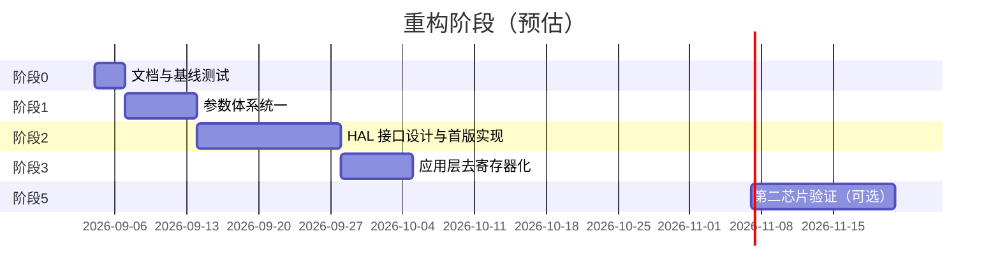

# FOC 框架重构计划

> 版本：v1.0  
> 日期：2026-09-03  
> 目标：把当前项目从「VESC 瘦身 + STM32F4 直连」演进为**便于理解、可跨芯片移植**的电机控制框架。

---

## 1. 背景与目标

### 1.1 项目定位（见 `AI_CODE.md`）

- 每个功能模块单独 `.c` + `.h`，职责清晰。
- 代码可读、可调试，适合学习 FOC 控制链路。
- 算法层与芯片解耦，换 MCU 时主要改 BSP / HAL，不重写 FOC。

### 1.2 当前状态（2026-09 评估）

| 维度 | 评分 | 说明 |
|------|------|------|
| 便于理解 | 6/10 | 模块拆分、ISR 注释、Shell 调试较好；VESC 遗留与双参数体系增加认知负担 |
| 跨芯片移植 | 3/10 | 有 BSP 目录和 `hw_*.h` 意图，但应用层仍直连 TIM1 寄存器与 STM32 中断 |

### 1.3 重构后目标架构

```
┌─────────────────────────────────────────────────────────┐
│  App/  业务层（与芯片无关）                                │
│  motor_foc / motor_it / motor_protect / motor_if_start  │
│  motor_sensor / motor_param / cmd                       │
└──────────────────────────┬──────────────────────────────┘
                           │ 只调用 hal_motor.h / hal_board.h
┌──────────────────────────▼──────────────────────────────┐
│  Library/Hal/  硬件抽象接口（函数声明 + 类型）             │
└──────────────────────────┬──────────────────────────────┘
                           │ 各 port 实现
┌──────────────────────────▼──────────────────────────────┐
│  Library/Bsp/port/stm32f4/  板级 + 芯片实现               │
│  （从现有 Library/Bsp/ 迁移而来）                          │
└─────────────────────────────────────────────────────────┘
```

**原则：**

1. **算法不进 BSP** — Clarke/Park/SVPWM、保护、起步逻辑留在 `App/motor/`。
2. **应用不碰寄存器** — `motor_it.c`、`motor_ctrl.c` 禁止出现 `TIM1->CCR`。
3. **一套运行时参数** — `MOTOR_PARAM_S` 为唯一主配置，VESC 类型归档或薄封装。
4. **小步可验证** — 每个阶段完成后，开环/I-F/无感/保护行为与重构前一致。

---

## 2. 现状问题清单

| # | 问题 | 影响 | 涉及文件（示例） |
|---|------|------|------------------|
| P-01 | 双参数体系：`MOTOR_PARAM_S` vs `mc_configuration` | 新人不知改哪个结构体 | `motor_param.h`, `datatypes.h`, `mcconf_default.h` |
| P-02 | `datatypes.h` 1400+ 行 VESC 类型大量未用 | 阅读噪音 | `App/motor/inc/datatypes.h` |
| P-03 | 寄存器宏泄漏到应用层 | 换芯片必改 motor 代码 | `bsp_tim.h` → `motor_it.c`, `motor_ctrl.c` |
| P-04 | `includes.h` 万能头文件 | 所有 `.c` 隐式依赖 STM32 | `App/User/includes.h` |
| P-05 | VESC 死代码 / 混用风格 | 干扰主路径判断 | `hw.h`, `motor_task.c`, `foc_simulink0.h` |
| P-06 | BSP 无统一 HAL 边界 | 移植 = 重写 BSP + 应用胶水 | 整个 `Library/Bsp/` |
| P-07 | 板级配置宏堆砌 | 换板子可换头文件，换 MCU 不行 | `hw_hd75.h` |

---

## 3. 分阶段重构计划

整体分 **5 个阶段**，建议按顺序执行；每阶段独立可合并、可回滚。



---

### 阶段 0：基线与验收标准（预估 2~3 天）

**目的：** 重构前后行为可对比，避免「改完不知道有没有坏」。

**任务：**

| 任务 | 说明 |
|------|------|
| 0.1 记录当前控制参数默认值 | `MOTOR_ShowParam`、`showparam` 命令输出存档 |
| 0.2 定义最小回归用例 | 见下方「验收清单」 |
| 0.3 标注主路径 vs 非主路径 | 在 [代码阅读指南](./代码阅读指南.md) 写推荐阅读顺序 |
| 0.4 完成 VESC 类型审计 | 见 [datatypes审计](./datatypes审计.md) |
| 0.5 冻结第三方库 | `Library/`、`ThirtyLibrary/` 本阶段不改 |

**推荐阅读顺序（写入代码阅读指南）：**

```
Doc/doc/开环FOC学习笔记.md
  → App/motor/motor_foc.c        （Clarke/Park/SVPWM）
  → App/motor/motor_it.c         （ISR 控制链）
  → App/motor/motor_protect.c    （保护）
  → App/motor/motor_if_start.c   （I/F 起步）
  → App/cmd/cmd_openloop.c       （Shell 调试）

暂不看：datatypes.h、motor_task.c、foc_simulink0、VESC 归档区
```

**验收清单（每阶段结束后跑一遍）：**

- [ ] 上电偏移校准约 5 s 完成，无异常复位
- [ ] `olspeed 500` + `olstart` 能稳定开环转
- [ ] `olstop` 后 PWM 安全关闭
- [ ] `olstatus` 显示电流、母线电压、ISR 耗时合理
- [ ] 人为堵转触发过流/堵转保护，`olfault clear` 可恢复
- [ ] `encoder show` / `detect hall` 命令正常（若硬件已接）

---

### 阶段 1：参数体系统一（预估 1 周）

**目的：** 只保留一套运行时配置，降低理解成本。

**任务：**

| 任务 | 操作 | 文件 |
|------|------|------|
| 1.1 审计 VESC 类型引用 | `grep mc_configuration motor_all_state_t` 列出实际调用点 | 全 App |
| 1.2 归档未用 VESC 文件 | 移动到 `Doc/VESC/archive/`，不参与编译 | `datatypes.h` 等 |
| 1.3 保留必要枚举/故障码 | 把 `mc_fault_code` 等仍在用的定义抽到 `motor_common.h` | `motor_common.h` |
| 1.4 删除或 `#if 0` 死 API | `hw_init_gpio` 等无实现声明 | `hw.h` |
| 1.5 文档化 `MOTOR_PARAM_S` 字段 | 每个字段加 `@detail` 或分组注释 | `motor_param.h` |

**`MOTOR_PARAM_S` 分组建议（文档 + 注释）：**

```
├── 采样与换算      ia/ib/ic, v_bus, offset
├── 开环 V/F        ol_enable, ol_target_rpm, ol_vd/vq
├── I/F 起步        if_* 或通过 motor_if_start 子模块
├── 电流环 PI       ol_kp/ki, ol_vd_int/vq_int
├── 速度环          speed_loop_*
├── 无感观测        sensorless_*（或观测器模块内部）
└── 保护快照引用    由 motor_protect 写入，motor 只读
```

**完成标准：**

- [ ] `includes.h` 不再 `#include "datatypes.h"`（或仅保留精简版 `motor_types.h` < 200 行）
- [ ] 新人只需阅读 `motor_param.h` 即可理解运行时状态
- [ ] 编译通过，阶段 0 验收清单全部通过

**风险：** `motor_foc.c` 中 `foc_pll_run(..., mc_configuration*)` 等少数 VESC 接口需改为 `MOTOR_PARAM_S` 或独立小结构。

---

### 阶段 2：HAL 接口设计与 STM32F4 首版实现（预估 2 周）

**目的：** 在 BSP 与应用之间建立稳定边界。

#### 2.1 新增目录

```
Library/Hal/
├── inc/
│   ├── hal_motor.h      # PWM、ADC 采样、时间
│   ├── hal_sensor.h     # 霍尔、编码器（可选合并）
│   └── hal_board.h      # GPIO、UART、Flash 等板级
└── port/
    └── stm32f4/
        ├── hal_motor_stm32f4.c
        └── hal_board_stm32f4.c
```

现有 `Library/Bsp/` 逐步**委托**给 `port/stm32f4/`，不一次性删除，降低风险。

#### 2.2 `hal_motor.h` 接口草案

```c
/* 初始化：PWM + ADC-DMA 联动，但不启动输出 */
void Hal_Motor_Init(void);

/* 启动/停止三相 PWM（安全态：50% 占空或下桥关断，与现有 Bsp_Tim_StartPwm 行为一致） */
void Hal_Motor_PwmStart(void);
void Hal_Motor_PwmStop(void);

/* 设置三相比较值（0 ~ pwm_period_counts） */
void Hal_Motor_PwmSetDuty(uint32_t duty_a, uint32_t duty_b, uint32_t duty_c);

/* 触发 COM 事件（若芯片需要，STM32 保留；其他芯片可为空操作） */
void Hal_Motor_PwmCommit(void);

/* 读取原始 ADC 缓冲（或已换算的物理量，二选一，建议先 raw + 应用层换算） */
void Hal_Motor_AdcGetRaw(uint16_t *adc_buf, size_t len);

/* PWM 周期计数（= ARR），供 SVPWM 归一化 */
uint32_t Hal_Motor_PwmPeriodCounts(void);

/* 控制环触发频率 (Hz)，中心对齐 PWM 时为更新频率 × 2 */
float Hal_Motor_AdcSampleRateHz(void);

/* 微秒计时（ISR 耗时统计） */
uint32_t Hal_Motor_TimeUs(void);
```

#### 2.3 `hal_sensor.h` 接口草案

```c
void Hal_Encoder_Init(void);
uint16_t Hal_Encoder_GetCount(void);
void Hal_Encoder_SetCount(uint16_t count);

int Hal_Hall_Read(int samples);  /* 返回 0~7 */
```

#### 2.4 实现策略

| 步骤 | 说明 |
|------|------|
| 2.4.1 | 新建 `hal_motor_stm32f4.c`，内部调用现有 `Bsp_Tim_*`、`Bsp_Adc_*` |
| 2.4.2 | `TIMER_UPDATE_DUTY_M1` 宏**仅**留在 port 实现内 |
| 2.4.3 | `Motor_DmaInt` 仍由 `bsp_dma` / `stm32f4xx_it.c` 调用，暂不改动中断向量 |
| 2.4.4 | 单元测试：Shell 增加 `haltest pwm|adc|time` 调试命令（可选） |

**完成标准：**

- [x] `hal_motor.h` 编译通过，STM32F4 port 实现完整（含 ADC / 时基）
- [x] 现有 `Bsp_*` 对外仍可用（兼容层），但新代码只调 HAL
- [ ] 阶段 0 验收清单通过（待上板）

---

### 阶段 3：应用层去寄存器化（预估 1 周）

**目的：** `App/motor/` 不再出现 `TIM1`、`TIMER_UPDATE_DUTY_M1`。

**改动清单：**

| 文件 | 改动 |
|------|------|
| `motor_it.c` | `TIM1->ARR` → `Hal_Motor_PwmPeriodCounts()`；占空写入 → `Hal_Motor_PwmSetDuty` + `Hal_Motor_PwmCommit` |
| `motor_ctrl.c` | 同上 |
| `motor_encoder.c` | `Bsp_Tim4_*` → `Hal_Encoder_*`（或保留 Bsp 但经 hal_sensor 转发） |
| `motor_hall.c` | GPIO 读取经 `Hal_Hall_Read` |
| `bsp_tim.h` | `#ifdef HAL_INTERNAL` 保护寄存器宏（已完成） |

**`Motor_Foc_OutputVoltage` 目标形态（示意）：**

```c
static void Motor_Foc_OutputVoltage(...)
{
    uint32_t period = Hal_Motor_PwmPeriodCounts();
    svm_hqd(v_alpha, v_beta, v_bus, period, &da, &db, &dc, &sector);
    Hal_Motor_PwmSetDuty(da, db, dc);
    Hal_Motor_PwmCommit();
}
```

**完成标准：**

- [x] `grep -r "TIM1->" App/motor/` 无结果（或仅剩 `#if 0` 注释块）
- [x] `grep -r "TIMER_UPDATE_DUTY" App/` 无结果（仅注释残留）
- [ ] 阶段 0 验收清单通过（待上板）

---

### 阶段 4：includes 拆分与死代码清理（预估 1 周）

**目的：** 明确依赖边界，减小「看一眼 includes.h 就被 STM32 淹没」的问题。

#### 4.1 新头文件结构

```
App/User/
├── includes.h          # 保留，但变薄：只 include 下面两个
├── includes_app.h      # motor / cmd / param / sensor（无 STM32）
└── includes_platform.h  # HAL + FreeRTOS + BSP（仅 main / it / bsp 用）
```

**规则：**

| 目录 | 允许 include |
|------|--------------|
| `App/motor/*.c` | `includes_app.h` + 必要模块头（逐步减少） |
| `App/motor_param/*.c` | 同上 |
| `App/motor_sensor/*.c` | 同上 |
| `App/cmd/*.c` | 同上 |
| `App/User/main.c` | `includes.h`（平台 + 应用） |
| `App/User/stm32f4xx_it.c` | `includes_platform.h` |
| `Library/Bsp/*.c` | 芯片头 + HAL port |

> 注意：`AI_CODE.md` 当前要求业务 `.c` 只 `#include "includes.h"`。本阶段完成后**同步更新** `AI_CODE.md` 第 3 节。

#### 4.2 死代码处理

| 项 | 处理 |
|----|------|
| `foc_simulink0.h` | 移出 `includes.h`；若不用则从 Keil 工程移除 |
| `motor_task.c` ChibiOS 注释块 | 删除或移到 `Doc/VESC/archive/` |
| `motor_simple_foc/` | 保留为「学习分支」，文档注明未接入主 ISR |
| `hw.h` 未实现函数 | 删除声明或补 stub 返回 |

**完成标准：**

- [x] `App/motor/motor_foc.c` 编译不依赖 `stm32f4xx.h`（只含 `motor_foc.h` / `motor_math.h`）
- [x] `includes.h` 拆为 platform / app；`foc_simulink0.h` 已移出总入口；Simulink 源已移出 Keil 编译
- [x] `AI_CODE.md` 已更新 include 规则（算法文件例外）
- [ ] 阶段 0 验收清单通过

---

### 阶段 5：第二芯片验证（可选，预估 2 周）

**目的：** 证明 HAL 边界有效，而不只是「理论上可移植」。

**推荐验证目标（按难度排序）：**

1. **同厂商不同系列**：STM32G4 / H7（仍可用 CMSIS，改 port 层）
2. **国产替代**：GD32F4（与 F4 高度相似，验证 port 复制成本）
3. **差异较大**：ESP32 / RP2040（仅验证 HAL 接口是否足够，不必完整 FOC）

**最小 port 需实现：**

- `Hal_Motor_*` 全套
- ADC-DMA 或等价采样链路
- 一个 UART（Shell）
- SysTick / 微秒计时

**完成标准：**

- [ ] 新 port 目录 `Library/Hal/port/<chip>/` 可独立编译
- [ ] 开环 `olstart` 在新芯片上跑通
- [ ] 编写 `Doc/doc/移植指南_<chip>.md`

---

## 4. 板级配置演进

### 4.1 当前：`hw_hd75.h` 宏定义

适合**同 MCU 换板**，不适合换芯片。

### 4.2 目标：`board_<name>.h` + 结构体

```c
/* board_bm75.h — 仅引脚与硬件常量，不含函数 */
typedef struct {
    float shunt_res;       /* Ω */
    float amp_gain;        /* V/A */
    uint8_t adc_ch_ia;     /* 逻辑通道，port 层映射到硬件 */
    /* ... */
} board_config_t;

extern const board_config_t g_board;
```

`Hal_Motor_Init()` 读取 `g_board` 完成 ADC 增益、通道映射。换板 = 换 `board_*.h` + 链接对应 `g_board`。

---

## 5. 模块边界（重构后保持不变）

与 `AI_CODE.md` 一致，重构**不改变**以下分工：

| 模块 | 文件 | 重构时禁止 |
|------|------|------------|
| FOC 变换 | `motor_foc.c` | 不要塞进 PID 或保护 |
| 保护 | `motor_protect.c` | 不要在 ISR 里阻塞 |
| 起步 | `motor_if_start.c` 等 | 不要与保护混写 |
| 传感器 | `motor_hall.c`, `motor_encoder.c` | 不要合并为一个文件 |
| 命令 | `App/cmd/` | 不要直接写寄存器 |

---

## 6. 风险与回退

| 风险 | 缓解 |
|------|------|
| 重构引入控制回归 | 每阶段跑阶段 0 验收清单；Git 每阶段一 tag |
| HAL 抽象不足 | 先 STM32 薄封装，第二芯片验证后再改接口 |
| includes 拆分编译失败 | 先新增 `includes_app.h`，旧 `includes.h` 保留转发 |
| 与 VESC 上游合并困难 | 已决定 VESC 代码归档，不再追踪上游 |

**Git 建议：**

```
refactor/phase-1-param
refactor/phase-2-hal
refactor/phase-3-app-decouple
...
每阶段合并前打 tag：refactor-phase-N-baseline
```

---

## 7. 不在本次重构范围

以下明确**不做**，避免 scope 膨胀：

- 电机参数 R/L/磁链自动检测（`AI_CODE.md` 已暂停）
- 重写 FreeRTOS / letter-shell / FlashDB
- 替换 Keil 为 CMake / GCC（可另开任务）
- 完整 VESC 功能（CAN、BMS、平衡车等）
- 修改 `ThirtyLibrary/` 源码

---

## 8. 里程碑总览

| 阶段 | 交付物 | 理解性 | 可移植性 |
|------|--------|--------|----------|
| 0 | 代码阅读指南 + 验收清单 | +0.5 | — |
| 1 | 单一参数体系、`motor_types.h` | +2 | +0.5 |
| 2 | `hal_motor.h` + STM32F4 port | +0.5 | +2 |
| 3 | App 无寄存器依赖 | +0.5 | +2 |
| 4 | includes 拆分、死代码清理 | +1 | +1 |
| 5 | 第二芯片 port + 移植文档 | — | +2 |

**预期重构完成后：**

- 便于理解：**8~9 / 10**
- 跨芯片移植：**7~8 / 10**（取决于第二芯片验证深度）

---

## 9. 下一步行动

| 阶段 | 状态 |
|------|------|
| 0 文档/验收清单 | 文档已齐，**待上板**跑清单 |
| 1 参数统一 | 已完成（`MOTOR_PARAM_S` + `motor_types`，VESC 类型归档） |
| 2 HAL 接口 | 已完成首版；已补 ADC/时基 API |
| 3 App 去寄存器 | 主路径完成；`TIMER_UPDATE_*` 已 `HAL_INTERNAL` 保护 |
| 4 includes 拆分 | **推进中**：`motor_sense` 收采样换算；`motor_foc.c` 已不依赖 `includes.h`/`stm32f4xx.h`；Keil Simulink 组已清空 |
| 5 第二芯片 | 未开始 |

建议下一步：

1. **上板**验收：偏移校准、`olstart`/`olstop`、霍尔标定。
2. 继续阶段 4：让更多算法文件（`motor_math` / `motor_pid`）也只依赖无芯片头。
3. 阶段 5：第二芯片 port。

如需提交：`feat: 新增 motor_sense 并让 motor_foc 脱离平台头`。

---

## 附录 A：关键文件索引

| 类别 | 路径 |
|------|------|
| 控制主链路 | `App/motor/motor_it.c` |
| FOC 数学 | `App/motor/motor_foc.c` |
| 运行时参数 | `App/motor_param/inc/motor_param.h` |
| 板级宏 | `App/motor/inc/hw_hd75.h` |
| BSP 定时器 | `Library/Bsp/bsp_tim.c`, `bsp_tim.h` |
| 入口 | `App/User/main.c` |
| 编码约束 | `AI_CODE.md` |
| 学习笔记 | `Doc/doc/开环FOC学习笔记.md` |

## 附录 B：HAL 与现有 BSP 映射

| HAL 函数 | 现有实现 |
|----------|----------|
| `Hal_Motor_Init` | `Bsp_Init` 中 TIM/ADC/DMA 相关部分 |
| `Hal_Motor_PwmStart` | `Bsp_Tim_StartPwm(MOTOR1)` |
| `Hal_Motor_PwmSetDuty` | `TIMER_UPDATE_DUTY_M1` |
| `Hal_Motor_PwmCommit` | `TIM_GenerateEvent(TIM1, TIM_EventSource_COM)` |
| `Hal_Motor_PwmPeriodCounts` | `TIM1->ARR` |
| `Hal_Motor_AdcSampleRateHz` | `motor_it.c` 中 `Motor_DmaInt_GetAdcFrequencyHz` 逻辑 |
| `Hal_Motor_TimeUs` | `Bsp_Tim_DtNow` / TIM5 |
| `Hal_Motor_CurrentScale` | `FAC_CURRENT` |
| `Hal_Motor_PhaseVoltageGain` | `PHASE_VOLTAGE_DIVIDER_GAIN * ADC_VOLTS_PH_FACTOR` |
| `Hal_Motor_HasThreeShunts` | `HW_HAS_3_SHUNTS` |
| `Hal_Encoder_*` | `Bsp_Tim4_Enc*` |
