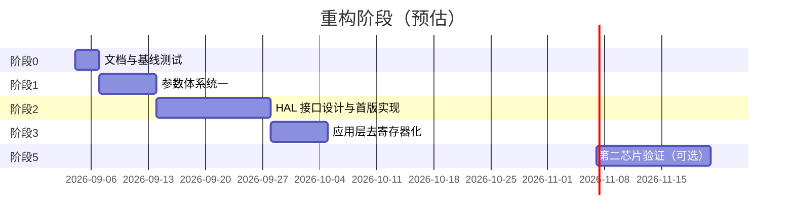

## 2026-10-11：整理并提交无感测试与磁链检测改进

- 用户反馈现场测试已完成，要求整理代码提交；本记录不将该反馈扩写为未提供的转速、时长或成功率。保留此前实测的成功与失败记录。
- 提交范围：三档磁链交叉检测、同时间窗角度/电压配对、电阻稳态窗口延长、sltest高速限流/跟踪验收/诊断与集中配置、对应主机回归和2804验证文档。清理重复测试断言；未修改外设基线、未自动应用检测结果或写Flash配置。
- Keil严格编译0错误/0警告；整理后全套主机回归与差异空白检查通过。其他机械、MATLAB、第三方目录及3508历史记录改动保留，不混入本次提交。本轮未重新烧录或启动电机。
## 2026-10-11：集中sltest测试条件与保护边界

- App/cmd/cmd_openloop.c将sltest散落数值集中到只读sltest_bounds和sltest_profile，字段命名标明单位。保护边界与2804/16V测试配置分开；R/L/磁链、零偏继续沿用当前电机配置，速度/档位时间继续由命令指定。保护范围、时序、限流、通过判据数值均未改变，未扩展运行时调参或Flash格式。
- 命令开头打印实际限流、切换阈值、速度容差及连续超限次数/监测周期，拒绝条件文案由配置值生成。Keil严格编译0错误/0警告；全套主机回归通过，最终具名初始化版本命令专项再次通过，git diff --check通过。本轮未烧录/上板运行/提交；控制器仍保留前次已烧录版本。
## 2026-10-11：2804高速限流平台已定位，低速重复性仍未通过

- sltest补Iq/速度环限流/PWM电压估算诊断，跟踪门槛从20%收紧至max(60RPM,5%)；旧0.15A限流下2200档实际1925RPM、PWM估算4.826/8V。仅>1800RPM档将限流改为0.30A，保持600RPM接管原限流与外设基线。
- Keil0错误/0警告、全套主机回归和补充限流断言通过，已烧录校验。再次RAM零偏校准后五档各5秒600～2600RPM通过（2600均值2600.7，编码器档末2640.9）；随后同校准10秒轮在600RPM持续偏差中止，前面亦有接管超时。不得称整体稳定性已解决。最终OFF/fault0、SSI err0，未写Flash配置/未提交。详见Doc/verify/2804高速限流对照_2026-10-11.md。
## 2026-10-11：同时间窗磁链修复最终三轮通过

- scan统一BEMF/原始编码器角位移、电压积分和实际采样时间戳；只用>=.16V可信参考候选。档位50%/75%/100%，原50rad/s跨度门槛不变；R等待1.5s/采样1s，保留漂移与斜率门槛。外设基线未动。
- Keil及全套主机回归通过，已烧录校验。最终同固件同校准三轮SUCCESS，拟合3.0683/3.2325/3.3378mWb（极差/均值8.39%），R1.23%/L7.99%；SSI错误增量0，结束OFF/fault0。软件一致性改进已实测，不能称高精度或长期可靠性验证。未应用模型/写配置/跑无感，新修改未提交。详见Doc/verify/滑行磁链同时间窗修复_2026-10-11.md。

## 2026-10-11：参数检测稳定性三轮复测未通过

- 同固件/16V/同校准连续三轮fluxscan 0.65 3000 0.3，R/L均有效，R极差/均值2.78%、L7.74%；磁链拟合0/3成功，失败于不同滑行档BEMF与原始角度参考冲突，不能称稳定。SSI历史错误4915前后不变，本次增量0。均结束OFF/fault0，未应用模型，无固件修改。详见Doc/verify/2804参数检测稳定性_2026-10-11.md。

## 2026-10-11：三档磁链交叉检测首次实机通过

- 滑行轨迹证实PLL测速延迟；scan参考改用新鲜原始角度差，转动验收改为独立编码器目标80%～120%，保留最低电压、后续质量检查及原单点门槛。新增真实片段主机边界测试，全套回归及Keil通过，已烧录校验。
- detect fluxscan 0.65 3000 0.3三档SUCCESS：R3.703259Ω、L1310.672uH、拟合磁链3.1966mWb/偏置.0079V/R².9996，参考覆盖98.1～98.9%。仅一次成功，重复性和绝对精度待验证；未应用模型/写Flash，结束OFF/fault0。详见Doc/verify/三速度磁链交叉检测_2026-10-11.md。新改动未提交。

## 2026-10-11：fluxscan检测参考更新遗漏已修复并上板

- 检测占用ISR绕过正常编码器更新；仅scan磁链阶段补1kHz参考更新，失败也打印参考。Keil及全套主机回归通过，已烧录校验。0.65A检测R3.647119Ω/L1348.548uH通过；首档BEMF427.7与参考1219.5eRPM冲突，覆盖82.7%，磁链拒绝。不同样本集合和PLL延迟仍需分清，不宣称根因全解。结束OFF/fault0，未应用无效磁链，新改动未提交。详见Doc/verify/三速度磁链交叉检测_2026-10-11.md。

## 2026-10-11：保存基线后加入三速度磁链交叉检测

- 先提交ecce868作为可回退基线，再新增detect fluxscan：一次R/L、三档滑行BEMF与新鲜编码器转速配对，参考覆盖/测速一致性不合格即拒绝；多点带截距拟合磁链，RAM-only、不自动应用。保留原detect motor/rl单点行为和外设基线。
- 真实函数编排主机回归覆盖成功与多种拒绝/中止恢复，纳入run.ps1，全套通过；Keil0错误/0警告。新固件已核对烧录并上板三轮；均在电阻阶段因采样不稳或斜率不一致拒绝，三档磁链尚未实测。结束OFF/fault0，未应用参数；新改动未再次提交。用法、限制及证据详见Doc/verify/三速度磁链交叉检测_2026-10-11.md。

## 2026-10-11：参数辨识方法级离线仿真

- 新增Python仿真与6项解析/误差传播测试，全部通过；输出JSON/CSV。未改固件、未上板，非现有C检测算法SIL。固定偏置可用多点截距分离，但采样比例和串联电阻项不能仅靠拟合消除。L还敏感于端电压与采样延迟。
- 现有R已有多点拟合，磁链已有关桥滑行/BEMF实际速度测量；建议下步多速度+编码器独立速度交叉验证，不能把仿真命令速度错误当作现有固件缺陷。详见Doc/verify/参数辨识方法仿真_2026-10-11.md与Scripts/simulate_parameter_identification.py。

## 2026-10-11：sltest中止原因快照已上板

- 状态/电流检查失败按位记录API/enable/故障/保护/非有限/电流超限及停机前状态，先关输出再打印，不清保护；任务50ms快照非硬件故障瞬间。主机电流/API异常注入回归通过，Keil0错误/0警告，烧录校验通过。
- 同校准两次sltest 10 600，观测均值603.3/607.1，固件PASS；未复现旧中止，不能认定根因解决。段末参考不新鲜未输出。最大完整回调68/69us，超期仍存在。最终OFF/目标0/速度OFF/接管BLOCKED/fault0。详见Doc/verify/无感中止原因快照_2026-10-11.md。

## 2026-10-11：接管分段耗时诊断与后段异常

- 增加每256控制拍抽样的渐变观测器/完成后观测器/电流坐标校正三段统计及计数峰值；CadenceReset清空统计。不改控制公式或外设。时序/电流/无感主机回归通过，Keil0错误/0警告，烧录校验通过。
- 两次渐变仅3样本，约12～12.3us，完成后约10.1～10.8us，坐标校正2us；支持接管初段附加开销量级3～4us，尚非精确峰值归因。诊断本身有扰动。
- 首轮固件PASS但段末编码器25.9与观测621冲突，用户确认稳定转动，参考存在缺帧；第二轮状态/电流检查中止，最终OFF/fault0。接管记录早于中止，未捕获中止瞬时数据。下一步补中止原因快照。详见Doc/verify/2804接管分段耗时_2026-10-11.md。

## 2026-10-11：接管初50ms超期重复定位

- 未改固件和外设，现有诊断两次600RPM接管均PASS。两次首50ms均19/25个窗口出现>66us完整回调，峰值68us；接管前最大64/65us无超期。200～800ms分别2/285、0/285个窗口超期。控制频率14986.9/14986.3Hz，最长间隔101/102us。
- 超期集中于50ms角度渐变路径，候选为观测器渐变比例运算和电流坐标校正，尚未分别计时，不能确认单一根因。上次73us本轮未复现；内部FOC与完整回调计时边界不同。两次最终停机无故障。详见Doc/verify/2804接管计算超期定位_2026-10-11.md及A/B日志。

## 2026-10-10：无感一键测试扩展至2600 RPM并实测

- sltest自定义目标扩展到500～2600 RPM；起转上限800 RPM不变，高速仅CLOSED接管后进入。最高目标>1200时临时8 V，电流限制不变，结束恢复原电压。配置最高速度不足时前置拒绝，闭环超速阈值随目标变化且不超过3000 RPM；底层外设未改。
- 真实命令主机回归通过，Keil0错误/0警告，烧录校验通过。2804/16 V空载，600/1000/1400/1800/2200/2600六档各统计5秒，观测均值599.0/1001.0/1400.3/1801.8/2204.0/2602.5，段末编码器589.6/999.4/1404.9/1797.5/2226.3/2581.0 RPM。全程CLOSED、PASS，SSIerr=0、stale_reseed=0。
- 最终OFF、目标0、speedOFF、takeoverBLOCKED、fault=0、电压上限恢复4 V。沿用实验零偏B和现有模型，非普适默认。仅验证空载短时；本轮最大FOC计算73us，尚不能宣称时序超期问题完全解决。详见Doc/verify/无感一键速度测试.md和2804_sltest_2600.log。
## 2026-10-10：固件串口无感一键多速度测试

- 新增 `sltest [hold_s [rpm1 ... rpm6]]`，默认600RPM启动接管后测500/600/700，各统计5秒；支持2～20秒、500～800RPM。沿用当前模型/零偏，不写Flash。结束、故障、失锁、输入中止均停机并恢复配置/反馈，目标0、速度环OFF。
- 复用现有命令队列中止机制，任务中每50ms监测、按实际微秒时基限制测试阶段时间，不阻塞中断。不改变外设基线或控制公式。当前限7极对、16V测试范围。
- 真实命令片段主机回归验证成功/接管超时/失锁/输入中止/前置故障/非法参数及恢复路径，已纳入run.ps1；Keil0错误/0警告，烧录校验通过。
- 默认命令实机PASS：500/600/700RPM观测均值500.1/600.9/698.8，段末编码器491.4/604.8/699.9；stale_reseed=0、age_max=3ms、SSIerr=0。仅这三档实测，800档尚未测。最后OFF、目标0、速度环OFF、接管BLOCKED、fault=0。
- 用法及限制：`Doc/verify/无感一键速度测试.md`；实机日志`Doc/verify/2804_sltest_default.log`。PASS只代表固件无感反馈和观测跟踪，不代替负载/实轴验证。
## 2026-10-10：保留接管初段并分离参考采样延迟

- 新增 `sltrace entry`：首次CLOSED立即记录，再保留384条并冻结；保留约128条接管前历史。只冻结记录、不停电机，entry/loss标记独立，保持原失锁捕获模式。容量和全部外设基线未变。
- 窗口边界/冻结后不覆盖/触发标记测试、离线已知延迟与角度回绕测试通过；Keil 0错误/0警告，烧录校验通过。
- 同固件/零偏B/编码器RAM零点4.884 rad，两次复测保留约接管前255 ms、后780 ms。B1 512条完整；B2 511条有效、1条格式不完整。两次无失锁，最终均OFF、目标0、速度环OFF、接管BLOCKED、fault=0。
- 前后独立编码器角度按时间插值，不使用接管中不稳定的测速外推；剔除无效或超过4 ms间隔参考。50～200 ms原始中位差0.990/1.022 rad，对齐后0.060/0.081 rad；200～780 ms原始1.178/1.228，对齐后0.077/0.100 rad。
- 结果支持大部分约1 rad表观偏差来自参考采样滞后，不应据此添加固定1 rad补偿。残余误差仍有散布，不是精确补偿值。首50 ms合格仅3/7条，缺帧区间不能据此宣称相位正确或根因已解决。
- 下一步优先获得接管首50 ms连续可信参考，并核对计算超期与电流目标切换。详见 `Doc/verify/2804接管初段相位对齐_2026-10-10.md`，分析脚本 `Scripts/analyze_sensorless_entry.py`，B1/B2原始日志和phase.csv/json。
## 2026-10-10：接管路径重复计算与观测器局部优化复测

- motor_control.c 拖转路径复用 RunIfDrag 已在本拍更新的 speed_loop_latched，避免 FillCurrentCtx 再次判断速度门槛；对齐路径保留原判定。motor_sensorless.c 仅 ARMCC 使用 O2，保持浮点规则、防护和全部外设基线。两项一起复测，不能单独归因各项收益。
- 控制完整回归、2804保持路径回归、无感状态/接管/回退回归通过；Keil 0错误/0警告，Code=156572、ZI=121104，烧录校验通过。
- 2804、16 V、600 RPM、I/F 0.30 A、速度PI限幅0.15 A，同实验零偏B；新编码器RAM零点4.880 rad。首次校准预检因电压字符串15.9 V不是16.0 V退出，未起转；第二次采用15～17 V数值范围检查后正常校准，原日志保留。
- I/F600窗口：14992.7 Hz、完整回调平均55.00 us、最大64 us；此前同类窗口约14961.7 Hz、56.78 us、最大67 us。
- CLOSED连续22次轮询、跨度29.099 s，无失锁；最后10次编码器588.9～622.3 RPM。CLOSED统计窗口完整回调最大66 us、over66=0；实测控制仍14923～14963 Hz，不能宣称稳定15 kHz。早期编码器rpm曾126.8、403.6，不能把整轮参考描述为稳定。
- 最终编码器stale_reseed=166、age_max=21 ms、SSI err=0。采样任务与速度任务均PRI_SPEED=osPriorityRealtime，但不能抢占ADC ISR；提高任务优先级不能直接消除ISR占用造成的延迟，本轮未修改任务/中断优先级。
- RAM环形记录最终只保留约1 s稳态，接管初段已被覆盖，不能用其“首50ms”统计声称接管峰值改善。末段511条有效格式行中，筛选encoder_valid、age<2ms、500<enc_rpm<700的391条，用enc_angle+enc_rpm*2π/60*7*age估计同时间参考角，相位误差中位0.377 rad、绝对误差95分位0.944 rad、最大1.444 rad；这是基于恒速外推的诊断估计，含校准/滤波/时间戳误差，不能直接设为补偿角。
- 下一步：需保留接管初段记录而非仅等失锁冻结，并对诊断开销做对照，进一步分清剩余相位偏差与参考采样延迟。当前单轮保持29 s不代表根因彻底解决。
- 最终OFF、目标0、速度环OFF、接管BLOCKED、fault=0。证据：`Doc/verify/2804_observer_o2_flash.log`、`2804_observer_o2_cal.log`（预检退出）、`2804_observer_o2_cal2.log`、`2804_observer_o2_B1.log`及CSV；原输出512条记录中1条未满足28列解析条件，未补造数据。
## 2026-10-10：接管峰值与编码器参考采样时序核对

- RAM 记录增加控制入口最大间隔、已完成完整回调最大耗时、DMA pending 次数和软件入口方向计数；不修改算法、ADC/PWM/DMA/定时器配置。当前回调耗时计入下一记录窗口，避免错误配对。
- 窗口边界、回绕和冻结主机测试通过；Keil 0 错误/0 警告，烧录校验通过。ZI=121104，调试 RAM 增加约 4 KiB。
- B1 在禁止接管时捕获编码器测速暂时无效，随后恢复约 600 RPM，未授权接管。B2 参考恢复后授权接管，CLOSED 留存跨度 1031.030 ms，脚本因参考测速无效主动停机，没有无感失锁触发。
- 接管前局部回调最大 64 us，CLOSED 前 50 ms 最大 70 us；控制最大间隔 100 us，最后窗口 106 us。CLOSED 501 条有效记录中，230 条编码器年龄>5 ms、470 条编码器测速无效，SSI err=0。参考缺帧与无感失锁必须区分。
- 本轮证实超期与参考更新不及时，但未复现上一轮约 221 ms 失锁，不能宣称唯一根因或问题解决。下一步降低接管计算峰值、核对采样任务执行余量，并做诊断开销对照。
- 最终 OFF、目标0、速度环OFF、接管BLOCKED、fault=0。详见 `Doc/verify/2804接管时序核对_2026-10-10.md` 及 B1/B2 原始日志、CSV。
## 2026-10-10：无感计算耗时优化复测（未解决失锁）

- 共用 Park/逆 Park 的 sin/cos 查表归一化，矢量限幅在确定未饱和时跳过平方根；保留边界及异常数值路径。新增数学回归覆盖 65537 个角度、210000 个限幅案例，通过；电流环、SVM、节拍测试通过。
- 仅 ARMCC 的 motor_control.c 使用 O2，未改变浮点模式或 ADC/PWM/定时器配置。控制编排回归通过，Keil 严格编译 0 错误、0 警告，烧录校验通过。
- 2804、16 V、600 RPM、I/F 0.30 A，复用实验零偏 B；本轮校准 CURR3 与 B 相差 1.24 count，首次单次恢复被保护拒绝且未起转，随后停机分两次 RAM 调整，所有值及动作保留日志。B 仅为因果对照，不作为物理正确零偏或默认值。
- 600 RPM 独立窗口：实测控制 14957.6 Hz，平均 66.856 us；ADC 回调 29914.7 Hz，完整计算平均 56.70 us、最大 67 us，仍有超期。上一版相近工况约 14740 Hz、58.68 us，局部优化有收益，但不能声称恢复稳定 15 kHz。
- RAM 记录捕获 CLOSED 约 220.625 ms 后退出，CLOSED 样本间隔平均 2.167 ms（名义 2 ms）；磁链最低 0.619 mWb。编码器采样最终 stale_reseed=49、age_max=14 ms，SSI CRC 错误为 0；缺帧附近的编码器相位不能作为精确参考。Shell 轮询未看到这段短暂 CLOSED，必须以 RAM 记录判断。
- 最终已停机、目标 0、速度环关闭、接管禁止、fault=0。下一步需继续降低接管路径峰值，并核对速度环启用至失锁之间的状态/采样时序；本轮尚未证明单一根因。
- 证据：`Doc/verify/2804_control_o2_flash.log`、`2804_control_o2_cal.log`、`2804_control_o2_B.log`（保护拒绝）、`2804_control_o2_B_replay.log` 及同名 CSV。
## 2026-10-10：ADC回调包围计时与观测器计算负担对照

- 在原有DMA2 Stream4有效HT/TC分支清标志之后、Motor_DmaInt前后加诊断包围。记录每次回调入口间隔、完整FOC/跳过拍耗时、>33us/>66us次数及返回时同一DMA标志是否再次置位。覆盖Motor_FocIsr_Step中的状态发布；不包含异常进入/退出和End统计自身，pending只表示有事件待处理，不能当作精确漏拍数。不改变清标志顺序、ADC/PWM/定时器/DMA/NVIC配置；统计与slcadence reset一起启用，100万回调后停止。整数累加会增加少量实时负担，此轮对照固定同一固件。
- 主机测试验证跨uint32回绕、完整/跳过分类、间隔和耗时阈值、pending及空指针，通过；Keil 0 Error/0 Warning，Code=156632/RO=14932/RW=1028/ZI=117012；J-Link Program & Verify成功。
- 2804/16V/限流2A条件不变。重启后编码器RAM校准4.872rad/inverted=1，SSI err=0、stale_reseed=0；新静态电流校准2045.380005/2044.321045/2044.704956，实际测试统一RAM重放前轮B=2045.413940/2044.740967/2045.386963。与前轮固件不同，不能跨固件直接比较成功率；本轮各对照间不重校准。R/L/psi、600RPM、0.30A启动及0.15A速度限流等沿用前轮。
- I/F600稳态：ADC回调29467.2Hz，完整控制14733.8Hz/67.871us；完整回调平均58.49us、最大69us，跳过拍平均2.89us。完整+跳过两次合计约61.38us，已接近66.667us预算，且尚未包括异常入口/出口及部分诊断开销。
- CLOSED稳态reset后第一窗口：控制13324.6Hz/75.049us，ADC回调26649.1Hz；42134次完整回调平均62.34us、最大73us；跳过平均2.86us；>66us回调2472次，pending73672/84268。完整+跳过合计65.20us，硬件异常开销未计入，实时余量不足。下一窗口重复13323.8Hz/62.34us。该轮保持CLOSED且最终正常软件停机，记录见2804_callback_B.log及RAM环形数据。
- 停机编码器参考ON→OFF：两次ADC回调都30000Hz、控制都15000Hz/66.667us；完整回调29.41→29.34us；ON的最大37us、OFF最大32us。这次停机没有复现前轮11kHz现象，故前轮OFF异常不能作为固定频率错误的证据。仅关参考采样不是本次掉频的主要解释。
- I/F600、takeover BLOCKED、RAM记录保持启用，做观测器ON→OFF→ON，期间不串口持续输出，统计窗口约3s（命令返回等待也在窗口内）。结果如下，编码器对应600.8/600.1/599.0RPM，模型与零偏不变：

| 观测器 | ADC回调Hz | 完整控制Hz/平均间隔 | 完整回调平均/最大 | >66us | 控制91..110us间隔 |
| --- | --- | --- | --- | --- | --- |
| ON | 29477.4 | 14738.8 / 67.848us | 59.19 / 68us | 144 | 1594/44973 |
| OFF | 29999.7 | 15000.0 / 66.667us | 52.10 / 61us | 0 | 0/28772 |
| ON恢复 | 29478.8 | 14739.5 / 67.845us | 59.19 / 68us | 150 | 1583/44787 |

- 结论：同条件减少观测器计算可重复恢复真实15kHz，重新开启又掉频，确认实时计算负担影响回调和控制节拍。与超长回调、pending及长/短回调交替相符，支持DMA标志合并/回调分频滑拍方向；尚未独立计数硬件每次触发，不能把pending直接称为已丢失的事件。这里不说明观测器数学模型错误，也不说明节拍是前轮零偏敏感的唯一原因。基线算法仍按66.667us，不用放宽阈值或改dt掩盖掉频。
- 未启用RAM trace的一次I/F启动出现命令响应超过5s，脚本异常退出；olstop后续在T199.985s进入、T205.362s返回，最终OFF/Fault0。该次只证明启动时Shell响应严重拖延，未获取有效on/off统计，不能当作干净计算耗时对照，也不能认定关闭记录一定导致问题。原始异常保留2804_callback_observer_on_off.log；有效重复见2804_callback_observer_on_off_trace.log。
- 下一步应在不改底层采样配置的前提下，按sample/control/output分段削减快环耗时，特别是重复换算、数学调用和诊断负担；需要停用诊断的对照开关评估观测影响，并检查从IRQ入口到返回的预算。恢复稳定15kHz和固定采样侧后，再核对校准与运行边沿一致性，不硬编码本次成功零偏。
- 日志：Doc/verify/2804_callback_flash.log、2804_callback_cal.log、2804_callback_B.log、2804_callback_off_compare.log、2804_callback_observer_on_off_trace.log。最终OFF、目标0、speed OFF、takeover BLOCKED、observer ON、16V保持开启、成功B零偏只保留RAM，未提交Git。
## 2026-10-10：实际控制节拍与电流零偏隔离对照

- 新增 `slcadence reset|show`：用已有 TIM5 微秒时基记录完整 FOC 入口间隔、区间直方图及入口时 TIM1 DIR。整数 ISR 累加、短临界区快照，超过 1000us 的间隔单独记 gaps，不计平均；最多累计一百万拍。DIR 是软件入口读数，并非 ADC 采样瞬间硬件锁存。统计未改变算法 dt、ADC/PWM/定时器/DMA 配置。新增代码会占用少量 ISR 时间，本次因果对照均使用同一诊断固件。
- 新增 `detect offset ram set ADC0 ADC1 ADC2`：仅停机且未选择 BLDC/未检测时允许 RAM 重放；每相必须有限、1000..3000 且相对当前零偏变化不超过 1 ADC count；先验证全部三相再写入，不写 Flash、不修改电压零偏或编码器零点。主机验证计时回绕、直方图/异常间隔、停机限制、NaN、越界及拒绝时不部分写入；两项通过。Keil 0 Error / 0 Warning，Code=156056、RO=14756、RW=1016、ZI=116936，J-Link 烧录校验通过。
- 条件：2804、16V、7极对、编码器仅参考，RAM校准零点4.875rad/inverted=1，SSI err=0、stale_reseed=0。模型 R=2.925ohm/L=0.86mH/psi=3.5mWb，Ortega gain=12e6；I/F Iq=0.30A、600RPM，接管后速度PI限流0.15A、Kp=0.0003、Ki=0.0005、blend=0.05s。所有四轮使用相同固件、模型及编码器零点，中间不再校准。

| 对照 | CURR1 / CURR2 / CURR3 零偏（ADC count） | 接管结果 |
| --- | --- | --- |
| A1，本轮校准 | 2045.519043 / 2044.711060 / 2044.878052 | RAM捕获 CLOSED 后约241.495ms退出 |
| B，重放上轮成功零偏 | 2045.413940 / 2044.740967 / 2045.386963 | 22次CLOSED轮询跨度15.610s，编码器556.8..741.9RPM，无失锁触发 |
| A2，恢复本轮校准 | 同A1 | RAM捕获 CLOSED 后约244.227ms退出 |
| 只改CURR3 | A1前两相不变，CURR3=2045.386963 | 22次CLOSED轮询跨度16.073s，编码器494.3..670.1RPM，无失锁触发 |

- A1/A2完整CSV行分别510/511，失锁后标记128均16行；连续失锁计时在退出前分别0.098201/0.099134s。B/只改CURR3末段CSV均509行且全CLOSED，失锁计时最大0.000867/0.002s。成功记录的约1.095s是环形缓存末段窗口，不能当作全部运行时长。原始串口偶有字符缺失，CSV仅保留24列完整且年龄有效的行，原始日志保留。
- 结论：A→B→A重复，加单独CURR3对照，证实本次运行中第三路零偏是接管敏感因素。CURR3按ACB约定映射逻辑ib；差值0.508911count，按约0.0806A/count换算约41mA，R*deltaI约0.120V（模型量级推算，不是独立端电压实测）。这不能证明B就是真实物理零偏，更不能据此硬编码B。校准同轮下降沿CURR3=2044.88，上升沿=2045.79，约0.91count差；软件入口DIR两方向都出现。需解决运行样本与校准样本的一致性，不能单看静态零偏稳定就判采样正确。
- 实际节拍：600RPM I/F稳态短窗口B为14783.5Hz/67.643us，只改CURR3为14778.8Hz/67.665us；仅CLOSED窗口重置统计后首段13146.6Hz/76.066us，其中11597/41129约28.2%间隔在91..110us，其后累计13796.1Hz/72.484us；算法始终按66.667us。这里统计入口频率，不是PWM频率。CLOSED成功仍有节拍误差，说明零偏影响不能归结为节拍一项。末次OFF窗口10935.8Hz/91.443us也异常，故不能直接断言只有无感计算超时；DMA回调漏计/合并、其他IRQ延迟及诊断负担尚需回调级统计区分，当前证据未确认其中哪项。
- 本轮未修改实际 dt 或校准边沿，未放宽锁定阈值。下一步应固定B零偏与同一编码器零点，核对ADC回调入口间隔、完整ISR及高优先级中断预算，确认66→100us间隔来源，再处理校准/运行边沿一致性；不能用改变dt补偿或选一次恰好成功的零偏掩盖问题。
- 日志：`Doc/verify/2804_cadence_zero_cal.log`、`2804_cadence_zero_A1.log`、`2804_cadence_zero_B.log`、`2804_cadence_zero_A2.log`、`2804_cadence_zero_C_only.log`及同名CSV。最终`2804_cadence_zero_final.log`确认OFF、Fault=0、speed OFF、takeover BLOCKED；成功B零偏仅留RAM，16V电源保持开启。
## 2026-10-10：无感接管PI坐标迁移实现与0.15A复测

- 修改App/motor/motor_control.c、motor_current.c及对应头：在UpdateTheta正常转速积分完成后，记录Sensorless_Update额外修正的角差；仅无感来源、接管尚未完成时，将此角差传入电流环。普通旋转、完成接管、有感和纯开环均不迁移；停机复位清零。没有改变ADC/PWM/定时器、角度渐变公式、失锁门槛、速度PI限流或模型参数。
- 电流PI迁移采用Iint_new=R(-delta)*Iint_old+Kp*(R(-delta)*Iref_old-Iref_new)。反馈同样旋转，所以在同一采样下新P项+积分的静止alpha/beta电压等于交接前；随后按新目标正常积分、矢量限幅及抗饱和。这里只补偿交接中的比例跳变，没有增加电流目标斜坡、临时放宽限流或清零积分。
- 主机验证：正负pi/2、小角及跨圈旋转同时0.30→0.15A目标切换，静止电压误差小于1e-5V；实际Current_Step的目标输出指针与motor字段别名也通过，避免先覆盖旧目标。控制编排验证只传递额外修正角，接管完成及纯开环不迁移，复位清零。test_motor_current、test_motor_control及2804有感保持回归均通过。Keil Code154952/RO14532/RW1012/ZI116876，0错误0警告；烧录Program & Verify成功。
- 首次重启RAM零偏2045.392944/2044.776978/2045.579956，编码器inverted=1/zero4.873rad。第一次运行在600RPM未进入CLOSED：磁链反复跌出50%～150%窗口，锁定连续计时被重置；RAM512条全部非CLOSED，新迁移未执行。禁止记为修复成功或失败，也没有为了接管放宽磁链门槛。
- 停机再次零偏为2045.413940/2044.740967/2045.386963，保留同一编码器RAM零点。2804/16V、R2.925Ω/L0.86mH/磁链3.5mWb、gain12e6、600RPM、0.30A启动、速度PI上限0.15A、Kp0.0003/Ki0.0005、50ms渐变：两次完整复测分别持续22个CLOSED采样(T149.463～164.219s，至少14.756s)及21个CLOSED采样(T292.311～306.385s，至少14.074s)，均未失锁/无故障。编码器轮询范围约582～668RPM和548～667RPM，仍有动态波动，不能称为精确稳速或所有工况稳定。
- 两次完整运行末段RAM均510条CLOSED可解析样本，最终Iq目标分别0.0550～0.0693A和0.0470～0.0709A，未超过0.15A；输出电压最大1.551/1.544V，loss最大0.6ms；编码器参考最大年龄4.132/3.013ms，无stale_reseed或SSI通信错误。用匹配帧年龄及编码器PLL转速推进参考角后，观测PLL角RMS偏差15.46/16.32度，仍需继续改善；不能用低电流单拍数值判定PI精度。
- 同一校准快速串口捕获入口窗口：512条中509条完整，65条CLOSED；进入记录228684295us，测试显式停机前末记录228835826us。此末时间不是失锁退出，不得把151.531ms误报失锁寿命。DQ请求从约(-1.55,1.06)V逐步转换，30～50ms均值约(0.15,1.73)V、完成后约(1.0,1.34)V，再由电流积分消除残余D轴电流；区别于旧实现渐变结束仍继承-1.55V。入口仍有短暂磁链低值和约450RPM的减速，保护计时最多4.8ms；该窗口测试只证明交接执行，持续运行由两次完整复测证明。
- RAM按30控制拍采样，名义2ms，但入口渐变阶段实际间隔约2.5～2.6ms，50ms配置在记录中完成约60多ms；既有ISR负载/实际控制节拍偏差还没有消除，不以软件名义频率冒充实测频率。零偏重新测量也改变了条件，因此未做同一零偏下旧/新固件严格A/B，不能宣称唯一根因已排尽。
- 日志及CSV：Doc/verify/2804_transport_pi_loss_event（未接管）、2804_transport_pi_recal_event、2804_transport_pi_entry、2804_transport_pi_repeat；统计2804_transport_pi_summary.txt，烧录2804_transport_pi_flash.log，校准2804_transport_pi_cal.log。下一步优先核对实际控制节拍/ISR预算和零偏对锁定条件的敏感性，再改善稳速及剩余相位误差，不先增加速度PI增益或放宽保护。
- 最终已停机OFF/target0/faultNONE，速度环关闭、takeoverBLOCKED，16V仍开启。新固件在板上，校准仅RAM，没有提交Git或保存Flash参数。

## 2026-10-10：补齐最终电流目标并隔离接管瞬态

- 只读事件样本增加最终Id/Iq目标、Clarke电流αβ、限幅后DQ电压请求、母线及电压上限；原iq_target列明确命名iq_PI。未改控制公式、保护门槛或ADC/PWM/定时器基线。512条占48KiB，Keil Code154688/RO14532/RW1008/ZI116872，0错误0警告；记录器主机环绕/退出冻结测试通过。烧录Program & Verify成功，重建RAM电流偏置及编码器方向/零点，零点4.881rad、inverted=1、SSI错误0。
- 同一固件与校准，16V/2804、600RPM、0.30A启动、50ms角度渐变、速度PI Kp0.0003/Ki0.0005。速度上限0.15A立即接管时，事件CLOSED76362992us→退出76577123us，214.131ms。接管首拍最终Iq从0.30A变0.15A；首100ms编码器参考有效，未出现此前5ms缺帧。电压幅值仅约1.9V并下降，远低于4V上限，因此这次不能归因于电压饱和或参考采样超时。
- 接管前DQ请求约(-1.56,1.06)V；角度渐变期间仍沿用开环电流PI积分，前50ms负Vd仍约-1.55V。14ms出现一次磁链低于1.75mWb，但此前已有周期性幅值波动；连续保护计时约108ms才开始。50～100ms采样平均Id约-0.42A，随后实际转速明显下降、磁链/观测角失真并回退。低电流ADC分辨率限制仍适用，不能凭单拍电流断言PI精度，也尚未独立证明积分坐标交接是唯一首因。
- 关闭速度环、保持0.30A的对照曾进入CLOSED并持续加速，触发软件轮询边界后停机；最终RAM记录到约1613RPM，不能当作600RPM稳速通过。因环形窗口覆盖了入口，固定Iq记录的第一条CLOSED时间不是实际接管时刻，不使用分析脚本的该时间计算接管寿命。
- 速度PI上限改为0.30A、其余相同：一次从T232.272到248.025s持续22个CLOSED轮询，至少15.753s；先超调到编码器872RPM，再回到约600RPM，末段目标Iq平均0.0776A、电压最大1.57V、loss最大1.267ms，参考最大年龄2.209ms。说明稳态并不需要持续0.30A，但交接阶段对目标限制敏感。不是完全稳定或重复通过结论。
- 重复0.30A接管、计划稳定后降0.15A的试验，在首次CLOSED轮询已经观测903.2RPM/编码器916.8RPM，越过900RPM测试边界并停机。因此未执行运行中降0.15A，禁止记为降限流通过。当前仅增加记录功能，未把0.30A改为默认解决方案。
- 日志/CSV：Doc/verify/2804_current_loss_event、2804_fixed_iq_loss_event、2804_matched_iq_takeover、2804_delayed_iq_limit。立即0.15A失锁记录512条中509条完整且年龄合理，匹配0.30A记录511条，原文保留。软件轮询上限并非硬件逐拍转速保护，固定电流对照的加速证明不能依赖目标600RPM限速；后续对照应保持速度控制。
- 结论：实机证据把问题收敛到接管瞬态，特别是电流目标0.30→0.15A和开环→转子坐标交接；模型/采样误差仍可能参与，但不能继续把所有失锁归咎参数电阻或SSI缺帧。下一步在不突破用户电流上限的前提下验证积分坐标迁移及电流目标平滑交接，先主机验证电压矢量连续性，再上板控制超调。最后OFF、target0、faultNONE、speedOFF、takeoverBLOCKED，功率16V仍开启。

## 2026-10-10：RAM失锁事件记录与两次实机捕获

- 新增sltrace arm/show：仅停机允许Arm/读取，不写Flash。512条64字节RAM环形缓存，每30个15 kHz控制拍约2 ms记录一次，在第一次CLOSED退出后强制记录事件及后续15条约30 ms并冻结。若未触发，停机show冻结现有窗口。记录发生在电流环和输出提交后；保存控制角、PLL角、磁链、观测RPM、Id/Iq、速度PI的Iq输出、电压估计、编码器角/RPM/匹配帧年龄、blend与loss_timer。iq_target列实际为速度PI输出，非所有工况最终电流目标；低电流采样单拍值不做电流精度结论。
- 文件：motor_timing.c/h、motor_foc_isr.c、motor_sensorless.c/h只读快照、cmd_openloop.c/command.c；test_motor_timing_profile.c增加环形覆盖、触发与冻结验证。主机测试和原接管边界测试通过，Keil 0错误0警告，ZI约100488字节，固件已烧录校验。记录带来额外ISR开销，不能等同无记录固件行为。
- 2804/16 V，R2.925Ω/L0.86mH/ψ3.5mWb，gain12e6，启动0.30 A，接管限流0.15 A，600 RPM；重新RAM校准后，同一校准分别做500 ms和50 ms渐变，均捕获短暂CLOSED后退出。两次均完成停机清理：OFF/target0/faultNONE，takeover BLOCKED，速度环OFF。
- 长渐变：CLOSED时间80728157 us，退出81350787 us，共622.630 ms；退出前loss_timer最高0.098134 s，下一记录状态OPEN_LOOP且loss_timer清零。失锁前约100 ms，磁链连续异常先启动loss计时，随后低于300 RPM条件延续计时，约100 ms后按现有策略回退。方向条件始终正向，未触发高速停机（当前强制600低于800安全上限）。磁链曾降至约0.03 mWb，远低于1.75 mWb有效下限。
- 接管前编码器参考所有记录有效、年龄小于1.5 ms，PLL相对转子平均仅数度；CLOSED开始约8 ms后参考首次无效，渐变期间频繁重新Seed测速，最大记录年龄约16 ms。编码器RPM为0或几十RPM在这些区段不能直接当作轴停转；已用短于4 ms的相邻原始角帧差独立检查，失锁前阶段确有减速/反向摆动。参考恢复后的失锁末段年龄约0.4～2.6 ms，PLL偏差达到约140度，不能把全部偏差归咎缺帧。
- 短渐变：CLOSED301443691 us→退出301688087 us，共244.396 ms；也在磁链异常/低转速持续约100 ms后回退，末段编码器有效且年龄小于约2.9 ms，PLL出现约130度偏差。50 ms渐变不能单独解决失败，不能把长渐变视为唯一根因。
- 已定位直接保护触发链：磁链/观测相位失真→估算与实际运动脱离→磁链异常或低转速连续计时→回退。仍未证明是哪一个电压模型、电流偏置、电流目标交接或调度问题最先导致磁链失真；采集超时是真实并存问题，但仅凭时间先后不宣称其单独导致观测器失锁。
- 串口轮询未看到短暂CLOSED，脚本最后报“Takeover did not lock”；RAM事件证明实际曾接管，此脚本报错不用于否定捕获。长事件512条中511条可解析、其中1条年龄损坏被剔除；短事件512条可解析，保留原始日志，不修补丢失字符。
- 日志：Doc/verify/2804_loss_event_capture.log、2804_loss_event_short_blend.log；清洗CSV为2804_loss_event.csv及2804_loss_event_short_blend.csv，分段分析2804_loss_event_long_analysis.txt/2804_loss_event_short_analysis.txt。超时重建后的编码器PLL速度未稳定时禁止直接拿它补偿角度做根因结论。
- 下一步：在可靠参考与同一校准下分别验证电流目标交接和观测器输入误差；需要补最终电流目标、实际电流αβ与电压限幅信息，或用编码器仅作角度约束的对照隔离观测器。暂不修改底层外设或失锁保护阈值。
## 2026-10-10：分段计时定位母线换算的软件双精度开销

- 新增motor_timing稀疏分段计时，每256个完整FOC拍采一拍，窗口最多256样本、整数累加；olrpm输出采样/保护、电流重构、控制总计、其内无感、输出平均微秒。控制总计包含无感，不能重复相加；计时仍不覆盖完整中断入口/出口，诊断有额外开销。
- 相关文件：motor_timing.c/h、motor_foc_isr.c、motor_sensorless.c默认包装、cmd_openloop.c、host桩与test_motor_timing_profile.c，已接入run.ps1。主机验证稀疏分频、无效时不记录、计时回绕和有界窗口，及原接管渐变/正反转边界，均通过；Keil 0错误0警告。
- 优化前诊断版：采样/保护约15 us、电流重构1.4 us、控制32～34 us（其内无感10～12 us）、输出8.5 us。该次接管未保持，结束OFF/0/NONE。日志2804_segment_profile_runtime.log。
- 确认HAL母线换算GET_INPUT_VOLTAGE因4095.0把运行计算提升为double，机器码调用ui2d、两次dmul、d2f。仅在本项目HAL预计算固定float系数，再用ADC计数乘系数；保留4095分母、V_REG、VIN电阻参数，不改第三方、ADC/PWM/定时器或采样配置。
- 全4096个ADC码点比较最大舍入差7.629e-6 V，单码约0.02132 V；目标机器码成为VCVT.F32和VMUL.F32，无软件double调用。Keil编译通过，已烧录校验并重新RAM零偏和编码器校准。
- 优化后开环采样/保护约10.8 us，控制32.5～32.7 us，无感约10.0～10.2 us，输出8.6 us。完整控制拍节省约4 us，对ADC两拍平均占用的贡献约6个百分点，尚未独立测完整ISR利用率。
- 第一次脚本在仍LOCKING时过早按失锁结束，已修正为先允许锁定、只有已见CLOSED再退出才判断接管丢失。第二次实机先CLOSED（obs716.6 RPM），随后OPEN_LOOP且编码器接近停转，脚本立即停机；本次延长验证未实现，不能宣称稳定闭环。CLOSED首帧分段样本数15且窗口跨切换，不作为稳态平均。日志2804_bus_float_profile_runtime.log和2804_bus_float_profile_retry.log。
- 第二次测试编码器stale_reseed 0→3、age_max 5 ms、SSI错误0，相比之前约0.5 s缺帧改善明显但未清零；旧gap_max约1.075 s包含初始化，不当作本次运行缺帧。最终OFF、target0、faultNONE，增益12e6、接管BLOCKED、速度环OFF。
- 下一步：保持计算优化，捕获接管到失锁的高密度相位/电流/磁链数据，分辨观测角偏差和电流目标交接；目前0.15 A只在此前短测通过，本轮未复现，不提升为默认参数。
## 2026-10-10：接管电流、渐变时间与高增益RAM对照

- 本轮未修改固件代码、外设或Flash参数。2804、16 V、启动Iq=0.30 A，I/F先升至600 RPM再开速度环和接管；速度PI Kp=0.0003、Ki=0.0005。每组结束恢复速度参数、渐变0.2 s、增益12e6并核对OFF/target=0/fault=NONE。
- 0.05 A接管上限、50 ms渐变：短时CLOSED后失速并回退，否定过低限流。命令请求20 ms被现有参数下限限制为50 ms，以下均记录实际值。
- 0.15 A、50 ms：22个CLOSED快照均编码器有效，采样转速561.6～680.7 RPM；取前三帧后的19个600±60 RPM样本，时间补偿后PLL-编码器均值0.9度、居中RMS16.7度。
- 固定0.15 A，恢复500 ms渐变：22个CLOSED快照均有效，采样转速580.5～661.1 RPM；19个稳态样本均值-0.6度、居中RMS15.7度。短测约15 s，没有长时验收；峰值为稀疏采样峰值，不能排除未采到的切换尖峰。两组结果支持优先采用0.15 A作为该2804下一次测试上限，尚不能推广为固件默认。
- 高增益120e6、0.15 A、500 ms：接管后首个快照已回到OPEN_LOOP且编码器接近零速，后续检查确认未保持CLOSED，脚本终止并恢复增益12e6。先前高增益开环观测改善不能外推到实际接管。
- 编码器stale_reseed累计：0.15 A短渐变11→14，长渐变14→19；统计包含停机滑行，尚未隔离运行与清理阶段。SSI错误持续为0。渐变时间缩短不能单独解决任务缺帧。
- 日志：`2804_takeover_low_iq_short_blend.log`、`2804_takeover_mid_iq_short_blend.log`、`2804_takeover_mid_iq_long_blend.log`、`2804_takeover_mid_iq_gain120m.log`，位于Doc/verify；纯CLOSED筛选比较 `2804_takeover_parameter_comparison.txt`。
- 下一步：保留12e6和0.15 A试验条件，分段定位ISR运算耗时与渐变期间速度PI实际调度，捕获切换瞬态。约90%占用和相位周期波动仍未解决；不把本轮短测标成稳定闭环验收。
## 2026-10-10：CLOSED完成后直接跟随PLL的优化实测

- `motor_sensorless.c`在blend>=1后直接使用已归一化PLL角，省去重复渐变除法、角差与折返；渐变段、失锁与同步回退行为保持。主机测试延长至4500拍，覆盖正反转和跨±π，检查完成后控制角等于PLL且反馈有效；测试通过。Keil 0错误0警告，已烧录校验并重新RAM校准。
- 相同2804/16 V/600 RPM/0.30 A条件实际进入CLOSED，后续连续22次快照编码器valid=1、zero=1、fault=0。接管后状态格式化59.5 ms（前次5.68 s），中断平均30.2 us、报告90%（前次30.4 us、91%）；小幅运算节省可明显改善接近饱和时的任务运行，但不能认定预算已充足。
- 接管初期编码器读数曾达1044.8 RPM，stale_reseed最终5次、age_max约0.5 s；后续稳定段编码器约568～629 RPM。启动过冲和缺帧仍未解决，长时间稳定性未验收。实时状态打印存在跨时刻字段，本次诊断脚本中主动状态读取也增加背景负载。
- 角度分析22个600 RPM附近有效快照：时间补偿后PLL-编码器均值1.2度、居中RMS14.2度；该筛选包含少量接管前快照，不能作为纯闭环角度验收。日志 `Doc/verify/2804_blend_fast_runtime.log`，分析 `Doc/verify/2804_blend_fast_analysis.txt`。
- 结束已核对OFF、target=0、fault=NONE。未修改外设基线或提交。下一步针对渐变期间负载与速度PI接入时机处理过冲，并复核完整中断余量。
## 2026-10-10：接管后任务饥饿复测

- 使用当前固件、2804、16 V、0.30 A，I/F 升至600 RPM后再开启速度环与无感接管；日志为 `Doc/verify/2804_takeover_runtime_diagnostic.log`。
- 实机进入CLOSED且blend=1。运行中FOC计时平均30.4 us，ADC 30 kHz对应报告占用91%；此计时不包括完整中断入口/出口，不能当作全系统余量。
- 状态格式化耗时由停机约8.6 ms增至5.68 s，串口回复超过脚本5 s等待时间；清理命令随后成功执行，确认OFF、target=0、fault=NONE。
- 编码器累计stale_reseed由47增至95，gap_max达到1.077 s、age_max达到0.664 s；SSI传输、CRC和状态错误仍为0。证据支持接管后任务调度余量不足，尚不能据此判定观测相位错误或编码器硬件故障。
- 本次只采集诊断，未更改控制算法或ADC/PWM硬件基线，未烧录。运行状态快照中转速字段采集时刻不同，不用于独立测速验收。
- 下一步：检查并降低CLOSED路径额外计算，测完整中断预算；保持原有渐变轨迹和保护条件，主机验证后上板比较任务缺帧与编码器相位。稳定无感闭环仍未验收。
# FOC 框架重构计划

### 2026-10-10：修正I/F相位锁定参考及帧时间配对

- 确认olrpm的GetElecAngle取控制侧消费的缓存帧，却把MT6701最新采集时间戳配给该角，参考更新分频后可产生约1ms/25°电角误差。新增GetSampleTimeUs与缓存帧配对，诊断按对应时间戳补偿；编码器主机测试与Keil通过。保持供电烧录、RAM校准，日志2804_angle_time_flash.log、2804_angle_time_cal.log。
- 修复后原算法600RPM/0.30A/model2.925Ω/0.86mH/3.5mWb/gain12e6/sldt0的16个稳态点，PLL-编码器均值-1.1°/中心化RMS11.5°/跨度38.1°，编码器-I/F为83.7°±约数度。证实1.4rad(80°)绝对切角门限会拒绝准确转子角，不应以约90°差断言无感观测固定错相。日志sensorless_3508_20261010_164819.log、2804_matched_baseline_analysis.txt；首次清理状态回包缺字导致脚本未确认停机，独立停机并读回确认OFF/目标0/fault NONE。
- motor_sensorless.c/h新增lock_phase_error：按命令电流矢量相对I/F角的atan2(signed Iq,Id)检查磁链方向，Id0路径用±pi/2常量，无每拍三角开销；原phase_error仍记录PLL-I/F实际切角。phase_ok对lock_phase_error应用原门限，观测角不加90°补偿，不扩大门限；沿原blend_time渐变切角，速度/磁链/方向/持续锁定及失锁保护不变。olrpm增加lockph字段，脚本判据与头文件/命令注释同步。
- test_motor_sensorless与真实数学known-angle测试通过：准确1.5rad转子角可锁定，反向-1.5rad磁链与正向Iq矢量不匹配仍全部拒绝；原0.2s渐变及跨±pi/动态速度测试通过。Keil0错误0警告。串口脚本主机测试原模拟olstatus不含停机字段，与当前清理检查不兼容；补模拟OFF/目标0及slstats清理断言后通过。未修改外设或保存参数Flash。
- 600RPM接管关闭实机：10s统计F/S/D/P失败全部0、最长连续候选10s，稀疏诊断lock累计超过20s；原算法P失败约61%、最长约8ms。模型、gain12e6、sldt0、phase1.4均不变。16点PLL-编码器均值6.5°/中心化RMS10.6°，并未宣称观测波动全部消失。日志sensorless_3508_20261010_165313.log、2804_current_vector_observe_analysis.txt。
- 实际接管首测提前spenable1启动，使用速度模式较快斜坡，0.30A未起转，未进入CLOSED；随后先以100RPM/s起转，到编码器600.7RPM及lock1.919s后启用spenable1/sltakeover1，0.3A速度限流、PI0.0003/0.0005、blend0.5s。进入CLOSED、fb valid、fault0，首个采样obs710.4RPM/Iq0.166A；但参考valid0并出现重建，触发脚本退出。不能称稳定无感闭环已验收，当前阻塞转为闭环/渐变运行时采集连续性及速度环动态。
- 日志2804_current_vector_flash.log、2804_current_vector_cal.log、2804_current_vector_takeover.log、2804_current_vector_takeover_deferred.log。最终OFF/目标0/fault NONE、接管关闭、速度环关闭，速度PI/限流/渐变恢复原值，sldt0；未提交。下一步量化实际闭环时中断/后台任务负载，保证参考采集后继续速度及角度验收。

### 2026-10-10：参考更新分频释放ISR余量

- 运行中耗时对照：sldt0为28.7us/86%，sldt0.003为29.4us/88%（按30kHz ADC回调计），后者参考采样重建及长间断复现。停机15.8us不能用作运行基准。日志2804_dt0_active_timing.log、2804_dt003_active_timing.log。高负载与间断相关，尚未完整量化中断入口开销、调度及每模块峰值。
- motor_output.c等价优化符号整数合并后转换、固定除数倒数乘法，test_motor_output通过、Keil0错误0警告；保持供电烧录并RAM校准。实际仅降到29.3us，仍重建557次，不作为彻底修复。日志2804_output_perf_flash.log、2804_output_perf_cal.log、2804_dt003_optimized_timing.log。
- motor_sensor_update.c仅compare且非ENCODER时累计dt，约1ms更新一次参考PLL；正式ENCODER逐拍更新及2ms保护不变，参考5ms保护不变。cmd_openloop.c的olrpm原始角年龄改为硬件时间戳差，避免分频后年龄低估。ADC/PWM/定时器/SSI采集频率不变，未提高超时门限。
- test_motor_sensor_update通过：参考短步不逐拍更新、完整累计dt交接、关闭compare不更新、正式控制和故障路径隔离。Keil0错误0警告、git diff --check通过。保持16V供电烧录校验通过，RAM校准offset4.872rad、inverted1、zero_valid1。
- 同600RPM/0.30A/sldt0.003运行中28.4us/85%，watch3秒30点全部valid1，PLL595.79～602.04RPM，stale_reseed0、age_max2000us、SSI错误0。日志2804_reference_decimation_flash.log、2804_reference_decimation_cal.log、2804_dt003_decimated_timing.log。该轮参考间断消失，仍需连续角度诊断及更多工况确认，不宣称无感接管已解决。
- 连续olrpm20点对照亦完成，两轮均16个稳态有效点且最终stale_reseed0/SSI错误0。sldt0.003的PLL-编码器均值29.2°、中心化RMS15.9°、跨度63.8°；同校准恢复0后为9.4°/19.3°/63.1°。小补偿虽略减中心化波动，却增大平均偏差，单轮稀疏采样不支持采用该参数。电角度零点精度未独立验证，ABC低通相位延迟仍待检查。
- 补偿日志sensorless_3508_20261010_164239.log、2804_decimated_dt003_analysis.txt；基准sensorless_3508_20261010_164340.log、2804_decimated_dt0_analysis.txt；最终2804_decimated_final_status.log。结束OFF/目标0/fault NONE、sldt0、接管关闭。无Git提交、未保存RAM校准到Flash。后续验证电流滤波坐标及原始角与时间戳发布一致性，再评估真实相位及接管，不能仅放宽相位门限。

### 2026-10-10：补偿开关复现参考采集间断

- 5ms参考超时固件下，sldt0/600RPM/0.30A基准20点有16个稳态有效点，编码器597.4～601.5RPM；近似年龄补偿后PLL角差均值12.1°、中心化RMS15.7°、跨度53.6°，编码器与I/F均值77.2°。基准结束stale_reseed0、SSI错误0。日志sensorless_3508_20261010_145458.log及2804_reference5ms_baseline_analysis.txt。
- sldt0.003同条件复测出现sample_age6.467ms及参考失效，主动终止，独立串口停机并恢复sldt0，确认OFF/目标0/fault NONE。诊断stale_reseed837、age_max50266us、SSI错误0。此前5ms修复只消除了较小间断，不能宣称参考链已彻底修好；不采用此轮角差评价补偿。
- 排除连续olrpm打印：sldt0.003启动后只等待7s再watch3s，仍出现大量valid0及PLL归零，重建计数837→1262；同流程恢复sldt0再次运行，窗口测速恢复约600RPM且全部valid1。异常随补偿开关复现，但尚未量化运行中ISR执行负载或定位具体编译指令，不能直接认定通信硬件故障或补偿算法精度问题。
- 日志2804_reference5ms_dt003_abort.log、2804_dt003_without_olrpm_watch.log、2804_dt0_return_watch.log。结束保持sldt0、接管关闭、OFF/目标0/fault NONE。下一步检查补偿分支执行时间及调度挤占，再恢复角度对照；外设基线不变，无Flash参数保存或Git提交。

### 2026-10-10：编码器参考与控制的超时路径隔离

- motor_encoder.c/h新增UpdateReference，仅诊断参考使用5ms超时；原Update/PredictState保留2ms。motor_sensor_update.c显式按反馈源分支，ENCODER始终走原2ms路径，即使compare已开启也不放宽控制保护。ADC/PWM/定时器、采集频率不变。
- 主机测试通过：正式路径3ms间断重Seed且保留零点；参考路径3ms不重Seed、超过5ms仍失效并重Seed；控制与参考路由隔离。Keil0错误0警告。
- 用户明确要求保持功率供电直接烧录。确认OFF/故障NONE后在16V供电下烧录校验通过，启动仍OFF；重新RAM零偏及编码器校准成功，offset4.867rad、inverted1、zero_valid1。
- 600RPM、0.30A、sldt0、接管关闭复测：fresh288315→297449、stale_reseed始终0，age_max1066→2333us；watch3秒30点全部valid1，PLL598.45～600.90RPM，SSI全部错误0。此前同类测试重Seed128次，本轮消除了观察到的参考测速归零。日志2804_reference5ms_flash.log、2804_reference5ms_cal.log、2804_encoder_reference5ms_watch.log。
- 本次适配1kHz参考采集的超时余量，不能称采集任务延迟本身已解决，也不能称无感相位锁定已解决。结束OFF/目标0/fault NONE，校准未写Flash，sldt0、接管关闭，下一步恢复真实角误差及电压补偿对照。

### 2026-10-10：实机确认参考采样超时重Seed

- 只读诊断固件已烧录校验通过。用户确认16V/2A后RAM校准成功：delta=-477、inverted1、offset4.872rad，SSI错误0。启动前fresh35921、stale_reseed0、age_max1066us。
- sldt0、接管关闭、0.30A及2804模型，600RPM直接启动后watch3秒。结束fresh44967、stale_reseed128、age_max2399us；运行时间连续、zero_valid1、SSI CRC/xfer/status/error全部0，rejected0。证实此次测速异常触发了2ms采样超时后的PLL速度清零重建；不是控制器重启或RAM零点丢失。尚未定位采样任务延迟的全部原因。
- gap_max1075973us为校准阶段已存在的累计峰值，不能用它认定运行时停采1秒。窗口累计测速亦可能因Seed跳过差分漏计，不作实际转速精密真值。日志2804_sampling_diag_cal.log、2804_encoder_sampling_diag_watch.log，烧录2804_encoder_sampling_diag_flash.log。
- 结束OFF/目标0/fault NONE、sldt0、接管关闭。下一步只针对1kHz参考模式处理超时余量及采集间断、验证PLL持续跟踪；保留正式编码器控制的2ms故障保护和原硬件外设配置。未提交、未保存RAM校准到Flash。

### 2026-10-10：排除校准丢失并增加采样重建诊断

- 异常期间T+连续递增且zero=1，后续运行时间仍连续；没有控制器重启的日志证据。sldt恢复0后600RPM的encoder watch仍复现：累计计数窗口517.72～591.10RPM，PLL0～695.59RPM，并有valid0，SSI错误及rejected均0。窗口累计可能在重Seed时漏计，因此不是独立精确真值。日志2804_encoder_raw_pll_watch.log。
- 代码确认sample_age>2ms置sample_stale，新帧遇到stale会Seed，将PLL速度清零但保留电角零点；1kHz参考采集对该门槛的调度余量很小。尚不能仅凭现象证明实机根因。
- motor_encoder.c/h和cmd_encoder.c新增只读累计fresh_frames、max_sample_gap_us、stale_reseeds、max_sample_age_us诊断，不改变超时门槛、保护或外设。测试模拟3ms缺帧，计数及重建路径正确且zero_valid保留；test_motor_encoder通过，Keil0错误0警告。待烧录后以计数增量核实实机。
- 当前已确认OFF/目标0/fault NONE、sldt0、接管关闭。新诊断尚未上板，未提交、未保存校准到Flash。

### 2026-10-10：仅RAM观测死区补偿实现及首轮对照限制

- motor_output.c/h新增仅RAM的观测电压补偿比例，默认0、范围[0,0.02]，含义为有效死区秒数×PWM频率；cmd_openloop.c/command.c新增停机命令sldt。参数不进入motor_settings/Flash，不修改PWM比较值、ADC、定时器或硬件死区；只在无感/开环I/F的观测电压重建后按VESC归一化扣除补偿。
- 相电流ABC采用0.01一阶滤波，仅用于补偿方向；停机SAFE输出或重新设置参数时清滤波状态。注意这是直接相电流滤波，并非VESC滤波Id/Iq再反变换，电角频率35/70Hz时有相位延迟，尚需进一步验证，不应直接视作完全一致的VESC实现。非零参数遇到非有限电流时跳过补偿；参数无效不覆盖旧设置。
- host test_motor_output通过：非零补偿不改变实际PWM比较值、补偿极性、单次小幅反向噪声、停机复位、恢复0与NaN/超界拒绝。Keil0错误0警告，用户确认断功率后烧录校验通过；本次随后修改仅注释。未提交。
- 用户确认16V/限流2A后重新RAM零偏及编码器校准，delta=-500、inverted=1、offset4.873rad；SSI无错误。新基准sldt0：600RPM/0.30A/12e6，筛选后13/20点，PLL真实角差均值2.2°、中心化RMS8.6°、跨度27.8°；存在异常参考测速，不能与之前不同零偏的基准直接拼成精度提升结论。
- sldt0.003首轮600RPM出现大量encoder valid=0或不合理RPM（0～676.9），尽管观察器测速约600且最终SSI CRC/status/xfer错误0、rejected0。参考链可能有调度间断/超时重Seed，根因尚未证实；这轮不得用于真实角误差结论，因此未继续增大补偿。
- 10s磁链中心约0.753mWb→0.541mWb仅为诊断提示，参考链异常时不宣称补偿有效或死区值已标定。基准日志sensorless_3508_20261010_142705.log、补偿日志sensorless_3508_20261010_142800.log、校准2804_deadtime_encoder_cal.log、烧录2804_deadtime_ram_flash.log。
- 最终sldt恢复0并读回，OFF/目标0/fault NONE，编码器SSI错误0，接管关闭。日志2804_deadtime_restore.log。下一步先核查编码器参考采集超时/PLL重Seed的运行时证据，再验证滤波坐标及补偿量，不改变外设基线。

### 2026-10-10：VESC电压估计核查与原增益同流程复测

- 本地只读VESC HEAD c0094f58db86efab1fa0f496ebb59c387a573f6b，conf_general.h为7.00，工作树干净；并未证明与用户此前刷入二进制完全相同。foc_math.c默认配置分支MXLEMMING_LAMBDA_COMP；咱们对应ORTEGA_ORIGINAL核心公式一致。
- VESC mcpwm_foc.c:5083附近用滤波Id/Iq反变换得到相电流符号，按foc_dt_us*1e-6*foc_f_zv扣除调制死区误差，再乘2/3*Vbus得到电压。咱们Motor_OutputEstimateVoltage已有相同归一化和方向公式，实际调用死区比例0。host test_motor_output通过，相序公共模、补偿极性及无效输入边界正常；未发现可直接修正的确定公式错误。
- BM75 BSP设定HW_DEAD_TIME_NSEC=360ns；在16V/15kHz下代入VESC估计，单相正、另两相负时alpha补偿约0.0768V。这仅为数量级，实际有效死区未测，不能把该设定视作标定值。现有分段V-RI均值约(0.0322,-0.0257)V也只是理想电压和采样值计算，不能独立区分电流零偏与逆变器误差。
- 同直接爬至600RPM流程复测原gain12e6，0.30A及模型不变：20点诊断，统计10s中心(0.718,-0.641)mWb、模长约0.963mWb；之前同流程120e6为0.258mWb。原增益复测仍返回原中心偏移量级，支持增益抑制积分偏移的证据，尚非全部根因定位。
- 日志sensorless_3508_20261010_142159.log及2804_encoder_gain12_repeat_analysis.txt。最终OFF/目标0/fault NONE，保留12e6、接管关闭；无代码/外设更改、无参数Flash保存。下一步补偿方向需采用滤波电流，并用仅RAM可调有效死区参数对照，不更改硬件定时器死区；实际参数须通过真实角误差和多个工况核验。

### 2026-10-10：编码器参考下纠偏增益对照

- 在已校准编码器、16V/2A限流、0.30A、模型2.925Ω/0.86mH/3.5mWb、开环驱动及接管关闭的条件下，将observer gain从12e6临时改为120e6，PLL保持2000/30000。无代码或外设修改、无Flash参数保存。
- 600RPM共20次诊断，排除起转4次后16点速度598.5～602.0RPM。近似采样年龄补偿后PLL-编码器均值8.1°、中心化RMS5.8°、跨度21.9°；原始角RMS6.3°、跨度25.2°。之前12e6的18点为均值3.6°、RMS14.7°、跨度45.7°。均为电角度，单轮、启动路径不同（本轮直接爬至600，前轮300→600），并非严格重复性验收。
- 10s统计磁链中心从约0.953mWb降至0.258mWb，磁链范围0.002333～0.003961Wb；F/S/D失败0。真实参考角误差缩小，但PLL-I/F相位失败比例由60.6%升到79.1%，最长候选7.4ms：phase_ok指标包含真实负载角和切换角跳变，不能替代观测准确度，尚不应据此放宽门限接管。
- 证据支持积分中心偏移对周期角误差有主要贡献，提高纠偏可抑制它；尚未分清电流零偏、实际端电压误差和磁链模型/初始条件的各自贡献，不能称根因全部定位或将120e6直接写默认。
- 结束确认OFF/目标0/fault NONE，SSI错误0、拒绝样本0；恢复12e6、PLL2000/30000并读回确认。日志sensorless_3508_20261010_141813.log、2804_encoder_gain120_analysis.txt、2804_gain_restore.log。下一步做同启动路径的增益重复对照，并核查磁链模型与输入偏置；接管过渡另行验证。

### 2026-10-10：2804新编码器RAM校准及相位参考核查

- 增加 `encoder detect ram`，复用原方向/零点流程，仅应用运行时校准，不调用参数Flash保存；原无参数命令保留自动保存行为。涉及cmd_encoder.c、motor_encoder_detect.c及motor_encoder.h，不改ADC/PWM/定时器基线。Keil编译0错误0警告，固件烧录校验通过。
- 用户确认16V、限流2A、轴自由后，0.30A校准成功：方向delta=-472、inverted=1，offset=4.875rad；旧齿槽表按原校准行为清除，结果RAM-only。校准日志2804_encoder_ram_calibration.log。
- 0.30A、R/L/磁链=2.925Ω/0.86mH/3.5mWb、接管关闭，300→600RPM各20次诊断。按编码器速度距目标不超过5%筛选，各18个稳态样本；编码器分别298.3～302.4、598.9～601.9RPM，本轮无上次147RPM异常。
- 近似按编码器采样年龄外推电角度后，PLL相对编码器平均偏差分别-1.6°/+3.6°，中心化RMS10.6°/14.7°，跨度42.4°/45.7°；编码器相对I/F角平均82.2°/79.0°，波动跨度7.6°/11.4°。均为电角度及稀疏样本，零点精度尚无独立计量认证。
- 新证据不支持“观测器固定错90°”：真实转子本身与I/F强制角有接近80°差。当前phase_ok比较PLL与I/F，而非真实角误差；其限制兼顾接管角跳变，不能仅凭此失败宣称观测器失锁，也不能直接放宽或用固定偏置掩盖真实观测波动。
- 600RPM统计149847拍/10s：F/S/D失败0，P失败90771（约60.6%），最长候选7.733ms，磁链中心约0.953mWb。原始角相对参考RMS15.9°，PLL14.7°，说明波动已存在于PLL输入，不能只归因于PLL。仍需核查积分电压/电流误差及磁链中心偏置，再设计接管角度过渡。
- 测试最终OFF、目标0、fault NONE，未接管、未保存参数Flash。日志sensorless_3508_20261010_141435.log及2804_encoder_calibrated_compare_analysis.txt；烧录日志2804_encoder_ram_flash.log。校准掉电丢失。

> 当前执行顺序以根目录 AI_CODE.md 为准；下方旧阶段编号/时间表仅保留历史记录。
> 2026-09-05：已完成配置/校准持久化边界，主机验证通过，完整固件与硬件验收待做。见 [实施记录](./架构实施记录_2026-09-05.md)。

> 版本：v1.0  
> 日期：2026-09-03  
> 目标：把当前项目从「VESC 瘦身 + STM32F4 直连」演进为**便于理解、可跨芯片移植**的电机控制框架。

---

## 1. 背景与目标

### 1.1 项目定位（见 `AI_CODE.md`）

- 每个功能模块单独 `.c` + `.h`，职责清晰。
- 代码可读、可调试，适合学习 FOC 控制链路。
- 算法层与芯片解耦，换 MCU 时主要改 BSP / HAL，不重写 FOC。

### 1.2 当前状态（2026-09 评估）

| 维度 | 评分 | 说明 |
|------|------|------|
| 便于理解 | 6/10 | 模块拆分、ISR 注释、Shell 调试较好；VESC 遗留与双参数体系增加认知负担 |
| 跨芯片移植 | 3/10 | 有 BSP 目录和 `hw_*.h` 意图，但应用层仍直连 TIM1 寄存器与 STM32 中断 |

### 1.3 重构后目标架构

```
┌─────────────────────────────────────────────────────────┐
│  App/  业务层（与芯片无关）                                │
│  motor_foc / motor_it / motor_protect / motor_if_start  │
│  motor_sensor / motor_param / cmd                       │
└──────────────────────────┬──────────────────────────────┘
                           │ 只调用 hal_motor.h / hal_board.h
┌──────────────────────────▼──────────────────────────────┐
│  Library/Hal/  硬件抽象接口（函数声明 + 类型）             │
└──────────────────────────┬──────────────────────────────┘
                           │ 各 port 实现
┌──────────────────────────▼──────────────────────────────┐
│  Library/Bsp/port/stm32f4/  板级 + 芯片实现               │
│  （从现有 Library/Bsp/ 迁移而来）                          │
└─────────────────────────────────────────────────────────┘
```

**原则：**

1. **算法不进 BSP** — Clarke/Park/SVPWM、保护、起步逻辑留在 `App/motor/`。
2. **应用不碰寄存器** — `motor_it.c`、`motor_ctrl.c` 禁止出现 `TIM1->CCR`。
3. **一套运行时参数** — `MOTOR_PARAM_S` 为唯一主配置，VESC 类型归档或薄封装。
4. **小步可验证** — 每个阶段完成后，开环/I-F/无感/保护行为与重构前一致。

---

## 2. 现状问题清单

| # | 问题 | 影响 | 涉及文件（示例） |
|---|------|------|------------------|
| P-01 | 双参数体系：`MOTOR_PARAM_S` vs `mc_configuration` | 新人不知改哪个结构体 | `motor_param.h`, `datatypes.h`, `mcconf_default.h` |
| P-02 | `datatypes.h` 1400+ 行 VESC 类型大量未用 | 阅读噪音 | `App/motor/inc/datatypes.h` |
| P-03 | 寄存器宏泄漏到应用层 | 换芯片必改 motor 代码 | `bsp_tim.h` → `motor_it.c`, `motor_ctrl.c` |
| P-04 | `includes.h` 万能头文件 | 所有 `.c` 隐式依赖 STM32 | `App/user/includes.h` |
| P-05 | VESC 死代码 / 混用风格 | 干扰主路径判断 | `hw.h`, `motor_task.c`, `foc_simulink0.h` |
| P-06 | BSP 无统一 HAL 边界 | 移植 = 重写 BSP + 应用胶水 | 整个 `Library/Bsp/` |
| P-07 | 板级配置宏堆砌 | 换板子可换头文件，换 MCU 不行 | `hw_hd75.h` |

---

## 3. 分阶段重构计划

整体分 **5 个阶段**，建议按顺序执行；每阶段独立可合并、可回滚。



---

### 阶段 0：基线与验收标准（预估 2~3 天）

**目的：** 重构前后行为可对比，避免「改完不知道有没有坏」。

**任务：**

| 任务 | 说明 |
|------|------|
| 0.1 记录当前控制参数默认值 | `MOTOR_ShowParam`、`showparam` 命令输出存档 |
| 0.2 定义最小回归用例 | 见下方「验收清单」 |
| 0.3 标注主路径 vs 非主路径 | 在 [代码阅读指南](./代码阅读指南.md) 写推荐阅读顺序 |
| 0.4 完成 VESC 类型审计 | 见 [datatypes审计](./datatypes审计.md) |
| 0.5 冻结第三方库 | `Library/`、`ThirtyLibrary/` 本阶段不改 |

**推荐阅读顺序（写入代码阅读指南）：**

```
Doc/doc/开环FOC学习笔记.md
  → App/motor/motor_foc.c        （Clarke/Park/SVPWM）
  → App/motor/motor_it.c         （ISR 控制链）
  → App/motor/motor_protect.c    （保护）
  → App/motor/start/motor_if_start.c   （I/F 起步）
  → App/cmd/cmd_openloop.c       （Shell 调试）

暂不看：datatypes.h、motor_task.c、foc_simulink0、VESC 归档区
```

**验收清单（每阶段结束后跑一遍）：**

- [ ] 上电偏移校准约 5 s 完成，无异常复位
- [ ] `olspeed 500` + `olstart` 能稳定开环转
- [ ] `olstop` 后 PWM 安全关闭
- [ ] `olstatus` 显示电流、母线电压、ISR 耗时合理
- [ ] 人为堵转触发过流/堵转保护，`olfault clear` 可恢复
- [ ] `encoder show` / `detect hall` 命令正常（若硬件已接）

---

### 阶段 1：参数体系统一（预估 1 周）

**目的：** 只保留一套运行时配置，降低理解成本。

**任务：**

| 任务 | 操作 | 文件 |
|------|------|------|
| 1.1 审计 VESC 类型引用 | `grep mc_configuration motor_all_state_t` 列出实际调用点 | 全 App |
| 1.2 归档未用 VESC 文件 | 移动到 `Doc/VESC/archive/`，不参与编译 | `datatypes.h` 等 |
| 1.3 保留必要枚举/故障码 | 把 `mc_fault_code` 等仍在用的定义抽到 `motor_common.h` | `motor_common.h` |
| 1.4 删除或 `#if 0` 死 API | `hw_init_gpio` 等无实现声明 | `hw.h` |
| 1.5 文档化 `MOTOR_PARAM_S` 字段 | 每个字段加 `@detail` 或分组注释 | `motor_param.h` |

**`MOTOR_PARAM_S` 分组建议（文档 + 注释）：**

```
├── 采样与换算      ia/ib/ic, v_bus, offset
├── 开环 V/F        ol_enable, ol_target_rpm, ol_vd/vq
├── I/F 起步        if_* 或通过 motor_if_start 子模块
├── 电流环 PI       ol_kp/ki, ol_vd_int/vq_int
├── 速度环          speed_loop_*
├── 无感观测        sensorless_*（或观测器模块内部）
└── 保护快照引用    由 motor_protect 写入，motor 只读
```

**完成标准：**

- [ ] `includes.h` 不再 `#include "datatypes.h"`（或仅保留精简版 `motor_types.h` < 200 行）
- [ ] 新人只需阅读 `motor_param.h` 即可理解运行时状态
- [ ] 编译通过，阶段 0 验收清单全部通过

**风险：** 旧 `foc_pll_run` 无调用者且已删除；其余 VESC 接口仍需按实际调用核对，不能仅按类型名批量迁移。

---

### 阶段 2：HAL 接口设计与 STM32F4 首版实现（预估 2 周）

**目的：** 在 BSP 与应用之间建立稳定边界。

#### 2.1 新增目录

```
Library/Hal/
├── inc/
│   ├── hal_motor.h      # PWM、ADC 采样、时间
│   ├── hal_sensor.h     # 霍尔、编码器（可选合并）
│   └── hal_board.h      # GPIO、UART、Flash 等板级
└── port/
    └── stm32f4/
        ├── hal_motor_stm32f4.c
        └── hal_board_stm32f4.c
```

现有 `Library/Bsp/` 逐步**委托**给 `port/stm32f4/`，不一次性删除，降低风险。

#### 2.2 `hal_motor.h` 接口草案

```c
/* 初始化：PWM + ADC-DMA 联动，但不启动输出 */
void Hal_Motor_Init(void);

/* 启动/停止三相 PWM（安全态：50% 占空或下桥关断，与现有 Bsp_Tim_StartPwm 行为一致） */
void Hal_Motor_PwmStart(void);
void Hal_Motor_PwmStop(void);

/* 设置三相比较值（0 ~ pwm_period_counts） */
void Hal_Motor_PwmSetDuty(uint32_t duty_a, uint32_t duty_b, uint32_t duty_c);

/* 触发 COM 事件（若芯片需要，STM32 保留；其他芯片可为空操作） */
void Hal_Motor_PwmCommit(void);

/* 读取原始 ADC 缓冲（或已换算的物理量，二选一，建议先 raw + 应用层换算） */
void Hal_Motor_AdcGetRaw(uint16_t *adc_buf, size_t len);

/* PWM 周期计数（= ARR），供 SVPWM 归一化 */
uint32_t Hal_Motor_PwmPeriodCounts(void);

/* 控制环触发频率 (Hz)，中心对齐 PWM 时为更新频率 × 2 */
float Hal_Motor_AdcSampleRateHz(void);

/* 微秒计时（ISR 耗时统计） */
uint32_t Hal_Motor_TimeUs(void);
```

#### 2.3 `hal_sensor.h` 接口草案

```c
void Hal_Encoder_Init(void);
uint16_t Hal_Encoder_GetCount(void);
void Hal_Encoder_SetCount(uint16_t count);

int Hal_Hall_Read(int samples);  /* 返回 0~7 */
```

#### 2.4 实现策略

| 步骤 | 说明 |
|------|------|
| 2.4.1 | 新建 `hal_motor_stm32f4.c`，内部调用现有 `Bsp_Tim_*`、`Bsp_Adc_*` |
| 2.4.2 | `TIMER_UPDATE_DUTY_M1` 宏**仅**留在 port 实现内 |
| 2.4.3 | `Motor_DmaInt` 仍由 `bsp_dma` / `stm32f4xx_it.c` 调用，暂不改动中断向量 |
| 2.4.4 | 单元测试：Shell 增加 `haltest pwm|adc|time` 调试命令（可选） |

**完成标准：**

- [x] `hal_motor.h` 编译通过，STM32F4 port 实现完整（含 ADC / 时基）
- [x] 现有 `Bsp_*` 对外仍可用（兼容层），但新代码只调 HAL
- [ ] 阶段 0 验收清单通过（待上板）

---

### 阶段 3：应用层去寄存器化（预估 1 周）

**目的：** `App/motor/` 不再出现 `TIM1`、`TIMER_UPDATE_DUTY_M1`。

**改动清单：**

| 文件 | 改动 |
|------|------|
| `motor_it.c` | `TIM1->ARR` → `Hal_Motor_PwmPeriodCounts()`；占空写入 → `Hal_Motor_PwmSetDuty` + `Hal_Motor_PwmCommit` |
| `motor_ctrl.c` | 同上 |
| `motor_encoder.c` | `Bsp_Tim4_*` → `Hal_Encoder_*`（或保留 Bsp 但经 hal_sensor 转发） |
| `motor_hall.c` | GPIO 读取经 `Hal_Hall_Read` |
| `bsp_tim.h` | `#ifdef HAL_INTERNAL` 保护寄存器宏（已完成） |

**`Motor_Foc_OutputVoltage` 目标形态（示意）：**

```c
static void Motor_Foc_OutputVoltage(...)
{
    uint32_t period = Hal_Motor_PwmPeriodCounts();
    svm_hqd(v_alpha, v_beta, v_bus, period, &da, &db, &dc, &sector);
    Hal_Motor_PwmSetDuty(da, db, dc);
    Hal_Motor_PwmCommit();
}
```

**完成标准：**

- [x] `grep -r "TIM1->" App/motor/` 无结果（或仅剩 `#if 0` 注释块）
- [x] `grep -r "TIMER_UPDATE_DUTY" App/` 无结果（仅注释残留）
- [ ] 阶段 0 验收清单通过（待上板）

---

### 阶段 4：includes 拆分与死代码清理（预估 1 周）

**目的：** 明确依赖边界，减小「看一眼 includes.h 就被 STM32 淹没」的问题。

#### 4.1 新头文件结构

```
App/user/
├── includes.h          # 保留，但变薄：只 include 下面两个
├── includes_app.h      # motor / cmd / param / sensor（无 STM32）
└── includes_platform.h  # HAL + FreeRTOS + BSP（仅 main / it / bsp 用）
```

**规则：**

| 目录 | 允许 include |
|------|--------------|
| `App/motor/*.c` | 显式模块头 + HAL / 标准库（**禁止**万能 `includes.h`） |
| `App/motor_param/*.c` | 同上；`flash_storage.c` 例外（仍需 STM32 Flash API） |
| `App/motor_sensor/*.c` | 显式模块头 + HAL / 标准库 |
| `App/cmd/*.c` | `includes.h` 或 `includes_app.h`（暂保留） |
| `App/user/main.c` | `includes.h`（平台 + 应用） |
| `App/user/stm32f4xx_it.c` | `includes.h` / `includes_platform.h` |
| `Library/Bsp/*.c` | 芯片头 + HAL port |

> 注意：`AI_CODE.md` 第 3 节已同步：算法/控制/参数/传感器 `.c` 允许显式模块头；cmd/main 仍可用万能入口。

#### 4.2 死代码处理

| 项 | 处理 |
|----|------|
| `foc_simulink0.h` | 移出 `includes.h`；若不用则从 Keil 工程移除 |
| `motor_task.c` ChibiOS 注释块 | 删除或移到 `Doc/VESC/archive/` |
| `motor_simple_foc/` | 保留为「学习分支」，文档注明未接入主 ISR |
| `hw.h` 未实现函数 | 删除声明或补 stub 返回 |

**完成标准：**

- [x] `App/motor/motor_foc.c` 编译不依赖 `stm32f4xx.h`（只含 `motor_foc.h` / `motor_math.h`）
- [x] `App/motor/*.c` 与 `motor_sensor`、`motor_param`（除 `flash_storage`）已脱离万能 `includes.h`
- [x] `includes.h` 拆为 platform / app；`foc_simulink0.h` 已移出总入口；Simulink 源已移出 Keil 编译
- [x] `AI_CODE.md` 已更新 include 规则（算法/控制/参数例外）
- [ ] `App/cmd/*.c` 进一步变薄（可选）
- [ ] 阶段 0 验收清单通过

---

### 阶段 5：第二芯片验证（可选，预估 2 周）

**目的：** 证明 HAL 边界有效，而不只是「理论上可移植」。

**推荐验证目标（按难度排序）：**

1. **同厂商不同系列**：STM32G4 / H7（仍可用 CMSIS，改 port 层）
2. **国产替代**：GD32F4（与 F4 高度相似，验证 port 复制成本）
3. **差异较大**：ESP32 / RP2040（仅验证 HAL 接口是否足够，不必完整 FOC）

**最小 port 需实现：**

- `Hal_Motor_*` 全套
- ADC-DMA 或等价采样链路
- 一个 UART（Shell）
- SysTick / 微秒计时

**完成标准：**

- [ ] 新 port 目录 `Library/Hal/port/<chip>/` 可独立编译
- [ ] 开环 `olstart` 在新芯片上跑通
- [ ] 编写 `Doc/doc/移植指南_<chip>.md`

---

## 4. 板级配置演进

### 4.1 当前：`hw_hd75.h` 宏定义

适合**同 MCU 换板**，不适合换芯片。

### 4.2 目标：`board_<name>.h` + 结构体

```c
/* board_bm75.h — 仅引脚与硬件常量，不含函数 */
typedef struct {
    float shunt_res;       /* Ω */
    float amp_gain;        /* V/A */
    uint8_t adc_ch_ia;     /* 逻辑通道，port 层映射到硬件 */
    /* ... */
} board_config_t;

extern const board_config_t g_board;
```

`Hal_Motor_Init()` 读取 `g_board` 完成 ADC 增益、通道映射。换板 = 换 `board_*.h` + 链接对应 `g_board`。

---

## 5. 模块边界（重构后保持不变）

与 `AI_CODE.md` 一致，重构**不改变**以下分工：

| 模块 | 文件 | 重构时禁止 |
|------|------|------------|
| FOC 变换 | `motor_foc.c` | 不要塞进 PID 或保护 |
| 保护 | `motor_protect.c` | 不要在 ISR 里阻塞 |
| 起步 | `motor_if_start.c` 等 | 不要与保护混写 |
| 传感器 | `motor_hall.c`, `motor_encoder.c` | 不要合并为一个文件 |
| 命令 | `App/cmd/` | 不要直接写寄存器 |

---

## 6. 风险与回退

| 风险 | 缓解 |
|------|------|
| 重构引入控制回归 | 每阶段跑阶段 0 验收清单；Git 每阶段一 tag |
| HAL 抽象不足 | 先 STM32 薄封装，第二芯片验证后再改接口 |
| includes 拆分编译失败 | 先新增 `includes_app.h`，旧 `includes.h` 保留转发 |
| 与 VESC 上游合并困难 | 已决定 VESC 代码归档，不再追踪上游 |

**Git 建议：**

```
refactor/phase-1-param
refactor/phase-2-hal
refactor/phase-3-app-decouple
...
每阶段合并前打 tag：refactor-phase-N-baseline
```

---

## 7. 不在本次重构范围

以下明确**不做**，避免 scope 膨胀：

- 电机参数 R/L/磁链自动检测（`AI_CODE.md` 已暂停）
- 重写 FreeRTOS / letter-shell / FlashDB
- 替换 Keil 为 CMake / GCC（可另开任务）
- 完整 VESC 功能（CAN、BMS、平衡车等）
- 修改 `ThirtyLibrary/` 源码

---

## 8. 里程碑总览

| 阶段 | 交付物 | 理解性 | 可移植性 |
|------|--------|--------|----------|
| 0 | 代码阅读指南 + 验收清单 | +0.5 | — |
| 1 | 单一参数体系、`motor_types.h` | +2 | +0.5 |
| 2 | `hal_motor.h` + STM32F4 port | +0.5 | +2 |
| 3 | App 无寄存器依赖 | +0.5 | +2 |
| 4 | includes 拆分、死代码清理 | +1 | +1 |
| 5 | 第二芯片 port + 移植文档 | — | +2 |

**预期重构完成后：**

- 便于理解：**8~9 / 10**
- 跨芯片移植：**7~8 / 10**（取决于第二芯片验证深度）

---

## 9. 下一步行动

| 阶段 | 状态 |
|------|------|
| 0 文档/验收清单 | 文档已齐，**待上板**跑清单 |
| 1 参数统一 | 已完成（`MOTOR_PARAM_S` + `motor_types`，VESC 类型归档） |
| 2 HAL 接口 | 已完成首版；已补 ADC/时基 API |
| 3 App 去寄存器 | 主路径完成；`TIMER_UPDATE_*` 已 `HAL_INTERNAL` 保护 |
| 4 includes 拆分 | **主路径完成**：`App/motor` / `motor_sensor` / `motor_param`(除 flash) 已脱离万能 `includes.h`；cmd/main/BSP 仍用总入口 |
| 5 第二芯片 | 未开始 |

建议下一步：

1. **上板**验收：偏移校准、`olstart`/`olstop`、霍尔标定；`plot create speed|sine` 看 VOFA 曲线。
2. （可选）继续阶段 4：`App/cmd/*` 显式 include；或开始阶段 5 第二芯片 port。

如需提交：`refactor: 控制与参数模块脱离万能 includes.h`。

---

## 附录 A：关键文件索引

| 类别 | 路径 |
|------|------|
| 控制主链路 | `App/motor/motor_it.c` |
| FOC 数学 | `App/motor/motor_foc.c` |
| 运行时参数 | `App/motor_param/inc/motor_param.h` |
| 板级宏 | `App/motor/inc/hw_hd75.h` |
| BSP 定时器 | `Library/Bsp/bsp_tim.c`, `bsp_tim.h` |
| 入口 | `App/user/main.c` |
| 编码约束 | `AI_CODE.md` |
| 学习笔记 | `Doc/doc/开环FOC学习笔记.md` |

## 附录 B：HAL 与现有 BSP 映射

| HAL 函数 | 现有实现 |
|----------|----------|
| `Hal_Motor_Init` | `Bsp_Init` 中 TIM/ADC/DMA 相关部分 |
| `Hal_Motor_PwmStart` | `Bsp_Tim_StartPwm(MOTOR1)` |
| `Hal_Motor_PwmSetDuty` | `TIMER_UPDATE_DUTY_M1` |
| `Hal_Motor_PwmCommit` | `TIM_GenerateEvent(TIM1, TIM_EventSource_COM)` |
| `Hal_Motor_PwmPeriodCounts` | `TIM1->ARR` |
| `Hal_Motor_AdcSampleRateHz` | `motor_it.c` 中 `Motor_DmaInt_GetAdcFrequencyHz` 逻辑 |
| `Hal_Motor_TimeUs` | `Bsp_Tim_DtNow` / TIM5 |
| `Hal_Motor_CurrentScale` | `FAC_CURRENT` |
| `Hal_Motor_PhaseVoltageGain` | `PHASE_VOLTAGE_DIVIDER_GAIN * ADC_VOLTS_PH_FACTOR` |
| `Hal_Motor_HasThreeShunts` | `HW_HAS_3_SHUNTS` |
| `Hal_Encoder_*` | MT6701 I2C2（PB10/PB11）角度快照；协议在 `motor_mt6701.c` |

---

## 附录 C：BLDC 六步独立后端（2026-09-11）

- 状态：已完成纯控制代码、主 ADC 中断仲裁、Shell 命令和主机测试；BM75 已完成约 24 V 空载正反转与 5%/8% 占空比上板验证。
- 控制层：`motor_bldc_six_step.c` 提供霍尔/直接换相，`motor_bldc_sensorless.c` 提供定向、开环斜坡、BEMF 过零、30° 延迟接管及超时退出；均为实例状态，显式接收输入与 `dt`，不访问 HAL/RTOS/全局电机。
- 集成层：`motor_bldc_six_step_hal.c` 只把控制结果交给 HAL，不包含板级相序或寄存器操作。
- 硬件层：`hal_motor_bldc.h` 定义 `PWM/LOW/FLOAT` 契约；STM32F4 实现位于 `Library/Hal/port/stm32f4/`，BLDC 按 BM75 原理图 INHA/B/C ↔ TIM1 CH1/2/3 直接映射。
- 主路径：`motor_it.c` 在 BLDC 被选择时每个 ADC 周期执行采样、公共保护和无感 Step；`bldc stop` 保持出口选择权，`bldc exit` 才交回 FOC，避免停机后三相悬空被 FOC 中点输出覆盖。
- 应用入口：Shell 新增 `bldc start <duty> [cw|ccw]`、`stop`、`exit` 和 `status`；BLDC 已选择时 FOC 使能命令返回 `MOTOR_ERR_BUSY`。
- 验证：Keil `Foc` 全量构建为 0 error / 0 warning；`test_motor_api`、`test_motor_bldc_six_step` 和
  `test_motor_bldc_sensorless` 已实际执行通过，覆盖正反转、非法霍尔、换相超时、开环到闭环接管、
  30° 延迟、过零丢失和 FOC/BLDC 互斥。整套 `Tests/host/run.ps1` 的既有 `test_motor_control` 链接替身问题仍与本项分开记录。
- 限制：空载正反转和实际过零方向已验证；尚未验证带载、堵转、硬件 Break、最坏 ISR 耗时及更高占空比，因此不得标记完整硬件验收完成。
- 下一步：按 `Examples/06_bldc_sensorless.md`，先用低母线电压和限流电源核对六种桥臂状态，再逐步验证开环启动与 BEMF 波形。
- 2026-09-12 上板诊断：24 V、5% 占空比时开环可带动电机，但未接管。翻转板级过零极性后累计过零由 3 增至 212；逐 step 数据为 `23,0,88,14,1,86`，而各 step 均成功进入起始侧约 91～95 次。step 2/5（A 相）稳定、1/4（B 相）失败、0/3（C 相）不稳定，符合 BLDC 相电压 B/C 顺序错误；下一版仅在 BLDC 集成入口恢复 SENS1/2/3 的 ABC 顺序，保持其余参数不变继续验证。
- 继续核查发现 `HW_HAS_3_SHUNTS` 条件下主 PWM 为 TIM1 CH1/2/3 直出，而首版 BLDC HAL 又按旧 ACB 说明对调 CH2/CH3。仅交换采样后逐 step 变为 `0,0,88,0,0,86`，验证输出与采样仍不匹配；因此 BLDC HAL 改为 INHA/B/C ↔ CH1/2/3，BLDC 采样使用 SENS1/2/3 原理图 ABC 顺序，等待下一轮上板确认。
- 统一 ABC 后逐 step 为 `87,2,87,68,3,86`，仅悬空 B 相的 step 1/4 固定失败，而两步 `armed` 均约 95，说明已进入起始侧但边沿方向相反。核心新增按相 BEMF 极性掩码，BM75 仅反转 B 相，等待下一轮上板确认；未直接降低连续 6 次接管门槛。
- B 相反相复测为 `87,0,87,15,1,85`，且 step 1/4 的 `armed` 从约 95 降至 4/5，证明 B 相原极性正确，已撤销 BM75 的反相配置。下一版增加每个 step 的 BEMF 最小/最大值，先判断 SENS2 是否存在幅值不足或偏置，再决定阈值或硬件处理。
- 用户补充实际现象为“快速起步后跟不上、快速震动并停止”。结合原 50 ms→3 ms、1.5 s 的周期线性斜坡，后段换相频率加速度过大，更符合开环失步。BM75 默认改为 80 ms→8 ms、3 s 平滑插值、5 s 超时；连续 6 次过零接管条件不降低，B 相反相保持撤销，等待同一 24 V/5% 工况复测。
- 2026-09-12 慢斜坡上板结果：24.11 V、5% 占空比、CW、空载条件下成功进入并保持 `CLOSED_LOOP`，`fault=NONE`、`motor_fault=0`、连续/累计过零均为 101；六步过零计数为 `16,17,17,17,17,17`，armed 为每步 17，证明该工况下 ABC 输出/采样映射、过零极性、开环接管和 30° 延迟闭环链路已打通。此结果只覆盖低占空比空载正转，CCW、负载、启停重复性、堵转保护、硬件 Break 和 ISR 最坏耗时仍待验证。
- 同工况 CCW 首测未接管：六步均有过零但最大连续数仅 2。代码核查发现 CCW 输出已经交换 PWM/LOW 且反向遍历 step，期望 BEMF 边沿相对 step 与 CW 相同，检测函数再次按 CCW 翻转属于重复反向；已移除该额外翻转并增加 CCW 开环到闭环主机测试，等待复测。
- CCW 修正后复测通过：24.12 V、5% 占空比、空载时保持 `CLOSED_LOOP`，`fault=NONE`、`motor_fault=0`、连续/累计过零均为 113；六步计数 `18,19,19,19,19,19`，armed 每步均为 19。至此同一低压空载工况的 CW/CCW 启动、无感接管、停止和退出已验证；重复启停、阶跃占空比、带载、堵转、硬件 Break 与 ISR 最坏耗时仍待测试。
- CW 8% 占空比复测通过：24.08 V、空载时保持 `CLOSED_LOOP`，连续/累计过零 142，六步计数 `23,24,24,24,24,23`，无控制或公共保护故障；停止和退出正常。当前最高已验证占空比为 8%，不外推到 25% 上限。
- 用户反馈 5% 与 8% 闭环均仍有明显抖动。原闭环直接使用单次 `2*t_zc` 作为下一换相周期，过零噪声会逐拍改变换相间隔；已增加换相周期一阶滤波（默认 0.25）和单次 ±25% 变化限幅，并在状态中输出 `period`。该修改仅完成主机/编译验证前不宣称改善已上板确认。
- 周期滤波版 5% 复测仍抖，状态显示滤波周期达 84.938 ms。根因是原接管条件只有连续 6 次过零，斜坡初段即在极低速切入闭环，后续不再加速。新增 `takeover_max_period_s=20 ms`：连续过零和速度条件同时满足才接管，在此之前继续开环斜坡；周期滤波只在接管时初始化并用于后续闭环。
- 5%～12% 复测显示六步过零数始终均衡，但机械抖动随速度升高而加剧。代码复核发现使用 `2 *（换相到本次过零时间）` 预测下一换相时刻，会让换相相位误差逐拍反向传播。闭环现改为测量相邻过零点的 60° 周期，并在本次过零后延时该周期的 50% 换相；核心主机测试及 Keil 全量构建通过，改善效果等待上板复测。
- 相邻过零周期版 8% 复测仍有剧烈震动。为先区分功率六步输出与 BEMF 闭环问题，新增 `bldc open <duty> <sector_ms> [cw|ccw]` 固定周期开环诊断；该模式完成定向后不读取 BEMF、不自动接管，状态显示 `OPEN_FIXED`。
- 固定开环 8%/12 ms 起步后稳定，而 8%/8 ms 已无法稳定跟随，证明功率六步路径可用且存在当前电压下的速度边界。主仓库记录的 VESC 参考子仓库已检出到 `ThirtyLibrary/bldc` 的锁定提交 `c0094f58`。对照其 `mcpwm.c` 确认了 PWM 窗口选样和 BEMF 积分的抗干扰思路；本工程采用独立实现，只让 TIM1 向上计数侧样本进入状态机，并在确认反向区后累加正向 BEMF 伏秒面积。主机测试已通过，积分阈值待上板校准。
- 固定开环 8%/12ms 实测除起步外运行平稳，而 8%/8ms 已不能稳定跟随；自动闭环此前却被过零信号拉到约 6.4ms，确认存在伪过零导致的失控加速。BM75 暂将闭环最短 60° 周期限制为 12ms，并已加入 PWM 同步单侧采样和 BEMF 伏秒积分换相；软件测试已通过，抖动改善与阈值仍待上板复测。
- 后续时序复核发现 TIM2 固定 CCR2=250 等效于 TIM1 更新后 500 计数采样，而 5% PWM 导通脉冲仅约 280 计数，原 BEMF 样本实际位于关断续流区。现参照 VESC 的时序原则独立实现占空比跟随采样：BLDC 运行时将相电压触发移到 PWM 导通脉冲中点，停机恢复 FOC 的固定采样点。该时序修正待上板验证。
- 5% 下将积分阈值从 0.4 mV*s 调至 0.1 mV*s 后，状态出现换相周期由约 58 ms 突然压到 12 ms，随后当前扇区等待超过 28 ms 且积分为零，符合转子跟不上旋转磁场。积分换相现复用周期变化限制：BM75 每步最多缩短 10%，滤波周期按实际换相间隔平滑更新；新增主机测试覆盖“积分提前命中但不得提前换相”，上板效果待复测。
- 8% 过零延迟模式实测六步计数完全均衡，但在约 68ms 即接管并长期运行于约 60ms/扇区，机械仍明显抖动；固定开环 12ms 已证明更高速度区可平稳运行。BM75 接管周期上限由诊断阶段的 100ms 收紧为 20ms，使开环继续加速后再进入无感闭环，不改 ADC/PWM 外设基线。
- 接管上限 20ms、过零延迟 25% 复测出现严格的长短步交替：`47.333,4.400,47.600,4.267,46.533,4.467ms`。逐步 BEMF 显示部分正确方向半波终值仅约 0.21～0.25V，而原过零迟滞为 0.20V，触发点实际落在扇区末端并跨扇区传播。BM75 BLDC 专用过零迟滞降为 0.05V，延迟测试恢复标准 50%；不修改 VESC 派生 ADC/PWM 配置。
- 0.05V 迟滞、50% 延迟复测将异常集中到 step1/4：两步约 53ms，其余四步约 7.2～7.7ms。step1/4 均为 B 相悬空，约 53ms 又接近正常周期的六倍，表明 B 相在等下一整圈的反向边沿；输出 CH2 与采样 SENS2 映射核对一致，因此重新启用 B 相 BEMF 极性反转。此前高阈值下反相失败的结论不再沿用。
- B 相反转在 0.05V 迟滞下复测仍失败：最大连续过零仅 18，未能接管并最终 `STARTUP_TIMEOUT`，因此撤销 B 相反转。上一轮 step1/4 长周期改按“闭环相位偏晚、错过当前扇区过零后等待下一圈”继续验证，下一步使用零延迟判断能否打断该循环。
- 零延迟复测仍严格奇偶交替：偶数步约 40～41ms，奇数步约 1～2ms。逐步波形同时显示偶数步强负半波约 -0.745V、正半波仅 0.06～0.09V，奇数步强正半波约 1.07～1.23V，证明当前“偶数上升/奇数下降”的全局期望方向完全相反。BM75 撤销 `step0_rising=true`，恢复偶数下降、奇数上升；下一轮使用标准 50% 过零延迟验证。

---

## 附录 D：MT6701 I2C 适配（2026-09-28）

- `motor_mt6701.c/.h` 独立实现 MT6701 地址与寄存器协议，按手册顺序读取 `0x03`、`0x04`，发布 14 位绝对机械角度。
- BM75 使用外设口 I2C2：PB10=SCL、PB11=SDA，400 kHz；I2C 事务在独立 1 kHz 后台任务执行，不进入 ADC/FOC ISR。
- FOC 快环读取最近一次完整快照，并用机械转速做最多 2 ms 的短时角度外推；连续 3 次 I2C 失败后反馈失效并回退开环角。
- `encoder show` 增加 I2C 成功、错误和连续错误计数。零点仍通过 `encoder detect` 建立，不向 MT6701 EEPROM 写零点。
- 验证：完整主机测试通过；Keil `Foc` 全量构建 0 error / 0 warning。尚未完成 MT6701 实物通信、方向、零点及带电机闭环验证。
- 2026-09-29：新增 SSI 后端并设为默认。接线为 BM75 `5V/RX_SDA_NSS/SCK_ADC_EXT/MISO_ADC_EXT2/GND`
  对 MT6701 `VCC/CSN/CLK/DO/GND`；SPI1 mode 1、5.25 MHz、24 位帧，校验 6 位 CRC 和磁场/超速状态，
  后台采集 10 kHz。SSI 会占用 PA5/PA6，使 ADC_EXT1/ADC_EXT2 不再可用；三相电流、相电压和母线采样配置不变。
  I2C 后端继续保留，可通过 `MOTOR_MT6701_INTERFACE` 切回。硬件效果仍待上板验证。

## 2026-10-09：3508 无感观测短测

24 V、7 极对、Iq=1 A，完成 300→600 RPM 实机观测，未授权角度接管。300 RPM 观测约 294～304，600 RPM 约 604～607；600 RPM 相位条件不能持续通过，锁定计时复位，因此无感闭环仍待验证。全程无故障，最终已停机。Keil 完整重编译 0 错误/0 警告，主机测试通过；外设基线未修改。记录与限制见 [3508 无感观测短测](../verify/3508无感观测_2026-10-09.md)，下一步核验模型参数与相位误差来源。

同日继续：R/L 两次检测 R=0.466/0.556 Ω、L=114/112 µH，滑行 BEMF 磁链 2.345 mWb。临时检测模型与磁链归一化增益对比改善观测转速采样波动，但未获得连续 0.10 s 相位锁定；均未接管、无故障。已停机并恢复原模型与观测增益，检测及对比配置未保存 Flash。详情与日志见同一验证记录。下一步需同拍观测角/启动角诊断，区分真实负载角与观测误差。

同日追加开环无感复测：原3508模型和增益、24 V、1 A，300→600→800 RPM，每档10次短采样。稳态观测约297～303、596～607、793～809 RPM，均无故障；600/800相位条件仍反复失败，采到lock最多8/4 ms，未验证闭环。结束Enable OFF、目标0，接管和速度环关闭。日志 sensorless_3508_20261009_182654.log；未修改控制或外设配置。

2026-10-09 同拍诊断与撤销接管修复：motor_sensorless诊断增加参考/原始/PLL角与同拍相位，olrpm捕获后打印；低速撤销退出CLOSED并保留观测积分，高速撤销请求MOTOR_SPEED_LOSS。主机测试全通过，Keil完整重编译0错误0警告，烧录后3508原模型1A/24V复测300→600→800RPM，24次同拍一致性检查通过，无故障，最终已停机目标0。相位条件仍不连续通过，800RPM一拍磁链低于门槛；未进入CLOSED，实机撤销接管仍待验收。日志sensorless_3508_20261009_183420.log及3508无感观测记录。未改模型、观测公式、相位阈值、外设配置。

同日0.5A试验失败：用户现场确认未转，观测接近0。旧脚本漏未起转中止仍升档，日志随后出现控制器uptime归零，原因未明；已再次明确停机、目标0、Fault NONE。脚本补未跟随连续两拍和目标配置改变中止，离线替身验证不会升下一档且执行停机清理。未重新启动；记录见3508验证文档。

2026-10-09恢复1A仅300RPM复核：用户确认已实际转起来且基本平稳；稳态观测296.5～305.6RPM，12次同拍一致性通过，全程无故障。S=0符合300低于500RPM接管门槛。已停机目标0，不升档不接管。日志sensorless_3508_20261009_190825.log；下一步1A起转后受控减流，区分起步与运行需求。

同日提交前审核：检测命令严格解析有限数值，核心入口拒绝 NaN/Inf；检测占用期间拒绝 FOC/BLDC 启动及配置修改，公共停机接口请求中止。完整检测在 R/L 与磁链之间保持占用，失败调用不解除其他检测的占用；结果读取使用短临界区。主机回归与 Keil 完整构建通过，脚本未起转/复位中止的离线测试纳入 `Tests/host/test_sensorless_observe.py`。本轮审核未启动电机，新增检测互斥仍待实机验收；3508 模型与无感接管继续标为实验阶段，未修改 ADC/PWM/定时器/DMA 基线。

2026-10-09 21:36：增加无感快环条件统计slstats，达到目标且达到接管速度后最多累计10秒，停机保留、下次Seed清零。主机回归通过，Keil0错误0警告，已烧录。1A/300→600RPM短测因串口超时中止并确认停机无故障。120238拍统计F/S/D失败0、P失败49367（41.1%），最长连续候选9ms；相位67.0～93.3度。阻塞已定位到该窗口内的相位条件，实际负载角与观测误差仍不能分离；不放宽门槛或加固定补偿。尚未增加角度分箱及电流/电压统计；新增开销及串口迟滞待处理。详细记录见3508验证文档，本轮修改未提交。

21:47：统计重置改为仅清控制前缀，避免停机每拍复制/恢复统计；olrpm改RAM格式化后发送。主机全回归通过、Keil0错误0警告，已烧录。300→600短测正常结束停机无故障，但600回包仍有约1秒迟滞。149847拍统计P失败42.0%、F/S/D失败0、最长9.133ms，相位阻塞未解决。启动phase_boost仅首拍作用，不是稳态固定90度来源。代码未提交，继续保留接管关闭。

21:55：修复无感运行仍以高优先级10kHz轮询未使用MT6701的负载问题；运行非ENCODER且非编码器标定时暂停SPI轮询，停机恢复。外设配置不变，Keil通过并烧录，无感主机测试通过。300→600同工况回包由约1秒降至24～28ms，短测正常结束停机无故障。相位失败仍44.5%、最长9.733ms；磁链均值中心偏置约0.554mWb（额定23.2%），只作为进一步诊断线索，不直接固定补偿、不接管。详细记录见3508验证文档，修改未提交。

2026-10-09 22:02～22:23：1A起转后降低运行电流的短测脚本与离线顺序/停机验证已完成。0.6A出现秒级锁定但重复性不足；0.5A及RAM零点校准也未单独解决。新增detect offset ram复用校准流程但不写Flash，已编译烧录和实机验证。提高纠偏增益至120e6、0.5A运行的单轮稳态9.64s中，相位失败56/144502（0.039%）、最长4.91s。仍有残余越界、未取得现场观察，未作为默认配置或开启接管；末态停机无故障、恢复1A/gain12e6。独立真角/冷Seed/电压偏置模型测试纳入回归，详见3508验证记录。

2026-10-09 接管时间修复：定位CLOSED每拍将控制角回写ol_theta后仍乘累计blend，使角差重复消除、实际切换远快于0.2s设定。先新增时间比例行为测试复现失败，再改为新增blend/(1-上一拍blend)修正剩余角差；半程/90%进度及正反跨π测试通过。全套主机回归通过，Keil0错误0警告。板端真实motor_math.c与理想数学桩的已知真角对照均通过，真实快速atan2的无偏置RMS0.0295/max0.0355rad；不能以主机模型代替实机角度精度。此修复只作用CLOSED，不解释此前接管关闭的相位越界。正在烧录并维持接管关闭做候选参数重复试验，闭环硬件验收未完成，代码未提交。

接管时间修复已烧录校验，仍保持接管关闭；补充正反600RPM独立等速轨迹时长测试通过。22:31候选gain120e6/运行0.5A复测，统计149847拍中P失败323（0.2156%）、最长2.47s，仍有残余越界，不能宣称稳定闭环。电机末态停机目标0、Fault NONE，恢复起转及观测基线参数；现场轴观察未取得，后续排查偏置与接管电流过渡。

2026-10-09 根因诊断：增加8段电角统计及最终CCR平均电压还原，只记录数据；后续分箱每8拍采样，锁定计数仍逐拍。真实SVM整圈测试证明增益1.0，修复参数检测沿用0.75系数的确定错误；编译/烧录通过，不改外设。两次R/L检测约0.822～0.840Ω/141µH，但负拟合截距提示测量混入采样/逆变器误差，尚待用户万用表独立核查，不写默认值。磁链中心偏置与电角周期相位波动对应；离线去中心后相位跨度约0.527→0.052rad。RAM磁链2.39→2.05对照中心0.554→0.177mWb、周期幅度0.266→0.090rad，独立模型验证单边纠偏/偏大磁链允许残余偏心。相位均值约1.438仍超过1.4门槛，不能把通过率直接当角度准确性。0.3A升速前减流导致观测失去跟踪、脚本中止停机，不能用于证明稳态负载角。全套主机、分析脚本及异常停机测试通过；最坏实时耗时及硬件偏置源未验收。末态停机无故障、接管关闭、恢复原RAM模型/增益/起转电流，未提交。详见Doc/verify/3508相位锁定根因分析_2026-10-09.md。

### 2026-10-09：VESC 对照后的 PWM 电压观测接入

- 状态：软件第一步完成；未烧录、未实机测试，完整死区补偿和检测统计接入仍待完成。
- 文件：App/motor/motor_output.c、App/motor/inc/motor_sensorless.h、Tests/host/test_motor_output.c。
- 行为：I/F 无感/开环路径先保留指令与 PWM 重构差异诊断，再将逻辑 ABC 比较值重构的平均电压传给下一拍观测器，反映调制限幅与量化。未改 PWM 输出和 ADC/定时器配置。
- 验证：输出路径主机测试通过；Keil build 0 error、0 warning。
- 限制：重构是理想逆变器电压，不包含死区与管压降；电阻检测仍使用 PI 指令电压。不能据此宣称电阻和锁相问题解决。
- 下一步：建立可验证的有效电压估计接口，并统一检测统计，核实电流采样后复测 R。实机前确认三相线重新连接。

### 2026-10-09：统一电阻检测与无感的PWM电压估计

- 新增纯计算接口 Motor_OutputEstimateVoltage：逻辑ABC比较值重构α/β平均电压；有效死区分数显式传入，按本地VESC的调制归一化推导补偿。零流符号取0，无效周期、电压、比较值、补偿参数返回失败并清零输出。
- 无感I/F与电阻检测共用此接口。实机调用均传0，死区补偿未启用；不把360 ns硬件宏当成有效死区标定结果。非零补偿需要调用者提供滤波电流，尚未接入实机。
- R统计从PI指令模长改成PWM重构模长；L脉冲计算仍使用指令电压，尚未完成电压时序/脉冲平均估计接入，不据此宣称完整R/L检测已修复。三点拟合与检测电流范围保持原样。
- 电流代码核查：hw_hd75.h的0.0005 Ω、20 V/V与BM75_IO定义一致；3.3/4095/(0.0005*20)=0.080586 A/count。Sense中ib取CURR3、ic取CURR2，与输出物理ACB相序一致。仅证明配置和映射一致，不证明实物增益、ADC参考或零偏准确。
- 验证：全套Tests/host/run.ps1通过；Keil build 0 error、0 warning。新增独立电压案例验证公共模抵消、正反电流、β方向、零流及无效输入。没有修改外设配置或PWM命令，没有烧录、实机测试或提交。
- 用户确认三相线尚未接回；硬件复测暂不能进行。接线恢复后，先复查零偏与电流统计，再评估受限电流的R复测，不直接无感闭环接管。

### 2026-10-09：统一电压估计后的实机检测

- 用户确认三相接回、电机固定，24 V功率开启、电源限流2 A。J-Link核对固件内容已匹配并重启。起始停机、目标0、接管关闭。
- RAM零偏校准：下降沿均值2045.793/2045.052/2045.356 counts，峰峰9/10/14 counts；上升沿均值2046.42/2046.03/2046.76 counts。相电流原始波动约0.73/0.81/1.13 A峰峰，不能视为RMS或均值误差。校准未写Flash。
- 0.5/0.75/1 A：实测电流0.5049/0.7524/1.0054 A，PWM估计电压0.5522/0.7169/0.8697 V。拟合R=0.634179 Ω，截距0.2346 V，R²=0.9992；L=189.476 µH。
- 1/1.5/2 A：实测电流1.0021/1.5013/2.0029 A，PWM估计电压0.8412/1.1272/1.3665 V。拟合R=0.524839 Ω，截距0.3233 V，R²=0.9972；L=167.685 µH。
- 较大电流区间拟合R降低约17%，L降低约11.5%。两组R仍高于万用表约0.20～0.25 Ω。说明当前检测值对测试电流敏感，不能宣称真实绕组R已获得；死区/管压降、电流采样误差及磁饱和等因素尚未独立区分。不同时间、零偏和接线条件下与旧0.82 Ω比较不能归因于本次代码改动。
- 两次检测均完成、fault NONE、结束Enable OFF/目标0/接管关闭；R/L只保存检测结果RAM，不应用模型或写Flash。没有旋转或闭环接管测试。
- 原始记录：vesc_voltage_offset_ram.log、vesc_voltage_rl_05.log、vesc_voltage_rl_10.log、vesc_voltage_flash_jlink.log。下一步优先核实静态测量的非线性和采样噪声；暂不把检测值自动用于无感闭环。

### 2026-10-09：R检测统计偏差排查

- 修改仅在R稳态采样窗口累加Id/Iq均值、平方和、PWM估计α/β电压均值及三相电流和均值，任务侧打印标准差。与原模长统计使用相同有效样本集合，不改PI、拟合输入或PWM。Keil编译0错误0警告，烧录校验成功。
- 用户之前确认的24 V/电源限流2 A与已接回条件下，重新RAM校准，执行两组既有短测；每点采样7504拍。原始记录vesc_rdiag_static.log，烧录vesc_rdiag_flash.log。
- 低电流组：Id均值0.5007/0.7508/1.0013 A，Iq均值约0；Id标准差0.0572/0.0558/0.0548 A，Iq标准差0.0574/0.0590/0.0557 A。原模长均值0.5038/0.7531/1.0028 A，比均值矢量模长高0.619%/0.306%/0.150%。原拟合R=0.661569 Ω，偏置0.1357 V。
- 高电流组：Id均值1.0028/1.5017/2.0019 A，Iq均值0.0003/0.0003/-0.0012 A。标准差约0.055～0.060 A。模长统计抬高0.150%/0.080%/0.035%。原拟合R=0.541420 Ω，偏置0.2972 V。
- 用打印的均值矢量重新离线拟合：低组约0.659576 Ω，高组约0.540984 Ω。打印数值已四舍五入，结果仅用于量级比较。说明当前采样噪声引起的模长平均偏差不是电阻高于万用表估计数倍的主因；不是证明采样链完全正确。
- 三相电流和均值约0.107～0.120 A；完整Clarke会抵消纯共模分量，但差模偏置、增益与实物接线/接触问题仍待查。偏置截距不能直接认定为死区电压，更不能取一个截距反算死区后自动启用补偿。
- 最终确认Enable OFF、目标0、故障NONE、接管BLOCKED，参数未自动应用或保存Flash。没有旋转/闭环测试。下一步要以独立的静态端电压或电流测量核对PWM估计与ADC增益；现有单一固件统计不能唯一分离两者。不得更改ADC/PWM基线以试错。

### 2026-10-09：更换2804、16 V静态对照

- 用户确认换为2804并把电源改16 V，串口读数16.0 V。保持停机/目标0/速度环OFF/无感接管BLOCKED；关闭观测器。只在RAM设模型R=2.55 Ω、L=0.86 mH、磁链3.5 mWb及Iq=0.30 A，未切换编译profile或写Flash。当前其他默认值仍来自3508；本轮纯静态检测不依赖这些观测模型值，不能用于随后直接旋转。
- RAM零偏下降沿均值2045.899/2045.017/2045.098 counts。curtest 0.30 2500：Id平均0.282 A、Iq平均0.008 A，平均|Id误差|0.042 A、平均|Iq|0.040 A，fault NONE，自动停止及配置恢复成功。日志2804_static_current_03.log。
- 0.3/0.45/0.6 A检测：I模长平均0.2979/0.4427/0.5796 A，V模长平均0.9011/1.3666/1.9093 V；Id平均0.2933/0.4397/0.5774 A。R拟合3.575936 Ω、截距-0.1812 V、R²0.9964；L=1.236214 mH。日志2804_rl_03_16v.log。
- 0.5/0.75/1 A检测：I模长平均0.4879/0.7252/0.9624 A，V模长平均1.5364/2.4251/3.3287 V；Id平均0.4853/0.7233/0.9612 A。R拟合3.777029 Ω、截距-0.3090 V、R²打印1.0000；L=1.235596 mH。日志2804_rl_05_16v.log。
- 对照图纸Rs2.55 Ω、Ls0.86 mH：R高约40%/48%，L高约44%。R两窗口仍有差异，L复测接近。这个结果不使用万用表数据，但图纸并非实物真值，故不能认定测量链一定错误或实物一定偏差。R与L同时偏大提示共同电压/电流比例或参数定义需核对，是线索，不是已确认增益1.5倍。
- 实测电流标准差Id约0.055～0.061 A、Iq约0.050～0.054 A；均值跟踪偏低，负拟合截距，需继续核实稳态窗口、电流增益及有效端电压。不用提高R²或更换观测模型解释真实性。
- 两轮结果仅RAM检测存储，未自动应用。最终Enable OFF、目标0、fault NONE、观测DISABLED、接管BLOCKED，未进行持续旋转或闭环接管。

### 2026-10-09：2804偏差的代码核查

- 本轮不启动电机、不烧录、不修改外设。核对motor_foc.c、motor_sense.c、motor_timing.c、motor_detect.c、STM32 HAL、Keil编译宏以及BM75_IO定义。
- 16 V/24 V下真实SVM扫描8192个角度样本，独立由CCR算平均相电压，最大矢量误差0.004883 V。数学调制与CCR重构未发现1.5倍错误；这不能验证实际门极/功率输出。Tests/host/test_linear_svm_voltage.c已加入16 V用例，测试通过。
- 电流比例路径为3.3/4095/(0.0005*20)=0.080586 A/count。Keil预处理定义没有覆盖放大倍数、分流器或V_REG。完整Clarke和Park保持幅值约定；逻辑B/C交换与ACB输出一致。HAL返回TIM1 ARR，PWM平均占空比使用CCR/ARR，中心对齐不需要再除2。
- 检测在PWM下降沿执行，dt取ADC周期乘分频2；稳态窗口实际累积约7504样本，对应标称15 kHz下0.5 s。代码链未发现直接漏乘/重复乘1.5，但未独立测量真实采样周期，不能把名义频率当作硬件实测。
- 修正此前推论：L计算明确使用本轮测得R扣除R*I，R与L偏差不是独立证据，不能据同时偏高就判定共同增益错误。L还有固定0.9稳定性系数，脉冲端电压仍用指令值；因此尚不是完整VESC有效电压检测路径，0.9也不是本板独立校准结果。
- R升流0.8 s、等待0.2 s、平均0.5 s。2804当前Ki18、较高电阻使建流慢，均值低目标2%～4%；应增加同窗首尾电流诊断或稳态判据。当前拟合用实测电流而非目标，跟踪误差本身不能直接解释约四成的R偏差，不能仅延长等待就宣称已修复。
- 量级核对：假设图纸R2.55 Ω适用于实物，1 A档I_d=0.9612 A、PWM估计Vα=3.3286 V，多出约0.878 V；0.3 A档多出约0.153 V。以名义PWM15 kHz、硬件360 ns、16 V估算VESC方向项α修正约0.077 V（正A负B负C）。单一恒定死区模型不能自然解释该变化；实际驱动传播、低电流换向及实物电阻/增益仍未验证。该计算不是有效死区标定。
- 结论：没有证据支持硬加2/3系数，也不改ADC/PWM基线。已确认检测模型和稳态质量存在待完善项；实际电压、电流与电机参数真值仍缺独立测量，不能唯一定位硬件原因。后续优先做静态端电压交叉核对，再决定补偿与检测算法改动。

### 2026-10-10：同板HD75 V7.00零偏对照

- 用户确认同一BM75刷入VESC，硬件名HD75、FW V7.00；本地conf_general.h版本7.00、HD75名称匹配，但版本号不能证明二进制与本地源码逐字一致。
- 截图两次电流偏移2033.90/2032.96/2033.83与2033.87/2033.01/2033.79，最大差0.05 count。与此前本项目2045～2046的共同偏移约12 count相比，VESC校准重复性好；不能据此证明运行时采样无误。
- 明确GPIO差异：ThirtyLibrary/bldc/hwconf/trampa/hd/hw_hd75.c第70行附近以Disable DCCAL名义将PD2推挽拉低；该HD75头未定义CURRENT_FILTER_ON/OFF，由公共hw.h回退空宏。本项目Library/Bsp/bsp_gpio.c第159行先置高再推挽配置PD2，运行保持高。BM75_IO定义第99/161行说明实际BM75 PD2是CURR_FILTER，高接入电流滤波，不是外部零偏校准脚。因此同名HD75不能自动代表BM75所有模拟控制行为完全一致。
- 默认VESC mcpwm_foc_dc_cal(2493)：逐相50% PWM，其余相浮空；任务每个系统tick读取ISR已更新的m_currents_adc，1000次/相。可选HW_USE_ALTERNATIVE_DC_CAL(2706)为三相50%；本地HD75未定义该宏。
- 本项目Detect_OffsetRun：三相同时50%，按ADC中断PWM计数方向直接累计1000样本，下降沿用于校准；下降/上升沿均打印。VESC当前无HW_HAS_PHASE_SHUNTS时跳过V7侧后更新电流缓存，默认对应V0侧；所以不能把VESC简单说成无选择地混合双沿。
- VESC驱动电压校准会PHASE_FILTER_ON；本项目当前校准未显式切换PC13。默认初始化关闭相电压滤波。因此电压校准环境也不是完全一致。
- 电流零偏约12count大部分为共模，完整Clarke抵消共同项，不能直接解释R跨次46%变化。滤波/校准桥臂状态的差异可能影响零点和动态电流，仍需单变量对照。
- 本轮仅读取代码及记录，没有修改PD2、ADC/PWM时序、烧录或启动。若后续改滤波/触发等底层基线，必须先核实原理图/时钟及VESC配置，说明影响并获用户明确确认；不直接照搬HD75低电平。

### 2026-10-10：从VESC恢复本项目固件

- 用户授权重新烧录并继续测试，明确要求以物理合理性评估，不以VESC为绝对基准。用户已确认关闭16 V功率电源、仍接2804且停稳。
- Keil构建0错误0警告；J-Link烧录及校验成功，复位运行。记录2804_return_ours_20261010_flash.log。
- 串口准备命令确认停机、目标0、无感关闭/接管禁止、速度环关闭、故障NONE。仅RAM设Iq0.30 A和模型R2.55 Ω/L0.86 mH/磁链3.5 mWb，未保存配置。日志2804_return_ours_20261010_prepare.log。
- 保留当前BM75 PD2高电平滤波、ADC/PWM基线及现有检测方法，不照搬HD75低电平。准备复测零偏重复性和同电流静态R/L重复性。
- 已请求开启16 V、限流2 A及空轴固定的现场确认，目前尚未收到，未启动本轮校准或电机测试。

### 2026-10-10：恢复本项目后16 V重复性实测

- 用户确认功率电源开启，串口母线16.0 V、停机目标0后开始。仍用2804、PD2高电平滤波、原外设配置、禁用观测器与接管；未改变算法或编译profile。
- 三次RAM零偏：2045.880981/2045.063965/2045.217041；2045.937988/2045.119995/2045.223999；2045.926025/2045.057983/2045.149048。各通道均值跨度0.057007/0.062012/0.074951 counts，最大约0.075count。原始峰峰约7～11count，均值重复性不代表单拍无噪声。
- 固定0.3/0.45/0.6 A窗口，三次R=3.343493/3.353749/3.367243 Ω，截距-0.1551/-0.1535/-0.1609 V，R²0.9977/0.9977/0.9976。R全跨度约0.71%均值。
- 三次L=1.233659/1.236577/1.279947 mH，全跨度约3.70%均值；角度扫描、磁路及脉冲方法仍影响此统计，不能当作真值准确度。
- 0.6 A档Id均值0.5810/0.5807/0.5803 A，仍低目标约3%。Id/Iq标准差约0.055/0.051 A；模长统计差异很小。负截距可重复，但不能把负值直接作为实际逆变器固定电压损失。
- 本轮结果较重复；与图纸和VESC的差异仍不能由重复性单独裁决。VESC0.74 A与本轮三点斜率不是相同测量方法，尤其不能仅用2.76/1.48 Ω截图证明本项目准确。
- 最终Enable OFF、目标0、fault NONE、观测DISABLED、接管BLOCKED。零偏与检测结果RAM-only，未保存Flash、未持续旋转或闭环接管。
- 原始日志：2804_return_ours_20261010_repeat.log。下一步先量化稳态窗口影响，随后在必要的独立测量或经确认的单变量滤波对照下验证准确性；不无授权修改ADC/PWM/滤波基线。


### 2026-10-10：2804电阻等待窗口0.8 s对照

- 仅将motor_detect.c电阻稳态等待从0.2 s延长至0.8 s；爬升0.8 s、采样0.5 s、PI和ADC/PWM/PD2滤波基线不变。Keil编译0错误0警告，J-Link烧录校验通过。
- 用户恢复供电连接后，确认母线16.0 V、Enable OFF、目标0；三轮RAM零偏后执行detect rl 0.3，三点目标0.3/0.45/0.6 A，均SUCCESS。
- R=3.555513/3.588794/3.581678 Ω，截距-0.1991/-0.1975/-0.2158 V，R²0.9978/0.9979/0.9981；均值3.575328 Ω，全跨度约0.93%。L=1.367680/1.259502/1.230783 mH，尚不证明准确。
- 0.6 A档Id均值0.5984/0.5987/0.5989 A，对比0.2 s窗口0.5810/0.5807/0.5803 A，建流等待确实改善。R未向万用表参考靠近，不能把等待不足视为电阻偏高主因；两批零偏和供电周期不同，不能把全部R差异单独归因于等待时间。
- 若万用表6.3～6.4 Ω为未扣表笔的线间读数，表笔短接0.5 Ω，则等效星形相电阻约2.90～2.95 Ω；本次三点拟合约高21～23%。接触误差和电机温度未独立控制，不把此参考当作准确真值，也不据此强行缩放电压/电流系数。
- 保留0.8 s以改善取样前稳定性，电阻准确性问题仍未解决。下一步应核查不同电流档下实际端电压与采样行为；任何PD2/ADC/PWM基线调整仍需遵循项目确认规则。
- 最终Enable OFF、目标0、fault NONE、观测器DISABLED、接管BLOCKED。结果RAM-only，无参数Flash写入。日志2804_settle08_repeat.log；烧录日志2804_settle08_flash.log。
### 2026-10-10：2804静态检测等待窗口对照

- motor_detect.c电阻稳态等待0.2→0.8 s，编译与烧录校验通过；保留原ADC/PWM及PD2滤波配置。
- 三轮16 V检测R=3.555513/3.588794/3.581678 Ω，L=1.367680/1.259502/1.230783 mH；0.6 A档Id约0.599 A，改善原约0.581 A的跟踪不足，但电阻准确性问题尚未解决。
- 检测完成停机、无故障，结果RAM-only。详见Doc/verify/2804_settle08_repeat.log及3508_VESC实现对照_2026-10-09.md的对照补充。
### 2026-10-10：电阻检测有效性审核修正

- motor_detect.c增加采样窗口前后半段Id/Vd均值漂移检查（暂定3%）、相邻两段正斜率一致性检查（暂定10%），增加有符号Vd/Id拟合诊断及非有限值拒绝；仍使用原模长拟合作主结果，不改ADC/PWM/PD2基线。
- 任何检查失败都不置resistance_valid，不进入L检测；停止路径仍复用原检测清理逻辑。阈值用于拒绝明显异常，不代表准确度，需硬件验证。
- Keil编译0错误0警告。提取实际拟合函数和斜率判定代码做主机验证：线性3 Ω与-0.1 V截距通过，零电流跨度和NaN拒绝；2804实测三点虽然R²=0.9978，但分段斜率3.264446/3.842036 Ω、差16.24%，被拒绝。临时测试位于.build/host/test_resistance_review.c。
- 本次未烧录或启动电机，窗口漂移检查尚未上板验收。下一步进行有限时长静态复测，检查新诊断输出；拒绝检测结果不等于已消除物理测量误差。
### 2026-10-10：电阻有效性检查上板验证

- 用户同意后读取16.0 V、OFF、目标0、fault NONE，烧录新固件并校验通过；2804三轮RAM零偏与0.3/0.45/0.6 A静态检测。
- 窗口Id漂移最大1.58%、Vd漂移最大0.88%，均通过暂定3%门槛。分段斜率分别2.948187/4.016782、3.027213/4.017256、3.093818/3.901594 Ω，差30.77%、28.18%、23.10%，全部触发10%一致性拒绝；resistance_valid=false，未进入L检测。
- 模长拟合诊断R=3.472625/3.513632/3.496545 Ω，有符号Vd/Id拟合R=3.443984/3.490596/3.472188 Ω；约0.7～0.8%差异，不足以解释物理参考偏差。均值稳定不代表电压/电流测量准确，异常曲率的来源仍未定位。
- 最终OFF、目标0、fault NONE、观测DISABLED、接管BLOCKED；未应用检测结果、未写参数Flash。日志2804_quality_precheck.log、2804_quality_flash.log、2804_quality_repeat.log。尚缺稳态漂移拒绝分支的硬件故障注入验证。
### 2026-10-10：2804开环无感观测复测

- 16 V、0.3 A，RAM模型R=2.925 Ω、L=0.86 mH、磁链3.5 mWb，接管关闭。用户纠正首轮实际已起转，只是回复时尚未起转。
- 300 RPM复测用户确认实际转动基本平稳；稳定后估算293.8～307.2 RPM，相位差约1.20～1.85 rad、磁链约2.05～3.95 mWb。开环相位包含负载角，不能等同于真实转子角误差；未证明接管成功。
- 300→600 RPM短测用户确认基本平稳，但升速途中仅收到407.1、530.3 RPM两条观测，随后串口无应答；首次自动停机未确认，重连补发olstop后确认OFF、目标0、fault NONE、母线15.9 V。不把600 RPM列为稳定跟踪验收。
- 修正sensorless_observe_test.py：单条清理命令失败不跳过其他停机尝试，停机命令允许有限重发，最终必须检查OFF/目标0。串口失联仍不能保证停机，尚无板端定时停止保障；进一步运行前需要完善该保障。
- 日志sensorless_3508_20261010_124502.log、sensorless_3508_20261010_124538.log、2804_observe600_stop_recovery.log。未写参数Flash，未打开闭环接管。
### 2026-10-10：600 RPM相位排查收窄

- 用户明确不需要新增定时停止；继续保留外设基线与接管关闭。脚本仅对olrpm读命令允许有限重发，结束增加slstats读取。
- 上轮留存10 s统计速度/方向无失败，相位失败97668/149847（约65%），磁链失败1次；均值磁链偏移约0.95 mWb。
- 同参数复测300→600 RPM：串口再次超时，随后集中返回两条olrpm及两条olstop，估算589.9/593.1 RPM，控制板未重启；清理重试确认OFF、目标0、fault NONE。不能据此确定USB、UART或任务调度哪层导致延迟。
- 稳态10 s统计：149847样本，F失败11990（约8%），S/D失败0，P失败87832（约59%）；磁链1.125～5.486 mWb、相位0.9124～2.3054 rad；最长候选7.067 ms，默认锁定要求100 ms。
- 转子磁链均值alpha=1.583 mWb、beta=-0.497 mWb，模长约1.66 mWb（设定3.5 mWb的47%），分箱相位呈周期性波动。均值偏移不是直接测得的硬件零偏，尚不能归因于电流零点或端电压；但单纯放宽相位阈值不足以解决观测质量问题。
- 日志2804_phase_review_precheck.log、sensorless_3508_20261010_124858.log。下一步区分磁链轨迹中心偏移与开环负载角，并验证接管角度过渡；未改变观测器、外设或接管参数。
### 2026-10-10：接入MT6701参考对照

- 用户安装编码器后停机检查SSI成功帧369267、CRC/状态/传输错误0；旧电角零点可能不适用于新磁铁位置，暂不作为绝对角真值。
- 增加encoder compare 0|1（停机设置，默认关闭）；仅允许非编码器控制继续采集与角度更新，不改变反馈源或输出；参考传感器故障不触发编码器控制故障。olrpm增加同次临界区捕获的机械/电角、RPM、有效性和样本年龄。SSI样本本身仍存在年龄，不宣称严格同步物理采样。
- Keil编译0错误0警告，首次对照固件烧录校验通过；传感器更新主机测试通过（默认停用、启用后更新、参考故障不改变控制、关闭恢复）。RAM零偏成功，16V停机时参考速度有效、SSI无错误。
- 300RPM/0.3A短测起转后串口失联，多次停机尝试无回包，尚未拿到有效运行对照数据；请求用户关闭功率电源并确认停稳，不宣称停机已确认。日志sensorless_3508_20261010_131302.log。
- 编译新增诊断模式1kHz采集，编码器控制保持10kHz，ADC/PWM基线不变；高频采集负载仍属假设，不作为根因结论。新版尚未烧录，待用户停机确认后继续。
### 2026-10-10：1 kHz编码器对照复测阻塞

- 用户确认功率关闭且停稳后，1kHz诊断采集固件烧录校验通过；启动检查串口正常、编码器valid=1、SSI错误0、OFF/目标0/fault NONE，实读母线16.0 V。随后RAM零偏成功。
- 0.3A/300RPM起转仅收到Open-loop started，没有完整提示符；后续停机/状态重试无回包。尚无有效运行角度样本，不能评价编码器与观测器误差，也不能宣称1kHz已修复失联。
- 再次请求关闭功率电源确认停稳，后续仅做调试器异常/任务检查，不继续重复起转。日志2804_encoder_1khz_bootcheck.log、2804_encoder_1khz_offset.log、sensorless_3508_20261010_132813.log。
### 2026-10-10：失联现场调试及诊断复制优化

- 用户停稳确认后用J-Link保留现场：CFSR/HFSR均0，两次暂停PC不同（memcpy及控制速度更新），原始xPSR低9位0x4C为DMA2 Stream4异常号76；J-Link文本误标DebugMonitor，不能据此当作DebugMon异常。未发现固定HardFault死循环，不排除调度/中断耗时导致Shell延迟。
- 第一次在Motor_Sensorless_GetDiagnostics的memcpy中，保护路径每控制拍都调用该诊断读取。原函数把整个492字节runtime（含统计数组）复制到栈，诊断实际仅44字节。改为短临界区直接填诊断字段，去掉整块状态副本；未改观测公式、ADC/PWM配置或锁定判据。
- Keil0错误0警告，test_motor_sensorless通过，烧录校验通过。重启停机读回OFF、目标0、fault NONE、编码器CRC/状态错误0；采样中断平均15.7us、最大37us、负载47%，前版停机读回18.6us/43us/56%，仅作不同重启窗口的对照，不证明运行失联根因已经解决。
- 本轮没有重复起转，尚未获得运行编码器对照。日志2804_encoder_fault_jlink.log、2804_encoder_fault_repeat.log、2804_diag_small_flash.log、2804_diag_small_bootcheck.log。板端读回母线16.0V，与人工断电确认应在下次运行前核对。
### 2026-10-10：诊断优化后编码器对照成功

- 复测前16.0V、OFF、目标0、fault NONE，SSI错误0；RAM零偏成功，compare开启，1kHz参考采集，R/L/磁链=2.925Ω/0.86mH/3.5mWb，0.3A开环、接管关闭。
- 300RPM单档8次回包均正常，停机确认成功：稳态6样本编码器300.1～302.4RPM、观测291.0～309.4RPM。7极对数与记录样本年龄近似外推编码器电角后，扣各自固定圆均值，观测-编码器跨度51.9°、RMS17.5°；编码器-I/F跨度5.7°、RMS2.3°。旧零点未经新磁铁校准，均值偏差不可当绝对误差。
- 300→600复测回包与结束停机均正常，600档多数编码器598.3～601.6RPM，单次146.7RPM但valid=1；末次encoder show成功/CRC/状态/传输错误分别396510/0/0/0、rejected=0。不能断言该异常是物理掉速，需检查参考PLL重置/采样间断。
- 第二轮按参考转速距目标≤5%筛选（排除升速与146.7异常）：300RPM6样本观测-编码器跨度23.7°/RMS10.0°，编码器-I/F跨度5.0°/RMS1.8°；600RPM5样本分别43.4°/17.3°及11.9°/4.3°。稀疏Shell采样跨轮跨度有差异，不当成全带宽精度或速度改善趋势。
- 600稳态统计118702拍/7.921s：速度/方向失败0，相位失败73330（约62%），磁链失败168（约0.14%），最长候选6.533ms；磁链中心偏移约0.984mWb。参考对比支持观测角确有额外波动，尚不能区分端电压、电流采样或观测器算法的具体贡献。
- 两轮均最终OFF/目标0/fault NONE，未应用固定相位补偿、未接管、未写参数Flash。日志sensorless_3508_20261010_140132.log、sensorless_3508_20261010_140234.log及2804_encoder_compare_300_analysis.txt、2804_encoder_compare_600_analysis.txt。下一步先在RAM核对新编码器零点/方向与参考测速异常，再对比真实角误差随观测器设置变化。
