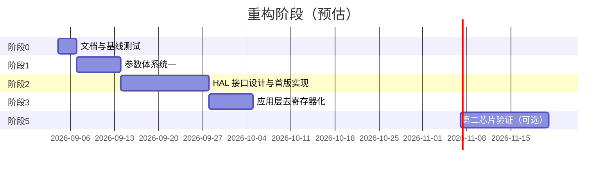

# FOC 框架重构计划

> 当前执行顺序以根目录 AI_CODE.md 为准；下方旧阶段编号/时间表仅保留历史记录。
> 2026-09-05：已完成配置/校准持久化边界，主机验证通过，完整固件与硬件验收待做。见 [实施记录](./架构实施记录_2026-09-05.md)。

> 版本：v1.0  
> 日期：2026-09-03  
> 目标：把当前项目从「VESC 瘦身 + STM32F4 直连」演进为**便于理解、可跨芯片移植**的电机控制框架。

---

## 1. 背景与目标

### 1.1 项目定位（见 `AI_CODE.md`）

- 每个功能模块单独 `.c` + `.h`，职责清晰。
- 代码可读、可调试，适合学习 FOC 控制链路。
- 算法层与芯片解耦，换 MCU 时主要改 BSP / HAL，不重写 FOC。

### 1.2 当前状态（2026-09 评估）

| 维度 | 评分 | 说明 |
|------|------|------|
| 便于理解 | 6/10 | 模块拆分、ISR 注释、Shell 调试较好；VESC 遗留与双参数体系增加认知负担 |
| 跨芯片移植 | 3/10 | 有 BSP 目录和 `hw_*.h` 意图，但应用层仍直连 TIM1 寄存器与 STM32 中断 |

### 1.3 重构后目标架构

```
┌─────────────────────────────────────────────────────────┐
│  App/  业务层（与芯片无关）                                │
│  motor_foc / motor_it / motor_protect / motor_if_start  │
│  motor_sensor / motor_param / cmd                       │
└──────────────────────────┬──────────────────────────────┘
                           │ 只调用 hal_motor.h / hal_board.h
┌──────────────────────────▼──────────────────────────────┐
│  Library/Hal/  硬件抽象接口（函数声明 + 类型）             │
└──────────────────────────┬──────────────────────────────┘
                           │ 各 port 实现
┌──────────────────────────▼──────────────────────────────┐
│  Library/Bsp/port/stm32f4/  板级 + 芯片实现               │
│  （从现有 Library/Bsp/ 迁移而来）                          │
└─────────────────────────────────────────────────────────┘
```

**原则：**

1. **算法不进 BSP** — Clarke/Park/SVPWM、保护、起步逻辑留在 `App/motor/`。
2. **应用不碰寄存器** — `motor_it.c`、`motor_ctrl.c` 禁止出现 `TIM1->CCR`。
3. **一套运行时参数** — `MOTOR_PARAM_S` 为唯一主配置，VESC 类型归档或薄封装。
4. **小步可验证** — 每个阶段完成后，开环/I-F/无感/保护行为与重构前一致。

---

## 2. 现状问题清单

| # | 问题 | 影响 | 涉及文件（示例） |
|---|------|------|------------------|
| P-01 | 双参数体系：`MOTOR_PARAM_S` vs `mc_configuration` | 新人不知改哪个结构体 | `motor_param.h`, `datatypes.h`, `mcconf_default.h` |
| P-02 | `datatypes.h` 1400+ 行 VESC 类型大量未用 | 阅读噪音 | `App/motor/inc/datatypes.h` |
| P-03 | 寄存器宏泄漏到应用层 | 换芯片必改 motor 代码 | `bsp_tim.h` → `motor_it.c`, `motor_ctrl.c` |
| P-04 | `includes.h` 万能头文件 | 所有 `.c` 隐式依赖 STM32 | `App/user/includes.h` |
| P-05 | VESC 死代码 / 混用风格 | 干扰主路径判断 | `hw.h`, `motor_task.c`, `foc_simulink0.h` |
| P-06 | BSP 无统一 HAL 边界 | 移植 = 重写 BSP + 应用胶水 | 整个 `Library/Bsp/` |
| P-07 | 板级配置宏堆砌 | 换板子可换头文件，换 MCU 不行 | `hw_hd75.h` |

---

## 3. 分阶段重构计划

整体分 **5 个阶段**，建议按顺序执行；每阶段独立可合并、可回滚。



---

### 阶段 0：基线与验收标准（预估 2~3 天）

**目的：** 重构前后行为可对比，避免「改完不知道有没有坏」。

**任务：**

| 任务 | 说明 |
|------|------|
| 0.1 记录当前控制参数默认值 | `MOTOR_ShowParam`、`showparam` 命令输出存档 |
| 0.2 定义最小回归用例 | 见下方「验收清单」 |
| 0.3 标注主路径 vs 非主路径 | 在 [代码阅读指南](./代码阅读指南.md) 写推荐阅读顺序 |
| 0.4 完成 VESC 类型审计 | 见 [datatypes审计](./datatypes审计.md) |
| 0.5 冻结第三方库 | `Library/`、`ThirtyLibrary/` 本阶段不改 |

**推荐阅读顺序（写入代码阅读指南）：**

```
Doc/doc/开环FOC学习笔记.md
  → App/motor/motor_foc.c        （Clarke/Park/SVPWM）
  → App/motor/motor_it.c         （ISR 控制链）
  → App/motor/motor_protect.c    （保护）
  → App/motor/start/motor_if_start.c   （I/F 起步）
  → App/cmd/cmd_openloop.c       （Shell 调试）

暂不看：datatypes.h、motor_task.c、foc_simulink0、VESC 归档区
```

**验收清单（每阶段结束后跑一遍）：**

- [ ] 上电偏移校准约 5 s 完成，无异常复位
- [ ] `olspeed 500` + `olstart` 能稳定开环转
- [ ] `olstop` 后 PWM 安全关闭
- [ ] `olstatus` 显示电流、母线电压、ISR 耗时合理
- [ ] 人为堵转触发过流/堵转保护，`olfault clear` 可恢复
- [ ] `encoder show` / `detect hall` 命令正常（若硬件已接）

---

### 阶段 1：参数体系统一（预估 1 周）

**目的：** 只保留一套运行时配置，降低理解成本。

**任务：**

| 任务 | 操作 | 文件 |
|------|------|------|
| 1.1 审计 VESC 类型引用 | `grep mc_configuration motor_all_state_t` 列出实际调用点 | 全 App |
| 1.2 归档未用 VESC 文件 | 移动到 `Doc/VESC/archive/`，不参与编译 | `datatypes.h` 等 |
| 1.3 保留必要枚举/故障码 | 把 `mc_fault_code` 等仍在用的定义抽到 `motor_common.h` | `motor_common.h` |
| 1.4 删除或 `#if 0` 死 API | `hw_init_gpio` 等无实现声明 | `hw.h` |
| 1.5 文档化 `MOTOR_PARAM_S` 字段 | 每个字段加 `@detail` 或分组注释 | `motor_param.h` |

**`MOTOR_PARAM_S` 分组建议（文档 + 注释）：**

```
├── 采样与换算      ia/ib/ic, v_bus, offset
├── 开环 V/F        ol_enable, ol_target_rpm, ol_vd/vq
├── I/F 起步        if_* 或通过 motor_if_start 子模块
├── 电流环 PI       ol_kp/ki, ol_vd_int/vq_int
├── 速度环          speed_loop_*
├── 无感观测        sensorless_*（或观测器模块内部）
└── 保护快照引用    由 motor_protect 写入，motor 只读
```

**完成标准：**

- [ ] `includes.h` 不再 `#include "datatypes.h"`（或仅保留精简版 `motor_types.h` < 200 行）
- [ ] 新人只需阅读 `motor_param.h` 即可理解运行时状态
- [ ] 编译通过，阶段 0 验收清单全部通过

**风险：** 旧 `foc_pll_run` 无调用者且已删除；其余 VESC 接口仍需按实际调用核对，不能仅按类型名批量迁移。

---

### 阶段 2：HAL 接口设计与 STM32F4 首版实现（预估 2 周）

**目的：** 在 BSP 与应用之间建立稳定边界。

#### 2.1 新增目录

```
Library/Hal/
├── inc/
│   ├── hal_motor.h      # PWM、ADC 采样、时间
│   ├── hal_sensor.h     # 霍尔、编码器（可选合并）
│   └── hal_board.h      # GPIO、UART、Flash 等板级
└── port/
    └── stm32f4/
        ├── hal_motor_stm32f4.c
        └── hal_board_stm32f4.c
```

现有 `Library/Bsp/` 逐步**委托**给 `port/stm32f4/`，不一次性删除，降低风险。

#### 2.2 `hal_motor.h` 接口草案

```c
/* 初始化：PWM + ADC-DMA 联动，但不启动输出 */
void Hal_Motor_Init(void);

/* 启动/停止三相 PWM（安全态：50% 占空或下桥关断，与现有 Bsp_Tim_StartPwm 行为一致） */
void Hal_Motor_PwmStart(void);
void Hal_Motor_PwmStop(void);

/* 设置三相比较值（0 ~ pwm_period_counts） */
void Hal_Motor_PwmSetDuty(uint32_t duty_a, uint32_t duty_b, uint32_t duty_c);

/* 触发 COM 事件（若芯片需要，STM32 保留；其他芯片可为空操作） */
void Hal_Motor_PwmCommit(void);

/* 读取原始 ADC 缓冲（或已换算的物理量，二选一，建议先 raw + 应用层换算） */
void Hal_Motor_AdcGetRaw(uint16_t *adc_buf, size_t len);

/* PWM 周期计数（= ARR），供 SVPWM 归一化 */
uint32_t Hal_Motor_PwmPeriodCounts(void);

/* 控制环触发频率 (Hz)，中心对齐 PWM 时为更新频率 × 2 */
float Hal_Motor_AdcSampleRateHz(void);

/* 微秒计时（ISR 耗时统计） */
uint32_t Hal_Motor_TimeUs(void);
```

#### 2.3 `hal_sensor.h` 接口草案

```c
void Hal_Encoder_Init(void);
uint16_t Hal_Encoder_GetCount(void);
void Hal_Encoder_SetCount(uint16_t count);

int Hal_Hall_Read(int samples);  /* 返回 0~7 */
```

#### 2.4 实现策略

| 步骤 | 说明 |
|------|------|
| 2.4.1 | 新建 `hal_motor_stm32f4.c`，内部调用现有 `Bsp_Tim_*`、`Bsp_Adc_*` |
| 2.4.2 | `TIMER_UPDATE_DUTY_M1` 宏**仅**留在 port 实现内 |
| 2.4.3 | `Motor_DmaInt` 仍由 `bsp_dma` / `stm32f4xx_it.c` 调用，暂不改动中断向量 |
| 2.4.4 | 单元测试：Shell 增加 `haltest pwm|adc|time` 调试命令（可选） |

**完成标准：**

- [x] `hal_motor.h` 编译通过，STM32F4 port 实现完整（含 ADC / 时基）
- [x] 现有 `Bsp_*` 对外仍可用（兼容层），但新代码只调 HAL
- [ ] 阶段 0 验收清单通过（待上板）

---

### 阶段 3：应用层去寄存器化（预估 1 周）

**目的：** `App/motor/` 不再出现 `TIM1`、`TIMER_UPDATE_DUTY_M1`。

**改动清单：**

| 文件 | 改动 |
|------|------|
| `motor_it.c` | `TIM1->ARR` → `Hal_Motor_PwmPeriodCounts()`；占空写入 → `Hal_Motor_PwmSetDuty` + `Hal_Motor_PwmCommit` |
| `motor_ctrl.c` | 同上 |
| `motor_encoder.c` | `Bsp_Tim4_*` → `Hal_Encoder_*`（或保留 Bsp 但经 hal_sensor 转发） |
| `motor_hall.c` | GPIO 读取经 `Hal_Hall_Read` |
| `bsp_tim.h` | `#ifdef HAL_INTERNAL` 保护寄存器宏（已完成） |

**`Motor_Foc_OutputVoltage` 目标形态（示意）：**

```c
static void Motor_Foc_OutputVoltage(...)
{
    uint32_t period = Hal_Motor_PwmPeriodCounts();
    svm_hqd(v_alpha, v_beta, v_bus, period, &da, &db, &dc, &sector);
    Hal_Motor_PwmSetDuty(da, db, dc);
    Hal_Motor_PwmCommit();
}
```

**完成标准：**

- [x] `grep -r "TIM1->" App/motor/` 无结果（或仅剩 `#if 0` 注释块）
- [x] `grep -r "TIMER_UPDATE_DUTY" App/` 无结果（仅注释残留）
- [ ] 阶段 0 验收清单通过（待上板）

---

### 阶段 4：includes 拆分与死代码清理（预估 1 周）

**目的：** 明确依赖边界，减小「看一眼 includes.h 就被 STM32 淹没」的问题。

#### 4.1 新头文件结构

```
App/user/
├── includes.h          # 保留，但变薄：只 include 下面两个
├── includes_app.h      # motor / cmd / param / sensor（无 STM32）
└── includes_platform.h  # HAL + FreeRTOS + BSP（仅 main / it / bsp 用）
```

**规则：**

| 目录 | 允许 include |
|------|--------------|
| `App/motor/*.c` | 显式模块头 + HAL / 标准库（**禁止**万能 `includes.h`） |
| `App/motor_param/*.c` | 同上；`flash_storage.c` 例外（仍需 STM32 Flash API） |
| `App/motor_sensor/*.c` | 显式模块头 + HAL / 标准库 |
| `App/cmd/*.c` | `includes.h` 或 `includes_app.h`（暂保留） |
| `App/user/main.c` | `includes.h`（平台 + 应用） |
| `App/user/stm32f4xx_it.c` | `includes.h` / `includes_platform.h` |
| `Library/Bsp/*.c` | 芯片头 + HAL port |

> 注意：`AI_CODE.md` 第 3 节已同步：算法/控制/参数/传感器 `.c` 允许显式模块头；cmd/main 仍可用万能入口。

#### 4.2 死代码处理

| 项 | 处理 |
|----|------|
| `foc_simulink0.h` | 移出 `includes.h`；若不用则从 Keil 工程移除 |
| `motor_task.c` ChibiOS 注释块 | 删除或移到 `Doc/VESC/archive/` |
| `motor_simple_foc/` | 保留为「学习分支」，文档注明未接入主 ISR |
| `hw.h` 未实现函数 | 删除声明或补 stub 返回 |

**完成标准：**

- [x] `App/motor/motor_foc.c` 编译不依赖 `stm32f4xx.h`（只含 `motor_foc.h` / `motor_math.h`）
- [x] `App/motor/*.c` 与 `motor_sensor`、`motor_param`（除 `flash_storage`）已脱离万能 `includes.h`
- [x] `includes.h` 拆为 platform / app；`foc_simulink0.h` 已移出总入口；Simulink 源已移出 Keil 编译
- [x] `AI_CODE.md` 已更新 include 规则（算法/控制/参数例外）
- [ ] `App/cmd/*.c` 进一步变薄（可选）
- [ ] 阶段 0 验收清单通过

---

### 阶段 5：第二芯片验证（可选，预估 2 周）

**目的：** 证明 HAL 边界有效，而不只是「理论上可移植」。

**推荐验证目标（按难度排序）：**

1. **同厂商不同系列**：STM32G4 / H7（仍可用 CMSIS，改 port 层）
2. **国产替代**：GD32F4（与 F4 高度相似，验证 port 复制成本）
3. **差异较大**：ESP32 / RP2040（仅验证 HAL 接口是否足够，不必完整 FOC）

**最小 port 需实现：**

- `Hal_Motor_*` 全套
- ADC-DMA 或等价采样链路
- 一个 UART（Shell）
- SysTick / 微秒计时

**完成标准：**

- [ ] 新 port 目录 `Library/Hal/port/<chip>/` 可独立编译
- [ ] 开环 `olstart` 在新芯片上跑通
- [ ] 编写 `Doc/doc/移植指南_<chip>.md`

---

## 4. 板级配置演进

### 4.1 当前：`hw_hd75.h` 宏定义

适合**同 MCU 换板**，不适合换芯片。

### 4.2 目标：`board_<name>.h` + 结构体

```c
/* board_bm75.h — 仅引脚与硬件常量，不含函数 */
typedef struct {
    float shunt_res;       /* Ω */
    float amp_gain;        /* V/A */
    uint8_t adc_ch_ia;     /* 逻辑通道，port 层映射到硬件 */
    /* ... */
} board_config_t;

extern const board_config_t g_board;
```

`Hal_Motor_Init()` 读取 `g_board` 完成 ADC 增益、通道映射。换板 = 换 `board_*.h` + 链接对应 `g_board`。

---

## 5. 模块边界（重构后保持不变）

与 `AI_CODE.md` 一致，重构**不改变**以下分工：

| 模块 | 文件 | 重构时禁止 |
|------|------|------------|
| FOC 变换 | `motor_foc.c` | 不要塞进 PID 或保护 |
| 保护 | `motor_protect.c` | 不要在 ISR 里阻塞 |
| 起步 | `motor_if_start.c` 等 | 不要与保护混写 |
| 传感器 | `motor_hall.c`, `motor_encoder.c` | 不要合并为一个文件 |
| 命令 | `App/cmd/` | 不要直接写寄存器 |

---

## 6. 风险与回退

| 风险 | 缓解 |
|------|------|
| 重构引入控制回归 | 每阶段跑阶段 0 验收清单；Git 每阶段一 tag |
| HAL 抽象不足 | 先 STM32 薄封装，第二芯片验证后再改接口 |
| includes 拆分编译失败 | 先新增 `includes_app.h`，旧 `includes.h` 保留转发 |
| 与 VESC 上游合并困难 | 已决定 VESC 代码归档，不再追踪上游 |

**Git 建议：**

```
refactor/phase-1-param
refactor/phase-2-hal
refactor/phase-3-app-decouple
...
每阶段合并前打 tag：refactor-phase-N-baseline
```

---

## 7. 不在本次重构范围

以下明确**不做**，避免 scope 膨胀：

- 电机参数 R/L/磁链自动检测（`AI_CODE.md` 已暂停）
- 重写 FreeRTOS / letter-shell / FlashDB
- 替换 Keil 为 CMake / GCC（可另开任务）
- 完整 VESC 功能（CAN、BMS、平衡车等）
- 修改 `ThirtyLibrary/` 源码

---

## 8. 里程碑总览

| 阶段 | 交付物 | 理解性 | 可移植性 |
|------|--------|--------|----------|
| 0 | 代码阅读指南 + 验收清单 | +0.5 | — |
| 1 | 单一参数体系、`motor_types.h` | +2 | +0.5 |
| 2 | `hal_motor.h` + STM32F4 port | +0.5 | +2 |
| 3 | App 无寄存器依赖 | +0.5 | +2 |
| 4 | includes 拆分、死代码清理 | +1 | +1 |
| 5 | 第二芯片 port + 移植文档 | — | +2 |

**预期重构完成后：**

- 便于理解：**8~9 / 10**
- 跨芯片移植：**7~8 / 10**（取决于第二芯片验证深度）

---

## 9. 下一步行动

| 阶段 | 状态 |
|------|------|
| 0 文档/验收清单 | 文档已齐，**待上板**跑清单 |
| 1 参数统一 | 已完成（`MOTOR_PARAM_S` + `motor_types`，VESC 类型归档） |
| 2 HAL 接口 | 已完成首版；已补 ADC/时基 API |
| 3 App 去寄存器 | 主路径完成；`TIMER_UPDATE_*` 已 `HAL_INTERNAL` 保护 |
| 4 includes 拆分 | **主路径完成**：`App/motor` / `motor_sensor` / `motor_param`(除 flash) 已脱离万能 `includes.h`；cmd/main/BSP 仍用总入口 |
| 5 第二芯片 | 未开始 |

建议下一步：

1. **上板**验收：偏移校准、`olstart`/`olstop`、霍尔标定；`plot create speed|sine` 看 VOFA 曲线。
2. （可选）继续阶段 4：`App/cmd/*` 显式 include；或开始阶段 5 第二芯片 port。

如需提交：`refactor: 控制与参数模块脱离万能 includes.h`。

---

## 附录 A：关键文件索引

| 类别 | 路径 |
|------|------|
| 控制主链路 | `App/motor/motor_it.c` |
| FOC 数学 | `App/motor/motor_foc.c` |
| 运行时参数 | `App/motor_param/inc/motor_param.h` |
| 板级宏 | `App/motor/inc/hw_hd75.h` |
| BSP 定时器 | `Library/Bsp/bsp_tim.c`, `bsp_tim.h` |
| 入口 | `App/user/main.c` |
| 编码约束 | `AI_CODE.md` |
| 学习笔记 | `Doc/doc/开环FOC学习笔记.md` |

## 附录 B：HAL 与现有 BSP 映射

| HAL 函数 | 现有实现 |
|----------|----------|
| `Hal_Motor_Init` | `Bsp_Init` 中 TIM/ADC/DMA 相关部分 |
| `Hal_Motor_PwmStart` | `Bsp_Tim_StartPwm(MOTOR1)` |
| `Hal_Motor_PwmSetDuty` | `TIMER_UPDATE_DUTY_M1` |
| `Hal_Motor_PwmCommit` | `TIM_GenerateEvent(TIM1, TIM_EventSource_COM)` |
| `Hal_Motor_PwmPeriodCounts` | `TIM1->ARR` |
| `Hal_Motor_AdcSampleRateHz` | `motor_it.c` 中 `Motor_DmaInt_GetAdcFrequencyHz` 逻辑 |
| `Hal_Motor_TimeUs` | `Bsp_Tim_DtNow` / TIM5 |
| `Hal_Motor_CurrentScale` | `FAC_CURRENT` |
| `Hal_Motor_PhaseVoltageGain` | `PHASE_VOLTAGE_DIVIDER_GAIN * ADC_VOLTS_PH_FACTOR` |
| `Hal_Motor_HasThreeShunts` | `HW_HAS_3_SHUNTS` |
| `Hal_Encoder_*` | MT6701 I2C2（PB10/PB11）角度快照；协议在 `motor_mt6701.c` |

---

## 附录 C：BLDC 六步独立后端（2026-09-11）

- 状态：已完成纯控制代码、主 ADC 中断仲裁、Shell 命令和主机测试；BM75 已完成约 24 V 空载正反转与 5%/8% 占空比上板验证。
- 控制层：`motor_bldc_six_step.c` 提供霍尔/直接换相，`motor_bldc_sensorless.c` 提供定向、开环斜坡、BEMF 过零、30° 延迟接管及超时退出；均为实例状态，显式接收输入与 `dt`，不访问 HAL/RTOS/全局电机。
- 集成层：`motor_bldc_six_step_hal.c` 只把控制结果交给 HAL，不包含板级相序或寄存器操作。
- 硬件层：`hal_motor_bldc.h` 定义 `PWM/LOW/FLOAT` 契约；STM32F4 实现位于 `Library/Hal/port/stm32f4/`，BLDC 按 BM75 原理图 INHA/B/C ↔ TIM1 CH1/2/3 直接映射。
- 主路径：`motor_it.c` 在 BLDC 被选择时每个 ADC 周期执行采样、公共保护和无感 Step；`bldc stop` 保持出口选择权，`bldc exit` 才交回 FOC，避免停机后三相悬空被 FOC 中点输出覆盖。
- 应用入口：Shell 新增 `bldc start <duty> [cw|ccw]`、`stop`、`exit` 和 `status`；BLDC 已选择时 FOC 使能命令返回 `MOTOR_ERR_BUSY`。
- 验证：Keil `Foc` 全量构建为 0 error / 0 warning；`test_motor_api`、`test_motor_bldc_six_step` 和
  `test_motor_bldc_sensorless` 已实际执行通过，覆盖正反转、非法霍尔、换相超时、开环到闭环接管、
  30° 延迟、过零丢失和 FOC/BLDC 互斥。整套 `Tests/host/run.ps1` 的既有 `test_motor_control` 链接替身问题仍与本项分开记录。
- 限制：空载正反转和实际过零方向已验证；尚未验证带载、堵转、硬件 Break、最坏 ISR 耗时及更高占空比，因此不得标记完整硬件验收完成。
- 下一步：按 `Examples/06_bldc_sensorless.md`，先用低母线电压和限流电源核对六种桥臂状态，再逐步验证开环启动与 BEMF 波形。
- 2026-09-12 上板诊断：24 V、5% 占空比时开环可带动电机，但未接管。翻转板级过零极性后累计过零由 3 增至 212；逐 step 数据为 `23,0,88,14,1,86`，而各 step 均成功进入起始侧约 91～95 次。step 2/5（A 相）稳定、1/4（B 相）失败、0/3（C 相）不稳定，符合 BLDC 相电压 B/C 顺序错误；下一版仅在 BLDC 集成入口恢复 SENS1/2/3 的 ABC 顺序，保持其余参数不变继续验证。
- 继续核查发现 `HW_HAS_3_SHUNTS` 条件下主 PWM 为 TIM1 CH1/2/3 直出，而首版 BLDC HAL 又按旧 ACB 说明对调 CH2/CH3。仅交换采样后逐 step 变为 `0,0,88,0,0,86`，验证输出与采样仍不匹配；因此 BLDC HAL 改为 INHA/B/C ↔ CH1/2/3，BLDC 采样使用 SENS1/2/3 原理图 ABC 顺序，等待下一轮上板确认。
- 统一 ABC 后逐 step 为 `87,2,87,68,3,86`，仅悬空 B 相的 step 1/4 固定失败，而两步 `armed` 均约 95，说明已进入起始侧但边沿方向相反。核心新增按相 BEMF 极性掩码，BM75 仅反转 B 相，等待下一轮上板确认；未直接降低连续 6 次接管门槛。
- B 相反相复测为 `87,0,87,15,1,85`，且 step 1/4 的 `armed` 从约 95 降至 4/5，证明 B 相原极性正确，已撤销 BM75 的反相配置。下一版增加每个 step 的 BEMF 最小/最大值，先判断 SENS2 是否存在幅值不足或偏置，再决定阈值或硬件处理。
- 用户补充实际现象为“快速起步后跟不上、快速震动并停止”。结合原 50 ms→3 ms、1.5 s 的周期线性斜坡，后段换相频率加速度过大，更符合开环失步。BM75 默认改为 80 ms→8 ms、3 s 平滑插值、5 s 超时；连续 6 次过零接管条件不降低，B 相反相保持撤销，等待同一 24 V/5% 工况复测。
- 2026-09-12 慢斜坡上板结果：24.11 V、5% 占空比、CW、空载条件下成功进入并保持 `CLOSED_LOOP`，`fault=NONE`、`motor_fault=0`、连续/累计过零均为 101；六步过零计数为 `16,17,17,17,17,17`，armed 为每步 17，证明该工况下 ABC 输出/采样映射、过零极性、开环接管和 30° 延迟闭环链路已打通。此结果只覆盖低占空比空载正转，CCW、负载、启停重复性、堵转保护、硬件 Break 和 ISR 最坏耗时仍待验证。
- 同工况 CCW 首测未接管：六步均有过零但最大连续数仅 2。代码核查发现 CCW 输出已经交换 PWM/LOW 且反向遍历 step，期望 BEMF 边沿相对 step 与 CW 相同，检测函数再次按 CCW 翻转属于重复反向；已移除该额外翻转并增加 CCW 开环到闭环主机测试，等待复测。
- CCW 修正后复测通过：24.12 V、5% 占空比、空载时保持 `CLOSED_LOOP`，`fault=NONE`、`motor_fault=0`、连续/累计过零均为 113；六步计数 `18,19,19,19,19,19`，armed 每步均为 19。至此同一低压空载工况的 CW/CCW 启动、无感接管、停止和退出已验证；重复启停、阶跃占空比、带载、堵转、硬件 Break 与 ISR 最坏耗时仍待测试。
- CW 8% 占空比复测通过：24.08 V、空载时保持 `CLOSED_LOOP`，连续/累计过零 142，六步计数 `23,24,24,24,24,23`，无控制或公共保护故障；停止和退出正常。当前最高已验证占空比为 8%，不外推到 25% 上限。
- 用户反馈 5% 与 8% 闭环均仍有明显抖动。原闭环直接使用单次 `2*t_zc` 作为下一换相周期，过零噪声会逐拍改变换相间隔；已增加换相周期一阶滤波（默认 0.25）和单次 ±25% 变化限幅，并在状态中输出 `period`。该修改仅完成主机/编译验证前不宣称改善已上板确认。
- 周期滤波版 5% 复测仍抖，状态显示滤波周期达 84.938 ms。根因是原接管条件只有连续 6 次过零，斜坡初段即在极低速切入闭环，后续不再加速。新增 `takeover_max_period_s=20 ms`：连续过零和速度条件同时满足才接管，在此之前继续开环斜坡；周期滤波只在接管时初始化并用于后续闭环。
- 5%～12% 复测显示六步过零数始终均衡，但机械抖动随速度升高而加剧。代码复核发现使用 `2 *（换相到本次过零时间）` 预测下一换相时刻，会让换相相位误差逐拍反向传播。闭环现改为测量相邻过零点的 60° 周期，并在本次过零后延时该周期的 50% 换相；核心主机测试及 Keil 全量构建通过，改善效果等待上板复测。
- 相邻过零周期版 8% 复测仍有剧烈震动。为先区分功率六步输出与 BEMF 闭环问题，新增 `bldc open <duty> <sector_ms> [cw|ccw]` 固定周期开环诊断；该模式完成定向后不读取 BEMF、不自动接管，状态显示 `OPEN_FIXED`。
- 固定开环 8%/12 ms 起步后稳定，而 8%/8 ms 已无法稳定跟随，证明功率六步路径可用且存在当前电压下的速度边界。主仓库记录的 VESC 参考子仓库已检出到 `ThirtyLibrary/bldc` 的锁定提交 `c0094f58`。对照其 `mcpwm.c` 确认了 PWM 窗口选样和 BEMF 积分的抗干扰思路；本工程采用独立实现，只让 TIM1 向上计数侧样本进入状态机，并在确认反向区后累加正向 BEMF 伏秒面积。主机测试已通过，积分阈值待上板校准。
- 固定开环 8%/12ms 实测除起步外运行平稳，而 8%/8ms 已不能稳定跟随；自动闭环此前却被过零信号拉到约 6.4ms，确认存在伪过零导致的失控加速。BM75 暂将闭环最短 60° 周期限制为 12ms，并已加入 PWM 同步单侧采样和 BEMF 伏秒积分换相；软件测试已通过，抖动改善与阈值仍待上板复测。
- 后续时序复核发现 TIM2 固定 CCR2=250 等效于 TIM1 更新后 500 计数采样，而 5% PWM 导通脉冲仅约 280 计数，原 BEMF 样本实际位于关断续流区。现参照 VESC 的时序原则独立实现占空比跟随采样：BLDC 运行时将相电压触发移到 PWM 导通脉冲中点，停机恢复 FOC 的固定采样点。该时序修正待上板验证。
- 5% 下将积分阈值从 0.4 mV*s 调至 0.1 mV*s 后，状态出现换相周期由约 58 ms 突然压到 12 ms，随后当前扇区等待超过 28 ms 且积分为零，符合转子跟不上旋转磁场。积分换相现复用周期变化限制：BM75 每步最多缩短 10%，滤波周期按实际换相间隔平滑更新；新增主机测试覆盖“积分提前命中但不得提前换相”，上板效果待复测。
- 8% 过零延迟模式实测六步计数完全均衡，但在约 68ms 即接管并长期运行于约 60ms/扇区，机械仍明显抖动；固定开环 12ms 已证明更高速度区可平稳运行。BM75 接管周期上限由诊断阶段的 100ms 收紧为 20ms，使开环继续加速后再进入无感闭环，不改 ADC/PWM 外设基线。
- 接管上限 20ms、过零延迟 25% 复测出现严格的长短步交替：`47.333,4.400,47.600,4.267,46.533,4.467ms`。逐步 BEMF 显示部分正确方向半波终值仅约 0.21～0.25V，而原过零迟滞为 0.20V，触发点实际落在扇区末端并跨扇区传播。BM75 BLDC 专用过零迟滞降为 0.05V，延迟测试恢复标准 50%；不修改 VESC 派生 ADC/PWM 配置。
- 0.05V 迟滞、50% 延迟复测将异常集中到 step1/4：两步约 53ms，其余四步约 7.2～7.7ms。step1/4 均为 B 相悬空，约 53ms 又接近正常周期的六倍，表明 B 相在等下一整圈的反向边沿；输出 CH2 与采样 SENS2 映射核对一致，因此重新启用 B 相 BEMF 极性反转。此前高阈值下反相失败的结论不再沿用。
- B 相反转在 0.05V 迟滞下复测仍失败：最大连续过零仅 18，未能接管并最终 `STARTUP_TIMEOUT`，因此撤销 B 相反转。上一轮 step1/4 长周期改按“闭环相位偏晚、错过当前扇区过零后等待下一圈”继续验证，下一步使用零延迟判断能否打断该循环。
- 零延迟复测仍严格奇偶交替：偶数步约 40～41ms，奇数步约 1～2ms。逐步波形同时显示偶数步强负半波约 -0.745V、正半波仅 0.06～0.09V，奇数步强正半波约 1.07～1.23V，证明当前“偶数上升/奇数下降”的全局期望方向完全相反。BM75 撤销 `step0_rising=true`，恢复偶数下降、奇数上升；下一轮使用标准 50% 过零延迟验证。

---

## 附录 D：MT6701 I2C 适配（2026-09-28）

- `motor_mt6701.c/.h` 独立实现 MT6701 地址与寄存器协议，按手册顺序读取 `0x03`、`0x04`，发布 14 位绝对机械角度。
- BM75 使用外设口 I2C2：PB10=SCL、PB11=SDA，400 kHz；I2C 事务在独立 1 kHz 后台任务执行，不进入 ADC/FOC ISR。
- FOC 快环读取最近一次完整快照，并用机械转速做最多 2 ms 的短时角度外推；连续 3 次 I2C 失败后反馈失效并回退开环角。
- `encoder show` 增加 I2C 成功、错误和连续错误计数。零点仍通过 `encoder detect` 建立，不向 MT6701 EEPROM 写零点。
- 验证：完整主机测试通过；Keil `Foc` 全量构建 0 error / 0 warning。尚未完成 MT6701 实物通信、方向、零点及带电机闭环验证。
- 2026-09-29：新增 SSI 后端并设为默认。接线为 BM75 `5V/RX_SDA_NSS/SCK_ADC_EXT/MISO_ADC_EXT2/GND`
  对 MT6701 `VCC/CSN/CLK/DO/GND`；SPI1 mode 1、5.25 MHz、24 位帧，校验 6 位 CRC 和磁场/超速状态，
  后台采集 10 kHz。SSI 会占用 PA5/PA6，使 ADC_EXT1/ADC_EXT2 不再可用；三相电流、相电压和母线采样配置不变。
  I2C 后端继续保留，可通过 `MOTOR_MT6701_INTERFACE` 切回。硬件效果仍待上板验证。

## 2026-10-09：3508 无感观测短测

24 V、7 极对、Iq=1 A，完成 300→600 RPM 实机观测，未授权角度接管。300 RPM 观测约 294～304，600 RPM 约 604～607；600 RPM 相位条件不能持续通过，锁定计时复位，因此无感闭环仍待验证。全程无故障，最终已停机。Keil 完整重编译 0 错误/0 警告，主机测试通过；外设基线未修改。记录与限制见 [3508 无感观测短测](../verify/3508无感观测_2026-10-09.md)，下一步核验模型参数与相位误差来源。

同日继续：R/L 两次检测 R=0.466/0.556 Ω、L=114/112 µH，滑行 BEMF 磁链 2.345 mWb。临时检测模型与磁链归一化增益对比改善观测转速采样波动，但未获得连续 0.10 s 相位锁定；均未接管、无故障。已停机并恢复原模型与观测增益，检测及对比配置未保存 Flash。详情与日志见同一验证记录。下一步需同拍观测角/启动角诊断，区分真实负载角与观测误差。

同日追加开环无感复测：原3508模型和增益、24 V、1 A，300→600→800 RPM，每档10次短采样。稳态观测约297～303、596～607、793～809 RPM，均无故障；600/800相位条件仍反复失败，采到lock最多8/4 ms，未验证闭环。结束Enable OFF、目标0，接管和速度环关闭。日志 sensorless_3508_20261009_182654.log；未修改控制或外设配置。

2026-10-09 同拍诊断与撤销接管修复：motor_sensorless诊断增加参考/原始/PLL角与同拍相位，olrpm捕获后打印；低速撤销退出CLOSED并保留观测积分，高速撤销请求MOTOR_SPEED_LOSS。主机测试全通过，Keil完整重编译0错误0警告，烧录后3508原模型1A/24V复测300→600→800RPM，24次同拍一致性检查通过，无故障，最终已停机目标0。相位条件仍不连续通过，800RPM一拍磁链低于门槛；未进入CLOSED，实机撤销接管仍待验收。日志sensorless_3508_20261009_183420.log及3508无感观测记录。未改模型、观测公式、相位阈值、外设配置。

同日0.5A试验失败：用户现场确认未转，观测接近0。旧脚本漏未起转中止仍升档，日志随后出现控制器uptime归零，原因未明；已再次明确停机、目标0、Fault NONE。脚本补未跟随连续两拍和目标配置改变中止，离线替身验证不会升下一档且执行停机清理。未重新启动；记录见3508验证文档。

2026-10-09恢复1A仅300RPM复核：用户确认已实际转起来且基本平稳；稳态观测296.5～305.6RPM，12次同拍一致性通过，全程无故障。S=0符合300低于500RPM接管门槛。已停机目标0，不升档不接管。日志sensorless_3508_20261009_190825.log；下一步1A起转后受控减流，区分起步与运行需求。

同日提交前审核：检测命令严格解析有限数值，核心入口拒绝 NaN/Inf；检测占用期间拒绝 FOC/BLDC 启动及配置修改，公共停机接口请求中止。完整检测在 R/L 与磁链之间保持占用，失败调用不解除其他检测的占用；结果读取使用短临界区。主机回归与 Keil 完整构建通过，脚本未起转/复位中止的离线测试纳入 `Tests/host/test_sensorless_observe.py`。本轮审核未启动电机，新增检测互斥仍待实机验收；3508 模型与无感接管继续标为实验阶段，未修改 ADC/PWM/定时器/DMA 基线。
