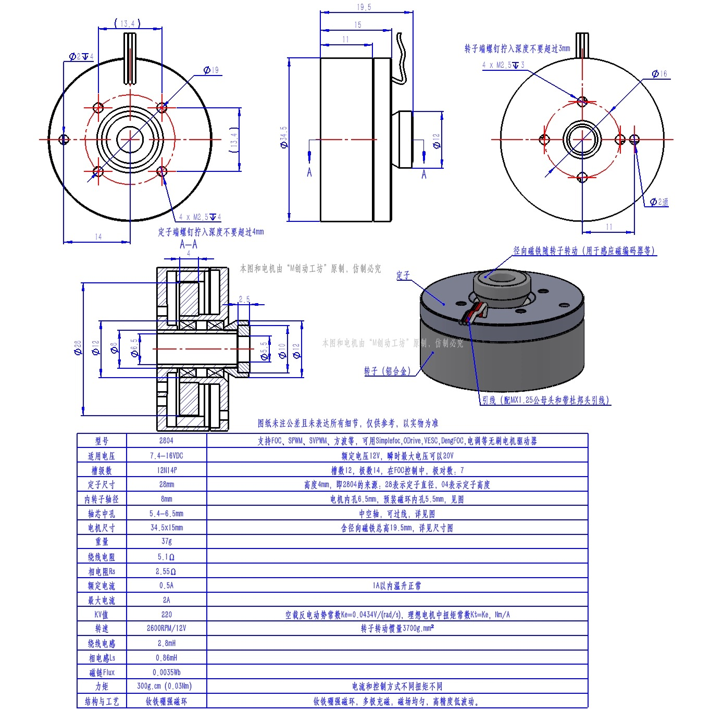

# 2804-220KV 电机适配与首次调试

电机型号：`2804-220KV`。



参数来源：用户于 2026-10-04 提供的 [2804 电机工程图](2804电机工程图.jpg)。图纸参数已录入
`App/motor_param/inc/motor_2804_220kv.h`。当前已在 BM75、16 V、MT6701 SSI、空轴条件下完成
编码器、电流环、速度环、位置环和关节超时保护的基础验证；带轮、竖直放置和实际负载尚未验收。

## 已知参数

| 项目 | 图纸值 | 软件采用值 |
| --- | ---: | ---: |
| 槽极 | 12N14P | 7 极对 |
| 工作电压 | 7.4～16 VDC | 已在 16 V 限流电源上测试 |
| 瞬时最大电压 | 20 V | 不作为首次测试电压 |
| KV | 220 RPM/V | 220 RPM/V |
| 额定转速 | 2600 RPM @ 12 V | 最大目标 2600 RPM |
| 额定/最大电流 | 0.5 A / 2 A | 首次 Iq、对齐电流 0.30 A |
| 绕线/相电阻 | 5.1 Ω / Rs=2.55 Ω | 观测器使用 Rs=2.55 Ω |
| 绕线/相电感 | 2.8 mH / Ls=0.86 mH | 观测器使用 Ls=0.86 mH |
| 磁链 | 0.0035 Wb | 0.0035 Wb |
| 力矩常数 | 0.0434 N·m/A | 0.0434 N·m/A |
| 额定力矩 | 300 g·cm | 约 0.03 N·m |

不要把图纸的“绕线电阻 5.1 Ω”与“相电阻 Rs 2.55 Ω”混用；当前观测器按图纸明确标出的
相参数 Rs/Ls 配置。到货后应实测任意两相的直流电阻并记录温度，确认图纸口径。

## 选择型号

当前源码仍默认 C2208，电机到货前不会改变现有固件。准备测试 2804 时，在 Keil 预处理宏中设置：

```text
MOTOR_SELECTED_MODEL=MOTOR_MODEL_2804_220KV
```

或将 `motor_nameplate.h` 的默认选择改为该型号，两种方式只选一种。编译后先通过状态输出确认
极对数为 7、最大转速为 2600 RPM。

## 首次上板顺序

1. 电机空载并固定，电源从低压、限流开始；不要直接使用 20 V。
2. 测量三组线间电阻，三组应接近；明显不一致时停止上电。
3. 检查 BM75 停机电流零点。换电机不必然要求重做偏移，但换板、零漂或 Flash 无效时必须重测。
4. 检查编码器机械角是否连续。编码器安装、方向和电角零点不得沿用另一台电机的标定结果。
5. 使用 `0.30 A` 做静态 D 轴和编码器标定。禁止用 `0.10～0.20 A` 判断电流精度，该范围在 BM75
   上只有约 1～2.5 个 ADC 计数。
6. 依次验证电流环、低速速度环、位置环和关节超时；任何抖动、反转、过流或失步立即停机。
7. 空载通过后再逐步提高转速；2 A 是图纸最大电流，不是首次测试电流。

## 位置环震动问题与本型号参数

### 已观察到的现象

- 小角度命令有时顺滑，但较大角度运动、到位保持或带轮竖直放置时会明显震动。
- 拆轮后震动仍可能出现，说明轮子动平衡和重力不是唯一根因；轮子的偏心、惯量及竖直方向重力矩会把问题放大。
- 早期测试中，位置状态可能显示已经接近目标，但到位时仍来回修正。只看最终位置误差不能证明机械上无抖动。

### 主要原因

0. 2026-10-05 实测确认，剧烈周期抖动的首要原因是沿用了旧电机/旧零点的齿槽补偿表：旧表范围
   `-0.218～+0.197 V`，大于 5～10 RPM 所需的平均驱动电压。关闭旧表后冲速消失；为当前 2804
   重新正反向标定 672 个样本后，新表范围为 `-0.040～+0.039 V`。以后执行 `encoder detect`
   成功后固件会自动清除旧表，必须重新运行 `encoder cog learn 2`。
   齿槽表从 Flash 恢复后，`encoder cog status` 的 `samples/progress` 运行计数会显示为 0；只要
   `calibrated=1` 且电压范围有效，这不代表表已丢失或损坏。
1. 旧位置环参数对 2804 的小惯量和齿槽转矩过于激进：速度 PI 曾使用 `Kp=0.05`、`Ki=0.20`，
   且直接电压后端允许输出到 `±2 V`。位置误差稍有变化就会产生过大的正反向电压，形成反复越过目标的极限环。
2. 低速直接电压控制缺少电流/转矩的精细反馈和足够阻尼。编码器量化、速度估算波动、静摩擦及齿槽转矩会使
   控制器在目标附近不断换向；积分过强还会造成到位后的累积和反冲。
3. BM75 的低电流分辨率有限，约为 `0.0806 A/ADC count`。保持位置常用的 `0.10～0.20 A` 只有约
   1～2.5 个 ADC 计数，不能依靠这一电流区间获得平滑且精确的转矩反馈，也不能据此判断电流 PI 精度。
4. 曾存在控制权冲突：位置环关闭时，后台位置任务仍会把普通速度目标覆盖为 0，导致速度测试的目标与实际启动目标
   不一致。该问题已修复，位置环未启用时不再改写速度命令。
5. 带轮竖直放置后，偏心重力矩随角度周期变化；若轮子不平衡，还会叠加周期扰动。它们会放大已有的低速极限环，
   但“安装轮子”本身不应成为不能定位的理由。基础控制稳定后，应通过负载前馈、速度阻尼及限幅逐步适配负载。
  
### 当前保守配置

2804 profile 当前采用以下位置控制初值：

| 参数 | 当前值 | 目的 |
| --- | ---: | --- |
| 位置外环 Kp | 1.0 RPM/deg | 避免重启后回到通用的 3.333 激进默认值 |
| 位置环最大速度 | 2 RPM | 限制首次空轴运动速度 |
| 速度 PI Kp | 0.020 | 降低目标附近的正反向冲击 |
| 速度 PI Ki | 0.02 | 减少积分累积和反冲 |
| 直接电压上限 | 0.35 V | 限制低速定位转矩突变 |
| 加速度上限 | 30 RPM/s | 避免阶跃速度命令激发机械振动 |

这些参数是安全、保守的基础测试参数，不是带负载性能参数。不得仅为提高速度就同时大幅提高 PI、输出电压和加速度；
应一次只调整一个量，并在每级确认无持续振荡、无故障、无明显发热。

### 当前验证结论

- 静态 D 轴电流测试可闭环，`0.50 A / 5 s` 时平均 Id 约 `0.481 A`，无故障；`0.30 A` 测试靠近
  BM75 低计数区，只能证明方向和基本闭环，不能宣称低电流测量精确。
- 编码器速度环已验证 `±150、±300、+600 RPM` 及回零，方向和跟随正常，无故障。
  2026-10-05 在 16 V 空载下又看了 `150` 与 `1800 RPM`，前馈取 `0.00308 V/RPM` 后分别落到约 150 与 1807 RPM。
- 位置一键小行程序列 `0° → 2° → 5° → -2° → 0°` 已在空轴下通过，并在结束后自动停机。
- 关节命令超时保护已触发并把电流命令清零，随后可正常退出。
- 上述结果只代表空轴基础链路。实际是否“顺滑”仍需结合目视、声音和温升判断；带轮、竖直重力负载和长期保持
  仍需单独测试，不能用串口最终误差代替机械验收。

### ODrive式轨迹与BM75采样适配

关节位置命令不再直接把大角度阶跃交给阻抗环。2804启用独立的一维制动轨迹，当前限制为最大`60 deg/s`
（10 RPM）、加速度`120 deg/s²`、减速度`180 deg/s²`；轨迹根据剩余距离提前减速，并给控制器连续的位置和
速度参考。实时通信、直接Iq测试和物理扭矩后端保持原语义，不被本地轨迹层隐式改写。

这里仅借鉴ODrive的轨迹规划和位置—速度—转矩级联思想，不照搬其低转矩电流控制假设：

- BM75约为`0.0806 A/ADC count`，`0.25 A`也只有约3.1个计数，轻载时允许全程使用Vq后端。
- 测试不再为了证明覆盖率而强迫进入Iq；若实际需求进入Iq区，则到位前必须退出到Vq并连续稳定。
- `joint hybridtest`要求误差连续1秒保持在`±0.75°`，成功、超时或中止后均自动停机。
- 后续Iq/Vq切换应加入输出连续跟踪和平滑混合；完成实机验证前，不能把“轨迹已接入”写成“带负载已稳定”。

## 速度电压前馈

`MOTOR_ENCODER_SPEED_FF_V_PER_RPM` 是编码器速度环的空载反电势前馈，单位 V/RPM。2804 当前值是 `0.00308`。

速度环不直接用电流精调。目标转速先换成一档基础 Vq，速度 PI 的输出仍按电流计算，再乘 `MOTOR_ENCODER_SPEED_VOLT_PER_AMP`（2.55 V/A，约等于相电阻）叠到这档电压上：

```text
Vq = 前馈 × 目标转速 + 速度PI电流 × 2.55
```

正转、反转只差一个符号。齿槽表的电压加在 PI 修正上，不改变前馈斜率。

PI 电流被限制在 `±0.20 A`，所以电压修正最多约 `±0.51 V`。前馈若偏离空载所需电压超过这 0.51 V，转速就会停在错误的平衡点上，加大 Kp、Ki 也拉不回来。

不能把铭牌 KV 直接倒过来当这个斜率。220 RPM/V 说的是空载转速相对母线电压。这里的 Vq 是相电压，还要受 `Vbus/√3` 和程序里的 9 V 上限约束。`1/220 = 0.004545 V/RPM` 在 1800 RPM 会给出 8.18 V，16 V 母线上实测转速冲到约 2460 RPM。`1/(220×√3) = 0.00262 V/RPM` 是把母线电压换成线性区相电压的估算，这次空轴上偏小，没有采用。

空载时转速近似正比于 Vq，而 Vq 又近似正比于前馈。固定一条命令转速，读稳定后的实测转速，下一次前馈按比例缩放：

```text
新前馈 = 当前前馈 × 命令转速 / 实测转速
```

转速高于命令就把前馈减小，低于命令就增大。一次只改这一项，PI、电流上限和母线电压保持不动。PI 已经顶在 `±0.20 A` 时，这个比例就是还能用的修正办法。

16 V 空轴、命令 1800 RPM 时：

```text
0.00308 = 0.00332 × 1800 / 1940
```

随后用实测比例往下收：

| 前馈 V/RPM | 1800 RPM 的前馈电压 | 16 V 空载实测转速 |
| ---: | ---: | ---: |
| 0.004545 | 8.18 V | 约 2460 RPM |
| 0.00332 | 6.0 V | 约 1940 RPM |
| 0.00308 | 5.54 V | 约 1807 RPM |

`0.00308` 来自 `0.00332 × 1800 / 1940`。最后一次 `olsnap` 里母线 15.9 V，Vq 约 5.04 V，速度环电流 -0.188 A，已经靠近 -0.20 A 的下限。空载还高大约 7 RPM，这是当前电流上限里剩下的偏差，不再靠加大 PI 消除。

150 RPM 的前馈只有约 0.46 V，修正量远小于 0.51 V，所以低速本来就能贴住目标。换母线电压或带上负载后，这档斜率要重新看，不能沿用这次 16 V 空轴的数。

## 待继续确认

- Rs/Ls 的图纸口径与实测值。
- 带轮后的偏心、动平衡、惯量和竖直方向重力扰动。
- 带负载位置环的速度、阻尼、保持误差、发热和长期稳定性。
- 低速电流/转矩的更高分辨率方案；不得通过修改 VESC 派生的 ADC/PWM/定时器基线来掩盖硬件采样盲区。
- 现有 2 RPM、0.35 V 参数仅用于空轴基础验收，性能提升必须逐级测试。
