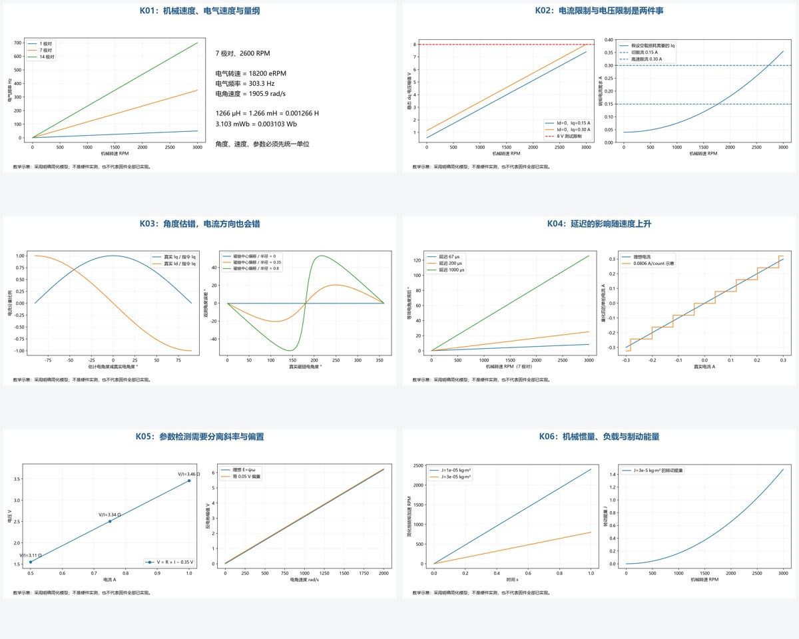

# 从能转到理解电机控制

这份补充沿着“能量怎么进去 → 如何测量 → 如何控制 → 为什么出错”展开。先读本文，再按链接回看原有图解。示例使用7极对2804；公式采用常见幅值不变Clarke/Park约定，实际板级极性仍需整体核对源码，不能单独移植符号。



## 1. 先建立单位与尺度感


机械角是轴转了多少，电角是转子磁场相对绕组经历了多少周期。p为极对数：θe=pθm+零点，ωe=pωm，eRPM=p×RPM，ωm=RPM×2π/60。极对数不是磁极数，14磁极对应7极对。

2600 RPM、7极对对应303.3 Hz电气频率。15 kHz控制约每电气周期49.5拍；“转速只有2600”不代表电气变化慢。控制频率、PWM频率、ADC触发频率和串口输出频率是四种不同的节拍。

参数输入前必须写出单位：1266 μH=1.266 mH=0.001266 H。本项目`slmotor R L flux`使用Ω、mH、mWb；检测输出的电感是μH，需除1000再输入。之前把1266当mH输入，相差1000倍。

绕组星形连接且三相对称时，直流线间电阻约为两倍相电阻；三角形线间电阻约为单绕组电阻的2/3。控制模型使用哪个等效相参数，要核对检测和变换约定。不能把任意万用表线间读数直接当Rs。表笔短接值只补偿引线的一部分，接触与低阻测量误差仍存在。

## 2. 电机同时受转矩和电压两种预算限制


表贴PMSM、Id≈0、忽略饱和的常见模型：

```text
vd = R id + Ld did/dt − ωe Lq iq
vq = R iq + Lq diq/dt + ωe (Ld id + ψf)
T  = 1.5 p [ψf iq + (Ld−Lq) id iq]
J dωm/dt = T − Tload − Bωm
```

稳态Id=0时，电压仍含反电势ωeψf和交叉耦合项。提高速度意味着需要更多电压；加负载或要求更快加速意味着需要更多Iq。电压够但Iq顶满，转速同样升不上去。这次2200档约停在1900 RPM，PWM幅值估算约4.83/8 V、Iq接近0.15 A，是转矩限流线索；提高高速限流后短测达到2600。

右图空载损耗曲线是自行设定的教学关系，不是对本电机损耗的测量。左图用用户R/L/磁链估算，不能替代实际端电压，因为逆变器死区、器件压降和角度偏差都影响结果。

在常见幅值约定下，SVPWM线性区最大相电压矢量约Vbus/√3，16 V对应约9.24 V。母线电压不是直接加到每相的正弦幅值。PWM频率提高也不会提高母线电压。

回看：[逆变桥与SVPWM](原理图阅读.md#逆变桥与-svpwm用开关时间合成连续电压矢量)、[电流环源码](../../App/motor/core/motor_current.c)、[速度环源码](../../App/motor/loop/motor_speed.c)。

## 3. 从原理图追踪能量和测量链

从电源正负端开始，依次找母线电容、三组MOS半桥、门极驱动、相线、分流电阻、放大器和ADC。再找母线分压、相电压分压、温度检测与故障输入。对应本板请结合[BM75 IO定义](../sch/BM75_IO定义.md)和原始原理图。

门极驱动器负责把MCU逻辑变成MOS所需的门极电压；自举高侧驱动还受自举电容补充电荷条件约束。死区避免上下管同时导通，但会造成与电流方向相关的平均电压误差。驱动传播延迟、MOS开关时间和ADC放大器恢复时间属于不同环节，不能只用一个“延迟补偿”解释全部误差。

母线电流不等于相电流，也不等于Iq；电源2 A限流不意味着相电流最多2 A。PWM让电机侧电流在桥与绕组中循环，功率关系比电流数值直接比较更可靠。理想dq电功率为1.5(vd id+vq iq)，实际还要加逆变器损耗。

注意停机语义：零速度命令、零Iq、三相相同占空比、所有MOS关闭、相间短接制动是不同电路状态。现有SAFE中点输出不能单凭名字认定为关桥。

## 4. 无感最关键的是角度，而不只是RPM


若估计电角比真实角超前δ，在估计dq中给Id*=0、Iq*=I，用本图定义的Park方向投影到真实坐标：真实Iq=Icosδ，真实Id=−Isinδ。30°误差时转矩分量约剩87%，60°时约剩50%，90°时转矩分量为零。实际电流环动态会使情况更复杂。

因此观测RPM接近目标并不能独立证明角度正确；带错角闭环可能需要更多电流，出现发热、振动或失锁。编码器必须先确认方向、极对数、磁铁固定、零点与采样有效，才能做电角参考。I/F的指令角只是施加磁场角，含真实负载角，不能当无误差转子角。

磁链观测核心是ψs=∫(v−Ri)dt，再扣除电感电流部分得到转子磁链估计。恒定电压误差会被积分累积；电流零偏会通过Ri变成等效电压误差。观测器有校正项，不能直接把无校正积分的无限漂移结论套到完整算法，但偏置仍可造成中心偏移和周期性角度误差。右图演示中心偏移的几何后果。

低速时反电势小，固定误差占比更大；静止时常规反电势观测缺乏角度信息。对齐、I/F、HFI解决不同启动条件。HFI依赖可测的角度相关电感特征，并非任何电机都能可靠零速无感。观测器增益过高还可能放大噪声。

回看：[无感原理](原理图阅读.md#无感观测的物理来源电压电流与磁链)、[主观测器](../../App/motor/observer/motor_sensorless.c)。

## 5. 采样、滤波和控制都是离散系统


纯延迟T在频率f处增加约−360fT度相位；转子角度的等效滞后是ωeT。2600 RPM、7极对，一个15 kHz控制拍约7.28电角度，1 ms约109.2°。后者只是“若真的存在1 ms纯延迟”的计算，不意味着当前系统实际滞后这么多。

滤波能减少噪声，也会改变动态相位。平均转速好看不代表瞬时角度可靠。提高串口速度改善记录效率，不会自动提高ADC采样、计算或PWM生效速度；ISR计算平均耗时低，也不代表峰值没有超出周期。

采样频率超过信号最高频率两倍是理想带限重建的必要背景条件，控制系统还需要相位裕量、抗混叠和有效采样窗口。电流环带宽应显著低于控制频率，速度环通常比电流环慢；不能把“采样15 kHz”写成“电流环带宽15 kHz”。

BM75资料给出的约0.0806 A/count意味着0.15 A仅约1.86 count。单拍Iq抖动不等于电机真实转矩在同幅抖动；也不能靠平均就消除零偏、增益误差或与PWM相关的系统误差。低侧电阻必须在对应有效导通窗口采样，放大器和ADC要有足够建立时间。本补充没有建议直接修改VESC外设基线。

## 6. 参数检测是辨识实验，不是填一个真值


电阻检测的单点V/I混合了电阻斜率与电压偏置。多点拟合V=RI+b可以分离近似固定偏置，但前提是电流跟踪稳定、温度和采样条件相近。R²接近1只说明模型对这组点拟合好，不保证电流增益和端电压标定正确。

电感来自di/dt，会受转子角、Ld/Lq、饱和、脉冲宽度和采样时刻影响。更大测试电流可能改善信噪比，也可能加热绕组并改变电感。电流越大不保证越准。

滑行磁链检测中E≈ωeψf，多速度拟合E=ψfωe+b可帮助识别固定误差。滑行速度不断下降，BEMF和编码器必须使用同一时间窗；PLL平滑速度与当前BEMF直接相除会产生偏差。这里的E应与ψf使用同一相幅值约定，不能混用线电压、峰值和RMS。

当前`detect fluxscan`是三档、编码器交叉参考、RAM-only；`slmotor`才显式设置无感模型。学习时区分：检测有效、结果应用、运行通过、长期稳定，是四个不同结论。

对照实测：[同时间窗修复](../verify/滑行磁链同时间窗修复_2026-10-11.md)、[高速限流对照](../verify/2804高速限流对照_2026-10-11.md)。

## 7. 电机最终还要面对机械与能量


相同Iq下，惯量越大，加速越慢；恒转矩模型仅用于说明J的影响，图中不包含电压饱和。摩擦、风阻、齿槽转矩、重力负载也不等价，零速保持时仍可能需要电流并持续产生铜损。三相对称、常见幅值约定下铜损约1.5R(id²+iq²)。

转动能量为Jωm²/2；速度翻倍，能量变四倍。主动减速可能将能量回送到母线。若电源不能吸收，电容电压升高：在“能量全部进电容”的理想情形，Vnew=√(Vold²+2E/C)。这是能量上界示意，实际取决于控制、电源、损耗和保护，不能把可调电源“质量好”当作可吸收回馈的证明。

弱磁通过负Id降低有效磁链、换取速度范围，会占用电流预算并引入热与磁体约束；它不能弥补低速无感角度不准。本项目有弱磁模块并不表示当前测试已启用或完成验收。

## 8. 用证据区分几种“能跑”

| 问题 | 应同时观察什么 | 不能单凭什么下结论 |
|---|---|---|
|转速升不上去|实际RPM、Iq目标/限流、电压矢量/限幅、母线|只看速度误差|
|相位是否正确|新鲜且校准的编码器电角、估计角、时间对齐|观测RPM接近目标|
|检测是否可信|重复性、参考覆盖、拟合残差、温度与单位|一次VALID或高R²|
|采样是否异常|原始ADC、零偏、采样窗、缺帧与时间戳|单次电流峰值|
|系统是否稳定|多次起停、稳态时长、正反转、负载、温升、故障退出|一次空载PASS|

先做能回答一个问题的实验，保留失败记录，再改一个因素做对照。不要同时改模型、观测增益、零偏和启动条件后，只凭一次通过判断根因。

## 学习顺序与自测

1. 先读第1～3节，能解释16 V母线为何不等于16 V相正弦，以及机械RPM和eRPM。
2. 读已有P01～P04，再读第4节，能画出估角误差怎样把Iq投影成Id。
3. 读第5～6节，再对照一次检测日志，能区分噪声、偏置、单位错误、参数变化。
4. 读第7～8节，设计一次同时能检查转矩限制和电压限制的速度测试。

自测答案：7极对600 RPM是4200 eRPM、70 Hz；3.1033 mWb在2600 RPM的理想反电势相幅值约5.91 V；0.15 A在0.0806 A/count下约1.86 count；不考虑其他影响时60°估角误差的转矩分量约减半。这里的数值都是约定明确的计算，不是新硬件测量。

## 进一步阅读：原理与实现要分别对照

- [Microchip AN2757：有编码器FOC](https://www.microchip.com/en-us/application-notes/an2757)：对应坐标变换、转子角反馈和闭环结构。
- [Microchip AN2520：PLL无感与弱磁](https://www.microchip.com/en-us/application-notes/an2520)：对应估角、启动与弱磁主题；算法细节不等同本项目主观测器。
- [TI SPRABQ3：三相PMSM无感FOC](https://www.ti.com/lit/an/sprabq3/sprabq3.pdf)：用于交叉理解系统结构，不能把不同板子的外设值直接移植。

生成补充图：`python 补充知识图.py`，依赖numpy、matplotlib、Pillow。原有`draw_principles.py`不改写本文；代码流程图快照仍需按各自生成日期理解。
